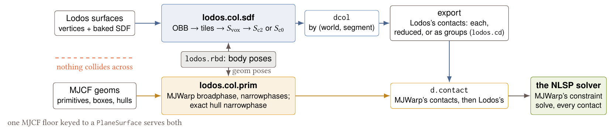
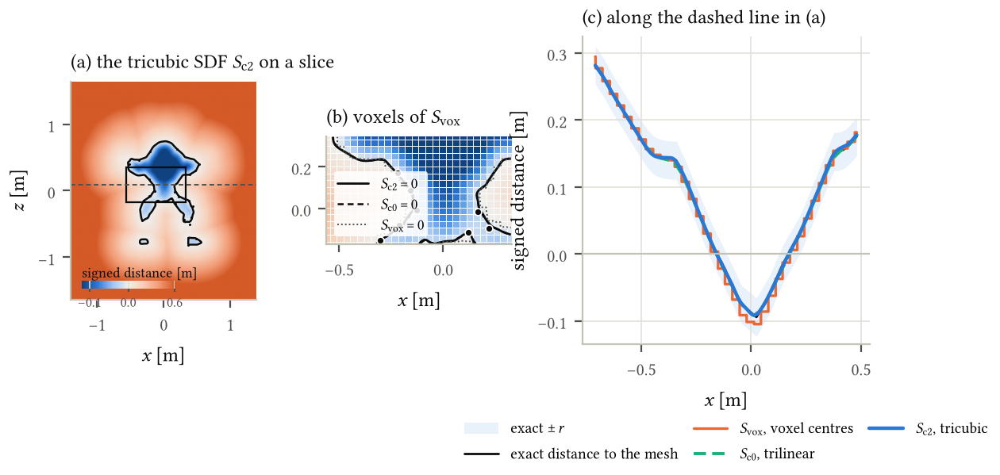
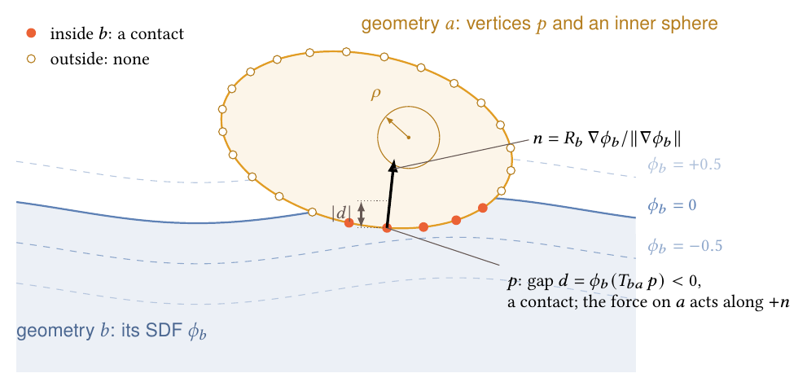
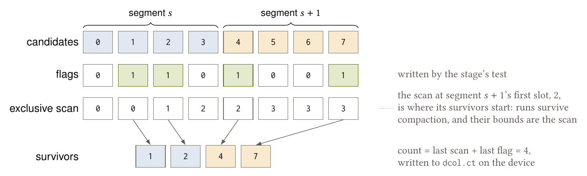
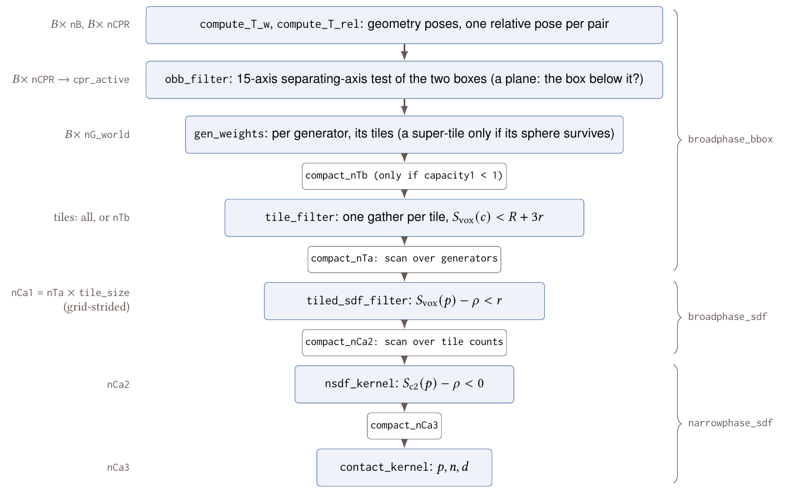
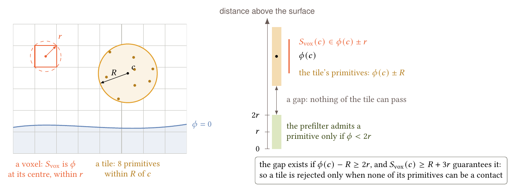
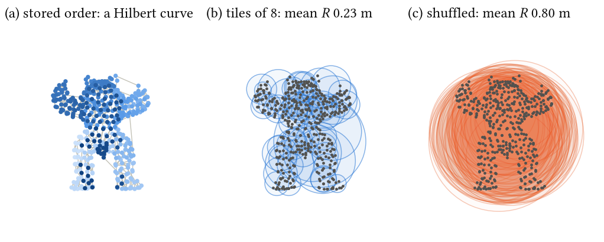
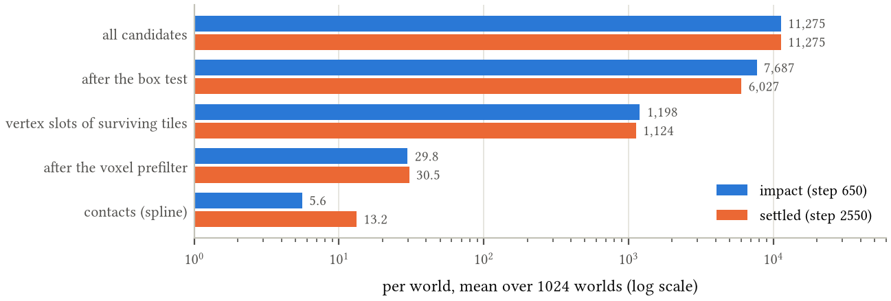
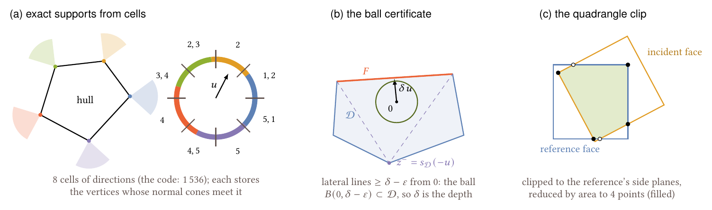
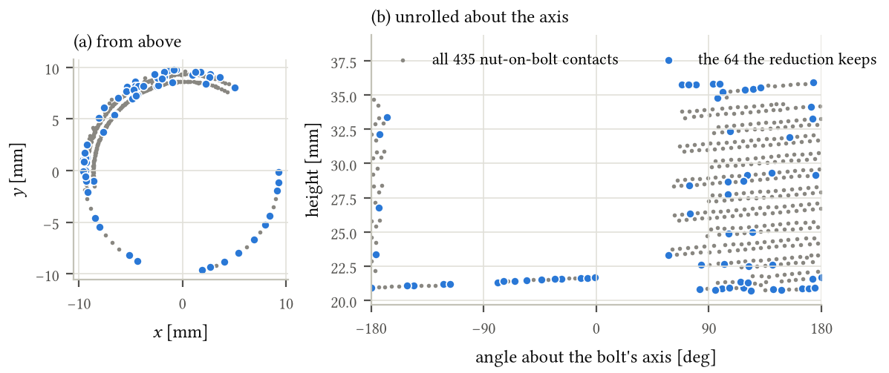

# Lodos v2: Collision Detection

*How the simulator finds contacts: the theory, the implementation and the interface*

The code as of 2026-11-04. Its companion, *Lodos v2: Contact Dynamics* (`docs/contact_dynamics.pdf`), covers what happens to the contacts afterwards. Both are built from `docs/manual/`.

**About this document.** Lodos v2 is a batched rigid-body simulator for NVIDIA Warp [5]: it steps thousands of copies of one scene in lockstep on one GPU, every part of the step captured into one CUDA graph. This manual describes everything between “the bodies have moved” and “here is the list of contacts”: the two collision pipelines a scene can use, how each represents geometry, how it finds contacts, what it hands to the contact solver, how it is sized, and how to use it from Python. It is written for two readers at once, a person who wants to understand or extend the simulator and an agent that has to use it correctly, so every option is named as the code names it and every claim about speed is a measurement on this repository's code. Theory and implementation alternate: each part states the model first and then where it lives, in boxes marked *In the code*. Notation follows the companion contact tutorial [1].

**Contents**

- [1 Contributions](#1-contributions)
- [2 Overview](#2-overview)
  - [2.1 Where collision sits in a step](#21-where-collision-sits-in-a-step)
  - [2.2 Two pipelines, one scene](#22-two-pipelines-one-scene)
  - [2.3 Batching and the step discipline](#23-batching-and-the-step-discipline)
  - [2.4 Conventions](#24-conventions)
- [3 Describing a scene](#3-describing-a-scene)
  - [3.1 An MJCF model plus Lodos surfaces](#31-an-mjcf-model-plus-lodos-surfaces)
  - [3.2 Pairs, directions and segments](#32-pairs-directions-and-segments)
  - [3.3 Contact parameters](#33-contact-parameters)
  - [3.4 MJCF geoms](#34-mjcf-geoms)
  - [3.5 Assets](#35-assets)
  - [3.6 Lodos surfaces in an MJCF file](#36-lodos-surfaces-in-an-mjcf-file)
- [4 Lodos surfaces: the representation](#4-lodos-surfaces-the-representation)
  - [4.1 Signed distance fields](#41-signed-distance-fields)
  - [4.2 The bake](#42-the-bake)
  - [4.3 Three evaluations of one field](#43-three-evaluations-of-one-field)
  - [4.4 Inner spheres](#44-inner-spheres)
- [5 The vertex–SDF contact model](#5-the-vertexsdf-contact-model)
  - [5.1 The contacts of a directional pair](#51-the-contacts-of-a-directional-pair)
  - [5.2 A contact record](#52-a-contact-record)
  - [5.3 Symmetric pairs and normals](#53-symmetric-pairs-and-normals)
  - [5.4 What vertex–SDF contacts cannot see](#54-what-vertexsdf-contacts-cannot-see)
- [6 The Lodos pipeline](#6-the-lodos-pipeline)
  - [6.1 Vocabulary and index spaces](#61-vocabulary-and-index-spaces)
  - [6.2 No host synchronization](#62-no-host-synchronization)
  - [6.3 Stream compaction and the dynamic-length scan](#63-stream-compaction-and-the-dynamic-length-scan)
  - [6.4 The stages](#64-the-stages)
  - [6.5 Why the margins are what they are](#65-why-the-margins-are-what-they-are)
  - [6.6 Tiles](#66-tiles)
  - [6.7 Super-tiles](#67-super-tiles)
  - [6.8 Specialization instead of branching](#68-specialization-instead-of-branching)
  - [6.9 What the stages leave](#69-what-the-stages-leave)
- [7 Capacities and overflow](#7-capacities-and-overflow)
- [8 MJWarp's pipeline and the exact hull narrowphase](#8-mjwarps-pipeline-and-the-exact-hull-narrowphase)
  - [8.1 The driver](#81-the-driver)
  - [8.2 Penetration depth of two hulls](#82-penetration-depth-of-two-hulls)
  - [8.3 Exact supports from cube-map cells](#83-exact-supports-from-cube-map-cells)
  - [8.4 The stages](#84-the-stages)
  - [8.5 Exactness and speed](#85-exactness-and-speed)
- [9 Contacts into the solver](#9-contacts-into-the-solver)
  - [9.1 Lodos's contacts in MJWarp's arrays](#91-lodoss-contacts-in-mjwarps-arrays)
  - [9.2 Contact reduction](#92-contact-reduction)
  - [9.3 Normal and moment bins](#93-normal-and-moment-bins)
- [10 Making surfaces](#10-making-surfaces)
- [11 Using it](#11-using-it)
  - [11.1 Through a simulation](#111-through-a-simulation)
  - [11.2 Reading contacts](#112-reading-contacts)
  - [11.3 The Lodos pipeline on its own](#113-the-lodos-pipeline-on-its-own)
  - [11.4 Benchmarks](#114-benchmarks)
- [12 Measured performance](#12-measured-performance)
- [13 Limitations and open issues](#13-limitations-and-open-issues)
- [A The options of make_collision_context](#a-the-options-of-make_collision_context)
- [B Glossary](#b-glossary)

## 1 Contributions

The collision side of Lodos v2 builds on MuJoCo's model format and MuJoCo Warp's (MJWarp's) collision pipeline [3, 4], on Warp, and on standard computational geometry. MuJoCo Warp is not a dependency: Lodos carries the parts of it that it uses as its own code, adapted from MuJoCo Warp 3.14.0 (the collision pipeline in `lodos.col.prim`, the model and data in `lodos.mjcf`, the constraint solve in `lodos.cd.solver`), and this manual calls them MJWarp's. What it adds:

1. **Vertex–SDF contact detection at batch scale** (Sections [5](#5-the-vertexsdf-contact-model) and [6](#6-the-lodos-pipeline)). Each geometry is a set of surface vertices plus a signed distance field (SDF); a contact is a vertex of one geometry inside another's field. The pipeline is a cascade of four conservative filters (an oriented-box separating-axis test per pair, a bounding-sphere test per tile of 8 vertices, a voxel-SDF test per vertex, the spline SDF), each cheaper per candidate than the next, with margins derived from the SDF's Lipschitz bound so that no filter can drop a contact ([Section 6.5](#65-why-the-margins-are-what-they-are)). On the five-armadillo drop it evaluates 6–13 contacts per world out of 11 275 candidates while touching only a tenth of them (Figure 8).
2. **A pipeline with no host synchronization**: every count lives on the device, every launch has a fixed size, and survivors are compacted by device-side scans whose length is read from device memory ([Section 6.2](#62-no-host-synchronization)). The whole collision pass, and with it the whole step, captures into one CUDA graph.
3. **Two-level tiling on Hilbert-ordered vertices**, with optional super-tiles and per-directional-pair tile sizes ([Section 6.6](#66-tiles)). Ordering each surface's vertices along a Hilbert curve makes every run of 8 a compact cluster, so tiles need no index of their own; tiling measured 4.0–9.3$\times$ on the stages it replaces, with identical contacts.
4. **Two SDF representations from one bake**: a tricubic B-spline (C$^2$ distance, C$^1$ normals) and trilinear interpolation of the same knot samples, recovered exactly from the spline coefficients, chosen per scene and compiled into the kernels rather than branched on ([Section 4](#4-lodos-surfaces-the-representation)). Inner spheres extend the same pipeline to deep penetrations at no cost to scenes without them.
5. **A capacity model with measured costs and three sizing routes** ([Section 7](#7-capacities-and-overflow)): offline calibration, a suggestion from the peaks a run reached, and a live autosizer. A stage that overflows drops its tail and raises a sticky flag, which `check_overflow` reports; the step itself never reads it.
6. **An exact hull narrowphase for MJWarp's pipeline** (the *hybrid*, [Section 8](#8-mjwarps-pipeline-and-the-exact-hull-narrowphase)): GJK and EPA [7, 8] on exact supports looked up from cube-map cells of each hull's Gauss map instead of hill climbs, GJK's closest point solved in float64 (float32 cancellation reported penetrating boxes 0.5 mm apart), a fix to GJK's termination tests under its direction tuning, a cross-step feature cache with a ball-containment certificate, EPA with one warp per pair at small batches, quadrangle contact manifolds, and a floor kernel. Against a float64 ground truth it misses no contact where MJWarp's own narrowphase misses 27–250 per scan; its narrowphase is 7.6–18.5$\times$ MJWarp's on twenty armadillos.
7. **Two pipelines in one scene, every contact reaching the solver** ([Section 9](#9-contacts-into-the-solver)): Lodos surfaces and MJCF geoms side by side with one shared floor; Lodos's contacts exported into MJWarp's contact arrays beside its own, one constraint each or gathered into contact groups, and excluded from the proximal loop's cross-step multiplier carry.
8. **Newton-style contact reduction, made deterministic** ([Section 9.2](#92-contact-reduction)): at most 240 contacts per directional pair, chosen by an atomic maximum over packed 64-bit words, which made the solve 4.4$\times$ faster under the mj mode (on MuJoCo's pyramidal cone at solimp `dmin` 0) and 18.5$\times$ under the exact mode (at a Baumgarte slop of 0) on the nut-bolt.
9. **An offline surface pipeline** from a robot's MJCF to baked surfaces ([Section 10](#10-making-surfaces)): watertight solids, a convex decomposition calibrated by eye, isotropic remeshing, manifold repair, Hilbert ordering and the bake, plus an inner-sphere packer.

## 2 Overview

### 2.1 Where collision sits in a step

A step of a `lodos.sim.Sim` runs, with no host round trip anywhere (`lodos.step.step_sim`):

1. the rigid-body pass of `lodos.rbd`: body poses, the mass matrix and its factor, the unconstrained acceleration;
2. **MJWarp's collision** (`lodos.col.prim`, the *prim pipeline*), if the scene has MJCF geoms that can pair: geom poses from the body poses, MJWarp's broadphase, its narrowphases and the exact hull narrowphase, into MJWarp's contact arrays `d.contact`;
3. **Lodos's collision** (`lodos.col.sdf`), if the scene has Lodos pairs: the staged vertex–SDF pipeline, into the collision data `dcol`;
4. contact dynamics: the NLSP solver, `lodos.cd.driver.SolverDriver`, which exports Lodos's contacts into MJWarp's contact arrays after MJWarp's own ([Section 9](#9-contacts-into-the-solver)) and runs MJWarp's constraint solve (`lodos.cd.solver`) over both, the companion manual's subject;
5. integration: semi-implicit Euler, or MuJoCo's `implicitfast`.

Figure 1 shows the two collision pipelines and where their contacts go.



*Figure 1: The two collision pipelines of one scene and where their contacts go. Lodos surfaces collide with Lodos surfaces, MJCF geoms with MJCF geoms; nothing collides across. The solver reads MJWarp's contact arrays, in which Lodos's contacts follow MJWarp's own: exported one by one or as contact groups, after the optional reduction.*

### 2.2 Two pipelines, one scene

A scene is an MJCF model plus, optionally, a list of *Lodos surfaces*. The two kinds of geometry are deliberately different (Table 1). A Lodos surface is a vertex set with an SDF and collides through directional vertex–field pairs; an MJCF geom is one of MuJoCo's primitives or a convex mesh and collides through MJWarp's pipeline. **The two never collide with each other.** A vertex–SDF surface cannot represent edge–edge contact ([Section 5.4](#54-what-vertexsdf-contacts-cannot-see)); where that matters a body carries both, its surface and its convex decomposition as massless MJCF meshes, and the pieces collide with other polytopes. One floor can serve both: a `PlaneSurface` keyed to the MJCF plane is the floor of the Lodos pairs, and the plane stays in MJWarp's collision.

**Table 1: The two collision pipelines.**

|  | Lodos surfaces (`lodos.col.sdf`) | MJCF geoms (`lodos.col.prim`) |
|---|---|---|
| geometry | surface vertices (and inner spheres) plus a baked SDF on a voxel grid | MuJoCo's primitives, boxes and convex meshes (hulls) |
| contact model | a primitive inside the other geometry's SDF: one contact per penetrating vertex | MJWarp's narrowphases; for box–box, box–mesh, mesh–mesh and plane–mesh the exact hull narrowphase: GJK, EPA and a manifold of up to 4 points |
| pairs | directional, declared: `[vertex surface, SDF surface]` | MJWarp's broadphase over `contype`/`conaffinity`, explicit pairs and excludes |
| output | `dcol`: contacts sorted by (world, segment), only penetrating ones | `d.contact`, `d.nacon`: unordered, within margin |
| to the solver | exported into `d.contact` after MJWarp's own, typed `NOCARRY`: one contact each, or a contact group's members | directly |

### 2.3 Batching and the step discipline

Everything is batched over $B$ worlds: the same model, different states. Arrays are allocated once, at construction, and never rebound; state is copied into them rather than swapped. Every launch has a size known on the host when the context is built, and every quantity that varies (how many pairs overlap, how many vertices survive a filter, how many contacts there are) lives in device memory and is read by the kernels that need it. That discipline is what lets `lodos.step.make_step_graph` capture the whole step into a CUDA graph, and it shapes every design decision in [Section 6](#6-the-lodos-pipeline). The price is that capacities must be chosen in advance ([Section 7](#7-capacities-and-overflow)).

### 2.4 Conventions

- **Frames.** A geometry's vertices, its SDF and its bounding box are stored in its body's frame. A pose $T_g = (R_g, t_g)$ maps body coordinates to world coordinates, $x = R_g p + t_g$.
- **Quaternions** are $(w, x, y, z)$, MuJoCo's order, everywhere in `lodos.rbd` and the solver; Warp's `wp.transformf` reads $(x, y, z, w)$. In the collision pipeline the conversion happens at exactly one place, `lodos.col.sdf.broadphase.compute_T_w` (the viewer's `viewer.collect` does its own); getting it wrong would not fail loudly, it would rotate every vertex by a scrambled quaternion.
- **Signed distance** is positive outside a geometry, negative inside, zero on its surface. A contact's `sdf` is its gap: negative in penetration.
- **Normals.** A Lodos contact's normal points out of the SDF geometry, towards the vertex geometry; the contact force acts on the vertex geometry along $+n$ and its reaction on the SDF geometry. An MJWarp contact's normal points from `geom[0]` to `geom[1]`, and its position is the midpoint of its two witness points. The export writes a Lodos contact's SDF geometry as `geom[0]`, so that the two conventions agree; positions pass through as their pipeline placed them ([Section 9.1](#91-lodoss-contacts-in-mjwarps-arrays)).

## 3 Describing a scene

### 3.1 An MJCF model plus Lodos surfaces

`lodos.sim.make_sim(mjm, B, surfaces=...)` builds a simulation of $B$ worlds of the MuJoCo model `mjm`. The Lodos half of the scene is a `lodos.sim.Surfaces`:

```python
import mujoco
from lodos import sim, step
from lodos.col.sdf import PlaneSurface
from viewer.scenes.assets import load_surface, surface_obj

xml = f"""<mujoco>
  <option cone="elliptic"/>
  <asset><mesh name="arm" file="{surface_obj('armadillo')}"/></asset>
  <worldbody>
    <geom name="floor" type="plane" size="5 5 0.1"/>
    <body name="a0" pos="0 0 1.5"><freejoint/><geom name="a0" type="mesh" mesh="arm" density="100"/></body>
    <body name="a1" pos="0 0 4.0"><freejoint/><geom name="a1" type="mesh" mesh="arm" density="100"/></body>
  </worldbody></mujoco>"""
mjm = mujoco.MjModel.from_xml_string(xml)
gid = lambda name: mujoco.mj_name2id(mjm, mujoco.mjtObj.mjOBJ_GEOM, name)
arm = load_surface("armadillo")                     # spline_type="cubic" (default) or "linear"
surf = sim.Surfaces(
    surfaces=[arm, arm, PlaneSurface()],            # one entry per Lodos geometry
    geoms=[gid("a0"), gid("a1"), gid("floor")],     # the MJCF geom each one is keyed to
    pairs=[(0, 1), (1, 0), (0, 2), (1, 2)],         # directional: [vertex surface, SDF surface]
    mu=0.8,                                         # friction of the default parameter rows
    col_kwargs=dict(tile_size=8))                   # make_collision_context options
s = sim.make_sim(mjm, 1024, surfaces=surf,
                 nconmax=256, njmax=1024)           # MJWarp's capacities hold Lodos's contacts too
replay = step.make_step_graph(s)
```

Each surface is *keyed* to an MJCF geom, normally the mesh of the same surface, from which MuJoCo computes the body's mass and inertia (`viewer.scenes.assets.surface_obj` writes a shipped surface's mesh as an OBJ for exactly this, through `lodos.col.sdf.write_surface_obj`). A keyed geom other than a plane leaves MJWarp's collision: `make_sim` sets its `contype` and `conaffinity` to zero on its own copy of the model, so the geom contributes inertia and nothing else. A `PlaneSurface` keyed to an MJCF plane is a half-space whose SDF is the $z$ coordinate in the frame of the plane's *body* (the geom's own position and orientation are not read), so the keyed plane must sit at its body's origin with the identity orientation, or the Lodos floor and the MJWarp floor disagree; a wall gets a static body of its own for this (`viewer.scenes.representations`). It has no vertices, so it can only be the SDF side of a pair, and the plane stays in MJWarp's collision, which gives one floor for both pipelines. The scene builders in `viewer.scenes` ([Section 11](#11-using-it)) construct all of this for the shipped scenes.

### 3.2 Pairs, directions and segments

A Lodos pair names two geometries, **the first supplying vertices, the second its SDF**. The direction is fixed: an interface tested both ways is two declared pairs, `(a, b)` and `(b, a)`, each finding its own contacts. The two directions genuinely find different things (the vertices of $a$ inside $b$ are not the vertices of $b$ inside $a$), so the asymmetry is the model, not an implementation detail; which side supplies vertices is a modelling choice, made for instance by sampling density in the SHARPA hand scenes (the more densely sampled link supplies the vertices).

Below the pair is the *segment*: one direction of one pair, the unit the contact reduction and the contact groups work on (Sections [9.2](#92-contact-reduction) and [9.3](#93-normal-and-moment-bins)). `make_collision_context(..., cpr_is_symmetric=...)` can declare a pair *symmetric*, in which case it owns both directions as two segments. The solver takes the contacts of both: they are constraints like any other, and the solve distributes the force among them. Every shipped scene declares asymmetric pairs, and then segments and pairs coincide. `make_collision_context` builds the index tables and keeps them on the collision model: `mcol.cpr_seg_beg`, `seg_cpr`, `seg_dir`, `seg_g_v` (the geometry supplying primitives) and `seg_g_s` (the geometry supplying the field).

### 3.3 Contact parameters

Every Lodos pair has one row of thirteen parameters (`lodos.cd.params`):

$$
[\,\mu,\ \text{stiffness},\ \text{sharpness},\ \text{dissipation},\ \text{stiction},\ \text{solref}(2),\ \text{solimp}(5),\ w\,].
$$

$\mu$ is every contact's friction. The next four define a spring-damper force law, which only contact groups read: a group weighs its members by the normal force the law gives each. solref and solimp are MuJoCo's impedance parameters, read under the mj mode, and $w$ is an impedance scale nothing reads (Table 2; the defaults are `lodos.sim.default_pair_params`). Their meaning is the companion manual's subject; here it matters only that parameters are per pair. `Surfaces(params=...)` takes a `(len(pairs), 13)` array; `mu` sets the friction of the default rows.

**Table 2: The pair table: defaults and readers. The exact mode takes no MuJoCo impedance at all (the companion manual's impedance rule).**

| columns | default | read by |
|---|---|---|
| $\mu$ | `Surfaces(mu=...)`, 0.8 | every contact, under either mode |
| stiffness, sharpness, dissipation, stiction | 5000, 500, 1.0, 0.05 | contact groups: their members' weights, and a ray member's friction |
| solref | 0.02, 1 | the mj mode |
| solimp | 0.9, 0.95, 0.001, 0.5, 2 | the mj mode |
| $w$ | 1 | nothing |

MJWarp's own contacts take their parameters from the MJCF, as MuJoCo would.

### 3.4 MJCF geoms

Every MJCF geom not keyed to a surface collides through MJWarp's pipeline, filtered as MuJoCo filters: `contype`/`conaffinity`, no self or parent–child pairs, `<exclude>`s and explicit `<pair>`s. Box–box, box–mesh, mesh–mesh and plane–mesh pairs go through the exact hull narrowphase by default (`make_sim(hybrid=...)` takes the set, `()` for MJWarp's own narrowphases throughout); the other pair types (spheres, capsules, cylinders, ellipsoids) through MJWarp's. A mesh geom collides as its convex hull. With the hybrid on (the default), `PrimCollision` refuses a model it does not support: nonzero margin or gap on a geom of a hybrid pair type, or any explicit `<pair>` (`ValueError`); SDF geoms, flexes or MuJoCo's native CCD disabled (`NotImplementedError`); and box sizes that differ between worlds. Such a model needs `make_sim(hybrid=())`. `hybrid` takes pairs of MuJoCo geom types; `lodos.col.prim.hybrid.pipeline` defines `HULL_TYPES` (box–box, box–mesh, mesh–mesh), `FLOOR_TYPES` (plane–mesh) and `ALL_TYPES`, the default.

### 3.5 Assets

A shipped surface is loaded by its name, from `viewer/assets/surfaces/<name>/surface_data.npz`, with `viewer.scenes.assets.load_surface(name, spline_type=None)`, and any bake with `lodos.col.sdf.load_surface_file(path, spline_type=None)`; the SDF representation is chosen here, at load time, because each surface's evaluator is built from it ([Section 4.3](#43-three-evaluations-of-one-field)). The asset directory is `$LODOS_ASSETS` if set, else `viewer/assets/`, in a clone and in an installed package alike; derived files (the OBJs MuJoCo takes inertia from) are cached in `$LODOS_CACHE`, `.scratch/` in a clone or `~/.cache/lodos`. The surfaces under `viewer/assets/surfaces` are the armadillo (451 vertices), cubes of several sizes and samplings, a box, a card, two spheres and the 25 stones of a masonry arch. The nut-bolt's bolt and two nuts live in `viewer/assets/nutbolt/surfaces/`, the 23 links of the SHARPA Wave hand in `viewer/assets/sharpa/final_sdata/`, the NIST task board's M8, M12 and M16 bolts and nuts, the board and the Franka's finger pad in `viewer/assets/nist/surfaces/`, and the Shadow hand's 21 links and the Kong toy in `viewer/assets/shadow_kong/` (overridable by `$LODOS_NUTBOLT_DIR`, `$LODOS_SHARPA_DIR`, `$LODOS_NIST_DIR` and `$LODOS_SHADOW_KONG_DIR`); load those through their scene modules or `load_surface_file`. [Section 10](#10-making-surfaces) says how surfaces are made.

### 3.6 Lodos surfaces in an MJCF file

The viewer, and anything that builds scenes from files (`viewer.scenes.catalog.from_mjcf`), reads Lodos surfaces from custom text fields named after the geom:

```xml
<custom>
  <text name="lodos:arm0" data="armadillo"/>                <!-- a shipped surface -->
  <text name="lodos:shell" data="bake/surface_data.npz"/>  <!-- a bake, relative to the file -->
  <text name="lodos:floor" data="plane"/>                  <!-- a plane, for both pipelines -->
  <numeric name="lodos:mu" data="0.8"/>                    <!-- optional pair parameters -->
  <numeric name="lodos:stiffness" data="5000"/>
  <numeric name="lodos:dissipation" data="0.15"/>
</custom>
```

The pairs are then every ordered pair of surfaces on different bodies and every surface against every Lodos plane, every pair with the one `mu`, `stiffness` and `dissipation` given; surfaces load tricubic, with no collision options. The viewer's *Export as MJCF* writes a built-in scene in this form, but lossily: it names a surface by its vertex count, so surfaces of equal count are confused (`cube_0.2` and `cube_0.8`, several arch stones), it cannot export the nut-bolt's or the SHARPA hand's surfaces, it writes only the first pair's parameters, and on loading the pairs are re-derived. A `lodos:controls` text names no geom: it is a recording of the controls the viewer plays (the viewer's guide, *Pre-recorded controls*).

## 4 Lodos surfaces: the representation

### 4.1 Signed distance fields

The signed distance field of a closed surface $\partial\mathcal S$ bounding a solid $\mathcal S$ is

$$
\phi(x) = \begin{cases} +\operatorname{dist}(x, \partial\mathcal S), & x \notin \mathcal S, \\ -\operatorname{dist}(x, \partial\mathcal S), & x \in \mathcal S. \end{cases} \tag{1}
$$

Two properties make it the right object for collision. A point query is $O(1)$: no iteration, no simplex, a lookup and an interpolation. And its gradient is the surface normal: away from the medial axis $\lVert\nabla\phi\rVert = 1$ and $\nabla\phi$ points out of the solid, so one evaluation yields both depth and normal. Every conservative test in the pipeline also rests on a third property: $\phi$ is 1-Lipschitz, $\lvert\phi(x) - \phi(y)\rvert \le \lVert x - y\rVert$.

### 4.2 The bake

A surface is baked once, offline ([Section 10](#10-making-surfaces); `notebooks/05_make_a_surface.ipynb` walks through one bake), from a closed triangle mesh in its body frame. The grid is the mesh's bounding box dilated (by default twice its size about its centre) and divided into cubic voxels of side $h$, 100 along the longest edge; the dilation gives the field room to be positive, since a grid clipped to the mesh would leave a vertex approaching from outside before the field ever read greater than zero. With $N = (N_x, N_y, N_z)$ intervals the grid has $(N_x+1)(N_y+1)(N_z+1)$ knots $p_{ijk} = p_{\min} + (i, j, k)\,h$. The bake stores three things:

- **the knot samples** $\phi(p_{ijk})$, each the distance to the mesh's closest triangle signed by Warp's mesh query, encoded as **tricubic B-spline coefficients** `sdf_coeffs`, of shape $(N_x+3, N_y+3, N_z+3)$. The fit is separable: along each axis the coefficients $c$ of $N+1$ samples $f$ solve the tridiagonal interpolation system $c_{i-1} + 4c_i + c_{i+1} = f_i$ (the unnormalized basis of Eq. (2), whose weights at a knot are 1, 4, 1), with the two end coefficients pinned so that the spline interpolates the first and last samples and two phantom coefficients extrapolated linearly outside the grid (`lodos.col.sdf.spline.c2.spline_c_1d`, solved in float64);
- **the voxel-centre samples** `vsdf_values` $\phi(p_{\min} + (i + \tfrac12, j+\tfrac12, k+\tfrac12)\,h)$, one per voxel, for the prefilter;
- **the vertices** $v$, the contact candidates, Hilbert-ordered ([Section 6.6](#66-tiles)), with the faces, edges and the grid parameters $p_{\min}$, $p_{\max}$, $N$, $h$ and $r = \tfrac{\sqrt 3}{2}\max_a h_a$, the radius of a voxel's circumsphere.

For the armadillo the grid is $85 \times 76 \times 100$ voxels of 32.8 mm (the surface is 1.64 m tall), $r = 28.4$ mm, and the coefficients are $88 \times 79 \times 103 \approx 716\,000$ floats, 2.9 MB, shared by every world. A surface's file is `surface_data.npz`, with the keys `v`, `e`, `f`, `e_l`, `p_min`, `p_max`, `N`, `h`, `r`, `sdf_coeffs`, `vsdf_values` and an optional oriented bounding box `bbox` (`load_surface_file` synthesizes one from the vertices when it is absent). A file may pin `spline_type`; none of the shipped ones does.

### 4.3 Three evaluations of one field

The narrowphase evaluates the field and its gradient at a query point $p$ in grid coordinates $q = (p - p_{\min})/h$, cell $l = \lfloor q\rfloor$:

**$S_{\mathrm{c2}}$, tricubic.** (`spline_type="cubic"`, the default). With the unnormalized cubic B-spline basis

$$
B(t) = \begin{cases} 4 - 6t^2 + 3\lvert t\rvert^3, & \lvert t\rvert \le 1, \\ (2 - \lvert t\rvert)^3, & 1 < \lvert t\rvert \le 2, \\ 0, & \text{otherwise}, \end{cases} \tag{2}
$$

the distance is a separable sum over the $4^3$ coefficients around the cell,

$$
S_{\mathrm{c2}}(p) = \sum_{a=0}^{3}\sum_{b=0}^{3}\sum_{c=0}^{3} c_{l_x+a,\,l_y+b,\,l_z+c}\; B(q_x - l_x - a + 1)\, B(q_y - l_y - b + 1)\, B(q_z - l_z - c + 1), \tag{3}
$$

and each component of the gradient is the same sum with one factor replaced by $B'$ and divided by that axis' $h$. The 64 coefficients are gathered once for the value and all three derivatives. $S_{\mathrm{c2}}$ is C$^2$, so its normals are C$^1$: they turn smoothly as a contact slides.

**$S_{\mathrm{c0}}$, trilinear.** (`spline_type="linear"`). A cubic B-spline interpolates its knots, and at a knot its weights are $(1, 4, 1, 0)$, so the samples are recovered exactly from the coefficients by one $[1, 4, 1]$ pass per axis (`lodos.col.sdf.spline.c0.knots_from_c_3d`); no new asset is needed. $S_{\mathrm{c0}}$ interpolates the 8 samples of the containing cell, an eighth of the gathers. It is C$^0$: its gradient jumps across cell faces, so a sliding contact's normal steps about once per cell crossed. On the 1 mm nut it measured 18% more throughput than $S_{\mathrm{c2}}$ at the same screw-law fidelity, with a rattlier seat.

**$S_{\mathrm{vox}}$, voxel centres.** One indexed load of `vsdf_values`, piecewise constant, used only to reject. Since a point of a voxel is within $r$ of its centre and $\phi$ is 1-Lipschitz,

$$
\lvert \phi(p) - S_{\mathrm{vox}}(p)\rvert \le r . \tag{4}
$$

Figure 2 shows the three on a slice through the armadillo. The normal is the normalized gradient, $n = \nabla S / \lVert \nabla S\rVert$, with a guard where the gradient cancels on the medial axis. **Every non-plane geometry of a scene must use the same representation**: the narrowphase kernels are compiled once per representation and the context picks one, rather than branching per candidate in the hottest loop of the pipeline. `make_collision_context` rejects a mixed context.



*Figure 2: The armadillo's SDF on the plane through its centre. (a) $S_{\mathrm{c2}}$ with its zero level set and the surface vertices within half a voxel of the plane. (b) The framed region, coloured by $S_{\mathrm{vox}}$ on its own voxels, with the zero level sets of $S_{\mathrm{c2}}$, $S_{\mathrm{c0}}$ and $S_{\mathrm{vox}}$. (c) Along the dashed line: the three evaluations against the exact signed distance to the mesh; $S_{\mathrm{vox}}$ stays within the voxel radius $r$ of it, as Eq. (4) requires.*

**Outside the grid.** A baked field exists only inside its grid. The tricubic sum reads exactly zero outside (its index is clamped but its basis argument is not, so all weights vanish) and the trilinear one extends the boundary value. The narrowphase therefore evaluates at the nearest grid point and adds the distance to it, $\phi(\operatorname{clamp}(p)) + \lVert p - \operatorname{clamp}(p)\rVert$, an upper bound on the true distance that is exact inside (`narrowphase.grid_excess`); without it an inner sphere far from a fingertip read as a penetration of its own radius. The prefilter deliberately does not add it: it extends the boundary voxel as a constant, which under-estimates the distance and so only ever admits too much.

> **In the code.** `lodos/col/sdf/__init__.py` (`load_surface_data`, `load_surface_file`, `PlaneSurface`, `SPLINE_TYPES`); `spline/c2.py` (the fit and the tricubic evaluator: a C2 field, C1 normals); `spline/c0.py` (the trilinear evaluator, a C0 field whose normals are discontinuous across cell faces, and `knots_from_c_3d`); `implicit.py` (the bake: `create_voxel_grid_from_verts`, `create_implicit_surface_from_mesh`; per-surface evaluators `eval_sdf`, `eval_nsdf`, `eval_vsdf` for the tools and notebook 05); `narrowphase.py` (the batched evaluators `eval_nsdf_c2`, `eval_nsdf_c0` over the packed tables, `grid_excess`).

### 4.4 Inner spheres

A geometry may carry spheres strictly inside it (centres and radii, `surf.sph_c` and `surf.sph_r`), so that a deep overlap is caught before the mesh's own vertices have passed through the other surface. They are not a second kind of candidate: a geometry's primitives are its vertices followed by its sphere centres, each with a radius $\rho$ (zero for a vertex), and every stage reads a point and a radius. A sphere's gap is exact from one field evaluation, $\phi(c) - \rho$, since the sphere is the $\rho$-offset of its centre. With no spheres in a scene the kernels are compiled without the radius read, so a scene without spheres pays nothing for them. `lodos.col.sdf.load_surface_data` reads them from a `spheres.npz` beside a bake (keys `c` and `r`); `lodos.col.sdf.load_surface_file`, and with it `viewer.scenes.assets.load_surface`, drops it on purpose, so that a scene built from them is a controlled one, and spheres are then passed by setting the two arrays. `tools/mesh_processing/pack_spheres.py` packs them ([Section 10](#10-making-surfaces)); no shipped scene uses them.

## 5 The vertex–SDF contact model

### 5.1 The contacts of a directional pair

Let segment $s$ test the primitives of geometry $a$ against the field of geometry $b$, with poses $T_a$ and $T_b$. The relative pose taking $a$'s body frame to $b$'s is

$$
T_{ba} = T_b^{-1} T_a . \tag{5}
$$

For a primitive at $p$ in $a$'s frame, with radius $\rho$, its position in $b$'s frame, its gap and its normal are

$$
\tilde p = T_{ba}\, p, \qquad d = S(\tilde p) - \rho, \qquad n = R_b \frac{\nabla S(\tilde p)}{\lVert \nabla S(\tilde p)\rVert}, \tag{6}
$$

with $S$ the scene's representation of $\phi_b$. **The primitive is a contact if and only if $d < 0$.** Its world position is $T_a p - \rho n$, the primitive's own surface (`contact_point="surface"`, the default); for a vertex ($\rho = 0$) the vertex itself. `contact_point="midpoint"` moves a *sphere's* contact to the midpoint of its two witness points, $T_a p - \tfrac12 (S(\tilde p) + \rho)\, n$, MuJoCo's convention, and leaves vertex contacts on their vertex. Depth and normal are the same either way; only the lever arm differs. Figure 3 draws the quantities.



*Figure 3: A directional pair $(a, b)$: the vertices of $a$ tested against the SDF of $b$. A vertex with $\phi_b < 0$ is a contact with gap $d$ and the normal of $b$'s field at it; the force on $a$ acts along $+n$. The same interface declared as $(b, a)$ finds $b$'s vertices in $a$'s field instead, with normals pointing the other way.*

The contacts are evaluated straight from the static body-frame vertex array (a few kilobytes, shared by every world and resident in L1) with one relative pose per pair, rather than from world-space vertices: that removes a per-contact pose inversion and a gather of tens of megabytes per step.

### 5.2 A contact record

The pipeline's output, in `dcol`, is one record per contact (Table 3). The records are **sorted by world and then by segment**, every (world, segment) one contiguous run whose bounds are `dcol.idul_B_nSEG_to_nCa3[b, s]` to `[b, s+1]`; the contact reduction and the contact groups depend on this layout, and every compaction in the pipeline preserves it. Only penetrating contacts are listed, so every one the export hands MJWarp is active, with zero margin and gap ([Section 9.1](#91-lodoss-contacts-in-mjwarps-arrays)).

**Table 3: A Lodos contact (arrays of length `nCa3_max`, the first `dcol.ct[2]` entries live).**

| array | meaning |
|---|---|
| `p_nCa3` | world position, on the vertex geometry ([Section 5.1](#51-the-contacts-of-a-directional-pair)) |
| `n_nCa3` | world normal, out of the SDF geometry |
| `sdf_nCa3` | the gap $d = S - \rho$, negative |
| `b_nCa3`, `seg_nCa3` | the world and the segment |
| `v_nCa3` | the primitive (vertex or sphere): a global index into the model's primitive array `mcol.v_b` |
| `idul_B_nSEG_to_nCa3` | per world, the start of each segment's run, `(B, nSEG + 1)` |

### 5.3 Symmetric pairs and normals

Normals are not canonicalized. A vertex of a pair's first geometry carries the outward normal of its second, so an interface declared both ways produces two sets of contacts whose normals point opposite ways, each to be resolved against the surface it actually penetrated. A symmetric pair's two directions are two segments, each with its own contacts; its relative poses are the inverse of each other, inverted rather than recomposed, which is cheaper and exact: recomposed from the world poses, the two would be inverses only to rounding.

### 5.4 What vertex–SDF contacts cannot see

The representation's bet is that the cost of a query is independent of the shapes' complexity: a 121-piece concave decomposition and a smooth blob cost the same per vertex. What it pays:

- **Contacts exist only where there are vertices.** The vertex spacing is the contact resolution; a flat face resting on another is supported at its vertices, so a coarse mesh there is a sparse support. The offline pipeline remeshes isotropically for this reason ([Section 10](#10-making-surfaces)).
- **Edge–edge contact is invisible.** Two edges crossing without either's vertices entering the other solid produce no contact. Where it matters, a body is supplemented by its convex pieces as MJCF meshes, colliding through MJWarp's pipeline with other polytopes (the mixed scenes, `viewer.scenes.mixed`). Where a surface and its pieces both touch, both pipelines contribute contacts; nothing suppresses the overlap.
- **The field is an interpolant**, exact at the knots and accurate to the interpolation error between them; the bake's zero level set is drawn by the bake tool so the error is visible (it measured 0.05–0.11 of a voxel on the SHARPA hand).
- **Memory**: one grid per geometry, not per world.

## 6 The Lodos pipeline

### 6.1 Vocabulary and index spaces

Five nested notions organize the code (Table 4). A *geometry* (`nB` of them) is one surface with its vertices, field and box. A *pair* (`nCPR`) names two geometries; the box test and the relative pose live here. A *segment* (`nSEG`) is a direction of a pair; everything from the vertex loop onwards is per segment, and so are the contact reduction and the contact groups. A *candidate* (`nC` per world) is one primitive of one segment: the per-world upper bound on contacts. A *tile* is a run of `tile_size` consecutive candidates of a segment, rejected or kept as a whole; a *generator* is either a super-tile of tiles or the pass-through that stands for all of a segment's tiles.

Each compaction produces a denser index space, and a thread in a later stage holds an index in its own space and recovers (world, segment, candidate) from it.

**Table 4: The pipeline's index spaces, from coarsest to finest survivor list.**

| space | size | one entry is |
|---|---|---|
| `nCPR` | $B \cdot$ `nCPR`, static | a pair in a world: its box test, `cpr_active` |
| `nTb` | `capacity1` $\cdot B \sum_s$ `seg_nT` | a tile of a segment whose boxes overlap (only when `capacity1` $< 1$) |
| `nTa` | `capacity_tile` $\cdot B \sum_s$ `seg_nT` | a tile that survived the tile filter |
| `nCa1` | `nTa_max` $\cdot$ `tile_size` | a primitive slot of a surviving tile (stage 1) |
| `nCa2` | `capacity2` $\cdot$ `nCa1_max` | a candidate that passed the voxel prefilter (stage 2) |
| `nCa3` | `nCa2_max` | a contact (stage 3) |

### 6.2 No host synchronization

A collision pipeline is a cascade of filters, and the natural implementation (filter, count the survivors, launch the next stage over them) reads the count on the host. That stalls the GPU and makes the step uncapturable. Here every stage is **launched at a preallocated capacity, and threads past the live count return at once**:

```python
i = wp.tid()
if i >= dcol.ct[stage]:      # the live count, read from device memory
    return
```

The counts `dcol.ct` (`[nCa1, nCa2, nCa3, nTa, nTb]`, the same layout in `ct_raw`, `ct_peak` and `overflow`) are written by one-thread kernels and never read back by the step. A count above its capacity is clamped, the overflowing tail is dropped, and a sticky flag is raised in `dcol.overflow`, which nothing reads unless `check_overflow` is called ([Section 7](#7-capacities-and-overflow)). The discipline that makes capture possible also makes it nearly unnecessary: Lodos's own pipeline gained nothing from graph capture (0.97$\times$ at $B$ = 32 768), because it had no host work left to remove, where MJWarp gained 12.9$\times$ from capture at 4096 worlds, mostly by not allocating its EPA scratch on every call.

### 6.3 Stream compaction and the dynamic-length scan

Survivors are compacted in three steps, all on the device: each thread writes a flag (or, at tile granularity, a count), an exclusive prefix sum of the flags gives each survivor its output slot, and a scatter writes the survivors densely in order (Figure 4). Because the scan is order-preserving and each stage enumerates its candidates in (world, segment, candidate) order, every survivor list stays segment-contiguous, and the segment bounds of each stage follow from the scan read at each segment's first entry.



*Figure 4: Stream compaction on the device: flags, an exclusive scan, a scatter. Read at a segment's first slot, the scan gives that segment's start in the compacted list, so segment runs survive compaction. At tile granularity the scan runs over per-tile survivor counts, `tile_size` times shorter than the slots.*

A scan's cost is linear in the length it is handed, and CUB's scan (`wp.utils.array_scan`) takes that length from the host, so it scans its whole allocation; a capacity at twice the true peak cost twice the scan on every step (on the SHARPA hand at $B$ = 32 768 the three capacity-sized scans were 616 µ s of a 10.5 ms step, 314 µ s of it the dead half). `lodos.utils.scan` is the fix: a reduce-then-scan whose launches are sized by the capacity but whose blocks past the live count, read from `dcol.ct`, exit without reading anything (`dyn_scan=True`, the default). A single-pass decoupled look-back scan [13] would read the input once less, but needs memory fences and a forward-progress guarantee that Warp does not expose; the reduce-then-scan wins whenever the live count is below about two thirds of the capacity, which is where capacities sit. Entries past the live count are left stale, and nothing reads them.

Two more measures take capacity out of the step time. `grid_stride=True` launches stage 1, the widest launch by an order of magnitude, at a fixed width of $2^{20}$ threads (when its capacity is larger), each thread walking slots a grid apart: without it, at 21.6$\times$ over-sized, stage 1 spent 489.5 µ s retiring idle threads against 144.4 µ s of work. And `mempool_release_threshold` lets Warp's memory pool keep up to 1 GiB instead of returning CUB's temporary buffers to the driver, which otherwise cost a fixed 0.6 ms per scan.

### 6.4 The stages

`lodos.col.sdf.collide.collide(mcol, dcol)` runs three functions (Figure 5):



*Figure 5: The Lodos pipeline: the launches of `collide`, the index space each runs over, and the test each applies. Every stage is launched at its capacity and exits on the live count; every compaction keeps the (world, segment) order.*

**Poses.** (`broadphase_bbox`). `compute_T_w` gathers each geometry's world pose from the body poses that `lodos.rbd` wrote (the arrays are bound, not copied) and reorders the quaternion; `compute_T_rel` forms Eq. (5) once per pair and materializes it per segment.

**Stage 0: the box test.** (`obb_filter`, one thread per world and pair). Each geometry has an oriented bounding box in its body frame; the test is the separating axis theorem on the 15 candidate axes of two boxes [10]: the three face normals of each and the nine cross products of their edge directions. On an axis $L$, boxes with centres $c_A$, $c_B$, axes $A_i$, $B_i$ and half-extents $h_i^A$, $h_i^B$ are separated if

$$
\lvert L^\top (c_B - c_A)\rvert > \sum_{i=1}^{3} \lvert L^\top A_i\rvert\, h_i^A + \sum_{i=1}^{3} \lvert L^\top B_i\rvert\, h_i^B , \tag{7}
$$

and the pair is active unless some axis separates. Before the axes the two boxes' bounding spheres are compared, an exact rejection that is cheaper, as MJWarp's own prefilter does. Everything stays in registers; no corner array is materialized. Against a half-space the test is whether the vertex geometry's box reaches below the plane, which is exact and cheaper. The result is `dcol.cpr_active`, one flag per world and pair. An axis-aligned box test measured 11.3% slower end to end: it is 5$\times$ cheaper, but it kept 2.6$\times$ the pairs and 1.6$\times$ the tiles, and what a pair test buys is what its result lets the later stages shrink.

**Generators and super-tiles.** (`gen_weights`, one thread per world and generator). A segment without super-tiles is one pass-through generator, which contributes all of its tiles if its pair is active. A segment with super-tiles (`super_size`, [Section 6.7](#67-super-tiles)) has one generator per super-tile, which contributes its tiles only if its own bounding sphere survives the tile test below; on the dense launch a rejected super-tile only skips its children's tests. With `capacity1` $< 1$, `compact_nTb` then compacts the contributed tiles into the `nTb` list, so the tile filter runs over the tiles of active segments only (on the SHARPA hand the box test rejects 90% of segments, carrying 86% of the tiles); at `capacity1 = 1.0`, the default, the tile filter is launched densely over every tile a world has, which is bit-identical.

**Stage 1: the tile filter.** (`tile_filter` or `tile_filter_seg`, one thread per tile). Tile $j$ of a segment carries a bounding sphere $(c_j, R_j)$ in its body frame, enclosing its primitives' own spheres; the tile survives if

$$
S_{\mathrm{vox}}(T_{ba}\, c_j) < R_j + 3r . \tag{8}
$$

[Section 6.5](#65-why-the-margins-are-what-they-are) derives the margin. Survivors are counted per generator and compacted by `compact_nTa`, whose scan runs over generators: a property of the scene, not a capacity, so it costs the same whatever `capacity1` is.

**Stage 1 to 2: the voxel prefilter.** (`tiled_sdf_filter`, one thread per primitive slot of a surviving tile, grid-strided). Each thread transforms its primitive by $T_{ba}$, reads $S_{\mathrm{vox}}$ and keeps the primitive if

$$
S_{\mathrm{vox}}(T_{ba}\, p) - \rho < r . \tag{9}
$$

Three details encode measured lessons: one thread per primitive rather than per tile, because the kernel is 86% bound by the gather of the vertex and per-tile threads would read it strided; the tile's survivor count accumulated here with one atomic per survivor, in place of a second pass over the flags (10.8 ns per world); and a partial last tile masked rather than removed, so the stage-1 count stays tiles times `tile_size`. `compact_nCa2` then scans per-tile counts, not per-slot flags: on the SHARPA hand at $B$ = 32 768 that is a scan over 6.6 million elements instead of one over 106.2 million (43.5 ns per world-step, 10% of the whole step).

**Stage 2 to 3: the narrowphase.** (`nsdf_kernel`, one thread per prefilter survivor). The spline field and its gradient at $T_{ba}\, p$ (Eq. (3), or $S_{\mathrm{c0}}$), the gap of Eq. (6), and the contact test $d < 0$; `compact_nCa3` compacts the contacts.

**Output.** (`contact_kernel`, one thread per contact). World position by the context's placement convention, world normal, gap, world, segment and primitive (Table 3).

> **In the code.** `lodos/col/sdf/collide.py`: `collide`, `broadphase_bbox`, `broadphase_sdf`, `narrowphase_sdf`, `make_collide_graph`, the capacity tools. `broadphase.py`: `compute_T_w`, `compute_T_rel`, `obb_filter`, `sphere_survives`, `tile_survives`, `gen_weights`, `tile_filter`, `tile_filter_seg`, `tiled_sdf_filter` (and `sdf_filter_kernel`, which picks its variant). `compact.py`: every compaction and every `resolve_*` index decoder. `lodos/utils/scan.py`: the dynamic-length scan. `narrowphase.py`: the evaluators, `nsdf_kernel`, `contact_kernel`. `types.py`: `CollisionModel`, `CollisionData`, `make_collision_context`.

### 6.5 Why the margins are what they are

Every rejection must be conservative: a dropped candidate that would have been a contact is not a performance bug but a body sinking through another, and nothing in the trajectory announces it. Two facts give the guarantees: Eq. (4), and that every primitive of a tile lies within $R_j$ of its centre.

**The prefilter.** The narrowphase keeps a primitive if $\phi(\tilde p) - \rho < 0$. Since $\phi \ge S_{\mathrm{vox}} - r$, such a primitive has $S_{\mathrm{vox}}(\tilde p) - r - \rho < 0$, which is Eq. (9): no contact is rejected, and the candidates admitted in excess are what stage 3 is for.

**The tile filter.** A primitive that passes the prefilter has $S_{\mathrm{vox}}(\tilde p) - \rho < r$, hence $\phi(\tilde p) - \rho < 2r$. A primitive of tile $j$ lies within $R_j - \rho$ of the centre (the bound encloses the primitive's sphere), so by the Lipschitz bound $\phi(\tilde p) \ge \phi(\tilde c_j) - (R_j - \rho)$, and by Eq. (4) $\phi(\tilde c_j) \ge S_{\mathrm{vox}}(\tilde c_j) - r$. A primitive of the tile can therefore pass only if

$$
S_{\mathrm{vox}}(\tilde c_j) - r - R_j < 2r \quad\Longleftrightarrow\quad S_{\mathrm{vox}}(\tilde c_j) < R_j + 3r . \tag{10}
$$

One $r$ is the $S_{\mathrm{vox}}$ error at the centre, one the error at the primitive, and one the prefilter's own threshold (Figure 6). A smaller margin would be faster and raise no error, and would drop contacts. The derivation never uses how many primitives a sphere covers, which is why super-tiles reuse the same test.



*Figure 6: The tile filter's margin. A tile's primitives lie within $R$ of its centre $c$; $S_{\mathrm{vox}}$ is within $r$ of $\phi$ everywhere; the prefilter admits a primitive up to $S_{\mathrm{vox}} < r$. A tile none of whose primitives can pass has $S_{\mathrm{vox}}(c) \ge R + 3r$.*

### 6.6 Tiles

On a piled scene the box test admits most of every candidate: on five settled armadillos 69% of all candidate slots, 99.4% of which the prefilter would then reject one at a time, its launch and its scan both sized by that count. A tile rejects `tile_size` candidates with one gather. Tiles are **contiguous runs of each segment's primitive list**, so they need no index of their own and the segment-contiguous order is preserved exactly. That only works if consecutive vertices are near each other, which is what the offline pipeline arranges: `lodos.col.sdf.io.process_mesh` quantizes each surface's vertices and sorts them along a Hilbert curve [12], on which points close in the order are close in space (Figure 7). On the armadillo, tiles of 8 in the stored order have a mean bounding radius of 0.23 m; the same vertices shuffled give 0.80 m, half the body's height.



*Figure 7: Why tiles are tight. (a) The armadillo's 451 vertices in their stored order, coloured light to dark along it and joined in it. (b) The bounding spheres of consecutive runs of 8, as the tile filter tests them. (c) The same runs after shuffling the order.*

**Choosing the tile size.** The default is 8, from a sweep on the five-armadillo drop: 6 and 8 measured 6.16$\times$ and 6.08$\times$ on the stages tiling replaces; 4 fell to 3.96$\times$, the tile level itself becoming the cost, and 16 to 3.90$\times$, too many vertices surviving. Against a per-vertex pipeline, always with the identical survivor set, tiling measured 6.1$\times$ at the drop's densest frame and 6.7–9.3$\times$ elsewhere, 9.2$\times$ on twelve armadillos, 8.7$\times$ on spheres and 4.0$\times$ on isotropically meshed boxes. It is not free everywhere: the tile level costs four launches and two scans where a per-vertex one costs one of each, so two-body scenes measured 0.76–1.43$\times$, break-even is around a thousand candidates per world, and a geometry of fewer than $2\cdot$`tile_size` vertices (an 8-vertex cube measured 0.68$\times$) gains nothing. Tiling is the only path: lower `tile_size` for such a scene, and at `tile_size=1` a tile is a vertex.

**Per directional pair.** `tile_size` may be a dict keyed by `(vertex geometry, SDF geometry)`, which is what a segment is, with an optional `None` key for the rest: `tile_size={None: 8, (1, 0): 16}`. On the SHARPA hand the total cost bottoms out at 8 (106.1 ns per world) between 131.6 at 4 and 216.1 at 128, a 55-tile palm and a 6-tile phalanx sitting at opposite ends of that curve. Sizes that differ cost 4.88 ns per world: a primitive slot's tile is then a lookup and a short walk over blocks of 32 slots (`resolve_nCa1_partition`) instead of a division. A context whose segments agree keeps the division.

### 6.7 Super-tiles

`super_size` groups tiles into super-tiles, bounded and tested exactly like tiles (so a super-tile is the tile of size `tile_size` $\cdot$ `super_size`), whose rejection removes their children from the tile filter's launch, which needs the compacted launch (`capacity1` $< 1$); on the dense one it only skips their tests. Fine tiles cull better (stage-1 survivors fell 11$\times$ from tile size 128 to 4) but cost more at the tile level (5.9$\times$ over the same range); a level above pays for fine tiles. It is off by default and per directional pair, with the same spelling as `tile_size`, 0 or at least 2 (1 is refused); a segment of a single tile ignores it, and box-like geometry, where this stage has twice measured slower, should keep it off.

### 6.8 Specialization instead of branching

Four choices are uniform across a whole launch and are compiled into the kernels rather than branched on: the SDF representation ($S_{\mathrm{c2}}$ or $S_{\mathrm{c0}}$, two narrowphase kernels), whether any geometry has spheres (two prefilter and two narrowphase kernels, the sphere-free ones never reading a radius), how a prefilter slot finds its tile (by division, or by the block partition when tile sizes differ, [Section 6.6](#66-tiles): two prefilter kernels again; the narrowphase, over a hundredth of the slots, branches on it), and the contact placement (two emitters). `make_collision_context` picks once per context, before any graph is captured. A per-candidate branch on a uniform value is divergence-free but costs registers in the hottest loops.

### 6.9 What the stages leave

Figure 8 measures the cascade on the five-armadillo drop (`viewer.scenes.armadillo`, 25 directional pairs of 451 candidates each, 1024 worlds): of 11 275 candidates per world, the box test leaves 6 000–7 700, the tile filter about 1 100–1 200 primitive slots (a tenth), the prefilter 30 and the narrowphase 6–13 contacts. Each filter is cheaper per candidate than the next, which is the whole design.



*Figure 8: What each stage leaves, per world, on the five-armadillo drop at 1024 worlds: while the bodies land (step 650) and once they are piled (step 2550). Measured by `docs/manual/make_data.py funnel`.*

## 7 Capacities and overflow

Capacities are fractions of a worst case, fixed at construction (Table 5). 1.0 everywhere cannot overflow, and allocates for a worst case no real scene reaches; the five-armadillo drop's worst-case buffers are about 4 GB at $B$ = 4096.

**Table 5: The collision capacities of `make_collision_context`.**

| knob | a fraction of | sizes |
|---|---|---|
| `capacity1` | $B \sum_s$ `seg_nT`, the tiles a batch has | the tile filter's launch over the tiles of active segments; 1.0 skips that compaction and launches densely, bit-identical and unable to overflow |
| `capacity_tile` | the same | the surviving tiles, and with them stage 1 (`nCa1_max` = `nTa_max` $\cdot$ `tile_size`; with tile sizes that differ, the same fraction of the batch's tile slots, a capacity of its own that can overflow) |
| `capacity2` | `nCa1_max` | the prefilter's survivors and the contacts (`nCa3_max` = `nCa2_max`) |

**What over-sizing costs.** With the dynamic-length scans, a compaction costs what is live, so the remaining cost of a capacity is the width of the launches it sizes. Measured on the SHARPA hand at $B$ = 8192 with each knob moved alone from a calibrated value: about 3$\times$ over-sized costs 2.2% (`capacity1`), 1.2% (`capacity2`) and 5.2% (`capacity_tile`) of the step, and per doubling 1.3%, 1.5% and 6.7%. `capacity_tile` is the only one still worth getting right, because it sizes stage 1; with CUB's scans instead (`dyn_scan=False`) the same over-sizing costs 6.9% and 35%.

**Overflow.** A stage whose survivors exceed its capacity keeps the first ones, drops the rest and raises a flag. A dropped candidate is a missing contact, and a truncated run is faster and wrong, the worst failure for a benchmark, so every benchmark here records the overflow state of every capacity. Note that `capacity2` is a fraction of `nCa1_max`, which tiling shrinks by about the culling factor: recalibrate the two together.

**Sizing.** Three routes, in increasing order of not needing a person:

- `collide.calibrate_capacity(mcol, dcol, states, safety=1.5)`: offline, over representative states (each a callable that installs one), returning consistent fractions; it does not measure the tile filter's launch, so it always returns `capacity1` 1.0 (size that one with the next two). Calibrate over rollouts that include the impacts and the settled pile, not over still frames: the states a simulation visits are not the recorded ones.
- `collide.suggest_capacity(mcol, dcol, safety=1.5)`: from the running peaks `dcol.ct_peak` a live context has reached since `reset_overflow`.
- `collide.Autosizer(mcol, dcol, recapture=..., warmup=64, every=256, safety=1.5, slack=1.5, grow=2.0)`: the same on a loop; call `sizer.tick()` after every step, and it looks every `every` steps after the warm-up, shrinking an allocation more than `slack` above its justified size and growing a stage that overflowed, with a ratchet so the two do not fight. It resizes in place (`resize_context`), which invalidates every captured graph (`recapture` rebuilds them); with `resize_contacts` it also moves `nCa3_max`, which obliges rebuilding the solver (`SolverDriver`), since its export, reduction and contact groups sized their arrays from it. Its peaks are batch totals, so it settles lower than an offline calibration (0.047 against 0.073 on the SHARPA hand): every world is sized by the batch's mean behaviour.

`collide.check_overflow(dcol)` reports which stage overflowed and by how much, and `get_counts(dcol)` returns `[nCa1, nCa2, nCa3]`; both synchronize, so keep them off the hot path. For a whole simulation, `lodos.utils.calibrate.peaks(sim, nsteps)` rolls the scene forward (it advances the state) and records the demand every step: on the collision stages, on MJWarp's contacts (`nacon`, Lodos's exported ones among them), on its broadphase candidates (`ncollision`), which share the contact buffer, and on its rows per world. A peak can last a few steps, so MJWarp's counts are read every step by default; `every=`$n$ reads them every $n$-th step, each read synchronizing. `lodos.utils.calibrate.suggest(report, safety=1.5)` turns that into `njmax` and an `nconmax` that holds the larger of the contacts' and the candidates' peaks: one sized by contacts alone can drop candidates ([Section 8.1](#81-the-driver)). It does not size Lodos's collision fractions (the tools above do), nor `nccdmax` or `njmax_nnz`. Calibrate at the batch size you will run, since a larger batch samples the tail of the per-world demand.

**Over a state set.** `lodos.utils.calibrate.measure(sim, states)` is the complete route. It rolls out a *state set* (`lodos.utils.states`: the starts a scene visits, with how a batch's worlds are assigned to them), and a `Tracker` captured in the step keeps every count's running maximum on the device: Lodos's stages and contacts per world, MJWarp's contacts *and broadphase candidates*, rows per world, and the hybrid's EPA and manifold counts. `lodos.utils.calibrate.calibrate` grows whatever overflowed and measures again until nothing does, and `settings` sizes every capacity from the peaks. `tools/performance_tuning/calibrate.py` writes the result to a tuning file that `make_sim(..., tuning=...)` reads; the guide *Performance Tuning* (`docs/performance_tuning.pdf`) is the reference.

## 8 MJWarp's pipeline and the exact hull narrowphase

### 8.1 The driver

`lodos.col.prim.driver.PrimCollision` runs MJWarp's collision on Lodos's rigid-body state. Lodos's kinematics computes body poses only, so `geom_kinematics` derives `geom_xpos` and `geom_xmat` for the geoms MJWarp's broadphase can pair, read off MJWarp's precomputed candidate list (`nxn_geom_pair_filtered`), and nothing else. MJWarp's broadphase (all pairs or sweep-and-prune, as `opt.broadphase` says) produces candidate pairs; its narrowphases handle every pair type the hybrid does not; and the hybrid, created once and persistent because its feature cache lives across steps, handles box–box, box–mesh, mesh–mesh and plane–mesh. Everything lands in `d.contact` and `d.nacon`. If a scene's only MJCF collider left is its floor, the pipeline does not run at all.

**MJWarp's capacities.** are per world, given to `make_sim`: `nconmax` contacts and `njmax` constraint rows (both must also hold Lodos's exported contacts, [Section 9.1](#91-lodoss-contacts-in-mjwarps-arrays)), `naconmax` contacts over the batch, `nccdmax` the collision scratch, and `njmax_nnz` the sparse Jacobian's nonzeros. Two are easy to get wrong. MJWarp's broadphase writes its candidate pairs into the contact buffer, and stacked polytopes produce 3–3.5 times more candidates than contacts, so a buffer sized by contacts alone dropped candidates silently (bodies fell through the floor); and without `nccdmax` MJWarp sizes its CCD scratch, and with it the hybrid's EPA scratch, to the whole contact capacity, which ran twenty armadillos at 1024 worlds out of memory. MJWarp also requires the CCD capacity to be at most the contact capacity. `lodos.utils.calibrate` measures the contacts, the candidates and the rows ([Section 7](#7-capacities-and-overflow)); the viewer checks all three and, whenever one overflows, grows it to at least double and takes the step again.

> **In the code.** `lodos/col/prim/`: `driver.py` (`PrimCollision`, `pairable_geoms`, `geom_kinematics`, `export_kernel`); `collision_driver.py`, `collision_core.py`, `collision_primitive.py`, `collision_convex.py`, `collision_gjk.py` and `types.py`, MJWarp's broadphases, narrowphases and their types, adapted from MuJoCo Warp 3.14.0; `hybrid/`: `meshdata.py` (hull tables), `ccd.py` (GJK and EPA on cell supports), `kernels.py` (the stages), `epa_warp.py` (EPA with a warp per pair), `pipeline.py` (`HybridNarrowphase`: allocation, launches, capture, `STAT_NAMES`), `truth.py` (the float64 ground truth).

### 8.2 Penetration depth of two hulls

For convex hulls $P$ and $Q$ with Minkowski difference $\mathcal D = P - Q = \{x - y : x \in P,\ y \in Q\}$, the hulls overlap if and only if $0 \in \mathcal D$, and the penetration depth and its axis are the shortest distance from the origin to $\partial\mathcal D$:

$$
\delta = \min_{\lVert u\rVert = 1} h_{\mathcal D}(u), \qquad h_{\mathcal D}(u) = \max_{x\in P} u^\top x - \min_{y\in Q} u^\top y , \tag{11}
$$

attained on a facet of $\mathcal D$: a face of $P$ against a vertex of $Q$, a vertex of $P$ against a face of $Q$, or an edge of each whose Gauss-map arcs cross [9]. GJK [7] decides overlap and computes separation distances by walking simplices of $\mathcal D$ towards the origin; EPA [8] expands GJK's final simplex into a polytope inside $\mathcal D$ until its closest face to the origin is on $\partial\mathcal D$. Both touch the hulls only through support queries $s_P(u) = \arg\max_{x\in P} u^\top x$.

### 8.3 Exact supports from cube-map cells

MJWarp's support query hill-climbs the hull's vertex graph from the previous support. The hybrid replaces it with a lookup (`ccd.cell_support`): the directions are divided into the cells of a $16\times16$ cube map (1 536 cells, each a cone bounded by four planes), and each cell stores every hull vertex that is the support of some direction in it. A vertex is the support along $u$ exactly when $u$ lies in its normal cone; a cone meets a cell if the cell's centre is in it or one of its boundary arcs, the Gauss images of the hull's edges, crosses the cell. So a cell's candidates are the support of its centre plus both ends of every edge whose arc meets it, found by intersecting four intervals per arc, with the planes inflated by $10^{-4}$ rad for directions rounded into a neighbouring cell, and checked against full scans at the cell's corners, centre and 16 random directions (`meshdata.support_cells`). A query is then the best of a handful of candidates: exact for every direction, with no walk (Figure 9a).

The hull tables (`meshdata.build`) are built from the hull MuJoCo computes for each collision mesh, not from its merged polygons, which on convex-decomposition pieces are not faces of the hull. Triangles are merged into faces where adjacent normals agree to within $1 - 10^{-7}$ in cosine; each face's support offset is the true maximum over all vertices; edges between faces of different normals, incidence lists, the largest quadrangle through each face corner, and the cells complete the tables. Boxes are hulls too, one per distinct size, so the kernels never distinguish them. Meshes nothing can pair get a placeholder: MuJoCo builds no hull for a mesh of a non-colliding geom, such as a surface's inertia mesh.

### 8.4 The stages

The narrowphase runs its stages as separate kernels, so that no stage pays for another's registers (`kernels.py`): a launch clearing the write half of the feature cache, then warm, GJK, EPA, manifold and plane, then one flipping the cache's halves; the driver's `export_kernel` then appends the contacts to MJWarp's arrays. The stages:

**Warm.** (per broadphase pair). Look up the pair's minimizing facet from the last step in a two-half hash table, rebuild that facet at the new pose, and run the *ball-containment certificate*: with axis $u$ and depth $\delta = h_{\mathcal D}(u)$, the candidate facet $F$ of $\mathcal D$ and the support $z^- = s_{\mathcal D}(-u)$, if every lateral plane of $\operatorname{conv}(F + z^-)$ and its base lie at distance at least $\delta - \varepsilon$ from the origin ($\varepsilon = 10^{-5}$), then the ball $B(0, \delta - \varepsilon)$ lies in $\mathcal D$, so the true depth is within $\varepsilon$ of $\delta$ and $u$ is a minimum-penetration axis. A certified pair goes straight to the manifold stage; a certified separation along the cached axis is no contact; anything else goes to the cold list.

**GJK.** (per cold pair). MJWarp's GJK on cell supports, with two fixes. Below $\lVert x_k\rVert = 10^{-4}$ MJWarp replaces the search direction by a simplex normal but still tests separation and the duality gap against $x_k$, with a support taken along the other direction; both tests could then fire falsely, reporting separation at tens of microns of overlap. Here both tests use the direction the support was taken in. And the closest point of the simplex is solved in float64 (`ccd._closest64`): with simplex vertices metres from the origin and distances of microns, float32 cancellation left its direction with $10^{-3}$ rad of noise, and a penetrating pair was reported 0.5 mm apart. A separating plane at a 1 µ m margin is a certificate of no contact; penetrating pairs go to EPA.

**EPA.** (per penetrating pair). MJWarp's EPA on cell supports. At small batches EPA is latency bound (its time is the slowest pair's chain of iterations, each scanning every face the polytope has had), so below about ten worlds per multiprocessor `epa_warp.py` gives each pair a warp: the 32 lanes scan disjoint face subsets and combine through tile reductions, find the horizon over the deleted faces and attach one new face per lane. The minimizing triangle is then decoded into hull features (face–vertex or edge–edge), whose exact depth and normal replace EPA's and are cached for the next step's warm start.

**Plane.** (per plane–mesh pair, the floor). MuJoCo's plane–convex contacts, the same points, depths and positions: the deepest vertex from one cell lookup along $-n$ (no contact if it is above the plane), then up to three more among the vertices within 1 mm of it, gathered by a flood fill over the hull's edges from the deepest vertex (the vertices below a plane are a connected subgraph of a convex polytope's graph), each written at the vertex moved half its distance onto the plane.

**Manifold.** (per contact pair). For a face contact, the incident face's largest quadrangle through its support vertex is clipped (Sutherland–Hodgman [11]) against the side planes of the reference face's largest quadrangle through its vertex nearest that support, and the result reduced to at most 4 points by area (Figure 9c). An edge–edge contact is the single closest point of the two edges, unless one of the four faces at its edges lies within MuJoCo's multi-contact tolerance of the normal (5.1$^\circ$) with a depth within 25 µ m of the exact one: nearly parallel faces, or an edge lying on a face, where an edge axis beats the face axis by microns (resting stacks). Then that face's clip gives the points. Every pair's deepest contact stays within 25 µ m of the exact depth. Corners closer than 1 µ m are merged.



*Figure 9: The exact hull narrowphase, in two dimensions. (a) Supports from cells: a vertex is the support for the directions of its normal cone; each cell of directions stores the vertices whose cones meet it. (b) The certificate: if every lateral plane of the facet pyramid lies at least $\delta - \varepsilon$ from the origin, the ball of that radius is inside $\mathcal D$ and $\delta$ is the depth. (c) The manifold: the incident face clipped against the side planes of the reference face.*

The conventions are MJWarp's, so the contact sets compare directly: geometry evaluated in a frame translated to `geom[0]`'s origin, normals from `geom[0]` to `geom[1]`, positions at the midpoint of the witnesses, distance negative in penetration. Table 6 lists the constants; `HybridNarrowphase.stats()` reads the path counters (`pairs`, `cache_found`, `cert_contact`, `cert_separated`, `cold`, `epa`, `epa_fail`, `feat_fail`, `manifold_fallback`, `cap_overflow` and others), reached as `sim.prim.hy.stats()` (`hy` is None when no hybrid pair type occurs; the call synchronizes). The hybrid takes GJK's and EPA's iteration counts and tolerance from MJWarp's `opt.ccd_iterations` and `opt.ccd_tolerance`, which also size the EPA scratch, so they are set through `make_sim(overrides=...)`.

**Table 6: The hybrid's constants: `kernels.py`'s, MJWarp's `FACE_TOL`, and the defaults of `meshdata.build` (`ncell`, `coplanar_cos`).**

| constant | value | meaning |
|---|---|---|
| `ncell` | 16 | cube-map cells per face side: 1 536 cells |
| `coplanar_cos` | $1 - 10^{-7}$ | triangles merged into one face |
| `EPS` | $10^{-5}$ | the certificate's slack on the depth |
| `SEP_TOL`, `MIN_SEP` | 1 µ m | a separating plane's margin; redundant manifold corners |
| `PATCH_TOL` | 25 µ m | an edge contact becomes a face patch within this of the exact depth |
| `FACE_TOL` | 5.1$^\circ$ | MuJoCo's multi-contact tolerance on the face normal |
| `PLANE_BAND` | 1 mm | the floor's band below the deepest vertex |

### 8.5 Exactness and speed

`truth.py` computes the depth of two hulls in float64 by full scans over every facet axis of $\mathcal D$ (face normals of both and the edge pairs that pass the Gauss-map arc test). Exhaustive scans against it, over every box pair of the twenty-cube drop and over the twenty-armadillo drop, found the hybrid missing no contact and reporting none falsely, where MJWarp's own narrowphase missed 27–250 per scan, by up to 1.8 mm. Its floor kernel reproduces MuJoCo's plane–convex contact sets (identical in 9 062 of 9 063 late pairs). Measured against MJWarp's narrowphases at 4096 worlds: 7.6–18.5$\times$ on twenty armadillos (walls and 34-piece meshes), 1.1–3.8$\times$ on box–box (MJWarp's box supports are analytic), 6.3–7.4$\times$ for the floor (0.30 against 2.23 ms), and 16.9$\times$ for the whole late twenty-armadillo narrowphase (3.18 against 53.53 ms). One known issue is open: EPA can settle on the wrong face for nearly parallel box faces (809 µ m against a 7.2 µ m truth, about one pair in 12 000 checks on resting cubes).

## 9 Contacts into the solver

The solver is MJWarp's constraint solve (the companion manual's subject), so it reads MJWarp's contact arrays: MJWarp's own contacts as its pipeline wrote them, and Lodos's, which `lodos.cd.driver.SolverDriver.contact_dynamics` appends to them every step before the rows are built. This section is that bridge: the export, the reduction that can stand before it, and the bins that the reduction and the contact groups share.

### 9.1 Lodos's contacts in MJWarp's arrays

`lodos.cd.driver.export_lodos` appends every Lodos contact to MJWarp's contact arrays after MJWarp's own, with the writes of MJWarp's `write_contact`: position, a frame from the normal, depth, the pair's friction, solref and solimp (the exact mode reads the friction alone), `condim` (`make_sim(condim=3)`), and the two MJCF geoms the surfaces are keyed to, **the SDF side first**, so that MJWarp's normal from `geom[0]` to `geom[1]` points out of the SDF surface and the Jacobian is formed on the right bodies. Symmetric pairs export both directions. MJWarp's constraint machinery then makes rows of them like any other contact.

**Contact groups.** With the solver's `groups` option the contacts of the grouped pairs are not exported one by one. `lodos.cd.groups` gathers each segment's contacts in one normal bin and moment sector ([Section 9.3](#93-normal-and-moment-bins)) into one MJWarp contact, typed `GROUP`, whose rows are built from its members: one row for a ray group, a friction cone's three for a cone group. How a group's force is shared among its members is the companion manual's subject.

Exported contacts are typed `CONSTRAINT | NOCARRY`, and groups `NOCARRY` too. The exact mode's proximal loop carries each contact's converged multipliers to the next step through a cache matched by (world, geom pair) and nearest position within 0.3 of the geom's bounding radius; a Lodos pair holds dozens of vertex contacts under one geom pair, so that match handed one cached force to many of them (on the mixed twenty-body scene worlds needed 300–650 iterations instead of about 33, and large batches went non-finite). The solve skips `NOCARRY` contacts in its cache (`lodos.cd.solver.nlsp`), so Lodos's start each step cold while MJWarp's keep the carry.

**Capacities.** MJWarp's `nconmax` and `njmax` must hold MJWarp's contacts and Lodos's as well (a contact is 3 rows at `condim` 3 on the elliptic cone, and 4 on MuJoCo's default pyramidal one, which the solver keeps under the mj mode with no proximal loop and no de Saxcé term). An exported contact past `naconmax` is dropped without a word, like one of MJWarp's own: capacities sized for the MJCF alone, as MJWarp's defaults are, can lose Lodos's contacts. Above 32 dofs MJWarp's constraint Jacobian is sparse, and `lodos.mjcf.io` estimates its nonzeros (`njmax_nnz`) as `njmax` rows of the widest pair of bodies that can touch; `make_sim` hands it the Lodos pairs' bodies, which the MJCF's own pairs do not name, so that they count. From the MJCF's pairs alone, a scene whose contacts are all Lodos's would have room for almost no rows, and every row past it would be dropped silently.

### 9.2 Contact reduction

MJWarp's solve makes constraint rows of every contact, and a Lodos pair has one contact per penetrating vertex: the 0.5 mm nut on its bolt has about 2 300 per world while threading and 4 400 seated, where a few hundred placed well hold the same bodies. `make_sim(contact_reduction=True)` hands the solver only the contacts `lodos.cd.reduce` keeps, Newton's reduction [6] applied per (world, segment):

- per normal bin (the 20 faces of an icosahedron, [Section 9.3](#93-normal-and-moment-bins)): the deepest contact, and the most extreme one in each of 6 directions 60$^\circ$ apart in the bin's plane, the corners of that patch;
- per cell of a grid over the vertex geometry's bounding box (at most 100 cells, in proportion to its extents): the deepest contact, for cover inside a large patch.

That is at most $20\cdot 7 + 100 = 240$ contacts per segment, each one Lodos found. **The choice is deterministic**: a slot's winner is the atomic maximum of one 64-bit word, the score quantized at 0.1 µ m in the high half and the contact's index inverted in the low half, so it does not depend on thread order and ties go to the lower index. A world's active segments take rows of a `(B, rows, 240)` table in segment order, `rows` = min(`nSEG`, 16); a world with more active segments than rows exports the rest unreduced, so no contact is lost. Each thread walks 16 consecutive contacts (which mostly share a bin and a cell, since a segment's contacts are contiguous and Hilbert-ordered), keeps each slot's best word in registers and bids an atomic only when the run changes: 1.55 to 0.53 ms at $B$ = 4096, bit-identical. At $B$ = 1024 on the 0.5 mm nut the reduction made the mj mode's solve, MJWarp's Newton, 4.4$\times$ faster (12.0 to 2.71 ms per step) and the exact mode's proximal solve 18.5$\times$ (151 to 8.15 ms; measured on 2026-10-24, the mj mode on MuJoCo's pyramidal cone at solimp `dmin` 0, the exact mode at a Baumgarte slop of 0). It acts on grouped pairs too: their groups are made of the contacts it keeps ([Section 9.1](#91-lodoss-contacts-in-mjwarps-arrays)). Figure 10 shows what it keeps of a seated nut.



*Figure 10: The contact reduction on the 1 mm nut seated on its bolt (one world, 5 s, under the mj mode on the elliptic cone): every contact of the nut's vertices in the bolt's field, and the ones the reduction keeps, which the solver is handed. (b) unrolls them about the bolt's axis, where the thread's flanks show as helical bands.*

### 9.3 Normal and moment bins

`lodos.cd.bins` defines the direction bins both the reduction and the contact groups use: `normal_bins` of 1, 6, 12 or 20, the faces of a cube, a dodecahedron and an icosahedron, each set turned so that $+z$ is the centre of a bin, so that the contacts of a floor, whose normals are $+z$ to rounding, share one bin instead of splitting by noise on a bin boundary (Newton's binning puts $+y$ through an icosahedron vertex, which with $z$ up leaves a floor's normal on an edge between bins). A contact belongs to the bin whose direction is closest to its normal, ties to the lower bin; `bin_tangents` gives each bin a fixed tangent pair. With `moment_bins` (1, 2, 3, 4 or 6) each normal bin is split into sectors by the direction, in the bin's plane, of the contact's position relative to the vertex body's root centre of mass. A contact group is a segment's contacts in one normal bin and moment sector; the solver's `normal_bins` and `moment_bins` choose the binning, 1 and 1 by default, and the reduction always uses the icosahedron's 20 (companion manual). How coarse a binning can be is the scene's to measure: one group a pair could not hold the NIST nut on its thread, whose radial reactions cancel inside a single group, and three moment sectors held it in all of 256 jittered worlds (measured on 2026-10-29: cone groups under the mj mode on MuJoCo's pyramidal cone).

## 10 Making surfaces

Nothing under `tools/mesh_processing/` is needed to run a simulation; it turns a MuJoCo model's meshes into surfaces, once per robot, and what ships is its output. `notebooks/05_make_a_surface.ipynb` makes one surface from one clean mesh, step by step, and is the place to start: the curve order, the grid, the bake, checks of the field against the mesh, the file, and the surface in a scene; step 5 below is the same bake, run as a batch over a robot's bodies. Both need the `mesh` extra, for `lodos.col.sdf.io`, which loads on first use. MuJoCo models ship their meshes as visuals and collide hand-fitted primitives; Lodos collides the mesh itself, which must then be watertight and outward-wound (the bake signs its field with Warp's mesh query) and carry few, evenly spaced vertices (each is a contact candidate, so their number is the per-step cost and their spacing the resolution). Raw CAD fails the first badly: of the SHARPA hand's 23 bodies, 11 are open after merging and 22 are multi-shell.

**Table 7: The surface pipeline (`tools/mesh_processing/run_pipeline.py robot.xml` runs all five; each step names its output by appending a suffix to its input, so a directory's name records how it was made).**

|  | script | what it does |
|---|---|---|
| 1 | `fuse_meshes_by_body.py` | merges each body's meshes into its body frame and makes it one watertight solid: the generalized winding number [14] says which solid the sheets bound, CGAL's alpha wrap [15] then gives one closed manifold shell |
| 2 | `calibrate_cp_decomp.py` | decimates (PaMO, intersection-free [18]) and decomposes each body with CoACD [16], a threshold slider and hull cap per body in a viewer; writes the hulls and their dilated boolean union |
| 3 | `interactive_remesh.py` | isotropic remeshing with Instant Meshes [17] to a vertex budget chosen per body by eye (edge-length CV 0.13 against 0.48 for quadric collapse) |
| 4 | `fix_nonmanifold_meshes.py` | removes duplicate-face flaps, and re-remeshes at the nearest vertex count that comes out a closed manifold |
| 5 | `create_surface_data.py` | Hilbert-orders the vertices and bakes the SDF ([Section 4.2](#42-the-bake)); `--voxels` 100, `--dilation` 2, `--encoding hilbert`, `--depth`, `--eps-divisor` |

On the SHARPA hand the chain goes from 113 474 merged visual vertices, through 525 241 watertight and 5 175 after PaMO, to the shipped bakes' 3 479 surface vertices over 23 bodies and 87 convex hulls, baked into 7.93 million voxels (67.8 MB) whose spline reads zero on its mesh to within 0.05–0.11 of a voxel. Steps 2 and 3 open a window and wait: what a decomposition threshold or a vertex budget does to a knuckle ring is not what it does to a fingertip. The reordering in step 5 (`lodos.col.sdf.io.process_mesh`) quantizes the vertices by their closest pair's distance, encodes them along a Hilbert (or Morton) curve and renumbers the faces to match; it is a permutation, and it is what makes tiles tight ([Section 6.6](#66-tiles)).

Steps 2 and 3 can replay a previous run's choices without their windows (`--choices`, `--targets`, `--no-view`), and step 5 gathers every step's per-body records beside the bakes, from where a tuning file's fingerprint reads them. The guide *Creating a Simulation from an MJCF* (`docs/creating_new_sim_from_mjcf.pdf`) walks the pipeline on the SHARPA hand.

Four further tools: `scene_surfaces.py` makes the primitive scenes' surfaces without a remesher (lattice-sampled box faces, subdivided icospheres, the arch's stones with subdivided faces, each with its own grid where a shape is thinner than a default voxel); `tools/mesh_processing/nutbolt/` makes the nut-bolt's (a T-junction repair of the CAD tessellation, an Instant Meshes remesh at a fixed edge length reprojected onto the repaired original, and a bake pairing the remesh's vertices with the original's SDF at $h$ = 0.2 mm; the nut at edge lengths 0.2–1 mm has 119 000 to 4 799 vertices); `tools/mesh_processing/nist/` makes the NIST task board's (Isaac Lab's M8, M12 and M16 parts: each bolt's field, each nut remeshed at a tenth, a fifth and two fifths of its pitch with the bolt's tools, the board and the Franka's finger pad as boxes); and `pack_spheres.py` packs inner spheres greedily from the bake's own interior voxels (each voxel with $S_{\mathrm{vox}} < 0$ is the centre of a sphere of radius $\lvert S_{\mathrm{vox}}\rvert - r$, provably inside), choosing by added volume with a lazy priority queue, since union volume is submodular.

## 11 Using it

### 11.1 Through a simulation

Almost every use goes through `lodos.sim.make_sim` ([Section 3.1](#31-an-mjcf-model-plus-lodos-surfaces)) or a scene builder:

```python
from viewer.scenes import armadillo, drop, mixed, nutbolt, representations
s = armadillo.build(batch=1024, nconmax=256, njmax=1024)                # Lodos surfaces only
xml, q0 = drop.scene_and_q0("cube20", 1024)                             # MJCF geoms only
s = mixed.build("mix6", 1024)                                           # both pipelines
s = nutbolt.build(4096, nut="nut_s1.0", jitter=0.05, contact_reduction=True,   # Newton's nut-bolt
                  tuning="tools/performance_tuning/tuned/nutbolt_1.tuning.json")
s = representations.build("surfaces", 20, 4096, walls=True,             # either representation
                          tuning="tools/performance_tuning/tuned/arm_walled_20_sdf.tuning.json")
```

The builders pass `make_sim`'s keywords through, and every scene with Lodos surfaces needs MJWarp capacities that hold its contacts ([Section 9.1](#91-lodoss-contacts-in-mjwarps-arrays)): given, a builder's own (`mixed`), or a tuning file's. Collision options go into `Surfaces(col_kwargs=...)`, which are `make_collision_context`'s ([Appendix A](#a-the-options-of-make_collision_context)); MJWarp's capacities and the hybrid's pair types into `make_sim` (`nconmax`, `njmax`, `nccdmax`, `naconmax`, `njmax_nnz`, `hybrid`), or a tuning file into `make_sim(tuning=...)`, which sizes them all. A `Sim` holds the contexts: `s.mcol` and `s.dcol` (Lodos's collision), `s.prim` (MJWarp's, a `PrimCollision`), `s.m` and `s.d` (MJWarp's model and data, `lodos.mjcf`, which its collision and the solver share), `s.mrbd` and `s.drbd` (the rigid bodies), `s.solver` (the solver, a `SolverDriver`) and `s.options` (the solver's options, resolved).

### 11.2 Reading contacts

```python
from lodos.col.sdf import collide
c = collide.get_contacts(s.mcol, s.dcol)    # numpy, the live contacts only; synchronizes
c["p"], c["n"], c["sdf"], c["batch"], c["seg"], c["cpr"], c["dir"], c["vertex"], c["radius"], c["sphere"]
n1, n2, n3 = collide.get_counts(s.dcol)     # survivors of stages 1, 2 and 3
collide.check_overflow(s.dcol)              # raises if a stage overflowed
d = s.d                                     # MJWarp's: d.nacon, d.contact.pos, .frame, .dist, .geom
```

After a step, MJWarp's arrays hold its own contacts followed by the Lodos contacts the solver was handed ([Section 9.1](#91-lodoss-contacts-in-mjwarps-arrays)).

Downstream Warp code should read the `*_nCa3` arrays directly, bounded by `dcol.ct[2]`, rather than synchronize. The viewer (`python -m viewer`, `docs/visualizer.pdf`) draws both pipelines' contacts in one convention, Lodos's in cool colours and MJWarp's in warm ones, with their normals, velocities and forces.

### 11.3 The Lodos pipeline on its own

```python
from lodos.rbd import forward, types as rbd_types
from lodos.col.sdf import collide, types as sdf_types
mrbd, drbd = rbd_types.make_rbd_context(mjm, B)
mcol, dcol = sdf_types.make_collision_context(
    mjm, drbd, cprs=[[0, 1], [1, 0]], surfaces=[arm, arm], surface_body_ids=[1, 2],
    tile_size=8, capacity_tile=0.2)
forward.fwd_rbd(mrbd, drbd)         # body poses: collision reads drbd.xpos, drbd.xquat directly
collide.collide(mcol, dcol)         # or capture it: g = collide.make_collide_graph(mcol, dcol); g()
```

### 11.4 Benchmarks

The broadphase's options change what the pipeline costs, not what it finds: **every broadphase configuration finds the same contacts**, whatever its tile sizes (`tile_size=1` is the per-vertex reference), dense or compacted launches, per-pair sizes and super-tiles, as long as nothing overflows ([Section 7](#7-capacities-and-overflow)), since every filter is conservative ([Section 6.5](#65-why-the-margins-are-what-they-are)) and every compaction keeps the order. The benchmarks are `bench/lodos_mjwarp/` (Lodos's mj mode against MuJoCo Warp as Newton runs it) and `bench/lodos_kamino/` (its exact mode against Kamino); `tools/performance_tuning/profile_scene.py` replays each stage of the step alone.

## 12 Measured performance

All numbers are on an RTX 4080 (16 GiB) with Warp 1.16, graph-replayed, at the batch size stated.

**Table 8: Lodos's collision stages against MuJoCo Warp's on the SHARPA hand grasping an armadillo (24 geometries, 248 directional pairs, 29 650 candidate vertices per world), ns per world-step at $B$ = 32 768, measured on Lodos-v1 [2], whose collision pipeline this is, against MuJoCo Warp 3.11.0.**

| stage | Lodos | MJWarp | ratio |
|---|---|---|---|
| broadphase | 70.9 | 116.2 | 1.6$\times$ |
| narrowphase | 58.0 | 1764.3 | 30.4$\times$ |

- **Lodos against MJWarp** (Table 8): the narrowphase, the evaluation the representation bets on, is 30$\times$ faster, and the stages around it are where the pipeline's largest measured gains lie, each removing a launch or a scan sized by an allocation rather than by the scene, each bit-identical: the dense tile index (+31%), the tile-granularity scan (+10%), the survivor count folded into the filter (+4%), the tile filter over active segments only (+11%).
- **Lodos's dynamics under MJWarp's pipeline and solve cost nothing**: on MJCF-only scenes Lodos's step against MuJoCo Warp end to end (same collision pipeline, same solver, MuJoCo Warp's own dynamics) measured 0.98–1.02$\times$ at 1024 and 4096 worlds (the twenty-cube and twenty-armadillo drops, 2026-10-22).
- **The hybrid against MJWarp's narrowphases**: [Section 8.5](#85-exactness-and-speed).
- **Collision is a small part of the step** on the 1 mm nut-bolt under the exact mode: 0.99 of 10.5 ms at 2 048 worlds, tuned (the performance guide's stage profile). Every stage scales with the nut's vertex count: the 0.5 mm nut, with four times the vertices, takes 2.4 times as long to collide (1.29 against 0.55 ms a step at 1 024 worlds), and its tuned step is 1.12$\times$ longer, the solve being most of it.

## 13 Limitations and open issues

- Vertex–SDF contacts miss edge–edge contact and resolve contact at the vertex spacing ([Section 5.4](#54-what-vertexsdf-contacts-cannot-see)); polytope supplements and the overlap of the two pipelines' contacts are the user's to arrange.
- Collision runs every step. Newton's nut-bolt example collides once per five substeps; colliding less often needs contacts carried across steps, and a decision. It is a small lever under the exact mode, where collision is about a tenth of the nut-bolt's step, and a larger one under the mj mode, whose solve costs less: collision was about 40 % of its step at 2 048 worlds on MuJoCo's pyramidal cone at solimp `dmin` 0 (2026-10-29).
- The hybrid's EPA can settle on the wrong face for nearly parallel box faces ([Section 8.5](#85-exactness-and-speed)); a certify-or-improve pass is planned.
- Capacities are fixed per context; the autosizer resizes only between captures, and `nCa3_max` moves only with `resize_context(contacts=True)` and a rebuilt solver, since the solver sizes its arrays from it.
- The MJCF export of the viewer names surfaces by vertex count, which confuses surfaces of equal count ([Section 3.6](#36-lodos-surfaces-in-an-mjcf-file)): a bug to fix.
- The SDF bakes are not reproducible bit for bit: a fresh bake of the armadillo has the shipped one's vertices, faces and grid, and its spline coefficients to 0.02 µ m (`notebooks/05_make_a_surface.ipynb`). A tuning file fingerprints the arrays of every bake it was measured on (`lodos.utils.tuning`), so calibrated capacities belong to the bakes on disk.

## A The options of make_collision_context

`lodos.col.sdf.types.make_collision_context(m, drbd, cprs, surfaces, surface_body_ids, ...)`; through `make_sim`, every option but the first five goes in `Surfaces(col_kwargs=...)`.

**Table 9: Options and defaults.**

| option | default | what it does |
|---|---|---|
| `cprs` |  | directional pairs `[g_vertex, g_sdf]`, indices into `surfaces` |
| `surfaces`, `surface_body_ids` |  | one surface (or `PlaneSurface`) per geometry, and its MuJoCo body |
| `cpr_is_symmetric` | all False | per pair, whether both directions run, as two segments |
| `contact_point` | `"surface"` | a contact on the primitive's surface, or `"midpoint"` between the witnesses |
| `tile_size` | 8 | primitives per tile; an int, or a dict by `(vertex geometry, SDF geometry)` with an optional `None` default |
| `super_size` | 0 | tiles per super-tile, same spelling; 0 for none |
| `capacity1` | 1.0 | the tile filter's launch, as a fraction of the batch's tiles; 1.0 launches densely |
| `capacity_tile` | 1.0 | surviving tiles, the same fraction; sizes stage 1 |
| `capacity2` | 1.0 | prefilter survivors and contacts, a fraction of `nCa1_max` |
| `dyn_scan` | True | scans bounded by the live count |
| `grid_stride` | True | stage 1 launched at a width the hardware holds |
| `mempool_release_threshold` | $2^{30}$ | bytes Warp's memory pool may keep; None leaves it |
| `partition` | None | resolve a stage-1 slot's tile by block partition rather than by division: None chooses it exactly when tile sizes differ; True forces it; False with differing sizes is refused |

Also refused: `capacity1` outside $(0, 1]$; a `tile_size` or `super_size` dict key that is not a directional pair of the context; a plane as the vertex side of a pair; a symmetric pair with a plane in it; geometries of mixed SDF representations.

## B Glossary

- **candidate** a primitive of a segment; at most one contact.
- **capacity** a preallocated fraction of a stage's worst case.
- **generator** a super-tile, or the pass-through standing for a segment's tiles.
- **hybrid** the exact hull narrowphase of [Section 8](#8-mjwarps-pipeline-and-the-exact-hull-narrowphase).
- **pair** two geometries that may touch; for Lodos, directional.
- **primitive** a vertex ($\rho = 0$) or an inner sphere ($\rho > 0$).
- **segment** one direction of one pair; the unit of the contact reduction and of the contact groups.
- **$S_{\mathrm{vox}}$, $S_{\mathrm{c0}}$, $S_{\mathrm{c2}}$** the voxel-centre, trilinear and tricubic evaluations of a baked SDF.
- **tile** a run of `tile_size` consecutive primitives of a segment, with a bounding sphere.

## References

1. O. Beker et al. Cone complementarity based models of contact dynamics: a self-contained tutorial for roboticists. Coming soon as `papers/contact_tutorial.pdf`, 2026.
2. O. Beker, A. R. Geist, G. Martius. LODOS: a lightweight simulator designed for contact-rich interactions with detailed meshes. `papers/lodos_v1.pdf`, 2026.
3. E. Todorov, T. Erez, Y. Tassa. MuJoCo: a physics engine for model-based control. IROS, 2012.
4. Google DeepMind and NVIDIA. MuJoCo Warp (MJWarp). <https://github.com/google-deepmind/mujoco_warp>, 2025.
5. M. Macklin. Warp: a high-performance Python framework for GPU simulation and graphics. NVIDIA GTC, 2022.
6. Newton physics engine. <https://github.com/newton-physics/newton>, 2025.
7. E. G. Gilbert, D. W. Johnson, S. S. Keerthi. A fast procedure for computing the distance between complex objects in three-dimensional space. IEEE Journal on Robotics and Automation 4(2), 1988.
8. G. van den Bergen. Proximity queries and penetration depth computation on 3D game objects. Game Developers Conference, 2001.
9. D. Gregorius. The separating axis test between convex polyhedra. Game Developers Conference, 2013.
10. S. Gottschalk, M. C. Lin, D. Manocha. OBBTree: a hierarchical structure for rapid interference detection. SIGGRAPH, 1996.
11. I. E. Sutherland, G. W. Hodgman. Reentrant polygon clipping. Communications of the ACM 17(1), 1974.
12. J. Skilling. Programming the Hilbert curve. AIP Conference Proceedings 707, 2004.
13. D. Merrill, M. Garland. Single-pass parallel prefix scan with decoupled look-back. NVIDIA Technical Report NVR-2016-002, 2016.
14. A. Jacobson, L. Kavan, O. Sorkine-Hornung. Robust inside-outside segmentation using generalized winding numbers. ACM Transactions on Graphics 32(4), 2013.
15. C. Portaneri, M. Rouxel-Labbé, M. Hemmer, D. Cohen-Steiner, P. Alliez. Alpha wrapping with an offset. ACM Transactions on Graphics 41(4), 2022.
16. X. Wei, M. Liu, Z. Ling, H. Su. Approximate convex decomposition for 3D meshes with collision-aware concavity and tree search. ACM Transactions on Graphics 41(4), 2022.
17. W. Jakob, M. Tarini, D. Panozzo, O. Sorkine-Hornung. Instant field-aligned meshes. ACM Transactions on Graphics 34(6), 2015.
18. PaMO: GPU remeshing and intersection-free simplification. <https://github.com/SarahWeiii/pamo>.
