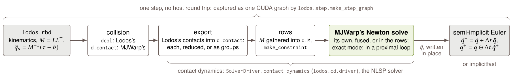
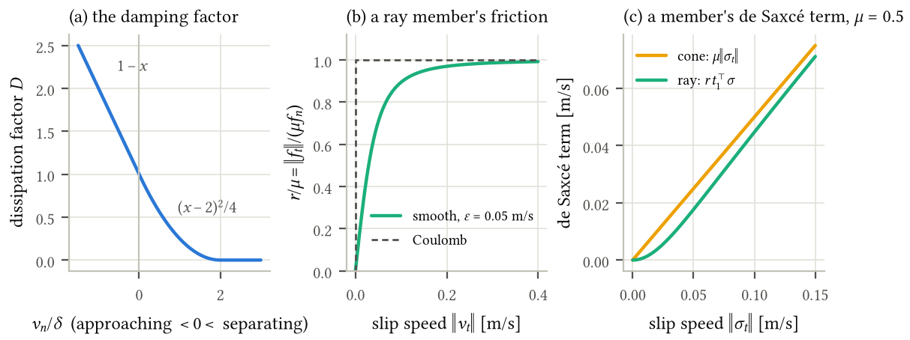
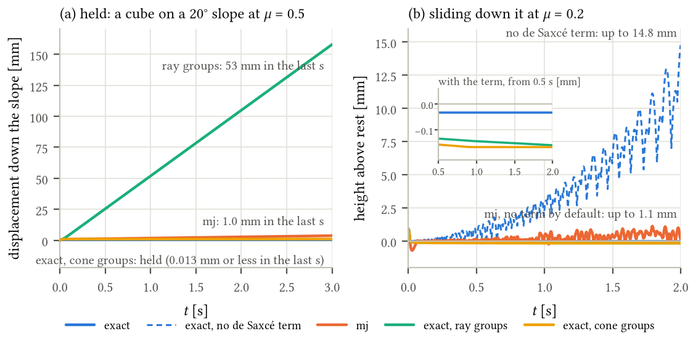
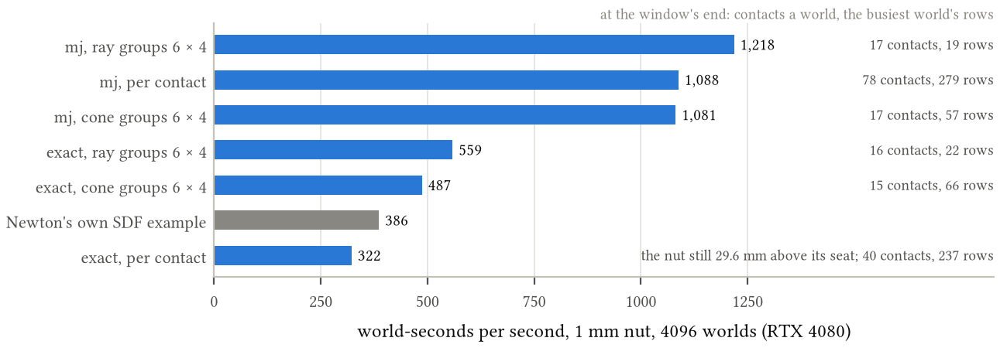

# Lodos v2: Contact Dynamics

*How the simulator turns contacts into motion: the problems, the solver and its options*

As of 2026-11-04. Its companion, *Lodos v2: Collision Detection* (`docs/collision_detection.pdf`), says where the contacts come from. Both are built from `docs/manual/`.

**About this document.** Lodos v2 steps thousands of copies of one scene in lockstep on a GPU, the whole step in one CUDA graph. This manual covers everything after collision detection: the rigid-body dynamics, the contact problems the simulator can pose (the exact one and MuJoCo's soft one), the one solver that solves them, called the NLSP solver, the three ways Lodos's contacts can reach it (one by one, reduced, or gathered into contact groups), the two solves of its Newton system that Lodos adds and its Hessian summed in shared memory, every option and what it was measured to do, and how to use them. Theory comes first in each part, then where it lives in the code (boxes marked *In the code*), then measurements, each dated and naming its settings where they differ from the defaults ([Section 12](#12-measured-behaviour)). The notation is the contact tutorial's [1]: $\dot q$ and $\ddot q$ are the generalized velocity and acceleration, $v$ always a contact velocity, $G$ the Delassus matrix, $\gamma_n$ the stabilization and $\Gamma$ the de Saxcé correction. Where the tutorial derives a transcription, this manual cites it rather than repeating the derivation. Lodos carries the parts of MuJoCo Warp [6] it uses as its own code, adapted from MuJoCo Warp 3.14.0: its model and data (`lodos.mjcf`), its collision pipeline (`lodos.col.prim`) and its constraint solve (`lodos.cd.solver`); “MJWarp's” in this manual names that code, Lodos's additions to it among them: the proximal solve and its `opt.prox_*` options, the contact groups' rows and the shared Hessian.

**Contents**

- [1 Contributions](#1-contributions)
- [2 Overview](#2-overview)
  - [2.1 The step](#21-the-step)
  - [2.2 One solver, three choices](#22-one-solver-three-choices)
- [3 Rigid-body dynamics](#3-rigid-body-dynamics)
  - [3.1 Model features](#31-model-features)
  - [3.2 The passes](#32-the-passes)
  - [3.3 The mass matrix](#33-the-mass-matrix)
  - [3.4 Integration and state](#34-integration-and-state)
  - [3.5 implicitfast](#35-implicitfast)
- [4 The contact problem](#4-the-contact-problem)
  - [4.1 Discrete-time contact dynamics](#41-discrete-time-contact-dynamics)
  - [4.2 The exact problem](#42-the-exact-problem)
  - [4.3 MuJoCo's problem](#43-mujocos-problem)
  - [4.4 The two modes](#44-the-two-modes)
  - [4.5 The impedance rule](#45-the-impedance-rule)
  - [4.6 The proximal blueprint](#46-the-proximal-blueprint)
- [5 The NLSP solver](#5-the-nlsp-solver)
  - [5.1 MJWarp's Newton solve](#51-mjwarps-newton-solve)
  - [5.2 The exact mode](#52-the-exact-mode)
  - [5.3 The de Saxcé term and the Baumgarte bias](#53-the-de-saxcé-term-and-the-baumgarte-bias)
  - [5.4 The mj mode](#54-the-mj-mode)
  - [5.5 From options to MJWarp](#55-from-options-to-mjwarp)
  - [5.6 Lodos's state in MJWarp](#56-lodoss-state-in-mjwarp)
- [6 Contact groups](#6-contact-groups)
  - [6.1 A group and its force](#61-a-group-and-its-force)
  - [6.2 The weights: the spring-damper law](#62-the-weights-the-spring-damper-law)
  - [6.3 Bins and sectors](#63-bins-and-sectors)
  - [6.4 The ray](#64-the-ray)
  - [6.5 The cone and its carried frames](#65-the-cone-and-its-carried-frames)
  - [6.6 The two modes on a group](#66-the-two-modes-on-a-group)
- [7 Contact reduction](#7-contact-reduction)
- [8 The fused Newton](#8-the-fused-newton)
- [9 The row-space Newton](#9-the-row-space-newton)
- [10 The shared Hessian](#10-the-shared-hessian)
- [11 The options in one place](#11-the-options-in-one-place)
- [12 Measured behaviour](#12-measured-behaviour)
  - [12.1 A cube on a slope](#121-a-cube-on-a-slope)
  - [12.2 The piles](#122-the-piles)
  - [12.3 Newton's nut-bolt](#123-newtons-nut-bolt)
  - [12.4 Isaac Lab's NIST threading](#124-isaac-labs-nist-threading)
  - [12.5 The FBF exactness scenes](#125-the-fbf-exactness-scenes)
  - [12.6 What to pick](#126-what-to-pick)
- [13 Using it](#13-using-it)
- [14 Limitations and open decisions](#14-limitations-and-open-decisions)

## 1 Contributions

The contact dynamics of Lodos v2 build on MuJoCo's model and solver [4, 5] as MJWarp implements them [6], and on the exact contact problem and the proximal-point blueprint of the contact tutorial [1]. What they add:

1. **MJWarp's solve on Lodos's state** ([Section 5.6](#56-lodoss-state-in-mjwarp)): MJWarp's constraint solve runs on the rigid-body state Lodos owns, bound into MJWarp's data with no copies, Lodos's mass matrix gathered into MuJoCo's layout and Lodos's vertex contacts exported into MJWarp's contact buffer beside its own, all inside the step's one CUDA graph. On MJCF scenes the step cost what MuJoCo Warp's own did, end to end (2026-10-22).
2. **The exact mode** (Sections [5.2](#52-the-exact-mode) and [5.3](#53-the-de-saxcé-term-and-the-baumgarte-bias)): MJWarp's Newton method inside the proximal and de Saxcé fixed point of the tutorial's blueprint (a prox solver, `lodos.cd.solver.nlsp.solve_prox`), extended with MuJoCo's soft rows inside the loop, a compile-time switch for the de Saxcé term, its shift of MuJoCo's reference through the row damping, a Baumgarte slop, and an anchor-only convergence test; with the rule that no MuJoCo impedance reaches it ([Section 4.5](#45-the-impedance-rule)) and a measured fix for the elliptic cone it would otherwise warp. At slop 0 it holds Newton's M20 nut on its seat in 95% of jittered worlds (the 1 mm nut) and passes the five FBF exactness scenes on polytopes.
3. **Contact groups** ([Section 6](#6-contact-groups)): a pair's contacts in one normal bin and moment sector solved as one MJWarp contact of a new type, `GROUP`, whose force acts through its members in proportion to their spring-damper normal forces: on a ray (one row, the ray of Lodos-v1's contact model [2], transcribed) or in a full friction cone (three rows, each member's friction along its own slip, its frame carried across steps by contact identity). Its Baumgarte bias and de Saxcé term are taken member by member. On the NIST threading replay under the mj mode, on MuJoCo's pyramidal cone, cone groups of three sectors ran 1.13$\times$ per contact, both fused.
4. **Contact reduction for the solve** ([Section 7](#7-contact-reduction)): Newton's reduction [7] of a pair's vertex contacts to at most 240 that hold it the same way, deterministic, on grouped pairs too: 4.4$\times$ (mj, on MuJoCo's pyramidal cone at solimp $d_{\min}$ 0) and 18.5$\times$ (exact, at slop 0) faster steps on the nut-bolt.
5. **The fused Newton** ([Section 8](#8-the-fused-newton)): MJWarp's Newton solve and its proximal rounds in one kernel per world, for models of up to 16 dofs, the same iterates to rounding: 2.3$\times$ the exact step on the nut-bolt.
6. **The row-space Newton** ([Section 9](#9-the-row-space-newton)): MJWarp's Newton system solved through the constraint rows with Lodos's per-tree factor of $M$, at a cost set by the rows rather than the dofs: ray groups 3.1$\times$ the per-contact exact step on a pile of twenty armadillos.
7. **lodos.rbd** ([Section 3](#3-rigid-body-dynamics)): a Warp port of MuJoCo's smooth dynamics with per-tree mass-matrix blocks, pull-based reverse passes that are bitwise reproducible, and tile-Cholesky factors for wide trees, captured with the rest of the step.

Item 7, the spring-damper law that weighs a group's members and the ray a ray group transcribes come from Lodos-v1 [2]; items 1–6 are Lodos v2's own, the exact mode after the contact tutorial's blueprint and the reduction after Newton's.

## 2 Overview

### 2.1 The step

A step of a `lodos.sim.Sim` (`lodos.step.step_sim`) is, with no host round trip anywhere (Figure 1):

1. **the rigid-body pass**, `lodos.rbd.forward.fwd_rbd`: kinematics, the mass matrix and its factor, the bias and passive forces, actuation, and the unconstrained acceleration $\ddot q_s$ (`qacc_smooth`);
2. **collision**: MJWarp's pipeline (`lodos.col.prim`) into `d.contact` and Lodos's (`lodos.col.sdf`) into `dcol` (the companion manual);
3. **contact dynamics**, `SolverDriver.contact_dynamics` (`lodos.cd.driver`): Lodos's contacts exported into MJWarp's contact buffer (every one, the ones the reduction keeps, or their groups), Lodos's mass matrix gathered into MJWarp's, the constraint rows built (`make_constraint`) and MJWarp's solve run on them, which writes $\ddot q$ into the array Lodos's integrator reads;
4. **integration**: semi-implicit Euler, $\dot q^+ = \dot q + \Delta t\,\ddot q$, then the positions from $\dot q^+$; or MuJoCo's implicitfast ([Section 3.5](#35-implicitfast)), where $\ddot q$ is implicit in the actuators' and the dofs' damping.

`lodos.step.forward(sim)` is everything but the integrator, the way MuJoCo's `mj_forward` is; `make_step_graph(sim)` captures the whole step into a CUDA graph whose replay advances the state one step; it runs one eager step first, to load the kernels, so building the graph advances the state one step too. `fwd_step(sim)` steps eagerly.



*Figure 1: One step. Lodos's contacts join MJWarp's in MJWarp's contact buffer, one by one, reduced or gathered into groups; MJWarp's Newton solve, its system solved as MJWarp does, fused into one kernel per world or through the rows, writes the constrained acceleration directly into Lodos's state.*

### 2.2 One solver, three choices

Every contact of both pipelines reaches one solver, MJWarp's constraint solve: Newton's method on MuJoCo's primal problem ([Section 4.3](#43-mujocos-problem)), whose objective is a nonsmooth nonlinear least-squares one in the accelerations; under the exact mode a proximal minimization runs around it ([Section 4.6](#46-the-proximal-blueprint)), hence the solver's name, NLSP: nonlinear least squares with proximal minimization. Three choices configure it (Table 1): the problem it poses, its *mode*; how Lodos's contacts reach it; and how its Newton system is solved. The mode decides the problem and the other two its cost; how Lodos's contacts reach the solve also decides how freely a pair's force is distributed: a reduced pair has fewer contacts, a grouped one a single force a group. [Section 12.6](#126-what-to-pick) summarizes what the measurements say about choosing.

**Table 1: The solver's three choices (`lodos.cd.driver.resolve_options`, and `make_sim`'s `contact_reduction`). The first of each is the default.**

| choice | option | what it does |
|---|---|---|
| the problem | `mode="exact"` | the exact problem, by a proximal loop around the Newton solve ([Section 5.2](#52-the-exact-mode)) |
|  | `mode="mj"` | MuJoCo's soft problem, solved as MJWarp solves it ([Section 5.4](#54-the-mj-mode)) |
| Lodos's contacts | every contact | one row set per penetrating vertex |
|  | `contact_reduction=True` | at most 240 a pair segment, chosen to hold it the same way ([Section 7](#7-contact-reduction)) |
|  | `groups="ray"` or `"cone"` | a segment's contacts in a bin and sector as one contact of one or three rows ([Section 6](#6-contact-groups)) |
| the Newton system | MJWarp's | the dof-space Hessian $M + J^\top D J$, Cholesky-factored |
|  | `fused_newton=True` | the whole solve in one kernel per world, at most 16 dofs ([Section 8](#8-the-fused-newton)) |
|  | `row_space=True` | solved through the rows, at a cost set by their number ([Section 9](#9-the-row-space-newton)) |

## 3 Rigid-body dynamics

`lodos.rbd` is a Warp port of the smooth dynamics MuJoCo and MJWarp implement, for the model features below, so that the whole step lives on the device.

### 3.1 Model features

Supported: free, ball, slide and hinge joints; joint springs, dof damping and armature; gravity compensation; actuators with joint, joint-in-parent and site transmissions, affine gain and bias, activation dynamics (none, integrator, filter, exact filter), control and activation clamping; MuJoCo's spring and damper disable flags; semi-implicit Euler and implicitfast. `make_rbd_context` *refuses* what it does not implement (tendons, equality constraints, flexes, mocap bodies, fluid forces, the implicit and Runge–Kutta integrators, and actuator features beyond those above), listing what is missing, because a port that ignored those fields would produce a plausible trajectory that is not the model's.

Joint limits and dof friction loss are constraints, which MJWarp's solve has rows for: they are solved as MuJoCo's soft rows under either mode (the proximal loop solves contacts only). `make_sim(joint_constraints=False)` removes them, on a copy of the model.

### 3.2 The passes

The equations of motion are MuJoCo's,

$$
M(q)\,\ddot q + b(q, \dot q) = \tau + J^\top f, \qquad \ddot q_s = M^{-1}(\tau - b), \tag{1}
$$

with $b$ the bias force (Coriolis, centrifugal and gravity, from recursive Newton–Euler), $\tau$ the passive and actuator forces, and $J^\top f$ the contact forces. `fwd_rbd` computes, in this order: kinematics (body, joint and site poses); the subtree centres of mass, body inertias and motion axes `cdof` about them; the mass matrix and its factor; actuator transmissions and velocities; body velocities and `cdof_dot`; passive forces; the bias force by RNE; actuation; `qfrc_smooth` and $\ddot q_s$.

Tree passes run by level: `body_level_id` groups the bodies by depth, a forward pass launches once per level with every body reading the parent the previous launch wrote, and a reverse pass reads *children* (`body_child_id`) rather than having children accumulate into their parent. A pull needs no atomics, so every reverse pass is bitwise reproducible. Quaternions are $(w, x, y, z)$ as in MuJoCo; spatial vectors are (angular, linear); every state array is batch-first, `(B, n)`.

### 3.3 The mass matrix

$M$ is block diagonal over kinematic trees (a tree starts at every dof without a dof parent). Each tree's block is built by the composite rigid-body algorithm [10], $M_{ij} = (I^c_{\text{body}(i)}\, \mathrm{cdof}_i)^\top \mathrm{cdof}_j$ for every $j$ on the dof path from $i$ to the root, plus armature, and factored $M = LL^\top$ per tree. Blocks are stored batch-last, `M_blk[blk_beg[t] + r n + c, b]`. Trees smaller than 13 dofs are factored by scalar Cholesky in one thread per (world, tree), a 6$\times$6 free body in registers; trees of 13 or more are built one dof per thread, gathered into batch-first tiles of 16–128 rows, factored and solved with Warp's tile Cholesky, and scattered back, which took a 27-dof humanoid from 0.75 to 0.21 ms per step at 1024 worlds. The solve reads $M$ itself, gathered entry for entry into MuJoCo's CSR `d.M`, and MJWarp factors its own Newton Hessian ([Section 5.6](#56-lodoss-state-in-mjwarp)); the row-space solve reads Lodos's factor $L$ instead ([Section 9](#9-the-row-space-newton)).

### 3.4 Integration and state

`lodos.rbd.integrate.integrate` is the step's integration, `symplectic_euler` under either integrator: it advances activations, then $\dot q^+ = \dot q + \Delta t\,\ddot q$, then the positions from $\dot q^+$, a ball or free joint's quaternion by the exponential map of $\Delta t\,\omega$ composed on the right and renormalized, then time. `lodos.rbd.io` puts states in and out without breaking captured graphs: `set_state(drbd, qpos=, qvel=, ctrl=, act=)` copies `(B, n)` host arrays into the existing buffers, `get_state` reads them back (synchronizing), and `save_state`/`restore_state` branch a trajectory on the device.

### 3.5 implicitfast

An MJCF's `integrator="implicitfast"`, or `make_sim(integrator="implicitfast")` in place of the MJCF's, selects MuJoCo's implicitfast (`lodos.rbd.implicit`, after MJWarp's `forward.implicit`). The step solves

$$
(M - \Delta t\,D)\,\ddot q = \tau - b + J^\top f \tag{2}
$$

for the acceleration it integrates, where $D = \partial(\tau)/\partial \dot q$ without the bias force's derivative (implicitfast's choice, which keeps $D$ symmetric): each actuator's $\mathrm{moment}\,\mathrm{moment}^\top\, \partial f/\partial v$ (the affine bias's velocity coefficient, plus the affine gain's times the control or activation; none where the force is clamped) and $-$damping on the diagonal, on the mass matrix's own pattern. The entries of $D$ that can be nonzero, and the actuators reaching each, are found on the host; a step computes only those. A free body standing alone (its own tree of 6 dofs, nothing massive below) solves its own 6$\times$6 block instead, with its gyroscopic force's derivative added, as MuJoCo's `mjd_freeMhat` does; the block is not symmetric and is solved by LU. `make_sim(implicit_constraints=...)` picks the matrix the contact solve sees:

- **False (the default): $M$, as MuJoCo has it.** The solve runs as under Euler; from its acceleration $\ddot q$ the step integrates $(M - \Delta t\,D)^{-1} M \ddot q$, the free bodies by their own blocks, and leaves `qacc` the solve's, as MuJoCo leaves `d->qacc`. The mass matrix and the implicit one are both factored each step.
- **True: $M - \Delta t\,D$ throughout.** It replaces $M$ before the factorization, so $\ddot q_s$, the solve's gathered $M$ and the factor the row-space solve reads are the implicit matrix's, and the contact impulse sees the damping that acts in the same step. One factorization; the free bodies' gyroscopic term, which is not symmetric, is left out.

Without constraints the two are one step, the gyroscopic term apart. Cost, at each scene's tuned batch (2026-10-27): on the SHARPA piles 0.98$\times$ Euler's throughput in MuJoCo's form, which factors two matrices a step, and 1.02$\times$ throughout.

**Speed.** Against MuJoCo Warp's own dynamics on the same model (unconstrained step and integrator, graph-replayed, 2026-10-22), Lodos's was, at 4096 worlds, 1.1$\times$ faster on twenty free cubes and 1.9$\times$ on twenty armadillos (MuJoCo Warp computes every geom pose in its kinematics; Lodos computes none), on par on the SHARPA hand (five trees, 22 dofs), and 1.5–2.1$\times$ slower on one and three humanoids (27-dof trees). Dynamics is under 2% of a contact-rich step either way.

> **In the code.** `lodos/rbd/types.py` (`RbdModel`, `RbdData`, `make_rbd_context`, the validation), `forward.py` (`fwd_rbd` and its sub-passes), `smooth.py` (kinematics, `com_pos`, `com_vel`, `rne`, `factor_m`, `solve_m`, the tile path, `solve_M_tree` and `mul_M_tree`), `passive.py`, `integrate.py`, `implicit.py`, `io.py`; `lodos/utils/math.py` (quaternion and spatial algebra).

## 4 The contact problem

### 4.1 Discrete-time contact dynamics

Each contact $i$ has a position $p_i$, a normal $n_i$ (a Lodos contact's out of the SDF geometry, towards the vertex geometry), a signed distance $d_i < 0$ and a friction coefficient $\mu_i$; its relative velocity is $v_i = J_i \dot q$, the vertex side's point velocity minus the SDF side's, and its force $f_i \in \mathbb R^3$ acts on the vertex side. With symplectic Euler, the end-of-step velocity and contact velocities are linear in the forces [1],

$$
\dot q^+ = \dot q_f + \Delta t\, M^{-1} J^\top f, \qquad v^+ = v_f + G f \Delta t, \qquad G = J M^{-1} J^\top, \tag{3}
$$

with the free velocity $\dot q_f = \dot q + \Delta t\, \ddot q_s$ and $v_f = J \dot q_f$. MJWarp forms each contact's rows $J_i$ (`efc.J`, dense or sparse) on its two bodies' dof chains; a contact group's rows are sums over its members ([Section 6.1](#61-a-group-and-its-force)).

### 4.2 The exact problem

The exact contact problem is the Signorini–Coulomb conditions with maximal dissipation, equivalently the nonlinear cone complementarity problem [8] or, with the de Saxcé velocity $\sigma$ split off, the cascaded QCQP (the tutorial's C-QCQP):

> **The exact problem (C-QCQP)**
>
> $$
> \begin{aligned}
> &\text{find } \sigma, f^* \in \mathbb R^{3N}: \\
> &\sigma = v_f + G f^* \Delta t, \\
> &f^* = \arg\min_{f \in \mathcal K}\ \tfrac12 f^\top (G \Delta t) f + (v_f + \Gamma(\sigma) + \gamma)^\top f ,
> \end{aligned} \tag{4}
> $$

with $\mathcal K$ the product of the friction cones $\{f_i : \lVert f_{i,t}\rVert \le \mu_i f_{i,n}\}$, the de Saxcé correction $\Gamma_i(\sigma) = \mu_i \lVert \sigma_{i,t}\rVert\, n_i$, and the stabilization $\gamma_i = \gamma_{n,i} n_i$. The exact mode's stabilization is Baumgarte's:

$$
\gamma_{n,i} = \alpha \min\!\big(0, (d_i + s)/\Delta t\big) + \max(0, d_i/\Delta t), \qquad \alpha = 0.1, \tag{5}
$$

with the slop $s$ 0.2 mm by default, which asks each contact for a normal velocity of at least $-\gamma_{n,i}$: a fraction $\alpha$ of a penetration deeper than the slop $s$ removed per step, a shallower one held where it is, a gap closed no faster than in one. Every Lodos contact penetrates, so only the first term fires for them. `baumgarte=False` sets $\gamma = 0$, the velocity-level target.

The slop (`baumgarte_slop`; `lodos.cd.driver.BAUMGARTE_SLOP`) is there because a contact exists only while it penetrates. Without it ($s = 0$) a resting contact is pushed out toward zero depth, vanishes, its body drops for a step ($g\Delta t^2 \approx 0.04$ mm) and the contact comes back, pushing out at about $\alpha g \Delta t \approx 2$ mm/s: the contact flickers. On the walled pile of five SHARPA hands this kept the solver from rest, palms vibrating at 1–2 mm/s and fingers at up to 2 rad/s; with the slop its polytope piles come to an exact stop, and a resting body sits up to $s$ deep. A slop can also let a contact sink: the NIST scenes set it to 0 (`viewer.scenes.nist.OPTIONS`), since at the demo's $\mu$ = 0.75 a thread self-locks, and with the default slop a held M8 nut sank 0.26 mm in 4 s, tilting to 1.9$^\circ$, the solve's errors integrating into penetration that nothing corrects until a contact is 0.2 mm deep; at 0 it settles 0.044 mm and holds (2026-10-26 morning and 2026-10-27 evening).

Dropping $\Gamma$ gives the convex relaxation, whose sliding contacts lift off with normal velocity $\mu\lVert v^+_t\rVert - \gamma_n$; with $\gamma = 0$ and no $\Gamma$ the objective is the end-of-step kinetic energy, $\tfrac12 f^\top(G\Delta t) f + v_f^\top f$ (the tutorial's kinetic-energy view), which `baumgarte=False, de_saxce=False` poses.

### 4.3 MuJoCo's problem

MuJoCo regularizes and solves the primal problem in accelerations (the tutorial's NLS transcription) [5]:

$$
\min_{\ddot q}\ \tfrac12 (\ddot q - \ddot q_s)^\top M (\ddot q - \ddot q_s) + \tfrac12 \sum_i \lVert \Pi_{\mathcal K_i}(a_{\text{ref},i} - J_i \ddot q)\rVert^2_{R_i^{-1}}, \tag{6}
$$

equivalently the regularized QCQP $\min_{f\in\mathcal K} \tfrac12 f^\top (G + R) f + (J\ddot q_s - a_{\text{ref}})^\top f$. Each contact row carries a softness $R_i$ and a reference acceleration from its `solref` $= (\tau_c, \zeta)$ and `solimp` $= (d_{\min}, d_{\max}, \text{width}, \text{mid}, \text{power})$: a stiffness $k = 1/(d_{\max}^2 \tau_c^2 \zeta^2)$, a damping $b = 2/(d_{\max}\tau_c)$ and an impedance $\text{imp}(d) \in [d_{\min}, d_{\max}]$ rising with depth over `width`, giving

$$
R_i = w_i \frac{1 - \text{imp}}{\text{imp}}, \qquad a_{\text{ref},i} = k\, \text{imp}\, \lvert d_i\rvert\, n_i - b\, v_i , \tag{7}
$$

with $w_i$ the contact's inverse weight. The regularization makes the problem strongly convex and lets sticking contacts creep; MuJoCo's frictional rows are further scaled by `impratio`, and its elliptic cone is written in residual space with the coefficient $\mu\sqrt{R_t/R_n}$. The objective is a least-squares one in the projected residuals: nonlinear, and nonsmooth wherever a row changes state.

### 4.4 The two modes

The solver takes `mode`:

- `"exact"` (the default): the exact problem, Eq. (4), with the Baumgarte target Eq. (5) (`baumgarte`, `baumgarte_alpha`, `baumgarte_slop`) and the de Saxcé term (`de_saxce`, on by default); it reads only $\mu$, and on grouped pairs the spring-damper columns that weigh a group's members ([Section 6.2](#62-the-weights-the-spring-damper-law));
- `"mj"`: MuJoCo's problem, Eq. (6), with $R$ and $a_{\text{ref}}$ from solref and solimp: a Lodos pair's from the pair table (MuJoCo's defaults where a scene sets none, solref $(0.02, 1)$ and solimp $(0.9, 0.95, 0.001, 0.5, 2)$: `lodos.sim.default_pair_params`), an MJWarp contact's from the MJCF; it refuses `baumgarte`, `baumgarte_alpha` and `baumgarte_slop`, and takes the de Saxcé term only when asked ([Section 5.4](#54-the-mj-mode)).

`lodos.sim.exact_mode(solver_kwargs)` says whether a configuration poses the exact problem.

### 4.5 The impedance rule

> **The rule.** No MuJoCo impedance reaches the exact mode: no solref, solimp or impratio. `make_sim` runs the exact mode's copy of the model at `impratio` 1, and the solve rewrites every contact row's weight and reference ([Section 5.2](#52-the-exact-mode)).

The reason `impratio` needs the rule is MJWarp's elliptic cone. It is written in residual space with $\mu_r = \mu\sqrt{R_t/R_n}$, which MJWarp sets to $\mu/\sqrt{\text{impratio}}$ for every contact: the true cone under MuJoCo's own weights ($R_t = R_n/\text{impratio}$), but not under the exact rows' equal ones, where it must be $\mu$. At `impratio` 10 a sticking contact then holds at most a tenth of $\mu f_n$ and the cost jumps at the stick–slide boundary: on the SHARPA hands, whose MJCF sets `impratio` 10 (as the Shadow hand's grasp does), the exact solve went non-finite in 14 of 16 variants, and a box held on a slope crept at 1.5 mm/s; at `impratio` 1 every hand scene stays finite and the box holds (2026-10-24 night, at slop 0). `make_sim`'s `overrides` cannot set `impratio` (they go to both MuJoCo's model and MJWarp's, and only the first has it), which is why `make_sim` edits its copy of the model.

### 4.6 The proximal blueprint

The exact problem's QP is only positive semidefinite in general ($G$ is rank deficient), and its de Saxcé term depends on the solution. The tutorial's blueprint handles both with one outer loop [1, 9]:

**Algorithm 1: Proximal minimization with the de Saxcé correction (the tutorial's blueprint)**

```text
choose $\rho > 0$ and a diagonal weight $D \succ 0$; $z \gets$ a warm start; $\sigma \gets v_f$
while not converged do
    $f^* \gets \arg\min_{f\in\mathcal K} \tfrac12 f^\top (G\Delta t) f + \tfrac\rho2 \lVert f - z\rVert_D^2 + (v_f + \Gamma(\sigma) + \gamma)^\top f$
    $z \gets f^*$    # the proximal anchor
    $\sigma \gets v_f + G f^* \Delta t$    # the de Saxcé velocity
end while
```

Each inner problem is strongly convex, and at a fixed point the proximal term vanishes and the optimality condition is the exact problem's. The solver's exact mode runs this blueprint on MJWarp's rows, per contact or per group ([Section 5.2](#52-the-exact-mode)).

## 5 The NLSP solver

The solver is MJWarp's constraint solve run on Lodos's state ([Section 5.6](#56-lodoss-state-in-mjwarp)) over both pipelines' contacts: `lodos.cd.driver.SolverDriver`, whose `contact_dynamics()` is the step's contact stage. Under the mj mode it solves MuJoCo's problem, Eq. (6), once; under the exact mode it runs the blueprint, each round one such problem on rewritten rows.

### 5.1 MJWarp's Newton solve

`make_constraint` assembles the rows of every contact (3 at `condim` 3, the default, on the elliptic cone; 4 on MuJoCo's pyramidal cone, its default, which the plain mj mode keeps where a model has it: every built-in scene names the elliptic cone, and the viewer gives it to an MJCF file that names none) plus joint-limit and friction-loss rows, and `solve` runs MuJoCo's primal Newton solver on Eq. (6): Newton directions from the Hessian $M + J^\top D J$ over the active rows (with the elliptic cone's curvature on a contact in its middle zone), Cholesky-factored; an exact line search; a warm start from the previous step's acceleration. Its iteration budget and tolerance are the model's (`opt.iterations`, `opt.tolerance`), which `make_sim`'s `overrides` change (`"opt.iterations=50"`, `"opt.tolerance=1e-6"`). Lodos's contacts are rows like any other, with their pair's friction (and MuJoCo's default torsional and rolling coefficients, 0.005 and 0.0001, which matter only above `condim` 3), under mj its solref and solimp, and one `condim` for all of them, `make_sim(condim=3)`. The proximal loop supports `condim` up to 3 only, so a higher one is for the plain mj mode. The solver assumes MJWarp's Newton solver, the default: the proximal loop, the fused Newton and the row-space solve require it, the loop also no sleeping (it sets the elliptic cone itself).

### 5.2 The exact mode

Under the exact mode the solver is the tutorial's blueprint (Algorithm 1) with Newton's method on the NLS transcription as the inner solver: the prox solver, `lodos.cd.solver.nlsp.solve_prox`. It rewrites every contact row:

$$
D_i = \frac{1}{\hat\rho\, w_i}, \qquad
a_{\text{ref},i,n} = -\frac{v_{i,n} + \gamma_{n,i} + \mu_i\lVert\sigma_{i,t}\rVert}{\Delta t} + \frac{z_{i,n}}{D_i}, \qquad
a_{\text{ref},i,t} = -\frac{v_{i,t}}{\Delta t} + \frac{z_{i,t}}{D_i}, \tag{8}
$$

the weight on all three rows, with $w_i$ the summed translational inverse weights of the two bodies (`body_invweight0`), $\hat\rho$ = `prox_rho` = 1, $z$ the proximal anchor and $\mu_i\lVert\sigma_{i,t}\rVert$ the de Saxcé term at the last de Saxcé velocity $\sigma$. Substituting into the NLS objective gives $\tfrac12 f^\top(G\Delta t) f + \tfrac{\Delta t}{2} (f - z)^\top R (f - z) + (v_f + \gamma + \Gamma)^\top f$ with $R = \hat\rho w$: Algorithm 1's inner problem exactly. The tangent rows carry no stabilization bias, since a tangential bias inside the exact de Saxcé complementarity misaligns the slip direction and can inject energy. A contact group's rows are rewritten the same way, its bias and term taken from its members ([Section 6.6](#66-the-two-modes-on-a-group)).

The loop runs `prox_iters_per_qp` rounds (10), each a Newton solve to convergence on the current rows, then $z \gets f^*$. With `refresh_de_saxce_per_prox` (on by default) $\sigma \gets J(\dot q + \Delta t\,\ddot q)$ and $\Gamma$ are re-taken after every round, as MJWarp's `prox_outer_iterations` $\times$ `prox_inner_iterations` = 10 $\times$ 1; without, $\Gamma$ is taken once, from the warm start, 1 $\times$ 10. A world freezes once $\max\lvert f^* - z\rvert \le$ `prox_tol_z` $(1 + \max\lvert f^*\rvert)$ and, with the refresh, $\max\lvert\Delta\Gamma\rvert \le$ `prox_tol_sigma` $(1 + \max\Gamma)$ ($10^{-3}$ each); frozen worlds skip all later work, and rounds after the first are skipped on the device once every world is frozen (with MJWarp's `opt.graph_conditional`, on by default). The exact mode needs the loop, since its rows have no softness of their own: `prox_iters_per_qp=0` (or `prox_rho=0`) is refused. Its loop runs on the elliptic cone whatever the model says ([Section 4.5](#45-the-impedance-rule) explains why at `impratio` 1). `d.solver_niter` counts a world's Newton iterations over all its rounds.

**The cross-step carry.** With `warm_start` (on), the converged anchors are carried into the next step through a cache keyed by (world, geom pair), each new contact matched to the nearest cached contact of its pair within 0.3 of the smaller of the two geoms' bounding radii, rotated into the new contact frame and projected onto the cone (`opt.prox_z_carry` = 1). Lodos's contacts are typed `NOCARRY` and skipped, and so are contact groups: a Lodos pair holds dozens of vertex contacts under one geom pair, and the position match handed one cached force to many of them (300–650 iterations instead of about 33 on the mixed twenty-body scene, and non-finite runs at large batches). Their anchors start each step cold; the acceleration's warm start applies to them as to any row. `warm_start=False` starts every step cold, with MuJoCo's warm-start disable bit and no carry.

### 5.3 The de Saxcé term and the Baumgarte bias

**The de Saxcé term.** Without $\Gamma$ the exact problem is its convex relaxation, and a sliding contact lifts off at $\mu$ times its slip ([Section 4.2](#42-the-exact-problem)): a unit cube sliding down a 20$^\circ$ slope at $\mu$ = 0.2 hops, up to 14.8 mm above the slope within 2 s (Figure 3b). With the term, the default, the normal row's target becomes $-(\gamma_n + \mu\lVert\sigma_t\rVert)$, and a slip that continues no longer lifts the contact: the same cube stays down, its highest point after landing 0.03 mm below rest. The term is taken at $\sigma = J(\dot q + \Delta t\,\ddot q)$, the velocity the current iterate leaves. With `refresh_de_saxce_per_prox` it is re-taken after every proximal round, so that the loop converges on the term at the step's own result, the blueprint's fixed point; without, it is taken once, at the warm start's acceleration. On the armadillo pile and the nut's seat the term and its refresh barely mattered, moving the seat within its spread for 1–2% of throughput: the thread's $\mu$ = 0.01 keeps the term small, and the slope is where it shows (2026-10-25 late night, at slop 0).

**The Baumgarte bias.** The normal row's target is $-\gamma_n$, Eq. (5): `baumgarte_alpha` (0.1) of a penetration deeper than `baumgarte_slop` (0.2 mm) removed a step, a shallower one held. `baumgarte=False` removes it, the velocity-level target. The tangent rows take none. A group's bias and term are its members' ([Section 6.6](#66-the-two-modes-on-a-group)).

### 5.4 The mj mode

Under `mode="mj"` with no loop and no term, the proximal path does not run at all: one Newton solve of MuJoCo's problem on the model's rows and cone, warm-started, exactly MJWarp's own solver. With a loop (`prox_iters_per_qp` $> 0$) or the term (`de_saxce=True`) the proximal path runs on *MuJoCo's soft rows* (`opt.prox_soft`):

$$
D'_i = \frac{1}{1/D_{\text{mj},i} + \rho_i}, \qquad
a'_{\text{ref},i} = a_{\text{ref,mj},i} - b_i\,\Gamma_i + \rho_i z_i \ \text{(normal row)}, \qquad
a_{\text{ref,mj},i} + \rho_i z_i \ \text{(tangent rows)}, \tag{9}
$$

$\rho_i = \hat\rho w_i$, with $b_i$ the normal row's damping from the contact's solref and solimp (MJWarp's own `_contact_kbimp`). At the fixed point $z = f$ this is MuJoCo's soft solution, with the reference shifted by the de Saxcé term through the row damping; without a loop ($\rho_i = 0$) it is one solve of MuJoCo's problem with the shifted reference. Either way the proximal path runs on the elliptic cone, so on a model with MuJoCo's default pyramidal cone the fixed point is the elliptic cone's soft solution, not the model's own. At solimp $d_{\min}$ 0 the loop lands on MuJoCo's solution (the cube sliding at $\mu$ = 0.2 rides at the same height with it or without), and the term sinks that cube 0.44 mm; at the pair table's default, $d_{\min}$ 0.9, the loop landed 0.12 mm from the plain solve (2026-10-31). On the nut-bolt either one stuck the 0.5 mm nut up the thread in every world and cost 2.8$\times$ (the term) and 9$\times$ (the loop) the step (2026-10-25 late night, at $d_{\min}$ 0, the plain mj mode timed on MuJoCo's pyramidal cone), which is why neither is on by default.

### 5.5 From options to MJWarp

`lodos.cd.driver.resolve_options` checks and completes the options and `lodos.cd.driver.overrides` turns them into MJWarp model overrides (Table 2); `make_sim` applies them before any of the caller's `overrides`, which can still change MJWarp's Newton settings. Three options select Lodos's code rather than MJWarp's settings: `groups` and its bins build `GROUP` contacts (`lodos.cd.groups`, and MJWarp's group arrays), `fused_newton` replaces MJWarp's `solve` with `lodos.cd.fused`'s kernel, and `row_space` hands MJWarp's Newton the row-space solve of its system (`nlsp.solve(m, d, newton_solve=...)`). `shared_hessian` is MJWarp's own, `opt.shared_hessian`: its sparse Hessian built in shared memory, which `make_sim` turns on, when the option is not given, wherever MJWarp can build it on a model of 64 padded dofs or more ([Section 10](#10-the-shared-hessian)).

**Table 2: The options and the MJWarp overrides they come to. Nothing but the shared Hessian is overridden for MuJoCo's own problem (mj, no loop, no term).**

| option | default | MJWarp |
|---|---|---|
| `mode` | `"exact"` | `opt.prox_soft` false (exact rows) or true (mj); `opt.cone` elliptic; `opt.prox_enable` 1 |
| `prox_rho` | 1.0 | `opt.prox_rho` (0 when there is no loop) |
| `prox_iters_per_qp` | 10 exact, 0 mj | `opt.prox_outer_iterations` $\times$ `opt.prox_inner_iterations`: $N \times 1$ with the refresh, $1 \times N$ without |
| `prox_tol_z` | $10^{-3}$ | `opt.prox_tol_z` |
| `prox_tol_sigma` | $10^{-3}$ | `opt.prox_tol_sigma` |
| `baumgarte`, `baumgarte_alpha`, `baumgarte_slop` | True, 0.1, 0.2 mm (exact only) | `opt.prox_baumgarte`, `opt.prox_baumgarte_alpha`, `opt.prox_baumgarte_slop` |
| `de_saxce` | on exact, off mj | `opt.prox_desaxce` |
| `refresh_de_saxce_per_prox` | on where it applies | the outer/inner split above |
| `warm_start` | True | MuJoCo's warm start (off: its disable bit, or-ed into the model's flags); `opt.prox_z_carry` 1 with a loop |
| `shared_hessian` | None: on from 64 padded dofs where it builds | `opt.shared_hessian`: True as an override, None decided and set by `make_sim` |

`resolve_options` refuses, with `ValueError`, an unknown mode; `baumgarte`, `baumgarte_alpha` or `baumgarte_slop` under mj; a negative `baumgarte_slop`; `prox_iters_per_qp` $< 0$; the exact mode without a loop; `refresh_de_saxce_per_prox` without the term or without a loop; an unknown group kind; `normal_bins` or `moment_bins` without groups, or outside `lodos.cd.bins`' sets; `row_space` with `fused_newton`; `fused_newton` under mj with a loop or the term; `shared_hessian=True` with `fused_newton` or `row_space`, which form no such Hessian. An option the solver does not take raises `TypeError`. `make_sim` further refuses groups on a scene without Lodos surfaces, a list of per-pair kinds of the wrong length, and what the fused kernel, the row-space solve or a shared Hessian asked for cannot take (Sections [8](#8-the-fused-newton), [9](#9-the-row-space-newton) and [10](#10-the-shared-hessian)). MJWarp's other prox options (`opt.prox_sigma_relax`, `opt.prox_host_convergence`) are reachable only through `overrides`.

### 5.6 Lodos's state in MJWarp

`lodos.cd.driver.SolverDriver` makes MJWarp's solve run on Lodos's state without copies:

- **The state is shared.** `bind_state` rebinds `d.qpos`, `d.qvel`, `d.cdof`, `d.subtree_com`, `d.xpos`, `d.xmat`, `d.qfrc_smooth`, `d.qacc_smooth` and `d.qacc` to Lodos's arrays (the layouts agree: batch first, MuJoCo's quaternion order, `cdof` as [angular, linear]), so the solve writes the constrained acceleration straight into the array Lodos's integrator reads, and the step has no generalized force to apply afterwards.
- **The mass matrix is gathered**: MJWarp reads MuJoCo's CSR `M` (each row's ancestor dofs, then the diagonal); `gather_M` copies Lodos's per-tree blocks into it entry for entry through a precomputed map.
- **Lodos's contacts join MJWarp's**: `export_lodos` appends each with its pair's parameters and the MJCF geoms its surfaces are keyed to, SDF side first (MJWarp's normal points from its first geom to its second), typed `CONSTRAINT | NOCARRY`; with `make_sim(contact_reduction=True)` only the contacts the reduction keeps ([Section 7](#7-contact-reduction)); a grouped pair's contacts are left to its groups, appended after them ([Section 6](#6-contact-groups)). Symmetric pairs export both directions: the rows are constraints, and the solve distributes force among them.

`make_sim`'s MJWarp capacities: `nconmax` and `naconmax` (contacts a world and in all: MJWarp's, Lodos's and their groups; MJWarp's broadphase pairs share a buffer of the same size), `njmax` (rows), `nccdmax`, and `njmax_nnz`, the sparse Jacobian's nonzeros above 32 dofs, whose estimate, when it is left out, counts Lodos's pairs beside the MJCF's own (`lodos.mjcf.io.put_data`). MJWarp sizes its other defaults from the pairs it knows, and a Lodos pair is not one of them: a default capacity can drop Lodos's contacts without a word, and `lodos.utils.calibrate` sizes them ([Section 13](#13-using-it)). On MJCF scenes Lodos's step cost the same as MuJoCo Warp's end to end (0.98–1.02$\times$, 2026-10-22).

> **In the code.** `lodos/cd/driver.py`: `MODES`, `OPTIONS`, `BAUMGARTE_SLOP`, `resolve_options`, `prox_path`, `overrides`, `export_lodos`, `gather_M`, `csr_map`, `bind_state`, `SolverDriver`. `lodos/cd/solver/nlsp.py`: `solve`, and `solve_prox` with its kernels (`_prox_init`, `_prox_update`, `_prox_check`, the anchor cache, `_prox_cache_fill`); `lodos/cd/solver/constraint.py`: `make_constraint`, `_contact_kbimp`. `lodos/mjcf/types.py`, `io.py`: the `opt.prox_*` options, `put_model`, `put_data`, `override_model`.

## 6 Contact groups

A Lodos pair holds one contact per penetrating vertex: hundreds on a pile's bodies, thousands on a nut in its thread, each three rows of the solve. A *contact group* gathers a pair segment's contacts in one normal bin and moment sector ([Section 6.3](#63-bins-and-sectors)) into one MJWarp contact, typed `GROUP`: one force for the group, shared among its members in fixed proportions. `groups` (off by default) chooses the treatment per Lodos pair: `None` or `"contact"`, every pair per contact; `"ray"` or `"cone"`, every pair grouped so; or a list of one kind per pair. Groups run under either mode, through MJWarp's solve, the fused kernel or the row-space solve, and on the contacts the reduction keeps when it is on; MJWarp's own contacts stay per contact. The design, with the problem each parameterization poses, is the Contact-Group Reparameterization section of the Lodos-v2 extended abstract [3].

### 6.1 A group and its force

A group has members $i$, each with its point $p_i$, normal $n_i$, depth $d_i$, a frame $C_i = [n_i\ t_{1,i}\ t_{2,i}]$ and a weight $a_i \ge 0$, $\sum_i a_i = 1$ ([Section 6.2](#62-the-weights-the-spring-damper-law)). It takes one force $\lambda$, and its members receive

$$
\text{cone (condim 3):}\ \ f_i = a_i\, C_i \lambda,\ \ \lambda \in \mathcal K_\mu = \{\lVert\lambda_t\rVert \le \mu\lambda_n\}; \qquad
\text{ray (condim 1):}\ \ f_i = a_i \lambda\,(n_i - r_i t_{1,i}),\ \ \lambda \ge 0, \tag{10}
$$

$\lambda_n$ being the group's total normal force. Every member stays in its own friction cone ($r_i < \mu$ on a ray; on a cone each member's force is $\lambda$ in its own frame, scaled), and a cone cuts off no force its members' frames can express. MJWarp builds the group's rows from its members, $\sum_i a_i d_{ik}^\top J_i$ for each row direction $d_{ik}$ (the frame's rows on a cone, $n_i - r_i t_{1,i}$ on a ray): for a dof with spatial motion $(\omega, v)$ about its tree's root centre of mass $c$, a side's entry is $v^\top F_k + \omega^\top M_k(c)$, with $F_k = \sum_i a_i d_{ik}$ and $M_k(c) = \sum_i a_i (p_i - c) \times d_{ik}$, the SDF side's subtracted from the vertex side's: one force and one moment a row, so a group's assembly walks its members once. On MuJoCo's pyramidal cone a cone group's rows are the pyramid's edges $n \pm \mu t_k$. The group's own point, normal and depth in MJWarp's contact buffer are nominal, its members' weighted means: MJWarp reads the members.

### 6.2 The weights: the spring-damper law

A group's members share its force in proportion to the normal force Lodos's spring-damper model gives each at the step's start (Lodos-v1's force law [2]; `lodos.cd.params`):

$$
\bar f_{n,i} = D\!\left(\frac{v_{i,n}}{\delta}\right) k \max(-d_i, 0), \qquad a_i = \frac{\bar f_{n,i}}{\sum_{j} \bar f_{n,j}}, \qquad r_i = \mu\, \frac{\lVert v_{i,t}\rVert}{\sqrt{\varepsilon^2 + \lVert v_{i,t}\rVert^2}}, \tag{11}
$$

with $v_i$ the member's relative velocity at the step's $\dot q$, the sum over the group's members, and the damping factor

$$
D(x) = \begin{cases} 1 - x, & x < 0 \ \text{(approaching)}, \\ (x - 2)^2/4, & 0 \le x < 2, \\ 0, & x \ge 2, \end{cases} \tag{12}
$$

which grows linearly as a contact approaches, decays quadratically as it separates and vanishes once it separates fast (Figure 2). $r_i$ is a ray member's friction ratio, the spring-damper model's smooth stiction ([Section 6.4](#64-the-ray)). The parameters are the pair table's spring-damper columns: the stiffness $k$ (5000 N/m by default), the sharpness (500, which cancels: $(k/s)\max(-ds, 0) = k\max(-d, 0)$), the dissipation velocity $\delta$ (1 m/s) and the stiction velocity $\varepsilon$ (0.05 m/s). A group's members share one pair, so $k$ cancels in the weights too: a member weighs by its depth and its damping factor. Since the list of contacts is exactly the penetrating ones, every member has $\bar f_{n,i} > 0$ unless it separates at $2\delta$ or faster; a group whose members all do carries no force: it is not exported, and neither are its contacts. The weights are fixed for the step: no solve adjusts how a group's force is split among its members.



*Figure 2: The spring-damper law of a group's members. (a) The damping factor $D$ of Eq. (12), which with the depth weighs a member, against its normal velocity in units of $\delta$. (b) A ray member's friction as a fraction of the Coulomb limit against its slip speed: smooth stiction, well inside the cone at low slip, where Coulomb's law allows any value up to the limit. (c) A member's de Saxcé term on a cone and on a ray (Eq. (14)), for a slip that keeps its direction and speed through the step.*

### 6.3 Bins and sectors

By default a group is a whole pair segment, one direction of one pair (`normal_bins=1`, `moment_bins=1`). With `normal_bins` of 6, 12 or 20 a segment's contacts are split by the direction of their normals, the faces of a cube, dodecahedron or icosahedron turned so that $+z$ is a bin centre (so a floor's contacts share one bin); with `moment_bins` of 2, 3, 4 or 6 each normal bin is split further into sectors by the direction, in the bin's plane, of the contact's point relative to the vertex body's root centre of mass. Every (segment, bin, sector) with contacts in a world is one group, at most the grouped segments times `normal_bins` times `moment_bins` a world.

Bins exist because one force cannot hold contacts whose reactions cancel. A nut's contacts on its thread, all round the axis, are one pair: as one group their radial reactions cancel inside it, and no solve can redistribute them, since the weights are fixed. On Isaac Lab's NIST M8 threading replay under the mj mode ([Section 12.4](#124-isaac-labs-nist-threading); 2026-10-29, on MuJoCo's pyramidal cone, where a cone group's rows are the pyramid's edges), with every world's starting nut moved 0.1 µ m, cone groups of one bin and one sector kept the nut on the bolt in 70 of 256 worlds (76 under the row-space solve); two moment sectors kept it in 254, three and four in all 256, as did 6 $\times$ 4 and per contact. Three sectors are three 120$^\circ$ wedges of the thread about the nut's centre of mass. The M20 nut-bolt scene's binning when grouped, `viewer.scenes.nutbolt.GROUP_BINS`, is 6 $\times$ 4.

### 6.4 The ray

A ray member's force lies on the ray through its spring-damper force, $n_i - r_i t_{1,i}$, with $t_{1,i}$ its slip direction at the step's start: the group chooses one magnitude, and every member's friction is the smooth stiction of Eq. (11) whatever the solve picks. One row a group, the fewest rows any treatment gives: on the walled pile of twenty armadillos, 31 rows a world for 120 dofs, against 125 per contact ([Section 9](#9-the-row-space-newton)).

The ray group transcribes the ray of Lodos-v1's contact model [2], which scales each pair's spring-damper forces by one factor: with one group a pair, that factor is the group's force over its members' summed spring-damper normal force, so Lodos-v1's QP over one factor a pair is the dual of MuJoCo's problem on one row a group (the ray substituted into the contact problem [3]). With it comes the ray's weakness: at low slip its stiction is well inside the cone, so a body that should stick creeps. The cube held on a 20$^\circ$ slope at $\mu$ = 0.5 creeps 53 mm in the last of three seconds under ray groups, where cone groups and contacts per contact hold it (Figure 3a).

Without the de Saxcé term a single active member's stationarity condition, $b^\top(v^+ + \gamma_n n) = 0$ with $b = n - r\hat s$, $\hat s$ the slip direction, is

$$
v^+_n = r\, \hat s^\top v^+_t - \gamma_n , \tag{13}
$$

the convex relaxation's lift-off with $r$ in $\mu$'s place: a sliding member separates at $r$ times its slip. The ray's de Saxcé term is therefore $r_i\, t_{1,i}^\top \sigma_i$, the slip along its own friction direction ([Section 6.6](#66-the-two-modes-on-a-group)).

### 6.5 The cone and its carried frames

A cone group's force is anywhere in the friction cone, in coordinates whose $\lambda_n$ is the group's normal force: three rows, with MJWarp's elliptic cone on them as on any contact. Its members' frames decide where its friction acts. $t_{1,i}$ follows member $i$'s own slip and $t_{2,i} = n_i \times t_{1,i}$, so one $\lambda_{t_1} = -\mu\lambda_n$ puts friction against every member's own slip: the exact per-contact answer for a sliding group, whether it spins, translates or both. A rotation shared by all of a group's frames changes nothing (the cone is round and the weight isotropic), so where no slip decides a frame it need only agree with the group's others.

Where the slip vanishes, the frame is carried in time. A contact keeps its identity from step to step as (world, segment, vertex): a segment lists its contacts in vertex order, so last step's record is found by bisection. A member's $t_1$ is last step's, turned with the vertex body's rotation and onto the new normal by the minimal rotation, then toward the slip: $t_1 = \mathrm{normalize}(v_t + \varepsilon_c \tilde t_1)$ with $\varepsilon_c = 10^{-4}$ m/s, so that a sliding member follows its slip and a stopped one keeps the direction it last slid in. A contact new this step takes its bin's tangent, turned onto its normal. The frames live in two buffers, this step's and last step's, whose roles a counter on the device swaps every step: nothing is copied, and the step stays capturable; `Groups.forget()` drops them for a state that does not follow the last.

A cone group slides by Coulomb: a cube on a slope of $\arctan(1/2)$ at $\mu$ = 0.3, its contacts one group, accelerates at $g(\sin\theta - \mu\cos\theta)$ to within 2% under the exact mode (5% under mj, whose soft friction lets it slip a little faster); held at $\mu$ = 0.5 on 20$^\circ$, the cube moves 0.013 mm in the last of three seconds (Figure 3a).

### 6.6 The two modes on a group

A term that is linear in the members, or fixed during the step, enters as a group sum; the de Saxcé term, which is neither, is taken member by member.

**The exact mode.** The group's Baumgarte bias is its members', $\sum_i a_i \gamma_n(d_i)$, each at its own depth, the slop included. Its de Saxcé term is taken at $\sigma_i$, member $i$'s relative velocity at $\dot q + \Delta t\,\ddot q$ from its two bodies' motion:

$$
\Gamma_g = \mu \sum_i a_i \lVert\sigma_{i,t}\rVert \ \ \text{(cone)}, \qquad \Gamma_g = \sum_i a_i\, r_i\, t_{1,i}^\top\sigma_i \ \ \text{(ray)}. \tag{14}
$$

A cone's term is its members' own Coulomb terms. A ray's cancels the friction part of the ray's row velocity, $\sum_i a_i(\sigma_{i,n} - r_i t_{1,i}^\top\sigma_i)$, so the ray holds its members' normal velocities, $\sum_i a_i(\sigma_{i,n} + \gamma_{n,i}) \ge 0$, however their slips turn within the step; at the step's start it is $r_i\lVert v_{i,t}\rVert$ (Figure 2c). The norm form, $r_i\lVert\sigma_{i,t}\rVert$, lets a group sink by $r_i(\lVert\sigma_{i,t}\rVert - t_{1,i}^\top\sigma_i)$ wherever a slip turns: on the walled pile of twenty armadillos (one bin, 4 s) its deepest contact reached 64 mm and lingered at 16–45 mm, where the linear form reached 20 mm and settled at 1–4 mm (2026-10-29 afternoon). The proximal weight is the per-contact one, from the two bodies' inverse weights, which the normalized weights make meaningful: a group whose members coincide is exactly a contact. A group's anchor starts each step cold: groups stay out of MJWarp's anchor cache.

**The mj mode.** A group's rows are its members' rows restricted to its force: $\tilde R = \sum_i a_i^2\, d_i^\top R_i d_i$ and $\tilde a_{\text{ref}} = \sum_i a_i\, d_i^\top a_{\text{ref},i}$, each member's impedance at its own depth (a ray's direction meets its members' friction rows too).

> **In the code.** `lodos/cd/groups.py`: `KINDS`, `resolve_kinds`, `check_bins`, `Groups` (`before_export`, `export`, `forget`) and its kernels `group_contacts` (bins, weights, frames), `group_count`, `group_assign`, `group_place`, `export_groups`, `flip`. `lodos/cd/bins.py`: `NORMAL_BINS`, `MOMENT_BINS`, `bin_normals`, `bin_tangents`. `lodos/cd/params.py`: the pair table, `dissipation_fn`. MJWarp's side: `ContactType.GROUP` (`lodos/mjcf/types.py`), `alloc_contact_groups` (`lodos/cd/solver/io.py`), `constraint.py`'s `_contact_group_sums` and group rows, `nlsp.py`'s `_group_bias` and `_group_gamma`.

## 7 Contact reduction

MJWarp makes rows of every contact it is handed, and a Lodos pair holds one contact per penetrating vertex: a nut on its bolt has about 2 300 a world mid-thread and 4 400 seated (0.5 mm nut), where a few hundred placed well hold the same bodies. `make_sim(contact_reduction=True)` hands MJWarp only the contacts `lodos.cd.reduce` keeps: Newton's own reduction [7], per (world, segment) instead of per shape pair,

- per normal bin (20, an icosahedron's faces), the deepest contact and the most extreme one in each of 6 directions 60$^\circ$ apart in the bin's plane, the corners of that patch;
- per cell of a grid over the vertex geometry's bounding box (at most 100 cells), the deepest contact, for cover inside a large patch;

at most 240 contacts a segment, each one Lodos found. A slot's winner is the atomic maximum of one 64-bit word, the score quantized at 0.1 µ m in its high half and the contact's index inverted in its low half, so which contacts are kept does not depend on thread order. A world's first 16 active segments are reduced, and one with more exports the rest whole: no contact is lost, the solve just sees more of them. A grouped pair is reduced like any other, and its groups are made of the contacts kept; a dropped contact's frame is still carried, for a step that keeps it. Newton lets only contacts within a depth threshold compete for the extremes, which keeps its speculative ones out; every Lodos contact penetrates, so all of them compete here.

It made a nut-bolt step 4.4$\times$ faster under the mj mode (12.0 to 2.71 ms at 1024 worlds) and 18.5$\times$ under the exact mode (151 to 8.15 ms) (2026-10-24, the mj mode on MuJoCo's pyramidal cone at solimp $d_{\min}$ 0, the exact mode at slop 0); on the 1 mm nut seated under the mj mode it keeps 64 of the 435 contacts the nut has on the bolt (the companion manual). On the NIST threading under mj, where few segments hold more than 240 contacts, it gained the groups 0–6%, and it takes 0.27–0.30 ms of a 4.5–6.2 ms step at 8 192 worlds (2026-10-29 evening, on MuJoCo's pyramidal cone). It is off by default; *Performance Tuning* measures where it pays.

> **In the code.** `lodos/cd/reduce.py`: `make_reduce_context`, `reduce`, and the kernels `assign_rows`, `score_contacts` (a thread walks 16 consecutive contacts, bidding only when its bin or voxel changes) and `mark_winners`; `lodos.cd.driver.export_lodos` and `lodos.cd.groups` read its `keep` flags.

## 8 The fused Newton

MJWarp's Newton solver takes about ten launches an iteration (the line search, the constraint update, the gradient, the Hessian, dense in global memory, the elliptic cone's curvature, the factorization, the convergence test) under a graph-conditional loop, and the proximal rounds wrap it in a few more. On a small model that is its cost: on the nut-bolt (12 dofs, about 140 rows a world) a Newton iteration takes about 0.2 ms at 2 048 worlds, nearly all of it launches and memory traffic, for a problem one block of threads solves in microseconds. `fused_newton=True` (off by default) runs the same solve as one kernel, one block a world (`lodos.cd.fused.FusedNewton`):

- the world's rows and dof vectors live in shared memory for the whole solve, the threads taking the rows in turn; the constraint Jacobian is read from MJWarp's `efc.J`, where L1 holds it;
- the line search is MJWarp's: its row functions, the same Newton step, the same bracketing and tolerance; its sums over rows are the warps' shuffles;
- the constraint update is MJWarp's;
- the Hessian $M + S^\top S$, $S$ the rows scaled by their curvature (none, one, or two on an elliptic contact in the cone's middle zone), is summed by the block from $S$'s rows staged in shared memory, and one thread factors it and solves for the search direction;
- the convergence test is MJWarp's: the improvement, the gradient or half the Newton decrement below the tolerance, or the budget spent;
- under the exact mode its rounds are MJWarp's proximal rounds, MJWarp's own initialization before the kernel and its anchor cache after; a contact group is solved as the contact its rows make, its de Saxcé term its members' (MJWarp's `_group_gamma` at the round's $\dot q + \Delta t\,\ddot q$).

One warp a world when the row capacity `njmax` is at most 128, two above. It takes Newton (not CG), a dense model of at most 16 dofs, no sleeping, elliptic contacts of `condim` 3 at most, a world's rows within 48 KB of shared memory, and under the exact mode its exact rows at `impratio` 1; under mj it takes MuJoCo's problem as it stands, without a loop or the term. `FusedNewton` refuses the rest (`ValueError`); at a scene's untuned row capacity (thousands of rows) it does not fit, so it wants a tuned `njmax`. The problem is strictly convex, so the two solves reach the same acceleration and their iterates differ by rounding alone: on the nut-bolt the same Newton iterations in 98.8–100% of worlds, the accelerations within $1$–$2\times10^{-6}$ (median, relative).

Measured on the 1 mm nut-bolt at 2 048 worlds (2026-10-29 night, the kernel holding $J$ in shared memory, as `FusedNewton(jshared=True)` does, with four warps a world above 128 rows on the elliptic cone and two on the pyramidal; the mj mode at solimp $d_{\min}$ 0): the solve alone took 2.9 against 8.9–9.0 ms under the exact mode and 0.40–0.50 against 0.94–1.12 ms under mj, on the pyramidal and the elliptic cone; the whole step went from 194k to 448k world-steps/s under the exact mode (2.3$\times$) and from 799k to 943k under mj on the pyramidal cone (1.18$\times$; collision is about 40% of that step). The tuning tools' artifact guard passed it under both modes, its metrics equal to the third digit; at each scene's tuned settings the exact step ran 2.34$\times$ on Painlevé's box, 1.73$\times$ on the incline and 2.17$\times$ on the 0.5 mm nut. With cone groups on the NIST threading under mj it is the fastest setting measured ([Section 12.4](#124-isaac-labs-nist-threading)).

> **In the code.** `lodos/cd/fused.py`: `FusedNewton` (`solve`), `newton_kernel`, `shared_layout`, `dense_M_entries`; `WARPS`, `NV_MAX`, `SHARED_MAX`.

## 9 The row-space Newton

MJWarp's Newton forms, every iteration, the dof-space Hessian $H = M + J^\top C J$, $C$ the rows' curvature, and factors it, $n_v \times n_v$ a world whatever the number of rows. On the piles (120–140 dofs) that was most of the solve (78% of the armadillo pile's, 2026-10-28), so taking rows away, as groups do, could not shorten it. `row_space=True` (off by default) solves the same system through the rows (`lodos.cd.rowspace.RowSpaceNewton`). With the curvature written $S^\top S$, $S = WJ$ ($S$'s rows those of the fused kernel), and Lodos's factor of each tree's block, $M = LL^\top$, the Woodbury identity gives

$$
\begin{aligned}
&H^{-1}g = L^{-\top}(w - Zq), \qquad q = W^\top z, \qquad w = L^{-1}g, \\
&(I + WGW^\top)\,z = WZ^\top w, \qquad g^\top H^{-1} g = w^\top w - (WZ^\top w)^\top z,
\end{aligned} \tag{15}
$$

with $Z = L^{-1}J^\top$ and $G = Z^\top Z = JM^{-1}J^\top$ formed once a step (the rows do not change within it, in any proximal round), $G$ only where two rows share a kinematic tree. Each iteration builds $A = I + WGW^\top$ over the world's rows, rounded up to blocks of 16, and factors it with MJWarp's blocked Cholesky. Everything else (the gradient, the line search, the constraint update, the convergence test, the proximal rounds) is MJWarp's, which calls the row-space solve in place of forming $H$. The iterates are MJWarp's: the same Newton iteration counts and accelerations to $10^{-7}$–$3\times10^{-6}$ relative, per contact and grouped, under both modes.

Its memory grows with the row capacity: $Z$ takes rows $\times\, n_v$ floats a world and $G$, $A$ and the factor rows$^2$ each, rows being `njmax` $+ 1$ rounded up to 16, at most 1 024, so a large batch wants a tuned `njmax`. A world past it takes $M^{-1}g$ for that iteration, a descent direction the line search still makes safe, and sets the solve's `overflow` flag. It takes Newton, no sleeping and elliptic contacts of `condim` 3 at most, and not `fused_newton`.

**Table 3: The row-space solve on the piles (2026-10-29 afternoon): the walled pile of twenty armadillos (120 dofs, 4 096 worlds) and of five SHARPA hands (140 dofs, 2 048 worlds), from a snapshot of the pile, its warm start the snapshot's (the previous step's solution); the mj mode at solimp $d_{\min}$ 0; two interleaved rounds, each run its own process, the faster round; no overflow.**

| scene | mode | configuration | rows a world | ms a step | vs per contact |
|---|---|---|---|---|---|
| armadillos | exact | per contact | 125 | 79.1 | 1.00 |
|  |  | ray groups | 31 | 58.0 | 1.37 |
|  |  | ray groups, `row_space` | 31 | 25.2 | 3.14 |
|  |  | cone groups | 94 | 73.7 | 1.07 |
|  |  | cone groups, `row_space` | 94 | 89.3 | 0.89 |
|  | mj | per contact | 125 | 17.3 | 1.00 |
|  |  | ray groups, `row_space` | 31 | 8.0 | 2.15 |
| hands | exact | per contact | 178 | 62.3 | 1.00 |
|  |  | ray groups | 28 | 44.1 | 1.41 |
|  |  | ray groups, `row_space` | 28 | 23.7 | 2.62 |
|  |  | cone groups, `row_space` | 83 | 54.1 | 1.15 |

It pays where the rows are fewer than the dofs (Table 3): ray groups (31 rows for 120 dofs) run 3.1$\times$ per contact on the armadillo pile and 2.6$\times$ on the hands; cone groups (94 rows, nearly a row a dof) gain nothing there, their dense row system costing what the Hessian does. At 3 proximal iterations the pile's exact step takes 33.9 ms per contact and 13.2 ms with ray groups in the row space. Against the number of worlds (2 proximal iterations under the exact mode), ray groups in the row space peaked at 406.7k world-steps/s (16 384 worlds) against per contact's 152.3k (4 096), and under mj (at solimp $d_{\min}$ 0) at 556.3k against 245.8k (16 384 both); 32 768 worlds ran out of the 16 GB. At 15 dofs it cannot gain: on the NIST threading its 24-row system is larger than the Hessian ([Section 12.4](#124-isaac-labs-nist-threading)).

> **In the code.** `lodos/cd/rowspace.py`: `RowSpaceNewton` (`prepare`, once the rows are assembled; called by MJWarp for each search direction), its kernels, `ROWS_MAX`. `lodos/cd/solver/nlsp.py`: `solve`'s `newton_solve` argument.

## 10 The shared Hessian

Above 32 dofs MJWarp takes the sparse path: the constraint Jacobian is stored by rows, and the Newton Hessian $H = M + J^\top C J$ is assembled densely in global memory, $n_v^{\mathrm{pad}} \times n_v^{\mathrm{pad}}$ a world ($n_v + 1$ rounded up to MJWarp's tile of 16: 128 for the armadillo pile's 120 dofs, 144 for the hands' 140). Under the elliptic cone it is rebuilt every iteration, in two launches: `_update_gradient_init_h_sparse` writes $M$ into it, one thread for each of the $(n_v^{\mathrm{pad}})^2$ entries of every world, and `_JTDACJ_sparse` adds each constraint group's $J^\top D J$ and the cone's curvature by atomic adds to global memory. On the armadillo pile the two took 35 of the exact solve's 77 ms (2026-10-29), more than the blocked Cholesky that factors $H$.

The solver's `shared_hessian` sets MJWarp's `opt.shared_hessian`, which sums the same $H$ in one kernel, one block of 512 threads a world, in shared memory: $M$'s entries, a thread each; then a warp for each constraint group (the rows sharing one sparse support, as `_JTDACJ_sparse` takes them), its lanes splitting the group's entries so that a warp never collides with itself, the elliptic cone's curvature from MJWarp's own formula; then the upper triangle written to global memory once, four columns a store. MJWarp's blocked Cholesky, the line search and everything else are unchanged. The sums run in another order, so $H$ is MJWarp's to rounding: the same Newton iterations, and the same accelerations to within $10^{-6}$ of the largest (0 to $6.2\times10^{-7}$ over the cases tested, 2026-10-30). Under the pyramidal cone MJWarp builds $H$ once a solve and then updates it for the rows that change state; only that first build is replaced.

By default it is on wherever MJWarp can build it on a model of 64 padded dofs or more, 48 dofs: `shared_hessian=None`, the default, is decided on MJWarp's model when the sim is built (`lodos.cd.driver.shared_hessian_default`, its threshold `SHARED_HESSIAN_MIN_NV_PAD`; where it can be built, `shared_hessian_refusal`), and `sim.options` records what was decided; `True` asks for it at any size, and is refused where it cannot be built; `False` turns it off. MJWarp's model has it off (`lodos.mjcf.io.put_model`), and an `opt.shared_hessian` in `make_sim`'s `overrides` is left as given.

The triangle, $n_v^{\mathrm{pad}}(n_v^{\mathrm{pad}}+1)/2$ floats, must fit the 48 KB of shared memory a block holds: up to 144 padded dofs, which takes the piles and not the house of cards (240 dofs, 256 padded). It takes Newton on the sparse path (more than 32 dofs, or `jacobian="sparse"`), elliptic contacts of `condim` 3 at most (MJWarp's and Lodos's, whose `condim` MJWarp's model does not count), no sleeping's compacted solve, and neither `fused_newton` nor `row_space`, which form no such Hessian. The default leaves it off there; asked for, MJWarp's `solve` and `SolverDriver` refuse it (`ValueError`).

**Table 4: The shared Hessian on the piles (2026-10-30, 512 threads a world, the mj mode at solimp $d_{\min}$ 0): the walled pile of twenty armadillos (120 dofs, 4 096 worlds) and of five SHARPA hands (140 dofs, 2 048 worlds; under mj 4 096, at the file tuned under mj), each at its tuning file, its worlds drawn from its state set; the step replayed 200 times after 100 untimed steps, and the contact-dynamics stage alone replayed on the state reached; two interleaved rounds, each run its own process, their mean; no overflow. Each cell but the gain is off $\to$ on.**

| scene | mode | world-steps/s | gain | contact dynamics (ms) | Newton iterations |
|---|---|---|---|---|---|
| armadillos | exact | 48.7k $\to$ 58.8k | +21% | 80.6 $\to$ 65.1 | 20.0 $\to$ 20.0 |
| armadillos | mj | 221.4k $\to$ 274.4k | +24% | 12.9 $\to$ 9.6 | 3.2 $\to$ 3.2 |
| hands | exact | 31.9k $\to$ 36.5k | +14% | 56.6 $\to$ 49.3 | 18.6 $\to$ 18.6 |
| hands | mj | 79.1k $\to$ 86.1k | +9% | 28.9 $\to$ 25.2 | 1.3 $\to$ 1.3 |

On the piles it is the same solve, faster (Table 4): the step 21% faster on the armadillos under the exact mode and 24% under mj, 14% on the hands under the exact mode and 9% under mj, at the same Newton iterations. The hands under mj run at a file tuned under mj (*Performance Tuning*): their contacts, three times the exact mode's, outgrew the exact file's capacities within four steps. On the 26 tuned scenes it can be built on (2026-10-30), the exact step ran from 4% slower to 45% faster, median 14% faster: the one slower is the smallest, six armadillos in a box (36 dofs, 48 padded), which at 256 threads a world ran 10% faster instead; under mj, the Lodos pairs at solimp $d_{\min}$ 0, the 11 scenes whose exact-mode tuning files held the mj mode's contacts ran 12–31% faster. Below 64 padded dofs it measured slower, each run in its own process (2026-10-30 and 2026-11-03, the exact mode): 4–8% on the Shadow hand's grasp (34 dofs) and 4% on the six armadillos in a box, both 48 padded; from 64 up it was faster, 13–14% on two SHARPA hands as polytopes (56 dofs, 64 padded), level with surfaces, and 3–45% on the piles of 120 and 140 dofs: hence the default's threshold.

The block is 512 threads a world, a GPU-specific tuning parameter (`_SHARED_HESSIAN_THREADS` in `lodos/cd/solver/nlsp.py`), 512 for every model, chosen on the RTX 4080 every number here comes from (100 KB of shared memory and 1 536 threads a multiprocessor). There two 42 KB blocks fit a multiprocessor at 144 padded dofs, which with 256 threads a block left 16 warps a multiprocessor, and the walled hands under mj (at solimp $d_{\min}$ 0), 224 contacts a world, stepped 5–8% slower than with MJWarp's own assembly; at 512 threads they stepped 8–9% faster, the exact hands gained a point or two, the armadillo pile lost two. A warp a contiguous run of groups, rather than every sixteenth, was slower everywhere, and 1 024 threads ask for more registers than a block may hold. A GPU with more shared memory a multiprocessor holds more blocks and may prefer another size, and whether the shared Hessian beats MJWarp's assembly there is unmeasured: before relying on it on another GPU, time it there (2026-10-30).

> **In the code.** `lodos/mjcf/types.py`, `io.py`: `opt.shared_hessian`. `lodos/cd/solver/nlsp.py`: `shared_hessian_refusal`, `_shared_hessian` (the kernel) and `_shared_hessian_build`, called from `_newton_hessian_solve`; `_SHARED_HESSIAN_THREADS`. `lodos/cd/driver.py`: the option, its refusals (`shared_hessian_refusal`), its default (`shared_hessian_default`, `SHARED_HESSIAN_MIN_NV_PAD`) and `SolverDriver`'s check.

## 11 The options in one place

**Table 5: The solver's options, `lodos.cd.driver.OPTIONS`, completed by `resolve_options`: their defaults under each mode. “–” means the mode refuses the option.**

| option | exact | mj | what it does |
|---|---|---|---|
| `mode` | `"exact"` | `"mj"` | the problem: Eq. (4) by a proximal loop, or MuJoCo's Eq. (6) ([Section 4.4](#44-the-two-modes)) |
| `prox_rho` | 1.0 | 1.0 | $\hat\rho$, the proximal weight relative to a contact's translational inverse weight |
| `prox_iters_per_qp` | 10 | 0 | the proximal rounds a step; the exact mode needs at least one |
| `prox_tol_z` | $10^{-3}$ | $10^{-3}$ | the loop's relative tolerance on the anchor |
| `prox_tol_sigma` | $10^{-3}$ | $10^{-3}$ | its relative tolerance on the de Saxcé term |
| `baumgarte` | True | – | the Baumgarte bias in the normal target |
| `baumgarte_alpha` | 0.1 | – | its gain $\alpha$ |
| `baumgarte_slop` | 0.2 mm | – | the penetration it leaves alone |
| `de_saxce` | True | False | the de Saxcé term (under mj, $-b\Gamma$ through the row damping) |
| `refresh_de_saxce_per_prox` | True | False | the term re-taken after every round; needs the term and a loop |
| `warm_start` | True | True | MuJoCo's warm start of $\ddot q$; with a loop the carried anchors |
| `fused_newton` | False | False | the solve in one kernel per world, at most 16 dofs ([Section 8](#8-the-fused-newton)) |
| `groups` | None | None | `"contact"`, `"ray"`, `"cone"`, or one per Lodos pair ([Section 6](#6-contact-groups)) |
| `normal_bins`, `moment_bins` | 1, 1 | 1, 1 | a group's bins and sectors; need `groups` ([Section 6.3](#63-bins-and-sectors)) |
| `row_space` | False | False | the Newton system through the rows ([Section 9](#9-the-row-space-newton)) |
| `shared_hessian` | None | None | MJWarp's sparse Hessian summed per world in shared memory; None: on from 64 padded dofs, wherever MJWarp can build it ([Section 10](#10-the-shared-hessian)) |

Table 5 lists the solver's options; they are passed as `make_sim(..., solver_kwargs=...)`. `make_sim`'s own arguments shape the solve too: `contact_reduction` (off, unless a tuning file turns it on; [Section 7](#7-contact-reduction)), `condim` (3, Lodos's contacts), MJWarp's capacities (`nconmax`, `njmax`, `naconmax`, `nccdmax`, `njmax_nnz`; [Section 5.6](#56-lodoss-state-in-mjwarp)), `joint_constraints` (True), `integrator` and `implicit_constraints` ([Section 3.5](#35-implicitfast)), `overrides` (MJWarp model overrides after the options' own, among them MuJoCo's iterations and tolerance, which are otherwise the MJCF's) and `tuning` (a tuning file's settings for whatever is not given; *Performance Tuning*).

```python
from lodos import sim
# the exact mode, every contact; then the same on reduced contacts
sim.make_sim(mjm, B, surfaces=surf)
sim.make_sim(mjm, B, surfaces=surf, contact_reduction=True, nconmax=768, njmax=3072)
# MuJoCo's problem; then at MuJoCo's tolerance 1e-5
sim.make_sim(mjm, B, surfaces=surf, solver_kwargs=dict(mode="mj"))
sim.make_sim(mjm, B, surfaces=surf, solver_kwargs=dict(mode="mj"),
             overrides=("opt.tolerance=1e-5",))
# nv <= 16: one kernel a world, a world's rows (njmax, tuned) in shared memory
sim.make_sim(mjm, B, surfaces=surf, njmax=128, solver_kwargs=dict(fused_newton=True))
# a pile: ray groups, the Newton system through the rows
sim.make_sim(mjm, B, surfaces=surf, solver_kwargs=dict(groups="ray", row_space=True))
# MJWarp's sparse Hessian in global memory, as upstream builds it (shared where it can be, by default)
sim.make_sim(mjm, B, surfaces=surf, solver_kwargs=dict(shared_hessian=False))
# a thread: cone groups of one normal bin and three moment sectors, reduced
sim.make_sim(mjm, B, surfaces=surf, contact_reduction=True,
             solver_kwargs=dict(groups="cone", moment_bins=3))
```

## 12 Measured behaviour

All measurements are on an RTX 4080 with Warp 1.16, graph-replayed. Each is dated, or comes from the data under `docs/manual/data/`, and is reproducible with the scripts named. Each names its settings where they differ from the defaults: the exact mode at slop 0, the mj mode with the pair table's solimp at $d_{\min}$ 0 rather than its default 0.9 (the NIST Franka scenes set Isaac Lab's own, $d_{\min}$ 0.9), or the plain mj mode on MuJoCo's pyramidal cone rather than the elliptic one the built-in scenes name. The exact mode always runs the elliptic cone.

### 12.1 A cube on a slope



*Figure 3: A 1 m cube on a 20$^\circ$ slope, one world per configuration of the solver, its defaults unless named (`docs/manual/make_data.py slope`, 2026-11-04). (a) At $\mu$ = 0.5 it should stay put: a ray group's smooth stiction creeps, MuJoCo's soft problem creeps more slowly; the exact mode, with or without the de Saxcé term, and a cone group hold. (b) At $\mu$ = 0.2 it slides: without the de Saxcé term the exact problem is the convex relaxation, and the cube hops off the slope; with it the exact mode, per contact or grouped, does not lift the cube off, and MuJoCo's soft problem, which takes no such term by default, lets it ride up to about a millimetre above rest (the inset, from 0.5 s on, at its own scale).*

The tutorial's two worked examples, creep and lift-off, on this simulator (Figure 3). Held at $\mu$ = 0.5 for 3 s, the cube moves in the last second 0.007 mm under the exact mode, 0.009 mm without the de Saxcé term and 0.013 mm with its contacts in a cone group; MuJoCo's soft problem lets it creep at 1.0 mm/s, and a ray group's smooth stiction at 53 mm/s. Sliding at $\mu$ = 0.2, the exact mode without the de Saxcé term is the convex relaxation, and the cube hops, up to 14.8 mm above the slope by 2 s; with the term the exact mode does not lift it off: after landing its highest point is 0.03 mm below rest, and 0.13–0.16 mm under the groups. MuJoCo's soft contacts, without the term, let it ride up to 1.1 mm above rest, and sink it deepest (0.25 mm).

### 12.2 The piles

Five armadillos dropped on a plane from 64 random stacks, 8 s; the fastest body's rms speed over the last 2 s, the median and 90th percentile over worlds (Table 6). No configuration brings every pile fully to rest. MuJoCo's soft contacts sit about 60$\times$ deeper than the exact mode's on average, and under mj the de Saxcé term lets the deepest contact reach 32 mm; the exact mode's median body rocks faster than mj's (46 against 7.6 mm/s), with the same 90th percentile.

**Table 6: The armadillo pile, 64 worlds (2026-10-25 late night; the exact mode at slop 0, the mj mode at $d_{\min}$ 0 and, without a loop or the term, on MuJoCo's pyramidal cone).**

| configuration | fastest body, median / 90th pct (mm/s) | contact depth, mean / max (mm) |
|---|---|---|
| exact (the defaults) | 46.4 / 61.0 | 0.010 / 0.62 |
| exact, the term not refreshed | 46.6 / 80.1 | 0.006 / 0.09 |
| exact, no de Saxcé term | 47.3 / 67.9 | 0.005 / 0.07 |
| mj (the defaults) | 7.6 / 62.5 | 0.584 / 0.85 |
| mj, the de Saxcé term | 8.9 / 100.1 | 0.741 / 32.2 |
| mj, 10 proximal rounds | 10.7 / 53.4 | 0.652 / 0.92 |
| mj, 10 rounds and the term | 7.1 / 88.5 | 0.920 / 36.8 |

On the walled pile of five SHARPA hands (2026-10-26 morning, three stacks, the slop on), the exact mode's polytope piles stop completely, fingers included. Its SDF piles keep a slow creep, palms at 0.2–0.7 mm/s, because Lodos's contacts start each step's proximal loop cold: 20 proximal iterations cut their drift 3–5$\times$, at about 1.8$\times$ the step.

### 12.3 Newton's nut-bolt

IsaacGymEnvs' M20 nut dropped onto its bolt 41 mm above the seat, turned $\pi$/8, to screw itself down under gravity at $\mu$ = 0.01 on the thread (`viewer.scenes.nutbolt`, $\Delta t$ = 1/480 s). The screw law predicts a constant acceleration down the thread, 6.64 mm/s$^2$. Under the mj mode the nut threaded at 2.484 mm a turn (the pitch is 2.5) and descended 32% short of the law with the 1 mm nut and 41% with the 0.5 mm one (medians over 64 jittered worlds, 2026-10-24, on MuJoCo's pyramidal cone at $d_{\min}$ 0); Newton's own SDF example crept down at a constant 2.5 mm/s instead. Under the exact mode per contact the meshed threads first catch on each other's mismatch, 0.1 mm in the first second, and then the nut picks up; its descent has not been fitted to the law. The seat, where the nut wedges at the thread runout, is the hard part (Table 7): the exact mode (at slop 0) brings 95% of the 1 mm worlds and 69% of the 0.5 mm ones to rest, its deepest nut contacts 0.04–0.1 mm deep, and MuJoCo's soft contacts (on the pyramidal cone at $d_{\min}$ 0) every world, 0.39 mm deep.

**Table 7: The nut-bolt, its contacts reduced: the share of 64 jittered worlds at rest on the seat after 12 s (nut rms speed under 0.1 mm/s) and their deepest nut contact, median (2026-10-25 late night; $^\dagger$ at slop 0); the descent against the screw law, median of 64 jittered worlds, and failures of 4 096 jittered worlds on the 0.5 mm nut, non-finite, off the seat or tilted past 10$^\circ$ (2026-10-24). The mj mode ran MuJoCo's pyramidal cone at $d_{\min}$ 0.**

| configuration | at rest, 1 mm / 0.5 mm | deepest contact | screw law | failures |
|---|---|---|---|---|
| exact, per contact | 95% / 69%$^\dagger$ | 99 / 40 µ m$^\dagger$ | not fitted | not counted |
| mj, per contact | 100% / 100% | 386 / 386 µ m | $-32$% / $-41$% | 0 |
| Newton's SDF example | does not reach its seat in 5 s | – | creeps at 2.5 mm/s | – |



*Figure 4: Throughput on the 1 mm nut at 4 096 worlds, all starting alike, in simulated seconds per wall-clock second summed over the worlds: 0.5 s untimed, then 4.5 s timed, Newton's 600-frame window (contacts reduced, `nconmax` 768, `njmax` 3 072, every configuration on the elliptic cone; `docs/manual/data/nutbolt_throughput.csv`, 2026-11-04). The mean of two interleaved rounds, each run its own process, within 2.6% of each other; no capacity overflowed. Groups are the scene's 6 $\times$ 4 bins. The configurations do not all time the same motion: under the exact mode per contact the nut was still threading at the window's end, 29.6 mm above its seat, where every other configuration had seated it. Starting alike, a configuration's worlds ended within 0.6–4.5 mm of each other: the solve is not bit-deterministic across worlds. Newton 1.7.0's SDF example runs unmodified but for its contact buffer, sized per world here, which as shipped overflows silently past about a thousand worlds; none of its worlds failed.*

Throughput on the 1 mm nut at 4 096 worlds (Figure 4, 2026-11-04, every configuration on the elliptic cone): 322 world-s/s under the exact mode per contact and 1 088 under mj, against 386 for Newton 1.7.0's own SDF example; with the scene's 6 $\times$ 4 groups, 559 (ray) and 487 (cone) under the exact mode, 1 218 and 1 081 under mj, all through MJWarp's Newton. The exact mode per contact timed a nut still in mid-thread, the others a seated one, so its ratios to the rest (mj per contact ran 3.4$\times$ its throughput) are not like for like. Grouped, a world held 15–17 MJWarp contacts and at most 19–66 rows at the window's end, against 40 contacts and 237 rows (exact) and 78 and 279 (mj) per contact.

### 12.4 Isaac Lab's NIST threading

Isaac Lab's NIST assembly demo threads an M8 nut onto its bolt with a Franka arm under a learned policy. `viewer.scenes.nist` replays that threading (the viewer's `nist_threading_m8`): the recorded state at the threading's start and 620 ticks of recorded drive targets, 10 ms a tick of 8 steps of 1.25 ms, colliding at every step, the arm following Isaac Lab's recorded path and its fingers their recorded positions. Every world threads unless said.

**Lodos and Newton.** (2026-10-28, Lodos's mj mode on MuJoCo's pyramidal cone, each configuration's capacities at 1.5$\times$ the peaks its own replay measured, each batch one run, repeated runs within about 1%, the configurations not interleaved; `bench/lodos_mjwarp/` compares the mj mode with MuJoCo Warp under Newton on this replay and fourteen piles and grasps, on the elliptic cone, in its report). At its best batch the solver ran 217 925 world-ticks/s under mj with the demo's contact parameters and MuJoCo's tolerance $10^{-5}$, 2 179$\times$ real time and 28$\times$ Newton colliding at every substep as Lodos does (7 696); under the exact mode (MuJoCo's tolerance $10^{-8}$, slop 0) it ran 49 864 at 2 proximal iterations and 38 350 at the default 10. Newton colliding once a tick, as the demo does, ran 51 222. The nut ends within $-0.06$ to $+0.23$ mm of where Isaac Lab's did under mj, and within $-0.27$ to $+0.78$ and $-1.06$ to $-0.04$ mm under the exact mode at 2 and 10 iterations.

**Cone groups under mj.** (2026-10-29 evening; MuJoCo's pyramidal cone, where a cone group's rows are the pyramid's edges; implicitfast with implicit constraints, MuJoCo's tolerance $10^{-5}$, contacts reduced). One normal bin and three moment sectors, the coarsest binning that kept every jittered world's nut ([Section 6.3](#63-bins-and-sectors)), give 24 rows a world against about 420 per contact. In the fused kernel they run 269.7k world-ticks/s at their best batch (16 384 worlds), 1.13$\times$ the per-contact fused solve's 238.4k (8 192); under MJWarp's Newton 262.0k, and in the row space 211.6k, whose 24-row system is larger than the 15-dof Hessian. At 8 192 worlds a step takes 4.53 ms grouped and fused against 5.26 per contact fused: the solve 0.46 against 1.18 ms and the rows 0.20 against 0.37, for 0.26 ms of group kernels; collision, the rigid bodies and the integration take 3.1–3.2 ms under every setting, 60–70% of the step. Over the timed runs the 1 $\times$ 3 groups lost a nut in about one world-run in 20 000–50 000, per contact none in 131 072.

### 12.5 The FBF exactness scenes

Song, Fan, Ascher and Pai's exactness scenes [11] (`viewer.scenes.fbf`), one world each, measured on 2026-10-24, the exact mode at slop 0. **The exact mode on polytopes passes all five**: the incline slides at 0.885 m/s after 2 s (exact: 0.877), the backspin ball rolls back at $-11.44$ m/s on the ground (exact: $-11.43$), Painlevé's box slides 1.60 m upright (exact: 1.63), the house of 40 cards stands and the masonry arch stands. MuJoCo's convex problem, the mj mode, throws the ball and tips the box, as FBF predicts of a convex relaxation; it holds the arch and drops the cards. Vertex-sampled surfaces cannot follow the backspin ball (200 rad/s at 60 Hz turns it 190$^\circ$ a step) under either mode.

### 12.6 What to pick

- **Exact contact** (the default): the exact mode, every contact, with `contact_reduction=True` on Lodos surfaces with dense patches. It holds a body on a slope, brings most nuts to rest on their seat and polytope piles to a stop, and is the slowest configuration.
- **MuJoCo's model**: `mode="mj"`; soft contacts, creep on slopes, MuJoCo's speed.
- **A small model** (16 dofs or fewer: a nut on its bolt, a part in a gripper): `fused_newton=True`, the same solve, 2.3$\times$ the exact step on the nut-bolt; it wants a tuned row capacity.
- **A pile of many dofs**: ray groups with `row_space=True`, 3.1$\times$ the per-contact exact step on the armadillo pile, at the price of the ray's smooth stiction, which creeps where a body should stick. Per contact, the shared Hessian, on by default from 64 to 144 padded dofs, already runs the armadillo pile's step 21% faster under the exact mode and 24% under mj (at solimp $d_{\min}$ 0) than MJWarp's own assembly.
- **Coulomb friction on fewer rows**: cone groups, binned fine enough that no group holds contacts whose reactions cancel (1 $\times$ 3 on the NIST thread, 6 $\times$ 4 on the M20 nut), fused on a small model.
- **A tighter budget**: fewer proximal iterations under the exact mode (`prox_iters_per_qp` 2–3): 2 instead of 10 ran the NIST threading 1.3$\times$ faster at its best batch, and 3 the armadillo pile's per-contact step 2.3$\times$. The tuning tools' artifact guard says whether a scene affords it (*Performance Tuning*).

## 13 Using it

The guide *Performance Tuning* (`docs/performance_tuning.pdf`) measures the solver's speed on every built-in scene, before and after tuning, and says which budgets each can afford under an artifact guard.

**Building and stepping.** `lodos.sim.make_sim(mjm, B, surfaces=..., qpos=..., solver_kwargs=..., ...)`, every argument after `B` by keyword, builds every context; `lodos.step.make_step_graph(sim)` captures a step; `lodos.step.fwd_step(sim)` steps eagerly. The scene builders of `viewer.scenes` take the solver's options and `make_sim`'s: `armadillo.build(solver_options=, **sim_kwargs)`, and the `build(..., solver_kwargs=, **sim_kwargs)` of `mixed`, `nutbolt`, `representations`, `fbf`, `sharpa`, `sharpa_armadillo` and `nist`; `viewer.scenes.drop.scene_and_q0(scene, nworld)` returns an MJCF and starting positions for `make_sim`. The pair table goes in `Surfaces(params=...)`, a `(len(pairs), 13)` array (the companion manual): the solve reads $\mu$, the mj mode solref and solimp, and contact groups the spring-damper columns.

**Diagnostics.** MJWarp's `d.solver_niter` counts a world's Newton iterations, summed over the proximal rounds; `d.prox_rounds` and `d.prox_converged` say how many proximal rounds a world ran and whether its loop met its tolerances; `lodos.utils.calibrate.peaks(sim, n)` (which advances the state) and `suggest(report)` size MJWarp's contacts (whose buffer holds its broadphase's pairs too) and rows, and `lodos.utils.calibrate.Tracker` keeps the peaks on the device, inside the step's graph; the groups keep the most groups a world had (`sim.solver.groups.gd.peak`) and whether one found no MJWarp contact (`gd.overflow`), and the row-space solve whether a world outgrew its rows (`sim.solver.rowspace.overflow`); Lodos's collision capacities have tools of their own (the companion manual). All synchronize.

**The viewer.** `python -m viewer SCENE --sim lodos` (`lodos-viewer` when installed with the `vis` extra) opens one world of any of its 71 built-in scenes or any MJCF, lets you change the mode, every option above and MuJoCo's iterations and tolerance at any frame, and draws both pipelines' contacts and forces in one convention, each member's share of a group's force included (`docs/visualizer.pdf`). `--sim mjwarp` and `--sim kamino` run Newton's `SolverMuJoCo` and `SolverKamino` on the same scene, where `viewer/newton/`'s environment is installed.

**Notebooks and benchmarks.** `notebooks/01`–`05`: a quick start, building a scene, the modes on a slope, batched rollouts on the nut-bolt, and a surface made from a mesh. `bench/lodos_mjwarp/` and `bench/lodos_kamino/` compare the mj mode with MuJoCo Warp and the exact mode with Kamino, both under Newton, each with its report.

## 14 Limitations and open decisions

- Joint-limit and friction-loss rows stay MuJoCo's soft rows under the exact mode. Whether to make them exact in the prox solver is open, as is a two-row-per-contact exact transcription there.
- Lodos's contacts' and groups' proximal anchors start each step cold (`NOCARRY`); carrying them would need a cache keyed by vertex. On the SHARPA piles made of Lodos surfaces that leaves a creep of 0.2–0.7 mm/s, which 20 proximal iterations cut 3–5$\times$.
- A group's force is split among its members by weights no solve adjusts, so a group whose contacts' reactions cancel cannot hold them: one group a pair loses a threaded nut, and on the NIST threading the 1 $\times$ 3 cone groups still lost about one nut in 20 000–50 000 world-runs, where per contact lost none in 131 072 (2026-10-29 evening, under mj on MuJoCo's pyramidal cone). Whether to accept 1 $\times$ 3 there, or to time and count 1 $\times$ 4, is open.
- By construction, a cone group's frames are taken at the step's start and lag a slip pattern that changes within it; a group at rest holds the friction pattern it last moved in, so a body that came to rest spinning meets a sideways push with no friction until its slip turns the frames; and bins and sectors are fixed in the world, so a contact that migrates between groups carries its share of force across with a jump.
- A ray group's friction is smooth stiction, so it creeps wherever a body should stick (53 mm/s on the slope).
- MJWarp sizes its default capacities for the pairs it knows: they can drop Lodos's contacts without a word. Calibrate (`lodos.utils.calibrate`), and keep a run that overflowed out of any measurement.
- MJWarp's solve is not bit-reproducible: it accumulates with float atomics, so worlds that start alike drift apart (0.6–4.5 mm on the nut-bolt by 5 s) and reruns differ once contacts start.
- A Lodos pair at $\mu$ = 0 carries no force: it exports a degenerate friction cone (`condim` 3, $\mu$ 0), which the solve leaves out, where MuJoCo clamps its own friction to `mjMINMU`. Whether to clamp Lodos's exported friction too is open (2026-10-27 evening).
- The solver fills MJWarp's `d.M` but not its mass factor; an MJCF selecting MJWarp's CG solver under the plain mj mode would read an unfilled factor in CG's preconditioner (found by review, not run).
- The shared Hessian's block, 512 threads a world, and its default's threshold, 64 padded dofs, were chosen on an RTX 4080; on another GPU, time it before relying on either ([Section 10](#10-the-shared-hessian)).
- Open (2026-10-29 afternoon): the proximal iterations with groups (3 doubles the pile's exact throughput; whether the solution stays accurate enough is for the tuning tools' measures); cone groups on the piles, which gain only with a factorization that uses the contact graph's sparsity; the ray's de Saxcé term in its linear form, as built, or the norm form.
- `lodos.rbd` has no tendons, equality constraints, or integrators beyond Euler and implicitfast, and was 1.5–2.1$\times$ slower than MuJoCo Warp's dynamics on deep trees (2026-10-22).

## References

1. O. Beker et al. Cone complementarity based models of contact dynamics: a self-contained tutorial for roboticists. Coming soon as `papers/contact_tutorial.pdf`, 2026.
2. O. Beker, A. R. Geist, G. Martius. LODOS: a lightweight simulator designed for contact-rich interactions with detailed meshes. `papers/lodos_v1.pdf`, 2026.
3. Lodos-v2: an exact and efficient primal-form solver for cone complementarity-based contact dynamics. `papers/lodos_v2.pdf`, 2026.
4. E. Todorov, T. Erez, Y. Tassa. MuJoCo: a physics engine for model-based control. IROS, 2012.
5. E. Todorov. Convex and analytically-invertible dynamics with contacts and constraints: theory and implementation in MuJoCo. ICRA, 2014.
6. Google DeepMind and NVIDIA. MuJoCo Warp (MJWarp). <https://github.com/google-deepmind/mujoco_warp>, 2025.
7. Newton physics engine. <https://github.com/newton-physics/newton>, 2025.
8. G. De Saxcé, Z.-Q. Feng. New inequality and functional for contact with friction: the implicit standard material approach. Mechanics of Structures and Machines 19(3), 1991.
9. R. T. Rockafellar. Monotone operators and the proximal point algorithm. SIAM Journal on Control and Optimization 14(5), 1976.
10. R. Featherstone. Rigid Body Dynamics Algorithms. Springer, 2008.
11. Song, Fan, Ascher, Pai. A splitting architecture for exact reduced Coulomb friction. SCA, 2026.
