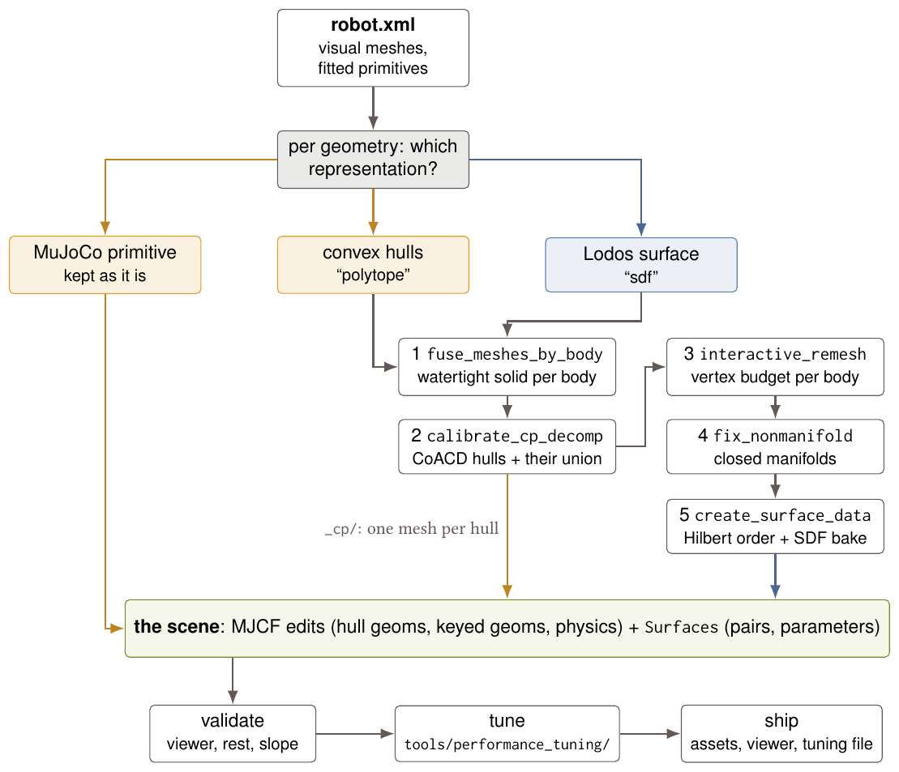

# Lodos v2: Creating a Simulation from an MJCF

*From a MuJoCo model to a scene Lodos simulates: geometry, assets, physics, validation and shipping*

The code as of 2026-11-04. A how-to guide on top of the two manuals, *Collision Detection* (`docs/collision_detection.pdf`) and *Contact Dynamics* (`docs/contact_dynamics.pdf`), which hold the theory. Its sequel, *Performance Tuning* (`docs/performance_tuning.pdf`), makes the scene fast. Built from `docs/manual/`.

**About this document.** You have a robot or an object as a MuJoCo model, an MJCF file, and want to simulate it in Lodos v2: thousands of worlds at once on one GPU, with its contacts found by either of Lodos's two collision pipelines and resolved by its contact solver, the NLSP solver: MJWarp's constraint solve over every contact. MuJoCo Warp's (MJWarp's) collision pipeline and constraint solve are Lodos's own code, adapted from MuJoCo Warp 3.14.0 (`lodos.col.prim`, `lodos.cd.solver`): MJWarp is not a dependency. This guide goes through every decision and step on the way.

- which representation each geometry should have;
- how a mesh becomes convex hulls or a Lodos surface, step by step through `tools/mesh_processing/`;
- how the hulls and the surfaces go into the scene;
- which of the MJCF's physics carries over and which must change;
- how to check the result and how to ship it.

It ends with one example done end to end: the SHARPA hand holding an armadillo, ported from the in-hand reorientation task of Lodos-v1 (`papers/lodos_v1.pdf`). That scene is in the live viewer as `sharpa_armadillo_sdf` and `sharpa_armadillo_polytope`. Like the manuals, the guide is written for a person and for an agent alike. Every option is named as the code names it, and every number not cited from Lodos-v1 was measured in this repository.

**Contents**

- [1 The path in one page](#1-the-path-in-one-page)
- [2 Deciding each geometry's representation](#2-deciding-each-geometrys-representation)
  - [2.1 The three choices](#21-the-three-choices)
  - [2.2 How to decide](#22-how-to-decide)
- [3 Installing what the pipeline needs](#3-installing-what-the-pipeline-needs)
- [4 The mesh pipeline](#4-the-mesh-pipeline)
  - [4.1 Step 1: watertight solids](#41-step-1-watertight-solids)
  - [4.2 Step 2: convex hulls](#42-step-2-convex-hulls)
  - [4.3 Step 3: the vertex budget](#43-step-3-the-vertex-budget)
  - [4.4 Step 4: closed manifolds](#44-step-4-closed-manifolds)
  - [4.5 Step 5: the bake](#45-step-5-the-bake)
  - [4.6 Records, and what they are for](#46-records-and-what-they-are-for)
  - [4.7 Other ways to make a surface](#47-other-ways-to-make-a-surface)
- [5 Convex hulls in the MJCF](#5-convex-hulls-in-the-mjcf)
- [6 Lodos surfaces in the scene](#6-lodos-surfaces-in-the-scene)
  - [6.1 The keyed geom](#61-the-keyed-geom)
  - [6.2 Pairs](#62-pairs)
  - [6.3 Parameters](#63-parameters)
  - [6.4 In Python, or in the MJCF file](#64-in-python-or-in-the-mjcf-file)
- [7 Physics: what carries over from the MJCF](#7-physics-what-carries-over-from-the-mjcf)
  - [7.1 What `lodos.rbd` takes](#71-what-lodosrbd-takes)
  - [7.2 The timestep](#72-the-timestep)
  - [7.3 Friction, impedance and the cone](#73-friction-impedance-and-the-cone)
  - [7.4 Actuators](#74-actuators)
  - [7.5 Joint limits and friction loss](#75-joint-limits-and-friction-loss)
  - [7.6 Choosing a mode, and resting contacts](#76-choosing-a-mode-and-resting-contacts)
- [8 Validating the scene](#8-validating-the-scene)
  - [8.1 In the viewer](#81-in-the-viewer)
  - [8.2 The checks](#82-the-checks)
- [9 Tuning and shipping](#9-tuning-and-shipping)
  - [9.1 A first tuning pass](#91-a-first-tuning-pass)
  - [9.2 Assets](#92-assets)
  - [9.3 In the viewer](#93-in-the-viewer)
- [10 Worked example: the SHARPA hand holding an armadillo](#10-worked-example-the-sharpa-hand-holding-an-armadillo)
  - [10.1 The hand's geometry, step by step](#101-the-hands-geometry-step-by-step)
  - [10.2 The armadillo: a bake reused at another scale](#102-the-armadillo-a-bake-reused-at-another-scale)
  - [10.3 Assembling the scene](#103-assembling-the-scene)
  - [10.4 Validation](#104-validation)
  - [10.5 Tuning](#105-tuning)
  - [10.6 What went wrong on the way](#106-what-went-wrong-on-the-way)
- [11 Troubleshooting](#11-troubleshooting)

## 1 The path in one page

Figure 1 is the whole path, and Table 1 the same as a checklist. The geometry is most of the work and most of the decisions.



*Figure 1: From an MJCF to a shipped scene. Each geometry is decided once: a MuJoCo primitive stays, a mesh becomes convex hulls (“polytope”, collided by MJWarp's pipeline) or a Lodos surface (“sdf”, a vertex set with a baked signed distance field). The hulls fall out of step 2 of the mesh pipeline, and the surfaces out of step 5.*

**Table 1: The checklist. Each line is a section of this guide.**

|  | what | where |
|---|---|---|
| 1 | Check that `lodos.rbd` takes the model's dynamics; change what it refuses | [Section 7](#7-physics-what-carries-over-from-the-mjcf) |
| 2 | Decide each geometry's representation: primitive, convex hulls, or Lodos surface | [Section 2](#2-deciding-each-geometrys-representation) |
| 3 | Install the mesh tools the decision needs | [Section 3](#3-installing-what-the-pipeline-needs) |
| 4 | Run the mesh pipeline: watertight solids, hulls, remesh, repair, bake | [Section 4](#4-the-mesh-pipeline) |
| 5 | Put the hulls into the MJCF | [Section 5](#5-convex-hulls-in-the-mjcf) |
| 6 | Key the surfaces to MJCF geoms; declare the pairs and their parameters | [Section 6](#6-lodos-surfaces-in-the-scene) |
| 7 | Set the timestep, friction, actuators and joint constraints for Lodos | [Section 7](#7-physics-what-carries-over-from-the-mjcf) |
| 8 | Validate: placement, rest, friction, capacities, the viewer | [Section 8](#8-validating-the-scene) |
| 9 | Tune it (the companion guide) and ship it: assets, viewer | [Section 9](#9-tuning-and-shipping) |

A scene in Lodos v2 is an MJCF model plus, optionally, a list of Lodos surfaces (`lodos.sim.Surfaces`), built by `lodos.sim.make_sim(mjm, B, surfaces=...)`. The collision manual's Section 3, *Describing a scene*, is the reference for that call.

- Every MJCF geom that can collide, and is not keyed to a surface, collides through MJWarp's pipeline (`lodos.col.prim`): MuJoCo's primitives through MJWarp's narrowphases, convex meshes and boxes through the exact hull narrowphase (the *hybrid*).
- Every surface collides through Lodos's vertex–SDF pipeline, in the directional pairs you declare.
- The two never collide with each other.
- Both pipelines' contacts go to one solver, MJWarp's constraint solve: Lodos's are exported into MJWarp's contact arrays after MJWarp's own. So `make_sim`'s MJWarp capacities, `nconmax` and `njmax`, must hold Lodos's contacts as well: sized for the MJCF alone, as MJWarp's defaults are, they can drop Lodos's contacts without a word ([Section 8.2](#82-the-checks)).

## 2 Deciding each geometry's representation

### 2.1 The three choices

**Table 2: What each representation is, collides with, costs and gets wrong.**

|  | MuJoCo primitive | convex hulls (“polytope”) | Lodos surface (“sdf”) |
|---|---|---|---|
| what | sphere, capsule, ellipsoid, cylinder, box, plane | one MJCF mesh geom per convex piece; a box is one | surface vertices plus an SDF baked on a voxel grid, in the body's frame |
| collided by | MJWarp's narrowphases | the hybrid: GJK, EPA and a manifold of up to 4 points, on exact supports | Lodos's cascade: box, tile, voxel SDF, spline SDF |
| represents | its exact shape | a convex decomposition: concave regions only to the decomposition's tolerance | any closed surface; concavities, thin features to the voxel size |
| contacts | MuJoCo's | up to 4 per hull pair | one per penetrating vertex |
| cost grows with | pairs | hull pairs in contact (and broadphase pairs) | vertices of the vertex side, before the filters; contacts after |
| cannot see | – | – | edge–edge contact between two coarse surfaces; a feature finer than the vertex spacing |

Table 2 compares the three.

- **Keep the primitives** the MJCF already uses for what they fit well: a floor plane, walls as boxes, a ball. They are the cheapest and they are exact.
- **Convex hulls** are MuJoCo's own way of colliding a mesh: a mesh geom collides as its convex hull, so a concave part needs a decomposition into several. The hybrid finds the true penetration depth of each hull pair, and reports a manifold of up to four points.
- **A Lodos surface** represents the concave shape itself, with no decomposition, and finds one contact per penetrating vertex. Its accuracy and its cost are both set by how many vertices it has and how they are spaced. How it works, and why a vertex–SDF pair cannot see edge–edge contact, is in the collision manual's Sections 4–5.

### 2.2 How to decide

- **A concave part that touches others over a wide area** (a hand's palm and fingers on an object, a nut on a bolt): a Lodos surface. A convex decomposition of a thread is thousands of hulls. The nut-bolt ships only as surfaces.
- **Boxes, cards, stones, anything whose contacts are edges and corners against faces**: hulls or boxes. A vertex–SDF contact needs a vertex where the contact is, so two coarsely sampled boxes can pass edge through edge. The shipped box and card surfaces are lattice-sampled over their faces, so that a face resting on a face has vertices across it (`tools/mesh_processing/scene_surfaces.py`).
- **Fast, many objects, rough shapes**: hulls with a small hull count, or surfaces with a small vertex budget. Which is faster depends on the scene. The performance guide measures both on every built-in scene that ships in both representations, as most do.
- **Both pipelines in one scene** is allowed and common: the mixed scenes (`arm_box_6`, `arm_box_20`) hold armadillos as surfaces and cubes as MJCF boxes. Only pairs within one pipeline collide. A body that must touch both kinds carries both representations: its surface keyed to one geom, and its hulls as further geoms with `mass="0"`.
- **Floors.** One MJCF plane serves both pipelines when a `PlaneSurface` is keyed to it: it stays a plane in MJWarp's collision, and every surface you pair with it collides against it.

> **Decide per geometry, not per scene.** The built-in scenes each ship in both representations because they are comparisons. A model you build for use needs only the representation that serves it, and mixing is free. The SHARPA hand's surfaces were made because its links meet the object over curved areas. A fingertip is 97 vertices, and the whole hand 3 479.

## 3 Installing what the pipeline needs

Running a simulation needs none of what follows. Lodos's own environment (`uv sync`) already carries the `mesh` group: `trimesh`, `torch` (CPU, for the Hilbert ordering) and `pyvista`. That is enough for steps 3–5 of the pipeline. Steps 1 and 2 need more:

**Table 3: What each step of `tools/mesh_processing/` needs beyond Lodos's environment.**

| step | needs | how |
|---|---|---|
| 1 | `scikit-image`; CGAL | `uv pip install scikit-image`. CGAL's newest wheel is for CPython 3.12, so on Lodos's 3.14 it cannot load, and step 1 wraps every body: run step 1 from a 3.12 environment with CGAL in `tools/mesh_processing/.pylibs` |
| 2 | PaMO; CoACD; `manifold3d` | PaMO runs from its container: `singularity pull tools/mesh_processing/.pamo.sif docker://sarahwei0210/pamo:0.0.2` (about 10 GB; AGPL-3.0, so its output meshes are kept and none of its code is linked). `uv pip install coacd manifold3d`: CoACD 1.0.14 installs on 3.14; `manifold3d` is `trimesh`'s boolean engine for the union |
| 3, 4 | Instant Meshes | a pre-built binary from its README, saved as `tools/mesh_processing/.instant-meshes` |
| 5 | the GPU | Warp's mesh query signs the field; minutes for a hand on an RTX 4080 |

> **There is no extra for steps 1 and 2.** `pyproject.toml`'s extras are `vis`, `mesh`, `notebooks` and `test`, and none holds what steps 1 and 2 need: install the packages above by hand.

## 4 The mesh pipeline

`tools/mesh_processing/` turns a model's meshes into hulls and surfaces in five steps, one script each (Table 4).

- Each step takes its input positionally and names its output by appending a suffix, so a directory's name is the record of how it was made: `robot.xml` $\to$ `robot_wt/` $\to$ `robot_wt_cp/` and `robot_wt_cp_fused/` $\to$ `..._im/` $\to$ `..._im_man/` $\to$ `..._im_man_sdata/`.
- `run_pipeline.py robot.xml` runs all five, and `--from N`/`--to N` resumes the chain anywhere. `--replay DIR` runs it without a window, steps 2 and 3 from the choices a previous run recorded in `DIR` (Sections [4.2](#42-step-2-convex-hulls) and [4.3](#43-step-3-the-vertex-budget)).
- Steps 1–4 write each body in its body frame, the frame a collision geometry has to be authored in, and again in world frame at `qpos0` (`<dir>_world/`) for viewing the assembled model. Step 5 writes body frame only.
- Every step writes a record, a JSON list with one row per body. Step 5 copies the earlier steps' records beside the bakes ([Section 4.6](#46-records-and-what-they-are-for)).

Each script's docstring and `--help` document its options; this section is about the decisions.

**Table 4: The five steps. “Choose” is the decision a step asks of you; steps 2 and 3 ask it in a window and wait.**

|  | script | does | choose |
|---|---|---|---|
| 1 | `fuse_meshes_by_body.py` | merges each body's meshes into its frame; makes each one watertight solid (winding number, then CGAL's alpha wrap) | `--geoms` (`visual`, `collision`, `all`), `--alpha`, `--voxel` |
| 2 | `calibrate_cp_decomp.py` | decimates (PaMO), decomposes with CoACD, writes the hulls (`_cp/`) and their dilated union (`_cp_fused/`) | a threshold and hull cap per body |
| 3 | `interactive_remesh.py` | isotropic remesh with Instant Meshes to a vertex target per body | the vertex target per body |
| 4 | `fix_nonmanifold_meshes.py` | removes duplicate-face flaps; re-remeshes at the nearest target that comes out a closed manifold | – |
| 5 | `create_surface_data.py` | Hilbert-orders the vertices and bakes the SDF; copies the records beside the bakes | `--voxels`, `--dilation` |

### 4.1 Step 1: watertight solids

The input is the MJCF, because which mesh belongs to which body is stated there and nowhere else. MuJoCo's compiler recentres every mesh on its inertial frame and folds the correction into the geom's pose, so a body's meshes come back in its frame exactly. Merging is concatenation, not a boolean union.

The solid comes from two passes that fail in opposite directions:

- the generalized winding number [1] decides which solid a soup of open sheets bounds;
- CGAL's alpha wrap [2] closes the result into one manifold shell.

The wrap alone tunnels through holes larger than its alpha. Handed a solid that is already closed, it cannot.

- **Choose `–geoms`.** Use `visual` (the default) when the model's collision geoms are hand-fitted primitives, as MuJoCo models usually ship them. Use `collision` when its collision meshes are the shape you want.
- **Judge it** by the record `fuse_meshes_by_body.json`: per body, watertight, the number of shells, the genus and the volume, and whether the winding-number pass was needed. On the SHARPA hand, 11 of the 23 merged bodies were open.

### 4.2 Step 2: convex hulls

PaMO [5] first decimates the watertight solids while keeping them intersection-free: the hand's 525 241 vertices become 5 175, since CoACD's cost grows with its input. The result is cached in `tools/mesh_processing/.tmp/`. CoACD [3] then decomposes every body, and a window opens with a threshold slider and a hull cap per body.

- **The threshold is CoACD's concavity tolerance**: lower means more hulls and a closer fit. A threshold does not mean the same thing on every body. On the SHARPA hand the chosen ones run from 0.075 to 0.622, for 1 to 24 hulls per body and 87 in all.
- **A hull is a contact candidate at every step, for every pair it can meet**, so the hull count is this representation's cost. Choose the coarsest decomposition that keeps the surfaces that will touch something.
- The step writes the hulls, one directory of `hull_*.obj` per body (`_cp/`), which are the polytope representation. It also writes their boolean union, one solid per body (`_cp_fused/`), which is what the surface pipeline continues from. Each hull is first scaled by `--dilate` (1.0005) about its centroid. CoACD's hulls meet face to face with zero-thickness interfaces, so the union needs the overlap; it costs 0.1 % of volume.
- **CoACD is not reproducible at a fixed seed**: three runs of one input gave 74, 76 and 78 hulls. So the meshes are the record, not the settings.

`--choices FILE` starts each body from the threshold and cap a previous run chose (its `calibrate_cp_decomp.json`), and `--no-view` decomposes at those settings, writes and exits. That recovers a decomposition's settings and, within a few percent, its hull counts.

### 4.3 Step 3: the vertex budget

**This is the step that sets a surface's cost and its resolution.** Each vertex is a contact candidate in every pair where the surface supplies vertices, and the spacing between vertices is the finest feature a contact can follow. Instant Meshes [4] remeshes each body to a target vertex count with triangles of nearly equal size: on the hand the edge length varies by a coefficient of 0.07–0.27, where quadric collapse gives 0.48.

- **Choose a target per body** with the slider, which is logarithmic because useful targets span two decades: the hand's run from 84 vertices (a phalanx) to 898 (the palm). The starting values come from `--spacing` (5.6 mm between vertices), which is a good first guess. Lower a body's target while its shape holds, and keep the vertices dense where contacts are made: fingertips sample their surfaces about twice as finely as the palm.
- **Read the topology tag** on each row. Instant Meshes guarantees no topology, and the result is not monotone in the target: a body can be clean at 100 vertices, pinched at 105 and holed at 110.

  - `open Ne` is a hole: the target is too low.
  - `nonman Ne` and `N dup f` are self-touching sheets and flaps. Step 4 repairs them.
- **Nothing is written on closing the window**; `Export` writes. The sliders start from `--spacing`, so writing on close would overwrite hand-chosen targets with the defaults.

`--targets FILE` starts from a previous run's targets (its `interactive_remesh.json`), and `--no-view` remeshes, writes and exits. Instant Meshes is deterministic: replaying the original SHARPA targets this way reproduces its 3 481 vertices exactly ([Section 10](#10-worked-example-the-sharpa-hand-holding-an-armadillo)).

### 4.4 Step 4: closed manifolds

No choices, and no window needed (`--no-view`).

1. First it deletes every copy of a repeated face, which leaves the volume identical and moves no surviving vertex.
2. Where a genuine bowtie remains, two sheets crossing at an edge, it remeshes again from step 3's input, at the nearest target that comes out a closed manifold: $+1, -1, +2, -2, \ldots$ vertices away.

On the SHARPA hand, 18 bodies were already clean, 4 were fixed by surgery and 1 was re-remeshed: its first target, one vertex below its 105, came out a closed manifold of 101. A surface that only ever supplies vertices to an asymmetric pair does not need to be closed: no field is baked from it.

### 4.5 Step 5: the bake

`notebooks/05_make_a_surface.ipynb` walks through this bake for one mesh, stage by stage: the curve order, the grid, the fit, checks of the field against the mesh, the file, and the surface in a scene.

- **The reorder.** `lodos.col.sdf.io.process_mesh` sorts each body's vertices along a Hilbert curve and renumbers the faces. It is a permutation, and it is what makes Lodos's tiles tight: a run of 8 consecutive vertices is a compact cluster (collision manual, *Tiles*).
- **The grid.** The bake samples the SDF on a voxel grid over the mesh's box, dilated `--dilation` times (2) about its centre so that the field has an outside, with `--voxels` cells (100) along the longest edge.

  - The voxel size $h$ is the field's resolution. On the hand it runs from 0.43 mm on a phalanx to 2.15 mm on the palm.
  - The grid is memory, 4 bytes per voxel and per spline coefficient: 1.7–4.8 MB a surface on the hand, 67.8 MB for all 23.
  - A shape thinner than about two voxels needs its own grid. A 4 cm card under the default grid has no negative interior; `scene_surfaces.py` gives each such shape its own.
- **The fit.** A tricubic B-spline fitted to the knot samples, plus the voxel-centre distances that Lodos's prefilter reads. The record's `sdf_error_h` is the spline's mean $\lvert\mathrm{sdf}\rvert$ on the mesh's own vertices in voxels, the bake's error: 0.05–0.11 on the hand.
- **One bake, two fields.** `"cubic"` ($S_{\mathrm{c2}}$, the default) and `"linear"` ($S_{\mathrm{c0}}$) are evaluations of the same knot samples, chosen when a surface is loaded (`load_surface(..., spline_type=...)`), not when it is baked. `linear` is cheaper per contact, with C$^0$ normals; the nut-bolt ships both.

A bake already beside the input is reused, so a second run opens in seconds. `--rebake` is needed after changing `--voxels`, `--dilation`, `--depth` or `--encoding`.

### 4.6 Records, and what they are for

Each step's record is a list of rows, one per body. Step 5 copies the earlier steps' records beside the bakes:

- `fuse_meshes_by_body.json`: watertightness, shells, volume;
- `calibrate_cp_decomp.json`: threshold, hull cap, hulls;
- `interactive_remesh.json`: target, vertices, topology;
- `fix_nonmanifold_meshes.json`: the repair applied;
- `create_surface_data.json`: vertices, grid, voxel size, bake error and the bake settings.

A surface installed anywhere then carries how it was made. `lodos.utils.tuning.surface_fingerprint` reads each body's rows from them into a tuning file. The vertex budget is the largest single lever on what a surface costs to collide, so a tuning file records the budget its capacities were measured at, and a re-baked surface makes the file stale (performance guide, *The tuning file*). The shipped SHARPA bakes carry the records of the run that made them in `viewer/assets/sharpa/final_sdata/`.

### 4.7 Other ways to make a surface

- **Primitive shapes** (boxes, cards, spheres, the arch's stones): `tools/mesh_processing/scene_surfaces.py` samples their faces directly (a lattice on a box's faces, a subdivided icosphere), bakes them and installs them as `viewer/assets/surfaces/<name>/`.
- **The same shape at another size**: `lodos.col.sdf.scale_surface(surf, scale, shift)` rescales a loaded bake in place, with no re-bake: vertices, box, grid, spline coefficients, voxel distances and inner spheres. Everything in a bake is a length or a field of lengths, and $\mathrm{sdf}'(kx + c) = k\,\mathrm{sdf}(x)$ holds to $1.7\cdot10^{-8}$ m. The keyed MJCF mesh then takes the same `scale` ([Section 6.1](#61-the-keyed-geom)). The worked example's 70 mm armadillo is the shipped 1.64 m bake scaled.
- **CAD with thin threads** (the nut-bolt): `tools/mesh_processing/nutbolt/` repairs the tessellation's T-junctions, remeshes at a fixed edge length and reprojects onto the original, then bakes the remesh's vertices against the original's own SDF at $h$ = 0.2 mm.
- **Inner spheres** for deep penetration: `tools/mesh_processing/pack_spheres.py` packs them from the bake's interior voxels into `spheres.npz` beside the bake. `lodos.col.sdf.load_surface_data` reads them; `load_surface_file`, and the scenes' `load_surface` through it, drops them: a sphere collides earlier than the mesh would, and every shipped timing is without them.

## 5 Convex hulls in the MJCF

The polytope representation is MJCF only. Each body gets one mesh geom per hull of its `_cp/<body>/`, and nothing else changes. The SHARPA scenes do it in code (`viewer.scenes.sharpa.scene_xml`): the menagerie's collision geoms are removed and the hull geoms added in their place.

```xml
<asset>
  <mesh name="right_index_DP_cp0" file="right_cp/right_index_DP/hull_000.obj"/>
</asset>
<body name="right_index_DP" ...>
  <geom name="right_index_DP_cp0" mesh="right_index_DP_cp0" class="elastomer_collision" friction="0.6"/>
</body>
```

- **Inertia.** By default MuJoCo computes a body's inertia from all its geoms, and a decomposition is not the shape's exact volume: each hull also fills its piece's concavities, and on the SHARPA hand the hulls hold 10 % more than the solids CoACD decomposed. Give the hull geoms `mass="0"`, or the body an explicit `<inertial>`, when the inertia should come from elsewhere. The worked example's armadillo takes its 49 g from the pieces at the original's density in both representations, as an explicit `<inertial>` (`sharpa_armadillo.armadillo_inertial`).
- **Which pairs collide** is MuJoCo's rule: `contype`/`conaffinity` bits, no pairs within a welded body or between a parent and its child, and the `<exclude>`s. The worked example's floor has `contype="2" conaffinity="2"`, so it meets the armadillo's pieces (`conaffinity="2"`) and never the hand's.
- **Inline meshes.** A hull can be given by its vertices alone, `<mesh name="p0" vertex="x y z ..."/>`, and MuJoCo takes the convex hull. The armadillo's 34 pieces are written this way after scaling. Write vertices with enough decimals: at 70 mm, five decimals of a metre is 0.01 mm of noise per vertex.
- **What the hybrid refuses.** The exact hull narrowphase takes box–box, box–mesh, mesh–mesh and plane–mesh pairs, and `PrimCollision` (`lodos.col.prim.driver`) refuses a model it does not support:

  - a nonzero `margin` or `gap` on a geom of those types;
  - any explicit `<pair>`;
  - SDF geoms, flexes, or MuJoCo's native CCD switched off;
  - box sizes that differ between worlds.

  Such a model runs with `make_sim(hybrid=())`, MJWarp's own narrowphases throughout.
- **Capacities.** The contacts and the broadphase's candidate pairs share MJWarp's `naconmax` arrays. A scene of many hulls has far more overlapping boxes than contacts. Size them with the tuning tools, not by contacts alone (performance guide, *Capacities*).

## 6 Lodos surfaces in the scene

### 6.1 The keyed geom

Each surface is keyed to one MJCF geom. That geom puts the surface on its body, gives MuJoCo the body's inertia, and is what the viewer draws, so its pose on the body is the surface's frame. `make_sim` switches every keyed geom off in MJWarp's collision (except a plane), so the geom itself never collides. Two ways to key:

- **The surface's own mesh**, placed with no offset: `viewer.scenes.assets.surface_obj(name)` writes a shipped surface's vertices and faces as an OBJ, cached (`lodos.col.sdf.write_surface_obj` writes any loaded surface's), and MuJoCo takes the inertia from it. This is what the drop scenes do:

  ```xml
  <asset><mesh name="arm" file="/path/to/.scratch/surface_obj/armadillo_surface.obj"/></asset>
  <body name="a0" pos="0 0 1.5"><freejoint/><geom name="a0" type="mesh" mesh="arm" density="100"/></body>
  ```

  A scaled surface keeps the same OBJ with `scale="k k k"` on the `<mesh>`, and its shift as the geom's `pos`. MuJoCo's default mesh inertia, `inertia="legacy"`, overestimates a closed mesh that is not convex: the armadillo above weighs 48.8 kg at density 100 under it, against 35.4 kg with `<mesh inertia="exact">`, which notebook 05 uses. The built-in scenes that take an armadillo's inertia from its surface, the drops and the mixed piles, keep the default.
- **A placeholder**, when the inertia comes from elsewhere. The SHARPA links are keyed to a 1 mm sphere, `contype="0" conaffinity="0" mass="0" group="5"`, and their inertia stays the menagerie's.

> **Units.** Everything is SI, as MuJoCo's is: metres, kilograms, seconds. A model authored in millimetres needs its meshes scaled (`<mesh scale="0.001 0.001 0.001">`) before step 1, and a surface baked at the wrong scale is rescaled with `scale_surface` ([Section 4.7](#47-other-ways-to-make-a-surface)), never by editing the grid.

> **The surface must be in its body's frame.** A surface's vertices and field are stored in its body's frame, and the simulator supplies the body's pose and nothing else. The pipeline writes body frame for exactly this reason. A surface baked in world frame collides where the world-frame mesh was at `qpos0`, carried along by the body: the error looks plausible.

### 6.2 Pairs

A Lodos pair is directional: `[vertex surface, SDF surface]` finds the vertices of the first inside the field of the second.

- **Which side supplies the vertices.** The more densely sampled side, and the side with the finer features. A vertex can be no finer than the spacing, and a field no finer than its voxels. The SHARPA scenes give each hand pair to the link whose surface has more vertices per unit area (`sharpa._density`). The armadillo is always the SDF side against the hand's links: its 451 vertices span 70 mm, coarser than a fingertip's.
- **Both directions** of an interface are two declared pairs, `(a, b)` and `(b, a)`, each finding its own contacts. The drop scenes declare every ordered pair of armadillos. The cost doubles, and the contacts the second direction adds are those where $a$'s field is the finer.
- **Within one articulated body**, pair what MuJoCo would collide: not two links welded together, not a parent and its child after welding, nothing an `<exclude>` names. `viewer.scenes.sharpa.collides(mjm, body_a, body_b)` is that test: 225 pairs on one hand.
- **Floors and walls**: every surface that can reach a `PlaneSurface` is paired with it, surface first. A plane has no vertices and can only be the SDF side.
- **Declare no pair that cannot touch.** Every pair costs its box test at every step, and a pair whose bodies overlap at rest (a knuckle's two links) collides at rest.

### 6.3 Parameters

Every Lodos pair has a row of 13 parameters: friction $\mu$, a spring-damper force law (stiffness, sharpness, dissipation, stiction) by which contact groups weigh their members, MuJoCo's solref and solimp (read only under `mode="mj"`), and an unused $w$ (collision manual, *Contact parameters*).

- `Surfaces(params=None, mu=...)` gives every pair the defaults with friction `mu`. Pass a `(len(pairs), 13)` array for per-pair values: `lodos.sim.default_pair_params(mu, n)` returns the default rows to edit.
- Under the exact mode, the default, the solver reads $\mu$ alone, and with contact groups the four spring-damper columns too.
- MJWarp's own contacts take their parameters from the MJCF.

### 6.4 In Python, or in the MJCF file

**In Python.** This gives full control, and is what the built-in scenes do. A scene module in `viewer/scenes/` typically has three functions: `scene_xml(...)` returns the MJCF text, `surfaces(mjm, ...)` returns the `Surfaces`, and `build(...)` returns a `Sim`. `viewer/scenes/sharpa_armadillo.py` is the worked example's, 234 lines.

**In the MJCF file.** This needs no code. The viewer and `viewer.scenes.catalog.from_mjcf` read custom text fields named after the keyed geom:

```xml
<custom>
  <text name="lodos:arm0" data="armadillo"/>             <!-- a shipped surface -->
  <text name="lodos:shell" data="bake/surface_data.npz"/>  <!-- a bake, relative to the file -->
  <text name="lodos:floor" data="plane"/>                  <!-- a PlaneSurface on this plane -->
  <numeric name="lodos:mu" data="0.8"/>
</custom>
```

The pairs are then every ordered pair of surfaces on different bodies, plus every surface against every plane, all with the one set of parameters (`lodos:mu`, and `lodos:stiffness` and `lodos:dissipation` for contact groups). A file that names no friction cone is loaded with the elliptic one ([Section 7.3](#73-friction-impedance-and-the-cone)). That suits piles of objects. It does not suit an articulated hand, whose pairs need the filter of [Section 6.2](#62-pairs) and a direction each.

## 7 Physics: what carries over from the MJCF

### 7.1 What `lodos.rbd` takes

Lodos does its own rigid-body dynamics on the device (`lodos.rbd`), from the MJCF's model, and refuses what it does not implement rather than ignoring it.

- **It takes:**

  - free, ball, slide and hinge joints;
  - joint springs, damping, armature and gravity compensation;
  - actuators with joint, joint-in-parent or site transmissions, with fixed or affine gain and bias and the simple activation dynamics;
  - semi-implicit Euler or MuJoCo's `implicitfast` integration (`make_sim(integrator=...)`, `"euler"` or `"implicitfast"`, overrides the MJCF's).
- **It refuses** (`NotImplementedError`, naming what it found):

  - tendons, equality constraints, flexes and mocap bodies;
  - any integrator but `Euler` and `implicitfast`;
  - fluid forces;
  - other actuator transmissions, gains, biases or dynamics;
  - `actearly`;
  - kinematic trees more than 128 dofs wide.

Joint limits and dof friction loss are not `lodos.rbd`'s: they are constraints of the contact solve ([Section 7.5](#75-joint-limits-and-friction-loss)). So the usual port of a MuJoCo model has these edits:

1. `<option integrator="Euler" cone="elliptic"/>` (or `"implicitfast"`) and a timestep the contacts can take (Sections [7.2](#72-the-timestep) and [7.3](#73-friction-impedance-and-the-cone));
2. mocap bodies (goal markers, targets) removed or turned into fixed bodies;
3. equality constraints and tendons removed, or their effect rebuilt from joints and actuators;
4. the `<keyframe>`s checked against the edited model's `nq` and `nu`.

### 7.2 The timestep

Lodos's contacts are resolved once per step. A timestep an MPC model ran at under MuJoCo's implicit integrator is usually too long.

- The worked example's original ran at 10 ms with `implicitfast` on the pyramidal cone.
- Under Lodos-v1 (`papers/lodos_v1.pdf`), with its spring-damper contact model at the default stiffness, the 49 g object's grasp went to NaN at 10 ms and sank 22 mm in 2 s at 5 ms.
- 2 ms holds. The drops, the hand piles and the worked example step at 2 ms, the nut-bolts at 1/480 s and the NIST threading replay at 1/800 s; the exactness scenes, ported from the FBF paper, at its 1/60 s, and 1/240 s for the cards and the arch.

Start at 2 ms and lengthen it only after the rest and grasp checks of [Section 8](#8-validating-the-scene) pass at the longer step.

### 7.3 Friction, impedance and the cone

- **The cone.** The exact mode solves on the elliptic cone whatever the MJCF says: `make_sim` sets it on its copy of the model. The mj mode at its defaults, with no proximal loop and no de Saxcé term, takes the model's cone: `make_sim` keeps a compiled model's, MuJoCo's default pyramidal unless the MJCF says `cone="elliptic"`. The viewer and the tuning tools load an MJCF file that names no cone, in it or in a file it includes, with the elliptic one (`viewer.scenes.catalog.from_mjcf`), as every built-in scene names it. Say `cone="elliptic"`, so that both modes solve on the same cone wherever the model is built.
- **`impratio`** is forced to 1 by `make_sim` under the exact mode, the default, and no solref or solimp reaches it (contact dynamics manual, *The impedance rule*). An MJCF `impratio="10"` does nothing there and is harmless. Under `mode="mj"`, MuJoCo's soft rows, it is read.
- **Friction** of a Lodos pair is its row's $\mu$. Of an MJWarp contact it is MuJoCo's maximum over the two geoms. Set them to agree when a body is in both pipelines; the worked example uses $\mu$ = 0.6 on every pair of both representations.

### 7.4 Actuators

Position servos are the common case. A `<position kp=... kv=...>` actuator, or the equivalent `<general>` with `biastype="affine"`, carries over as written.

> **A positive third bias parameter is a damping ratio.** The menagerie writes its servos as `<general gainprm="kp" biasprm="0 -kp 0.9" .../>`. MuJoCo reads a positive `biasprm[2]` on a position-like actuator as a damping ratio and compiles it into the velocity gain from the stiffness and the joint's inertia. Scaling `kp` without recompiling therefore scales the damping too. `viewer.scenes.sharpa.scene_xml(kp_scale=...)` softens the dropped hands' servos by scaling `gainprm[0]` and `biasprm[1]` in the XML, so that MuJoCo recompiles the damping.

- **A control held for the whole run** (a grasp): `lodos.rbd.io.set_state(sim.drbd, ctrl=...)` with a `(B, nu)` array. A scene in the viewer holds one through `SceneSource.ctrl`.
- **A control that changes**: write `sim.drbd.ctrl` between steps. It is a device array, so a captured step graph reads the new values. A scene in the viewer changes it through `SceneSource.controls`, and plays a recording through `RecordedControls`, which an MJCF file names by `lodos:controls`.
- Controls are clamped to `ctrlrange` unless the model disables clamping.

### 7.5 Joint limits and friction loss

Joint limits and dof friction loss are constraints, solved with the contacts: MJWarp builds them as MuJoCo's soft constraint rows, under either mode.

- `make_sim(joint_constraints=True)`, the default, keeps them.
- `joint_constraints=False` takes them out of the model: a limited joint turns freely, and a joint with friction loss slides without it.
- The SHARPA scene modules (`sharpa`, `sharpa_armadillo`) remove them from the MJCF unless `jlimit=True`. The viewer's SHARPA piles pass it; its `sharpa_armadillo` scenes do not.

A soft finger without limits bends backwards past its range under load: up to 0.74 rad in the five-hand pile at a tenth of the servos' stiffness.

### 7.6 Choosing a mode, and resting contacts

There is one solver, MJWarp's constraint solve over every contact; what you choose is its mode (`solver_kwargs=dict(mode=...)`), and the contact dynamics manual is the reference. In short:

- `"exact"`, the default, solves the exact contact problem, with no MuJoCo impedance, by MJWarp's Newton inside a proximal loop. It holds a grasp and brings a pile to rest.
- `"mj"` solves MuJoCo's soft problem by MJWarp's Newton, with no proximal loop: about three times the exact mode's throughput on the nut-bolt (contact dynamics manual, *Newton's nut-bolt*). Its contacts are soft, and creep: 1 mm/s down the contact dynamics manual's slope at the pairs' default solref and solimp, where the exact mode holds.
- Contact groups (`groups="ray"` or `"cone"`) solve each pair's contacts in a few groups rather than one by one: fewer rows and a faster solve on the piles, and another problem. Check a scene's own behaviour under them before relying on them (performance guide, *The solver: budgets and accuracy*).

`baumgarte_slop` (the exact mode's, 0.2 mm by default, `lodos.cd.driver.BAUMGARTE_SLOP`) leaves a resting penetration that small alone, which is what stops a resting contact from flickering in and out of existence.

## 8 Validating the scene

### 8.1 In the viewer

```python
python -m viewer                                # then a built-in scene or a file, from the Scene panel
python -m viewer path/to/scene.xml              # an MJCF with lodos: annotations
python -m viewer path/to/scene.xml --sim mjwarp # the same scene under Newton's MuJoCo Warp
```

- **Geometries** shows each representation (surfaces, hulls, keyed geoms) and draws each where MuJoCo puts it.
- **Overlays** shows contacts, normals and forces per pipeline.
- **State** edits any joint by gizmo or by value.
- **Sim** switches the sim from the frame on screen: Lodos, and, where `viewer/newton/`'s environment is installed, Newton's MuJoCo Warp (`mjwarp`) and Kamino (`kamino`), which collide each Lodos surface as its mesh with Newton's own SDF. Under Lodos it sets the solver's options, the mode among them, so one scene can be compared under both modes and against Newton's sims.
- **Performance** reads the state on screen against the viewer's capacities and runs the tuning tools in the background (performance guide, *In the live viewer*).

The viewer runs one world. A scene that misbehaves there misbehaves batched. *The Live Viewer* (`docs/visualizer.pdf`) is its manual.

### 8.2 The checks

**Table 5: What to check before trusting a new scene, and how.**

| check | how | expect |
|---|---|---|
| it builds | `make_sim` under each mode you will run; `lodos.rbd` names what it refuses | no exception |
| the start | one forward pass (`lodos.step.forward`); the deepest penetration over the contacts | no deeper than the scene's own resting depth (a keyframe can start penetrating: the worked example's starts 2.65 mm in, and backs out) |
| mass and inertia | `mjm.body_mass`, `body_inertia` against the CAD or the original model | equal |
| at rest | leave it 2 s from a settled state; each free body's displacement | under the exact mode, under a millimetre; under the mj mode soft contacts can creep (1 mm/s down the contact manual's slope) |
| friction | a block on a slope just inside its friction cone | holds (the contact manual's slope test) |
| the task | what the scene is for: a grasp holds, a pile settles, a nut threads | the original model's behaviour |
| capacities | `lodos.utils.calibrate.Tracker` over a rollout (`tools/performance_tuning/calibrate.py`); MJWarp's must hold Lodos's contacts | no overflow anywhere |

Table 5 lists them. Write the scene's own test once it passes: for the worked example, one that builds it in both representations and checks that the armadillo is within 5 mm of where the keyframe put it after 2 s ([Section 10.4](#104-validation)).

## 9 Tuning and shipping

### 9.1 A first tuning pass

A new scene runs at slow defaults: every Lodos collision capacity at 1.0, which is safe, and MJWarp's capacities at whatever the scene asked for, which must hold Lodos's contacts too ([Section 8.2](#82-the-checks)). The performance guide is the full treatment. Its first pass is one command:

```python
python tools/performance_tuning/tune.py path/to/scene.xml --out-dir tuning
```

It explores a state set from the scene's starts and times the scene as it is. It then picks tile sizes, sizes every capacity, tries cheaper solver budgets against an artifact guard, and finds the fastest batch size. Everything goes into one tuning file (`tuning/scene.tuning.json` here) that `make_sim(..., tuning=...)` reads:

```python
sim = make_sim(mjm, B, surfaces=surf, tuning="tuning/scene.tuning.json")
```

On the worked example it made the step 2.7$\times$ faster on the surfaces and 2.9$\times$ on the hulls under the exact mode, and 3.2$\times$ and 1.6$\times$ under mj (`--mode mj`; [Section 10.5](#105-tuning)).

### 9.2 Assets

- **Where they go.** A shipped surface lives in `viewer/assets/surfaces/<name>/surface_data.npz`, loaded by `viewer.scenes.assets.load_surface(name)`. A robot's surfaces live in a directory of their own beside its model and hulls, loaded with `lodos.col.sdf.load_surface_file(path)` through its scene module; `viewer/assets/sharpa/` holds `menagerie/`, `right_cp/<link>/hull_*.obj` and `final_sdata/<link>.npz`.
- **Keep the records** beside the bakes ([Section 4.6](#46-records-and-what-they-are-for)).
- **Licences.** Derived meshes fall under the source model's licence: the SHARPA hand's are the menagerie's, Apache-2.0. PaMO is AGPL-3.0: only its output meshes are kept, and no code of it is linked.
- **Paths** can be moved: `$LODOS_ASSETS` moves all of `viewer/assets/`; `$LODOS_SHARPA_DIR`, `$LODOS_SHADOW_KONG_DIR`, `$LODOS_NUTBOLT_DIR`, `$LODOS_NIST_DIR` and `$LODOS_FRANKA_DIR` one robot's or part's directory each; `$LODOS_CACHE` the cache of derived files such as `surface_obj`'s OBJs (`.scratch/` in a clone).

### 9.3 In the viewer

A scene ships in the live viewer as a built-in scene: a factory in `viewer/scenes/catalog.py` that returns a `SceneSource`, registered in `_builtin()`, in the panel's list or by name only, under a name with the representation as its suffix (`_sdf`, `_polytope`). *The Live Viewer* (`docs/visualizer.pdf`) goes through it step by step in *Adding a built-in scene*, with this guide's worked example as its example: a `SceneSource`'s fields, the registration, the capacities and the tuning file. A scene that needs the solver's options at values of its own sets them in its `SceneSource`: `solver_defaults`, a flat dict of the solver's options (`lodos.cd.driver.OPTIONS`) and MuJoCo's `iterations`, `tolerance`, `ls_iterations` and `ls_tolerance`, and `mode_defaults`, `{mode: options}`, laid over them under that mode. The NIST threading replay has both: `baumgarte_slop=0`, and 2 outer proximal iterations under the exact mode and MuJoCo's tolerance $10^{-5}$ under mj. The worked example sets neither. A scene described by `lodos:` annotations in its MJCF file ([Section 6.4](#64-in-python-or-in-the-mjcf-file)) needs no registration: the viewer loads the file as it is.

## 10 Worked example: the SHARPA hand holding an armadillo

Lodos-v1's in-hand reorientation task (`papers/lodos_v1.pdf`, Sections V-B.2 and V-C.2) holds a 70 mm armadillo in the SHARPA Wave right hand, palm up, under model-predictive control. It exists there in both representations: an MJCF for MuJoCo, with both the hand and the object as convex decompositions, and a simulation on Lodos surfaces. Here both are `viewer/scenes/sharpa_armadillo.py`, and the viewer's `sharpa_armadillo_sdf` and `sharpa_armadillo_polytope`.

### 10.1 The hand's geometry, step by step

The source is MuJoCo Menagerie's `sharpa_wave/right_hand.xml`: 23 bodies, 28 visual meshes, and a collision set of 15 capsules, 5 cylinders, a 32-part decomposition of the palm and one mesh on the pinky's metacarpal. Table 6 follows its meshes through the pipeline, from the records of the original run, which ship beside the bakes, and from a re-run of steps 3–5 with the scripts of `tools/mesh_processing/`.

**Table 6: The SHARPA hand through the pipeline. Steps 1–2 from the original run's records. Steps 3–5 re-run here headless from the original's step-2 output and vertex targets: `interactive_remesh.py --targets ... --no-view`, `fix_nonmanifold_meshes.py --no-view`, `create_surface_data.py --no-view`.**

| stage | vertices | notes |
|---|---|---|
| merged visual meshes | 113 474 | 11 of 23 bodies open |
| step 1: watertight solids | 525 241 | alpha 0.5 mm; winding number on the 11 open bodies |
| step 2: PaMO decimation | 5 175 |  |
| step 2: CoACD hulls | 4 587 | 87 hulls, 1–24 per body; thresholds 0.075–0.622 |
| step 2: their union | 6 522 | 23 single genus-0 shells |
| step 3: Instant Meshes | 3 481 | targets 84–898; re-run: **3 481**, identical |
| step 4: manifold repair | 3 469 | re-run: 18 clean, 4 by surgery, 1 re-remeshed |
| step 5: the bake | 3 479 | shipped (the original's step 4 projected, not repaired): 7.93 M voxels, 67.8 MB, error 0.05–0.11 of a voxel, 18 of 23 closed |
| step 5, re-run | 3 469 | 7.91 M voxels, 67.7 MB, error 0.045–0.087 of a voxel, all 23 closed |

Two things are worth seeing in it:

- **The vertex budget is a hundredfold reduction** from the watertight solids, chosen per body: 898 on the palm, 84–106 on a phalanx. That is the choice that sets this scene's cost ([Section 4.3](#43-step-3-the-vertex-budget)).
- **The re-run reproduces the original.** Instant Meshes is deterministic, so the recorded targets give the same 3 481 vertices. Step 4 repairs the same five bodies the same way. The bake comes out the same size with a slightly smaller error. The shipped bakes are the original run's, whose step 4 projected instead of repairing: five of its 23 surfaces are not closed manifolds. All five supply vertices only, where that is harmless. The re-run's are all closed, and the grasp holds on them as on the shipped ones: under the exact mode the armadillo moves 1.10 mm in 2 s, against 1.26 mm on the shipped bakes.

### 10.2 The armadillo: a bake reused at another scale

The object needs no pipeline run. The shipped armadillo surface (451 vertices, 1.64 m tall) and its 34-piece decomposition (`viewer/assets/armadillo_cp`) are the drop scenes' own. The original placed its pieces with a mesh scale of 0.0705458 and an offset in the object's frame. Here the same transform is composed with the drop scenes' convention for the pieces: `ARM_SCALE` = 0.0430 and `ARM_SHIFT`. Its results:

- `armadillo_surface()` is the bake scaled by `scale_surface`: 59 $\times$ 53 $\times$ 70 mm.
- `armadillo_pieces()` are the 34 pieces scaled the same way, written as inline vertex meshes.
- The keyed geom is the surface's OBJ with `scale="k k k"` and the shift as its `pos`, `contype="0" conaffinity="0" mass="0"`.
- The body's inertia is computed once from the 34 pieces at the original's density, 1900 kg/m$^3$, and written as an explicit `<inertial>`: 49.4 g, the same in both representations.

### 10.3 Assembling the scene

`sharpa_armadillo.scene_xml(rep)` edits the menagerie's `right_hand.xml` rather than copying it:

1. The option block becomes Lodos's: `timestep 0.002`, `integrator Euler`, `cone elliptic`. Joint limits and friction loss are removed unless `jlimit`. The menagerie's keyframes and sensors are dropped.
2. The hand's collision geoms are removed. Under `"polytopes"` each link gets its hulls from `right_cp/<link>/`, the fingertips with the menagerie's `elastomer_collision` class. Under `"surfaces"` each link gets a 1 mm placeholder sphere to key its surface to.
3. The palm hangs palm up from a `wrist` body of three world-aligned hinges (range $\pm$0.6 rad, damping 3, armature 0.02), each driven by a `<position kp="60" kv="3">` servo. These are the original's.
4. The armadillo is a free body at the original's position, with its explicit inertial, its keyed surface mesh and, under `"polytopes"`, its 34 pieces with `conaffinity="2"`.
5. A floor plane at $z$ = $-$0.30 m, `contype="2" conaffinity="2"`: it meets the armadillo and never the hand.
6. One keyframe, `home`: the original's 32 positions and 25 controls. The fingers are closed on the object, and the wrist targets are zero.
7. The original's goal marker, a mocap body, is dropped: `lodos.rbd` refuses mocap bodies, and nothing in the scene used it.

`sharpa_armadillo.surfaces(mjm)` declares the Lodos half:

- the hand's own pairs by `sharpa.collides`, the denser link supplying the vertices;
- all 23 links against the armadillo, armadillo on the SDF side;
- the armadillo against the floor.

Every pair has `default_pair_params(0.6)`. The servos keep the menagerie's stiffness, not the dropped hands' softened tenth, because a grasp needs it.

### 10.4 Validation

From the keyframe, the armadillo starts 2.65 mm inside the hand. It backs out in the first steps and then holds: under the exact mode it moves 1.3 mm (surfaces) and 2.2 mm (polytopes) in 2 s, and comes to rest.

### 10.5 Tuning

`tools/performance_tuning/tune.py` on both scenes under each mode, at their state sets (the keyframe rolled out, jittered by 2 mm, and under random wrist and finger targets: about 1 300 states), gave the settings in `tools/performance_tuning/tuned/sharpa_armadillo_*.tuning.json` and, under mj (`tune.py --mode mj`), in `tuned/mj/`. Table 7 shows the throughput before and after under both modes.

- **On the surfaces** the gain came from right-sizing the capacities (2.1$\times$ at the tuning's 1 024 worlds) and from the batch size (1.3$\times$ more at 4 096). The guard rejected both budgets: 5 proximal iterations doubled the creep at rest (0.70 against 0.33 mm/s), and 3 more than doubled it. Contact reduction passed, but was slower.
- **On the hulls** the capacities gave 1.18$\times$, 3 proximal iterations 1.63$\times$, where the guard found no difference at rest, and the batch size 1.5$\times$.
- **Under mj**, which runs no proximal loop and so has no proximal budget to try, the capacities gave 2.2$\times$ on the surfaces and 1.08$\times$ on the hulls, and the batch size 1.45$\times$ and 1.5$\times$ more. Contact reduction, tried on the surfaces, passed but was slower. Tuned, the hulls run faster under the exact mode at 3 proximal iterations than under mj.

**Table 7: World-steps per second on an RTX 4080, before (the scene's own settings, at the batch it fits) and after tuning, both scenes tuned on 2026-11-01 under the exact mode and, “(mj)”, under mj. From `tools/performance_tuning/tuned/` and `tuned/mj/`; “prox” $n$: `prox_iters_per_qp`; the performance guide has every scene.**

| scene | before |  | after |  | ratio | kept |
|---|---|---|---|---|---|---|
|  | $B$ | steps/s | $B$ | steps/s |  |  |
| `sharpa_armadillo_sdf` | 1024 | 63.3k | 4096 | 173k | 2.74 | – |
| `sharpa_armadillo_sdf (mj)` | 1024 | 287k | 4096 | 916k | 3.19 | – |
| `sharpa_armadillo_polytope` | 1024 | 170k | 4096 | 491k | 2.88 | prox 3 |
| `sharpa_armadillo_polytope (mj)` | 1024 | 278k | 4096 | 452k | 1.63 | – |

### 10.6 What went wrong on the way

- **The keyframe's quaternion was zeros.** The original's keyframe line was long enough to be cut off where it was read. The object's quaternion of all zeros normalized to garbage, and the armadillo started rotated inside the palm. Regenerate long arrays from the file, never from a display.
- **Inner spheres at the wrong scale.** Inner spheres are lengths too: the shipped bake's, left unscaled, would put a 70 mm armadillo inside spheres of 33–260 mm, and the grasp would throw it on the first step. `scale_surface` scales them.
- **Broadphase pairs.** Sized by contacts alone, MJWarp's `naconmax` is too small for the polytope scene: its 121 hulls have far more overlapping boxes than contacts, so the broadphase drops pairs, and in a tenth of the worlds the armadillo was thrown out of the hand. The artifact guard catches it, and the tuning tools size `naconmax` to the larger of the contacts' and the broadphase pairs' peaks.

## 11 Troubleshooting

**Table 8: Symptoms, causes and fixes.**

| symptom | cause | fix |
|---|---|---|
| `NotImplementedError` from `lodos.rbd` | a feature it does not implement | [Section 7.1](#71-what-lodosrbd-takes): change the model |
| `ValueError` or `NotImplementedError` from `PrimCollision` | a margin, an explicit pair, SDF geoms, flexes | remove them, or `make_sim(hybrid=())` |
| bodies fall through each other at the start | a surface not in its body's frame, or keyed to a geom with an offset | [Section 6.1](#61-the-keyed-geom) |
| bodies pass through after the first impacts | a capacity overflowed and dropped contacts or broadphase pairs, MJWarp's too small for Lodos's contacts; a sparse Jacobian's `njmax_nnz` too small | check every overflow flag (`lodos.utils.calibrate.Tracker`); size with the tuning tools |
| an object is thrown on the first step | a start deep in penetration; inner spheres larger than the shape | check the start's deepest penetration; scale spheres with the surface |
| NaN within seconds | the timestep too long for the contact stiffness | 2 ms ([Section 7.2](#72-the-timestep)) |
| resting contacts flicker | no slop: each resting contact is pushed to zero penetration and lost | `baumgarte_slop` (0.2 mm by default) |
| slow creep at rest | the mj mode's soft contacts; too few proximal iterations; ray groups | the exact mode at its 10 proximal iterations, per contact or with cone groups ([Section 7.6](#76-choosing-a-mode-and-resting-contacts)) |
| a finger bends backwards | joint limits absent: `joint_constraints=False`, or a SHARPA scene without `jlimit` | the limits in the MJCF and `joint_constraints=True`, the default; or stiffer servos |
| two boxes pass edge through edge | vertex–SDF cannot see edge–edge contact | hulls or boxes for such geometry ([Section 2.2](#22-how-to-decide)) |
| slow | capacities at their defaults | `tools/performance_tuning/tune.py` |

## References

1. A. Jacobson, L. Kavan, O. Sorkine-Hornung. Robust inside-outside segmentation using generalized winding numbers. ACM Transactions on Graphics 32(4), 2013.
2. C. Portaneri, M. Rouxel-Labbé, M. Hemmer, D. Cohen-Steiner, P. Alliez. Alpha wrapping with an offset. ACM Transactions on Graphics 41(4), 2022.
3. X. Wei, M. Liu, Z. Ling, H. Su. Approximate convex decomposition for 3D meshes with collision-aware concavity and tree search. ACM Transactions on Graphics 41(4), 2022.
4. W. Jakob, M. Tarini, D. Panozzo, O. Sorkine-Hornung. Instant field-aligned meshes. ACM Transactions on Graphics 34(6), 2015.
5. PaMO: GPU remeshing and intersection-free simplification. <https://github.com/SarahWeiii/pamo>.
