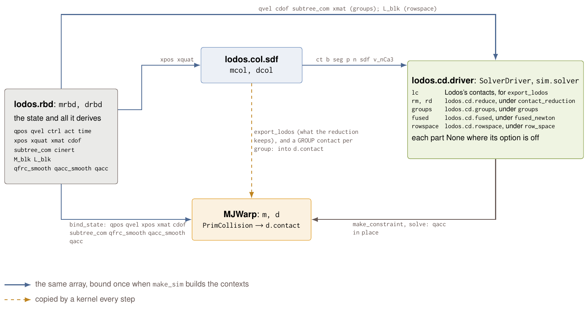

# Lodos v2: Development Guide

*How the codebase is built, the rules it keeps, and how to change it*

As of 2026-11-04. For a new developer, or an AI agent, about to change the code. The theory is in the two manuals, *Collision Detection* (`docs/collision_detection.pdf`) and *Contact Dynamics* (`docs/contact_dynamics.pdf`); the workflows are in the guides ([Section 8](#8-where-the-theory-and-the-workflows-live)). Built from `docs/manual/`.

**About this document.** You are about to change Lodos v2. This guide is the map: what every part of the repository is, where it lives, how the parts connect, the conventions and invariants the code keeps, how to check and measure a change, and the pitfalls already found. It does not repeat the theory or the workflows; it says where they are.

- Read Sections [1](#1-what-lodos-v2-is), [2](#2-the-repository), [3](#3-one-step-end-to-end) and [4](#4-conventions-and-invariants) before changing anything, [Section 5](#5-how-to-add-things) when you add something, [Section 6](#6-checking-and-measuring) before you check a change or measure, and [Section 7](#7-pitfalls-and-open-problems) before you debug.
- Every statement here was checked against the code on the date stamped above; a number with a date of its own was measured on that date.

> **The rules.** These hold for every change. Each is explained where the reference points.
>
> 1. **The exact mode takes no MuJoCo impedance**: whenever `mode="exact"` (the default), `impratio` is 1, and no solref, solimp or impratio may reach the contact solve ([Section 4.1](#41-the-exact-mode-takes-no-mujoco-impedance)).
> 2. **The step stays capturable**: Lodos's code adds no host synchronization inside the step, allocates every array when the contexts are built and never rebinds one; its loops have fixed bounds, and a converged world is retired by data, not by a branch. The solve adapted from MJWarp (`lodos.cd.solver`) allocates scratch per call and uses graph conditional nodes ([Section 4.2](#42-the-step-stays-capturable)).
> 3. **A new option is off by default.** Changing a default or removing a feature is the owner's decision: measure, then propose it ([Section 4.4](#44-options-are-off-by-default)).
> 4. **Refuse what cannot work**: invalid combinations raise, and a rename keeps no alias ([Section 4.5](#45-refuse-rather-than-ignore)).
> 5. **Check what a change affects**: the notebooks and scenes it touches; for a broad change and before a merge, every notebook and both benchmarks' smoke runs ([Section 6.1](#61-checking-a-change)).
> 6. **One feature per commit**, its message saying what changed and why; leave the owner's uncommitted work out of your commits ([Section 4.9](#49-commits-reports-and-decisions)).
> 7. **Never push** without the owner ([Section 4.9](#49-commits-reports-and-decisions)).
> 8. **Never commit** `results/`, `.scratch/` or other local output ([Section 4.9](#49-commits-reports-and-decisions)).
> 9. **Measure honestly**: alone on the GPU, configurations interleaved, chaotic scenes jittered, overflowed runs discarded ([Section 6.3](#63-measuring)).
> 10. **Record it**: a measurement goes in its commit message, with the commands that reproduce it, and in a dated report wherever the owner keeps them, with the decisions it raises ([Section 4.9](#49-commits-reports-and-decisions)).
> 11. **Changes for upstream go from upstream**: a change meant for MuJoCo Warp goes from a clone of upstream MuJoCo Warp, without the AI co-author line ([Section 2.3](#23-the-mujoco-warp-code)).

**Contents**

- [1 What Lodos v2 is](#1-what-lodos-v2-is)
  - [1.1 Where the code comes from](#11-where-the-code-comes-from)
  - [1.2 A scene](#12-a-scene)
  - [1.3 The contact solver](#13-the-contact-solver)
- [2 The repository](#2-the-repository)
  - [2.1 Top level](#21-top-level)
  - [2.2 The package](#22-the-package)
  - [2.3 The MuJoCo Warp code](#23-the-mujoco-warp-code)
  - [2.4 Assets and the cache](#24-assets-and-the-cache)
- [3 One step, end to end](#3-one-step-end-to-end)
  - [3.1 What make_sim builds](#31-what-make_sim-builds)
  - [3.2 The step](#32-the-step)
  - [3.3 The contexts share arrays](#33-the-contexts-share-arrays)
  - [3.4 Lodos's contacts in MJWarp's solve](#34-lodoss-contacts-in-mjwarps-solve)
  - [3.5 Capacities and overflow](#35-capacities-and-overflow)
  - [3.6 State carried across steps](#36-state-carried-across-steps)
- [4 Conventions and invariants](#4-conventions-and-invariants)
  - [4.1 The exact mode takes no MuJoCo impedance](#41-the-exact-mode-takes-no-mujoco-impedance)
  - [4.2 The step stays capturable](#42-the-step-stays-capturable)
  - [4.3 Determinism](#43-determinism)
  - [4.4 Options are off by default](#44-options-are-off-by-default)
  - [4.5 Refuse rather than ignore](#45-refuse-rather-than-ignore)
  - [4.6 Names](#46-names)
  - [4.7 Code style](#47-code-style)
  - [4.8 Frames, layouts and signs](#48-frames-layouts-and-signs)
  - [4.9 Commits, reports and decisions](#49-commits-reports-and-decisions)
- [5 How to add things](#5-how-to-add-things)
  - [5.1 A solver option](#51-a-solver-option)
  - [5.2 A collision feature](#52-a-collision-feature)
  - [5.3 A scene](#53-a-scene)
  - [5.4 A document](#54-a-document)
- [6 Checking and measuring](#6-checking-and-measuring)
  - [6.1 Checking a change](#61-checking-a-change)
  - [6.2 Guards for refactors](#62-guards-for-refactors)
  - [6.3 Measuring](#63-measuring)
  - [6.4 The scripts](#64-the-scripts)
- [7 Pitfalls and open problems](#7-pitfalls-and-open-problems)
  - [7.1 Pitfalls already found](#71-pitfalls-already-found)
  - [7.2 Open problems](#72-open-problems)
- [8 Where the theory and the workflows live](#8-where-the-theory-and-the-workflows-live)

## 1 What Lodos v2 is

### 1.1 Where the code comes from

Lodos v2 is a research simulator for batched rigid-body contact on one GPU: thousands of worlds of one MJCF model, stepped together. Everything runs in NVIDIA Warp; MuJoCo parses the MJCF, supplies the model's constants and is the reference the dynamics follow. It is built from three parts:

- **Lodos-v1** (`papers/lodos_v1.pdf`): its collision detection, the vertex–SDF pipeline of *Lodos surfaces* (`lodos.col.sdf`); its contact model, which scales a collision pair's spring-damper forces by one factor, and which Lodos v2 keeps as the ray parameterization of its contact groups (`lodos.cd.groups`; the spring-damper force law, which weighs every group's members, in `lodos.cd.params`); and its rigid-body dynamics `lodos.rbd`, a Warp port of MuJoCo's smooth dynamics.
- **MuJoCo Warp** (MJWarp) 3.14.0, whose collision pipeline, constraint solve, and model and data Lodos carries as its own code, adapted (`lodos.col.prim`, `lodos.cd.solver`, `lodos.mjcf`; [Section 2.3](#23-the-mujoco-warp-code)).
- **Lodos v2's own**: an exact contact solver, the *prox* solver, a proximal loop around MJWarp's Newton solve (`lodos.cd.solver.nlsp`); the solver's contact groups, its contact reduction and its two other solves of the Newton system (`lodos.cd.groups`, `reduce`, `fused`, `rowspace`); the exact hull narrowphase, the *hybrid* (`lodos.col.prim.hybrid`); and what joins the parts (`lodos.sim`, `lodos.step`, `lodos.col.prim.driver`, `lodos.cd.driver`): one scene with both collision pipelines, one contact solver seeing every contact, one step captured as one CUDA graph. `papers/lodos_v2.pdf` describes the solver.

Lodos's dynamics is the host: the contact solve takes its mass matrix from it. Measured on 2026-10-21, it was on par with MJWarp's on free bodies and hands and under 2 % of a contact-rich step, and MJWarp's was 1.1–2.1$\times$ faster on 27-dof humanoids.

### 1.2 A scene

A scene is an MJCF model plus, optionally, a list of **Lodos surfaces** (`lodos.sim.Surfaces`): baked vertex-and-SDF geometries, each keyed to an MJCF geom.

- A surface keyed to a non-plane geom takes that geom out of MJWarp's collision (`contype = conaffinity = 0`, on `make_sim`'s copy of the model). The geom is still what MuJoCo computes the body's inertia from, typically a mesh of the same surface.
- A `PlaneSurface` keyed to an MJCF plane leaves the plane in MJWarp's collision: one floor for both pipelines.
- Every other MJCF geom collides through MJWarp's pipeline (`lodos.col.prim`): MuJoCo's primitives through MJWarp's narrowphases, and box–box, box–mesh, mesh–mesh and plane–mesh pairs through the hybrid.
- Lodos surfaces collide with each other through directional pairs `[vertex surface, SDF surface]`; MJCF geoms collide with each other. **Nothing collides across.** A polytope that supplements a surface (its convex decomposition, as massless MJCF meshes) exists to give the edge–edge contacts a vertex–SDF surface cannot see, against other polytopes.
- Lodos pairs take a 13-column parameter table (`lodos.cd.params`), `[mu, stiffness, sharpness, dissipation, stiction, solref(2), solimp(5), w]`. The solve reads `mu`, and under the mj mode `solref` and `solimp`; contact groups weigh their members by the spring-damper columns (stiffness, sharpness, dissipation, stiction); nothing reads `w`.

`docs/creating_new_sim_from_mjcf.pdf` goes from an MJCF to a scene; the collision manual's *Describing a scene* is the reference.

### 1.3 The contact solver

Lodos has one contact solver, the **NLSP solver** (nonlinear least squares with proximal minimization; `lodos.cd.driver.SolverDriver`): MJWarp's constraint solve, its Newton solver, and around it, for the exact problem, the prox solver's proximal loop (`lodos.cd.solver.nlsp`), over MJWarp's contacts and Lodos's alike. It poses one of two problems, its *modes* (`lodos.cd.driver.MODES`):

- `mode="exact"`, the default: the exact contact problem, with a Baumgarte target and a de Saxcé term in the normal target, reached by the proximal loop. No MuJoCo impedance reaches it ([Section 4.1](#41-the-exact-mode-takes-no-mujoco-impedance)).
- `mode="mj"`: MuJoCo's soft problem, from the pair table's solref and solimp for Lodos's contacts and from the MJCF for MJWarp's: MJWarp's Newton solver on MuJoCo's rows, or, given a proximal loop or the de Saxcé term, the prox solver on those rows (`opt.prox_soft`).

Joint limits and dof friction loss are MuJoCo's soft rows in the same solve, under either mode; `make_sim(joint_constraints=False)` removes them. MuJoCo's own iteration count and tolerance come from the model (`mjm.opt`). The friction cone is the elliptic one wherever the prox solver runs, whatever the model names; MuJoCo's problem as it stands (mj, without a loop or the term) keeps the model's, and every built-in scene names the elliptic cone. How Lodos's contacts reach the solve, and how it solves the Newton system, are options (Table 1); the contact dynamics manual derives all of it and measures what to pick.

**Table 1: How Lodos's contacts reach the solve, and how it solves the Newton system. The first row of each part is the default; the others are off by default, but for the shared Hessian, on by default where it can be built on a sparse model of 48 dofs or more ([Section 4.4](#44-options-are-off-by-default)).**

| what | code | option |
|---|---|---|
| every Lodos contact as one MJWarp contact | `lodos.cd.driver.export_lodos` | – |
| at most 240 contacts a pair segment, Newton's reduction | `lodos.cd.reduce` | `make_sim`'s `contact_reduction` |
| a segment's contacts in one normal bin and moment sector as one MJWarp contact of type `GROUP`, its force acting through its members: a ray (one row) or a cone (a friction cone) | `lodos.cd.groups`, `lodos.cd.bins` | `groups` (`"ray"`, `"cone"`, or one per pair), `normal_bins`, `moment_bins` |
| MJWarp's Newton system, its dense or sparse Hessian | `lodos.cd.solver.nlsp` | – |
| MJWarp's Newton solve and its prox rounds as one kernel per world, for small models ($n_v \le 16$) | `lodos.cd.fused` | `fused_newton` |
| the Newton system solved through the rows (Woodbury, with Lodos's per-tree factor of $M$) | `lodos.cd.rowspace` | `row_space` |
| MJWarp's sparse Hessian (more than 32 dofs) summed per world in shared memory and written once | `lodos.cd.solver.nlsp`, `opt.shared_hessian` | `shared_hessian` |

## 2 The repository

### 2.1 Top level

**Table 2: The repository's top level. The last rows are local and gitignored.**

| path | what it is |
|---|---|
| `lodos/` | the simulator: [Section 2.2](#22-the-package) |
| `viewer/` | the live viewer and every scene's builder (`viewer/scenes/`): [Section 2.2](#22-the-package); `viewer/assets/`, what the scenes load, about 770 MB in git: [Section 2.4](#24-assets-and-the-cache); `viewer/newton/`, Newton's own sims, `SolverMuJoCo` and `SolverKamino`, for the viewer to compare with: a uv project of its own (Newton 1.7.0, upstream MuJoCo Warp) that imports no `lodos` |
| `bench/` | benchmarks and experiment harnesses, among them the two comparisons, Lodos's mj mode against MuJoCo Warp and its exact mode against Kamino: [Section 6.4](#64-the-scripts) |
| `tools/performance_tuning/` | state sets, calibration and the tuning tools; `tuned/`, every built-in scene's tuning file, and `tuned/mj/`, under the mj mode |
| `tools/mesh_processing/` | the offline mesh-to-surface pipeline (five steps; `create_surface_data.py` is the bake); `nutbolt/`, which remakes the nut-bolt's surfaces, and `nist/`, which makes the NIST parts' surfaces |
| `notebooks/` | five tutorial notebooks, `01_quickstart` to `05_make_a_surface`, stored with their outputs |
| `docs/` | the manuals and guides as PDF and Markdown; `docs/manual/` their LaTeX sources, figures, data and build |
| `papers/` | the papers: `lodos_v2.pdf`, the extended abstract on Lodos v2; `contact_tutorial.pdf`, the contact tutorial (coming soon); `lodos_v1.pdf`, Lodos-v1; `lodos_precursor.pdf`, its precursor ([Section 8](#8-where-the-theory-and-the-workflows-live)) |
| `README.md` | the overview, install, quick start and layout |
| `pyproject.toml`, `uv.lock`, `.python-version` | the package (hatchling: `lodos` and `viewer`), its extras and uv groups; Python 3.14 in development |
| `results/` | local output: what the benchmarks and the tuning tools write by default (their records, state sets and reports), and experiments' scripts and logs |
| `.scratch/` | the cache of derived files in a clone (the OBJs MuJoCo takes inertia from) and scratch work |
| `.venv/`, `MUJOCO_LOG.TXT`, `imgui.ini`, `docs/manual/build/`, `tools/mesh_processing/.tmp/`, `.instant-meshes`, `.pylibs/`, `.pamo.sif` | environments (`viewer/newton/`'s too), logs, window state, the LaTeX build, the mesh pipeline's intermediates and the tools it runs |

Table 2 lists the top level.

### 2.2 The package

Table 3 is every module of `lodos/`, with its main entry points, and below the rule those of `viewer/`. `lodos/__init__.py` imports no submodule: each subpackage binds its own, so that importing one module does not pull the tree. `lodos.col.sdf.io` and `lodos.col.sdf.serialize` need the `mesh` extra and load on first use. The modules marked M are adapted from MuJoCo Warp 3.14.0 ([Section 2.3](#23-the-mujoco-warp-code)).

**Table 3: The modules of `lodos/`, and below the rule those of `viewer/`. M: adapted from MuJoCo Warp 3.14.0.**

| module | role | entry points |
|---|---|---|
| `sim.py` | one scene: both pipelines, the solver; enforces the impedance rule | `make_sim`, `Surfaces`, `Sim`, `exact_mode`, `default_pair_params`, `INTEGRATORS` |
| `step/__init__.py` | the step, and its CUDA graph | `step_sim`, `forward`, `fwd_step`, `make_step_graph` |
| `rbd/types.py` | the rigid-body model and state; refuses unsupported features | `make_rbd_context`, `RbdModel`, `RbdData`, `TILE_MIN` |
| `rbd/forward.py`, `smooth.py`, `passive.py` | kinematics to `qacc_smooth`; the mass matrix per tree and its factor, tiled for trees of 13 dofs or more | `fwd_rbd`, `kinematics`, `factor_m`, `solve_m`, `solve_M_tree` |
| `rbd/integrate.py` | semi-implicit Euler; the step's integration under either integrator | `integrate`, `symplectic_euler` |
| `rbd/implicit.py` | implicitfast: $D$, the implicit matrix, MuJoCo's form's acceleration | `prepare`, `correct` |
| `rbd/io.py` | states in and out without breaking a graph | `set_state`, `get_state`, `save_state`, `restore_state` |
| `col/sdf/__init__.py` | Lodos surfaces: a bake loaded, its SDF representation, scaled, the OBJ MuJoCo takes its inertia from | `PlaneSurface`, `SurfaceData`, `load_surface_data`, `load_surface_file`, `scale_surface`, `write_surface_obj`, `SPLINE_TYPES` |
| `col/sdf/types.py` | Lodos collision's model and data; every capacity and option | `make_collision_context`, `CollisionModel`, `CollisionData` |
| `col/sdf/collide.py` | the pipeline's three stages, diagnostics, capacity tools | `collide`, `get_contacts`, `check_overflow`, `reset_overflow`, `suggest_capacity`, `calibrate_capacity`, `resize_context`, `Autosizer` |
| `col/sdf/broadphase.py`, `compact.py`, `narrowphase.py` | OBB and tile filters, voxel prefilter; stream compaction; the spline SDF and contacts | kernels, chosen per context (`nsdf_kernel(mcol)`, `sdf_filter_kernel(mcol)`, `contact_kernel(mcol)`) |
| `col/sdf/spline/c2.py`, `c0.py`, `implicit.py` | the SDF representations, tricubic (C2 field, C1 normals) and trilinear (C0 field, normals discontinuous across cell faces); the voxel grid, the bake and its evaluation | `eval_cs3`, `eval_cs1`, `create_implicit_surface_from_mesh` |
| `col/sdf/io.py`, `serialize.py` | making surfaces: mesh processing, Hilbert and Morton vertex order (the `mesh` extra) | `load_and_process_mesh`, `hilbert_encode`, `morton_encode` |
| `col/prim/driver.py` | MJWarp's collision on Lodos's poses, with the hybrid; writes `d.contact` | `PrimCollision`, `pairable_geoms`, `contact_out` |
| `col/prim/collision_driver.py`, `collision_core.py`, `collision_primitive.py`, `collision_convex.py`, `collision_gjk.py`, `types.py` (M) | MJWarp's broadphases and narrowphases | `nxn_broadphase`, `sap_broadphase`, `primitive_narrowphase`, `convex_narrowphase`, `write_contact` |
| `col/prim/hybrid/` | the exact hull narrowphase: cell supports, feature cache, GJK/EPA (`ccd.py`, adapted from MJWarp's), quadrangle manifold, floor kernel; float64 ground truth (`truth.py`) | `HybridNarrowphase`, `ALL_TYPES` |
| `cd/__init__.py` | the contact dynamics package's map; imports no submodule | – |
| `cd/driver.py` | the solver: Lodos's contacts and state for MJWarp's solve; its options and modes, and the exact mode's Baumgarte slop with why it exists; the shared Hessian's default | `SolverDriver`, `resolve_options`, `overrides`, `OPTIONS`, `MODES`, `BAUMGARTE_SLOP`, `shared_hessian_default`, `bind_state`, `export_lodos`, `gather_M` |
| `cd/params.py` | the pairs' 13-column parameters and the spring-damper force law contact groups weigh their members by | `make_default_contact_params`, `dissipation_fn` |
| `cd/bins.py` | normal bins (1, 6, 12, 20 directions) and moment sectors (1, 2, 3, 4, 6) | `bin_normals`, `bin_tangents`, `NORMAL_BINS`, `MOMENT_BINS` |
| `cd/groups.py` | contact groups: a segment's contacts per normal bin and moment sector as one MJWarp `GROUP` contact, ray or cone; weights, carried frames, members | `Groups`, `resolve_kinds`, `check_bins`, `KINDS` |
| `cd/reduce.py` | Newton's contact reduction, at most 240 contacts per segment | `make_reduce_context`, `reduce` |
| `cd/fused.py` | `fused_newton`: MJWarp's Newton solve and its prox rounds as one kernel per world, for small models | `FusedNewton`, `newton_kernel` |
| `cd/rowspace.py` | `row_space`: MJWarp's Newton system solved through the rows (Woodbury, with Lodos's per-tree factor of M) in place of the dense $n_v\times n_v$ Hessian | `RowSpaceNewton` |
| `cd/solver/` (M) | MJWarp's constraint solve: the rows, contact groups' among them (`constraint.py`); the CG and Newton solves, with the prox solver's proximal loop (`nlsp.py`); the blocked Cholesky (`block_cholesky.py`); the groups' arrays (`io.py`); its contexts (`types.py`) | `make_constraint`, `solve`, `shared_hessian_refusal`, `alloc_contact_groups`, `contact_force` |
| `mjcf/types.py`, `io.py` (M) | MJWarp's model and data on the device, which the prim collision and the solve share: `Model`, `Data`, `Option` and the enums; both made from MuJoCo's, with the capacity estimates | `Model`, `Data`, `put_model`, `put_data`, `override_model` |
| `utils/math.py` | quaternion and spatial-algebra helpers, with MJWarp's that its adapted code uses; MuJoCo's `mjMINVAL` | `quat_mul`, `quat_to_mat`, `make_frame`, `MINVAL` |
| `utils/kernels.py` (M) | MJWarp's kernel cache and timed event scopes | `cache_kernel`, `event_scope` |
| `utils/scan.py` | the exclusive scan whose length lives on the device | `scan`, `plan`, `workspace` |
| `utils/states.py` | state sets: the starts every tuning tool runs from | `StateSet`, `from_qpos`, `from_keyframes`, `load`, `install`, `rollout` |
| `utils/calibrate.py` | the demand on every capacity | `Tracker`, `measure`, `calibrate`, `settings`, `peaks`, `suggest` |
| `utils/tuning.py` | tuning files (`lodos-tuning/2`): one scene's settings, fingerprints, staleness | `apply`, `merge_into_make_sim`, `stale`, `knobs_only`, `describe` |
| `viewer/__main__.py` | the command line: `python -m viewer [SCENE]`, or `lodos-viewer` (`--sim`, the sim it starts under: `lodos`, `mjwarp` or `kamino`; `--tuned`; `--controls`) | `main` |
| `viewer/app.py` | the window | `LiveViewer` |
| `viewer/session.py` | sessions, runners and takes; the panel's options and how each applies; their speed arrows | `Session`, `Runner`, `Take`, `OPTIONS`, `default_config`, `FASTER` |
| `viewer/collect.py`, `geometry.py`, `joints.py`, `pairs.py`, `performance.py` | a frame's contacts and forces, read off `d.contact`; both pipelines' geometry as one drawn scene; joint editing and gizmos; the collision pairs' contact parameters; the Performance panel | `Collector`, `make_live_scene`, `apply_gizmo`, `PairTable`, `Performance` |
| `viewer/draw.py`, `trajectory.py` | recorded frames in Newton's OpenGL viewer, which the live viewer is built on; the frames | `TrajectoryViewer`, `Trajectory`, `save_recording`, `load_recording` |
| `viewer/newton_link.py`, `viewer/newton/` | Newton's sims, its MuJoCo Warp and Kamino, in a process of their own in `viewer/newton/`'s environment | `NewtonRunner`, `scene_package`, `available` |
| `viewer/scenes/catalog.py` | where a session's scene comes from: the built-in scenes, or an MJCF file and its `lodos:` annotations | `SceneSource`, `BUILTIN`, `PANEL`, `builtin`, `from_mjcf`, `export_mjcf` |
| `viewer/scenes/assets.py` | where the assets and the cache are; a shipped surface by name | `ASSET_DIR`, `load_surface`, `surface_obj`, `CACHE_DIR` |
| `viewer/scenes/` | the scene builders: `drop`, `armadillo`, `representations`, `mixed`, `fbf`, `sharpa`, `sharpa_armadillo`, `shadow`, `shadow_kong` (the Shadow hand lifting a Kong toy), `nutbolt`, `nist` (Isaac Lab's NIST pairs, board, driven nut, Franka and threading replay), `franka` (the arm); recorded controls in `data/` | `scene_xml`, `surfaces` and the starts; most a `build(...)` returning a `Sim` (`nist` has one per scene), but `drop`: `scene_and_q0`; `franka`: the arm's MJCF; `shadow` and `shadow_kong`, which the catalog builds |

**A reading path.** `lodos/sim.py` (`make_sim` and its docstring), `lodos/step/__init__.py`, `lodos/cd/driver.py` (its module docstring, `resolve_options`, whose docstring has every option, and `SolverDriver`), `lodos/cd/groups.py` with its design, the *Contact-Group Reparameterization* section of `papers/lodos_v2.pdf`, the module docstrings of `lodos/cd/reduce.py`, `fused.py` and `rowspace.py`, and the docstring of `make_collision_context` in `lodos/col/sdf/types.py`. The reading guide (`docs/reading_guide.pdf`) lists every source file in order.

### 2.3 The MuJoCo Warp code

Lodos carries the parts of MuJoCo Warp it uses as its own code, adapted from MuJoCo Warp 3.14.0 under its Apache-2.0 licence: MuJoCo Warp is not a dependency, and nothing in Lodos imports `mujoco_warp`. They are the broadphases and narrowphases (`lodos.col.prim`'s `collision_*` modules and `types.py`), the constraint rows and the solve (`lodos.cd.solver`), the model and data (`lodos.mjcf`: `put_model`, `put_data`, `override_model`), the kernel cache (`lodos.utils.kernels`) and the helpers at the end of `lodos.utils.math`. Each module's header names the MuJoCo Warp files it was adapted from, and every function and class keeps its MuJoCo Warp name. Lodos's `pyproject.toml` pins MuJoCo's matching release, 3.14.0, and Warp 1.16. Table 4 is what Lodos's copy has that MuJoCo Warp 3.14.0 does not, and what it leaves out.

**Table 4: Lodos's copy of MuJoCo Warp against MuJoCo Warp 3.14.0.**

| where | what |
|---|---|
| `cd/solver/nlsp.py` | the prox solver, an exact contact solver: a proximal loop around the Newton solve (`solve_prox`, under `opt.prox_enable`), its rounds (`opt.prox_outer_iterations`, `opt.prox_inner_iterations`) and its tolerances on the anchor and on the de Saxcé term (`opt.prox_tol_z`, `opt.prox_tol_sigma`); the Baumgarte reference (`opt.prox_baumgarte`, `opt.prox_baumgarte_alpha`, `opt.prox_baumgarte_slop`); the de Saxcé term (`opt.prox_desaxce`), shifted through the row's damping $b$ on MuJoCo's soft rows (`opt.prox_soft`); the anchor carried across steps (`opt.prox_z_carry`, `d.prox_zcache_*`); each world's rounds and convergence (`d.prox_rounds`, `d.prox_converged`) |
| `mjcf/types.py` | `ContactType.NOCARRY`: the anchor cache neither stores nor matches such contacts |
| `cd/solver/constraint.py`, `nlsp.py`, `io.py` | `ContactType.GROUP`, a contact standing for member contacts (`io.alloc_contact_groups`; without its arrays nothing changes): its rows the members' weighted, $\sum_i a_i d_i^\top J_i$, in the sparse and dense Jacobians; MuJoCo's rows the members' own restricted to the group's force; under the prox solver the Baumgarte bias and the de Saxcé term member by member, and no carried anchor |
| `cd/solver/nlsp.py` | `solve(m, d, newton_solve=...)`: a caller's solve of the Newton system in place of the dense Hessian (none allocated, the incremental Hessian off) |
| `cd/solver/nlsp.py` | `opt.shared_hessian`, off on MJWarp's model (Lodos decides it, [Section 4.4](#44-options-are-off-by-default)): the sparse path's Newton Hessian summed per world in shared memory, by 512 threads a world (a block size chosen on an RTX 4080), and written once (`_shared_hessian`, `shared_hessian_refusal`) |
| `mjcf/io.py` | `put_data(..., contact_body_pairs=...)`: the estimate of a sparse Jacobian's nonzeros counts the pairs of bodies that collide outside the model's own geom pairs (Lodos's) |
| left out | MuJoCo Warp's `collision()` entry point and its flex and SDF-geom collision (`PrimCollision` runs the broadphases and narrowphases itself); the rest of MuJoCo Warp, its step, smooth dynamics and integrators among it |

- **Upstream**: a change meant for MuJoCo Warp goes from a clone of upstream, without the AI co-author line, which upstream's `AGENTS.md` bars because of its CLA.
- The code keeps MuJoCo Warp's style: two-space indentation, lines up to 128 characters. `lodos.col.prim.hybrid`, which sits beside it, keeps the indentation too.

### 2.4 Assets and the cache

`viewer/assets/` holds what the built-in scenes load: `surfaces/` (the armadillo, cubes, boxes, cards, spheres and the arch's stones), `armadillo_cp/` (its 34 convex pieces), `arch/` (MIT), `nutbolt/` (IsaacGymEnvs' M20 nut and bolt, BSD-3), `sharpa/` (MuJoCo Menagerie's Sharpa Wave, Apache-2.0, with its hulls and surfaces), `shadow_kong/` (Menagerie's Shadow hand, Apache-2.0, and a Kong toy from Google Scanned Objects, with their surfaces and hulls), `nist/` (Isaac Lab's NIST parts as `tools/mesh_processing/nist` makes them, their surfaces, and Menagerie's Franka Panda, Apache-2.0) and `mjcf/`. Licences sit beside the assets that state one; Isaac Lab states none for its NIST parts. The viewer offers a scene only where its assets are.

- `viewer.scenes.assets.ASSET_DIR` is `$LODOS_ASSETS`, else `viewer/assets/`, in a clone and in an installed package alike. Five variables override it per scene: `$LODOS_NUTBOLT_DIR`, `$LODOS_NIST_DIR`, `$LODOS_FRANKA_DIR`, `$LODOS_SHARPA_DIR` and `$LODOS_SHADOW_KONG_DIR`.
- Derived files (the OBJ MuJoCo takes a surface's inertia from) are cached in `$LODOS_CACHE`, else `.scratch/` in a clone, else `$XDG_CACHE_HOME/lodos` (by default `~/.cache/lodos`).
- `lodos.col.sdf.load_surface_file`, which `viewer.scenes.assets.load_surface` calls with a shipped surface's name, drops any inner spheres beside a bake; pass them explicitly if a scene wants them. `scale_surface` scales everything in a bake that is a length, spheres included.
- The assets are in plain git (about 770 MB; the largest bakes, the M8 and M12 bolts' and the M20 bolt's, are 95, 66 and 64 MB). Whether to move them to LFS or a repository of their own is open.

## 3 One step, end to end

### 3.1 What make_sim builds

`lodos.sim.make_sim(mjm, B, *, surfaces=None, qpos=None, solver_kwargs=None, ...)` builds every context of a scene, in this order:

1. **The tuning file**, if one is given: its settings fill what the call leaves out, the capacities, `contact_reduction`, the solver's budgets and the collision options `surfaces.col_kwargs` does not name (`lodos.utils.tuning.merge_into_make_sim`).
2. **A copy of the model**, which it edits: the integrator, if `integrator` is given; joint limits and dof friction loss removed unless `joint_constraints`; `opt.impratio = 1` whenever the mode is exact ([Section 4.1](#41-the-exact-mode-takes-no-mujoco-impedance)); keyed non-plane geoms switched off for MJWarp. The caller's model is never changed.
3. **The rigid-body context** `(mrbd, drbd)`, the initial `qpos`, and one `kinematics` pass. Lodos's `kinematics` renormalizes quaternions in `qpos` in place, and float32 renormalization is not idempotent, so this pass puts the state exactly where Lodos's own scene builders put it.
4. **Lodos collision** `(mcol, dcol)`, if there are Lodos pairs, with `surfaces.col_kwargs`; and the 13-column pair table.
5. **The solver's options**, checked and filled by `lodos.cd.driver.resolve_options` (`sim.options`), and **MJWarp's model and data** `(m, d)` (`lodos.mjcf.io`'s `put_model` and `put_data`): MuJoCo's warm start disabled under `warm_start=False`; the overrides the options come to (`lodos.cd.driver.overrides`) before the caller's, on the copy of MuJoCo's model and on MJWarp's; the shared Hessian's default, decided on MJWarp's model (`shared_hessian_default`) and recorded in `sim.options`; the capacities, a sparse Jacobian's nonzeros (over 32 dofs) estimated for Lodos's pairs as well as the model's own (`contact_body_pairs`). The contact and row capacities left out are MJWarp's own estimates, which count none of Lodos's contacts ([Section 3.5](#35-capacities-and-overflow)). Then `PrimCollision`.
6. **The solver**, `SolverDriver`: it binds MJWarp's state arrays to Lodos's (`bind_state`), maps `M_blk` onto MuJoCo's sparse `M` (`csr_map`), builds what the options ask for: the reduction's context, the contact groups (which `make_sim` refuses in a scene without Lodos surfaces), `FusedNewton` or `RowSpaceNewton`; and it refuses a shared Hessian the model cannot take.

**Table 5: What a `Sim` holds.**

| attribute | what |
|---|---|
| `mjm`, `B` | `make_sim`'s copy of the model; the batch size |
| `mrbd`, `drbd` | `lodos.rbd`'s model and state |
| `mcol`, `dcol`, `surfaces`, `params` | Lodos collision, or None; the `Surfaces`; the pair table, or None |
| `m`, `d`, `prim`, `geom_bodyid` | MJWarp's model and data (`lodos.mjcf.types`); `PrimCollision` (`prim.active` says whether it has pairs); each geom's body |
| `options` | the solver's resolved options (`resolve_options`) |
| `solver` | the solver, `SolverDriver`: `lc`, what `export_lodos` reads; `rm`, `rd`, the reduction's; `groups`; `fused`; `rowspace`; each None where unused |

Table 5 lists what the result holds.

### 3.2 The step

`lodos.step.step_sim(sim)` is `forward(sim)` and then `lodos.rbd.integrate.integrate`. `forward` is everything but the integrator, like MuJoCo's `mj_forward`: the poses, contacts, constraint forces and `qacc` of the current state. `fwd_step(sim)` calls `step_sim`; `make_step_graph(sim)` captures it. Table 6 is a step stage by stage.

**Table 6: One step of a `Sim`, in order. “Bounded by” names the capacities a stage's output must fit ([Section 3.5](#35-capacities-and-overflow)).**

| stage | call | reads $\to$ writes | bounded by |
|---|---|---|---|
| rigid-body pass | `lodos.rbd.forward.fwd_rbd` | `qpos`, `qvel`, `ctrl`, `act` $\to$ poses, `cdof`, `subtree_com`, `cinert`, `M_blk` and its factor `L_blk`, `qfrc_smooth`, `qacc_smooth` | – |
| geom poses | `sim.prim.poses`, if `prim.active` | `xpos`, `xmat` $\to$ `d.geom_xpos`, `d.geom_xmat` of the pairable geoms | – |
| MJWarp collision | `sim.prim.collide()` | geom poses $\to$ zeroes `d.nacon` and `d.ncollision`; broadphase pairs; `d.contact` from MJWarp's narrowphases, then the hybrid's | `naconmax`; `nccdmax` $\times B$ |
| Lodos collision | `lodos.col.sdf.collide.collide`, if Lodos pairs | `xpos`, `xquat` $\to$ the stage lists and `dcol.ct`; the contacts `*_nCa3`, sorted by (world, segment) | `capacity_tile`, `capacity1`, `capacity2` |
| contact solve | `sim.solver.contact_dynamics()`: `reduce`, the groups' `before_export`, `export_lodos`, the groups' `export`, `gather_M`, `make_constraint`, the solve (`lodos.cd.solver.nlsp.solve`, or `FusedNewton`'s) | `dcol`, `d.contact`, `M_blk` (and `L_blk` under `row_space`), the bound state $\to$ Lodos's contacts and groups appended to `d.contact`; `d.M`; the rows; `qacc`; `d.qacc_warmstart` | `naconmax`, `njmax`, `njmax_nnz`; the reduction's rows |
| integration | `integrate` | `qacc` (under implicitfast in MuJoCo's form, `qacc_int`), `act_dot` $\to$ `act`, then `qvel`, then `qpos` from the new `qvel`, then `time` | – |

- **When MJWarp's collision runs.** `PrimCollision.active` is true when MJWarp's precomputed candidate list (`m.nxn_geom_pair_filtered`) has a pair whose type combination has a collider, `naconmax` is positive and contacts are not disabled. A Lodos-only scene's floor has nothing to pair with. `collide()` zeroes the counters either way, which the solve relies on before it appends Lodos's contacts.
- **The hybrid** runs only for the pair types present, and builds hull tables only for meshes something can pair; every other mesh gets a placeholder. A surface's inertia mesh may have no convex hull at all: MuJoCo builds `mesh_graph` only for meshes of colliding geoms. The tables are built once per process for each set of meshes.
- **The rigid-body pass** keeps one dense block per kinematic tree, batch last (`M_blk[blk_beg[t] + r n + c, b]`), factored $M = LL^\top$. The solve takes $M$ from `M_blk` (`gather_M`), and the row-space solve reads the factor: $Z = L^{-1} J^\top$. Trees of at least `TILE_MIN` (13) dofs are built one dof per thread, factored with Warp's tile Cholesky and scattered back into `L_blk`; smaller trees – a free body is $6\times 6$ – keep the serial kernels.
- **Nothing in the step collects for display.** The live viewer captures `forward` and the integrator as two graphs (and the whole step as a third) and collects a frame between them, on the host, from MJWarp's `d.contact` (`viewer.collect`): the one point where the forces exist and `qvel` is still the velocity the contacts occurred at.

### 3.3 The contexts share arrays



*Figure 1: The contexts `make_sim` builds, and the arrays they share. Solid: the same array object, bound when the contexts are built; dashed: copied by a kernel every step. The solver's parts exist only where their options ask for them. Also copied every step, not drawn: the geom poses (`PrimCollision.poses`, from `xpos` and `xmat`) and `M_blk` into MJWarp's `d.M` (`gather_M`).*

No context copies the state. Figure 1 shows which arrays are bound across contexts: collision reads the poses `kinematics` wrote; `bind_state` points MJWarp's `d.qpos`, `qvel`, `cdof`, `subtree_com`, `xpos`, `xmat`, `qfrc_smooth`, `qacc_smooth` and `qacc` at Lodos's arrays, so MJWarp's solve writes the constrained `qacc` straight into Lodos's; the solver's export, reduction and contact groups read Lodos's contact list where collision wrote it, the groups also `qvel`, `cdof`, `subtree_com` and `xmat`, and the row-space solve reads `L_blk`. The layouts agree: batch first, quaternions $(w, x, y, z)$, `cdof` as [angular, linear]; `bind_state` checks shapes and element sizes. This is why a buffer must never be rebound ([Section 4.2](#42-the-step-stays-capturable)). The state is `sim.drbd`'s; `sim.d`'s state fields are the same arrays.

### 3.4 Lodos's contacts in MJWarp's solve

Lodos's collision leaves, in `CollisionData`, `ct[2]` contacts, each with a point `p`, a normal `n`, a gap `sdf`, a world `b`, a segment `seg` and a vertex `v`, sorted so that every (world, segment) is one contiguous run, in vertex order, with bounds in `idul_B_nSEG_to_nCa3`; `CollisionModel` holds per segment its pair and its vertex and SDF geometries, and per geometry its body (`g_bid`). A contact's force acts on the *vertex* geometry along $+n$, its reaction on the SDF geometry; $n$ points out of the SDF geometry.

**One MJWarp contact each: lodos.cd.driver.** `export_lodos` appends every Lodos contact to MJWarp's arrays as `collision_core.write_contact` would: position, frame from the normal, depth, the pair's friction, solref and solimp, `condim`, zero margin, and the geoms `(SDF side, vertex side)` the two surfaces are keyed to, so that MJWarp forms the Jacobian on the right bodies with the normal pointing from geom 1 to geom 2. Symmetric pairs export both directions. With `contact_reduction` it exports only what `lodos.cd.reduce` keeps, at most 240 per segment; a grouped pair is reduced alike, and its groups are made of the contacts kept. Only the mj mode reads the exported solref and solimp; the exact mode rewrites every contact row's weight and reference. MJWarp reads the mass matrix as MuJoCo's sparse `d.M` (each row's ancestor dofs, then the diagonal); `gather_M` copies it out of Lodos's per-tree blocks every step, through an entry map `csr_map` computes once. It fills `d.M` only, not MJWarp's factor `d.qLD`, which MJWarp's CG solver reads ([Section 7.2](#72-open-problems)).

**Contact groups: lodos.cd.groups.** With `groups`, the pairs chosen are not exported contact by contact. A segment's contacts in one normal bin and moment sector (`normal_bins` $\times$ `moment_bins`, `lodos.cd.bins`) become one MJWarp contact typed `GROUP`, exported after the per-contact ones, whose force acts through its members: their points, frames, depths and weights go to MJWarp's `d.group_member_*` arrays, and MJWarp builds the group's rows $\sum_i a_i d_i^\top J_i$, MuJoCo's weights and references from the members' own, and the prox solver's Baumgarte bias and de Saxcé term member by member. A cone group (condim 3) takes a force in the friction cone; a ray group (condim 1), one row, takes one magnitude along each member's normal and its smooth-stiction friction, $n_i - r_i t_{1,i}$. The weights $a_i$ are the members' spring-damper normal forces at the step's start (`lodos.cd.params`), normalized over the group; a group whose weights sum to zero carries no force and is not exported. A cone member's first tangent follows its own slip and is carried from step to step by the contact's identity, (world, segment, vertex). The design is the *Contact-Group Reparameterization* section of `papers/lodos_v2.pdf`.

**No carried anchor.** Lodos contacts are typed `CONSTRAINT | NOCARRY`, and groups `NOCARRY` too. The prox loop carries each contact's converged multipliers into the next step through a cache matched by (world, geom pair) and nearest position, within 0.3$\times$ the smaller bounding radius of the two geoms. A Lodos pair has dozens of vertex contacts under one geom pair, and that match hands one cached force to many of them: with Lodos's contacts carried through it, worlds on `mix20` needed 300–650 iterations instead of about 33, and large batches went NaN. The solve's cache (`lodos.cd.solver.nlsp`) therefore skips `NOCARRY` contacts, so Lodos's start each step cold while MJWarp's keep the carry. Carrying them properly would need a key with the vertex in it.

### 3.5 Capacities and overflow

Every array is allocated once, so every count that varies is bounded by a capacity chosen at construction, and **a capacity that is exceeded drops work rather than failing**. Table 7 lists them, whether each is a batch total or per world, and where its overflow shows. `docs/performance_tuning.pdf` covers how to size them; `lodos.utils.calibrate.Tracker` keeps every count's running maximum on the device and reports what overflowed.

**Table 7: The capacities of a `Sim`. A run that overflowed simulated a different problem.**

| capacity | kind | when exceeded | where it shows |
|---|---|---|---|
| `capacity_tile`, `capacity1`, `capacity2` | batch fractions | a Lodos stage keeps its first survivors | `dcol.overflow`, `dcol.ct_peak`; `collide.check_overflow` |
| `naconmax` (`nconmax` $\times B$) | batch total | MJWarp drops contacts, Lodos's exported contacts and groups among them, *and broadphase pairs*, which share it | `d.nacon`, `d.ncollision` against `d.naconmax` |
| `nccdmax` $\times B$ | batch total | the hybrid drops EPA pairs and manifold contacts | the hybrid's counters (`Tracker`) |
| `njmax`, `njmax_nnz` | per world | MJWarp drops rows, or a sparse Jacobian's nonzeros | `d.nefc` against `d.njmax`; none for the nonzeros |
| the row-space system (`njmax` + 1 rows, rounded up to 16, at most 1024) | per world | a world past it takes $M^{-1} g$ as that iteration's direction, which the line search keeps safe | `sim.solver.rowspace.overflow`; the viewer reads it, `Tracker` does not |
| the reduction's rows (`min(nSEG, 16)`) | per world | segments past them export unreduced; nothing is lost | – |

- MJWarp's `nconmax` and `nccdmax` are named per world but are shares of batch totals: `naconmax = nconmax` $\times B$ unless given, `naccdmax = nccdmax` $\times B$, and `put_data` requires `naccdmax` $\le$ `naconmax`. Left out, `nccdmax` sizes the hybrid's EPA scratch to the whole contact capacity (out of memory on `arm20` at 1024 worlds).
- **MJWarp's default capacities count none of Lodos's contacts.** Left out, `nconmax` and `njmax` are MJWarp's estimates from the model: 48 contacts and 64 rows per world for a model without height fields, flexes or SDF geoms. Every exported Lodos contact and every group counts against `naconmax`, and its rows against `njmax`, so a bare `make_sim(mjm, B, surfaces=...)` drops contacts without a word. Pass capacities or a tuning file: the viewer's scenes and `viewer.scenes.mixed.build` and `fbf.build` pass their own, `drop.CAPS` lists the drops', and the other builders take them through their `**sim_kwargs`.
- **The fused and row-space solves want a tuned row capacity.** `FusedNewton` keeps a world's rows in shared memory and refuses an `njmax` whose rows do not fit in 48 KB, so it does not build at a scene's generous capacity (the viewer's NIST threading scene reserves 600 rows a world, at which it fits). The row-space solve's memory grows with `njmax`: rows $\times$ $n_v$, and rows$^2$ up to 1024 rows.
- MJWarp's overflow bitmask (`d.overflow`) has a bit for every capacity, but Lodos's step sets only those its kernels set themselves: the CCD and EPA-horizon bits of MJWarp's convex narrowphase and the hybrid, and the solve's iteration and line-search limits. Nothing sets the contacts', the broadphase's, the rows' or the nonzeros' (MJWarp's own step does, which Lodos does not run). Read the counters instead, as the tools do.
- The flags are sticky and the counts are not: report a stage's `ct_peak`, not its latest `ct_raw`. `reset_overflow` clears both.

### 3.6 State carried across steps

A world's state is more than `qpos` and `qvel`. Table 8 is everything that carries from one step to the next, which is what a reset, a branch or a timing from a fresh state must think about.

**Table 8: What carries across steps.**

| state | where, and when | reset by |
|---|---|---|
| `qpos`, `qvel`, `ctrl`, `act` | `drbd` | `lodos.rbd.io.set_state`; `lodos.utils.states.install` (and `kinematics`) |
| `time` | `drbd`, advanced by the integrator | `restore_state` of a `save_state` snapshot (`qpos`, `qvel`, `act`, `time`; not `ctrl`) |
| `qfrc_applied` | `drbd`: an input that persists | nothing clears it |
| `d.qacc_warmstart` | MuJoCo's warm start, copied from `qacc` after each solve; off with `warm_start=False` | `states.install` zeroes it |
| the prox anchor cache, `d.prox_zcache_*` | with a proximal loop (always under the exact mode) and `warm_start`: MJWarp's own contacts only | the live viewer zeroes `prox_zcache_n` on a cold start; `states.install` does not |
| the contact groups' carried frames (`gd.t1_body`, `n_body`, `vtx`, `idul_prev`) | with `groups`: each cone member's first tangent, found again by its vertex; two buffers whose roles swap every step | `Groups.forget`, which the live viewer calls on a cold start, and `bench.lodos_setting.start`; `states.install` does not |
| the hybrid's feature cache | per broadphase pair: last step's minimizing facet, on the persistent collision context | – (a cold cache can settle a borderline manifold point differently) |

`forward` alone, for display or inspection, is the first half of a step and moves this state: it renormalizes the quaternions in `qpos`, updates the hybrid's feature cache, overwrites `qacc_warmstart` and the anchor cache, and advances the groups' carried frames. An extra `forward` changes the step after it.

## 4 Conventions and invariants

### 4.1 The exact mode takes no MuJoCo impedance

> **The rule.** Whenever the exact mode is selected (the default, unless `mode="mj"`), `impratio` is 1, and MuJoCo's impedance machinery (solref, solimp, impratio, its regularization $R$ and reference `aref`) must not reach its contact solve. Any new exact-mode code path must keep this: check that it never reads solref, solimp or impratio.

- **Why.** The exact problem has no regularization. `impratio` reaches the prox solver through MJWarp's elliptic cone, which warps the friction coefficient to $\mu\sqrt{R_t/R_n} = \mu/\sqrt{\text{impratio}}$. That fits only MuJoCo's own weights; under the prox solver's equal weights at `impratio` 10 a sticking contact holds at most a tenth of $\mu f_n$, the cost jumps at the stick–slide boundary, a box creeps down a slope it should hold, and the SHARPA hands diverge.
- **Where it is enforced.** `lodos.sim.make_sim` sets `opt.impratio = 1` on its copy of the model whenever `exact_mode(solver_kwargs)`. The exact mode writes its own weight and its Baumgarte reference on every contact row, groups' included (`opt.prox_soft` off). `baumgarte`, `baumgarte_alpha` and `baumgarte_slop` are refused under mj, and `FusedNewton` refuses the proximal loop at an `impratio` other than 1.
- **The one exception.** The joint-limit and friction-loss rows stay MuJoCo's soft rows under either mode: the prox solver solves contacts only. `joint_constraints=False` removes them.
- **MJWarp's overrides cannot set `impratio`**: they go to MuJoCo's model and MJWarp's alike, and only the first has it (MJWarp keeps `impratio_invsqrt`), so an override of it raises. Set it on the MuJoCo model, as `make_sim` does.

### 4.2 The step stays capturable

`lodos.step.make_step_graph` captures the whole step into one CUDA graph, and replaying it is how a simulation runs: uncaptured, the Python-side launches cost more than a small scene's kernels. Everything in the step follows the discipline that makes that possible.

- **No host synchronization inside the step.** No `.numpy()`, no `wp.synchronize()`, no device count read on the host to size a launch. Every launch is sized when the context is built; threads past the live count return (`if i >= lc.ct[2]: return` in `export_lodos`). Diagnostics that read back (`check_overflow`, `get_contacts`, `Tracker.report`) say that they synchronize and stay off the hot path.
- **Allocate at construction.** The `make_*_context` functions and the solver's classes (`SolverDriver`, `Groups`, `FusedNewton`, `RowSpaceNewton`) allocate every array the step uses. What the step still allocates is temporary scratch from Warp's memory pool: the CUB scans (`wp.utils.array_scan`) and MJWarp's `solve` (`lodos.cd.solver.nlsp`), which builds its solver context on every call. Under capture these are stream-ordered allocations. `make_collision_context` raises the device's pool release threshold to at least 1 GiB (`mempool_release_threshold`, a device-wide setting), so that the pool keeps that memory rather than returning it to the driver at every scan; a scene without Lodos surfaces builds no collision context and leaves Warp's default of 0.
- **Never rebind a buffer.** The contexts share arrays by reference ([Section 3.3](#33-the-contexts-share-arrays)), and a captured graph holds their addresses. Write into the existing arrays: `lodos.rbd.io.set_state`, `wp.copy`, `array.assign`; never `drbd.qpos = wp.array(...)`. The one sanctioned reallocation is `lodos.col.sdf.collide.resize_context` (and the `Autosizer`, which calls it): every graph must be recaptured after it, and with `contacts=True` the solver rebuilt too (`make_sim` again), since its export, reduction and groups hold the old contact arrays.
- **Host branches are settled at capture.** What the step launches is decided on the host when it is captured: which of the solver's parts run (`SolverDriver`'s reduction, groups, fused or row-space solve) and MJWarp's host-side options (`opt.iterations`, the prox rounds, and `opt.prox_baumgarte` and `opt.prox_desaxce`, which select compiled kernel variants), so a graph records one path. Kernel variants are chosen the same way, by functions of the context (`nsdf_kernel(mcol)`, `lodos.cd.fused.newton_kernel`), built once and cached in module-level dicts.
- **Loops have fixed bounds, and converged worlds retire by data.** The proximal loop's rounds are unrolled on the host, `prox_iters_per_qp` of them (`lodos.cd.driver.overrides`); a world whose anchor and de Saxcé term have converged freezes, and once every world has, the remaining rounds are skipped on the device by a graph conditional node (`wp.capture_if`). MJWarp's Newton iterations run under another (`wp.capture_while`, `opt.graph_conditional`), up to `opt.iterations`, each world marked done as it converges. Lodos's own kernels keep the rule: the fused solve iterates inside its kernel up to the same budgets, and the row-space solve's kernels return for a world MJWarp has marked done (`ctx.done`).
- **A graph holds kernel arguments by value.** A Warp struct (`lodos.cd.driver.LodosContacts`, the groups' `GroupModel`) or a scalar is frozen into the graph when it is captured: changing it afterwards needs a recapture (the viewer recaptures for MJWarp's iteration counts and `opt.prox_baumgarte`). An array is held by its address, so values written into it in place are seen (the viewer writes the pairs' friction, solref and solimp, Lodos's and MJWarp's, MJWarp's tolerances and the prox solver's `prox_tol_z`, `prox_tol_sigma`, `baumgarte_alpha` and `baumgarte_slop` in place). An option that changes what is allocated needs a new context.
- **Building a graph advances the state one step**: `make_step_graph` runs one eager step to load the kernels, then captures. Capture before installing the states you mean to run (`lodos.utils.states.rollout`). The live viewer's runners undo their warm-up step instead (`Runner.capture`).
- **Keep step state out of module-level caches.** Lodos's hold kernels and read-only tables only (the kernel variants above; MJWarp's kernel cache, `lodos.utils.kernels.cache_kernel`; the hybrid's hull tables, `lodos/col/prim/hybrid/meshdata.py`). A solve must not read what another `Sim` left: results that depend on what ran before in the same process are a bug.
- MJWarp's `opt.prox_host_convergence` stops the prox iterations on the host and breaks capture; it is for debugging only.

### 4.3 Determinism

- **Lodos's own passes are bit-reproducible**: reverse tree passes read children rather than accumulate into parents, so they need no atomics; compaction is ordered; the reduction picks its winners by an atomic max over packed (score, inverted index) words, independent of thread order; the contact groups sum their members in order.
- **The contact solve is not**, once contacts start. MJWarp numbers contacts and rows with atomic counters (Lodos's export and the groups take their slots in `d.contact` the same way) and accumulates sums such as $J^\top f$ with float `atomic_add`, so two runs of one configuration part in the last bits once contacts start, and the difference grows. Identical worlds part the same way: those of the nut-bolt under MJWarp's Newton spread 2–5 mm in nut height by 5 s (on the pyramidal cone; measured 2026-10-24). Do not expect bit-identity from a scene with contacts; a guard compares over the steps on which repeated runs agree ([Section 6.2](#62-guards-for-refactors)).

### 4.4 Options are off by default

- **A new option is off by default**, so that every existing configuration runs as it did, and a guard ([Section 6.2](#62-guards-for-refactors)) can show it. Turning it on is a measurement; making it a default, or removing one, is the owner's decision, proposed with the measurement behind it. Say “off by default”, not “opt-in”.
- **None means the mode's own default.** Options whose default depends on the mode take `None`: `prox_iters_per_qp`, `baumgarte`, `baumgarte_alpha`, `baumgarte_slop`, `de_saxce` and `refresh_de_saxce_per_prox`; so do the bins, `normal_bins` and `moment_bins`, which only groups take. `shared_hessian`'s `None` is the model's: `make_sim` decides it on MJWarp's model (`lodos.cd.driver.shared_hessian_default`), on from 64 padded dofs, a sparse model of 48 dofs or more, wherever it can be built, and records the answer in `sim.options`.
- **Where defaults live.** `lodos.cd.driver` holds them: `BAUMGARTE_SLOP`, with why it exists, and `resolve_options`'s signature and body the rest. Scenes set their own on top: a `SceneSource`'s `solver_defaults`, and per mode its `mode_defaults` (`viewer.scenes.nist`'s `OPTIONS`: no Baumgarte slop; `THREADING_OPTIONS`: 2 proximal iterations under exact, MuJoCo's tolerance $10^{-5}$ under mj), and the binning a scene's contacts take when grouped, `group_bins` (the nut-bolts' 6 normal $\times$ 4 moment bins, `viewer.scenes.nutbolt.GROUP_BINS`). The live viewer reads the mode's defaults from `resolve_options` (`mode_options`), but `default_config` in `viewer/session.py` restates the others: `warm_start` on, `fused_newton`, `row_space` and `groups` off, `shared_hessian` auto, the bins the scene's or 1 $\times$ 1. Change them together.

**Table 9: The solver's options (`lodos.cd.driver.OPTIONS`) and their defaults under each mode (`resolve_options`), with `make_sim`'s `contact_reduction`.**

| option | exact | mj | what it is |
|---|---|---|---|
| `mode` | `"exact"`, the default | `"mj"` | the problem posed |
| `prox_iters_per_qp` | 10 (0 refused) | 0 | the proximal loop's outer iterations |
| `prox_rho`, `prox_tol_z`, `prox_tol_sigma` | 1.0, $10^{-3}$, $10^{-3}$ | 1.0, $10^{-3}$, $10^{-3}$ | its weight, relative to a contact's translational invweight; its relative tolerances on the anchor and on the de Saxcé term |
| `baumgarte`, `baumgarte_alpha` | True, 0.1 | refused | the Baumgarte bias in the normal target, its gain |
| `baumgarte_slop` | 0.2 mm (`BAUMGARTE_SLOP`) | refused | the penetration the bias leaves alone |
| `de_saxce` | on | off | the de Saxcé term in the normal target |
| `refresh_de_saxce_per_prox` | on | off | the term re-taken after every outer iteration; on wherever there is a term and a loop |
| `warm_start` | on | on | MuJoCo's warm start; with a loop, the anchor carried across steps |
| `fused_newton` | off | off | the solve as one kernel per world (`lodos.cd.fused`; $n_v \le 16$; under mj without a loop or the term) |
| `groups` | off | off | `"ray"`, `"cone"`, or one kind per pair: contact groups (`lodos.cd.groups`) |
| `normal_bins`, `moment_bins` | 1, 1 | 1, 1 | a group's bins (`lodos.cd.bins`); only with `groups` |
| `row_space` | off | off | the Newton system through the rows (`lodos.cd.rowspace`); not with `fused_newton` |
| `shared_hessian` | from 64 padded dofs, where it builds | from 64 padded dofs, where it builds | MJWarp's sparse Hessian summed per world in shared memory (`opt.shared_hessian`); None, the default, decided on MJWarp's model (`shared_hessian_default`): on from 64 padded dofs (48 dofs) up to 144, where `shared_hessian_refusal` names nothing; not with `fused_newton` or `row_space` |
| `contact_reduction` | off | off | at most 240 contacts a pair segment (`lodos.cd.reduce`), grouped pairs too |

Table 9 gathers the defaults; the contact dynamics manual's *The options in one place* explains each.

### 4.5 Refuse rather than ignore

- **A combination that cannot work raises**, with a message saying why. `resolve_options` refuses an unknown mode or group kind, the mj mode with a Baumgarte option, a negative slop or iteration count, the exact mode without a proximal loop, `refresh_de_saxce_per_prox` without the term or a loop, bins without `groups` or not among `NORMAL_BINS` and `MOMENT_BINS`, `row_space` with `fused_newton`, `fused_newton` under mj with a loop or the term, and `shared_hessian=True` with `fused_newton` or `row_space`. What depends on the model is refused where it is built: `make_sim` refuses `groups` in a scene without Lodos surfaces; `FusedNewton` refuses CG, a sparse model or $n_v > 16$, sleeping, elliptic contacts above condim 3, a model without rows (`njmax` 0), rows beyond its shared memory, `prox_soft`, and the loop at an `impratio` other than 1; `RowSpaceNewton` refuses CG, sleeping, elliptic contacts above condim 3 and trees that do not cover the dofs; `SolverDriver` refuses Lodos's contacts above condim 3 under `fused_newton`, and a shared Hessian asked for on a model `lodos.cd.driver.shared_hessian_refusal` names (MJWarp's reasons, `lodos.cd.solver.nlsp.shared_hessian_refusal` – CG, the dense path, elliptic contacts above condim 3, a Hessian beyond 48 KB of shared memory, sleeping – then Lodos's contacts above condim 3 under the elliptic cone, and `fused_newton` or `row_space`), as the solve does; by default `make_sim` turns it on only where that names nothing. Raise `ValueError` in new checks, not `assert`, which `python -O` removes. Accepted and ignored: `prox_rho`, `prox_tol_z` and `prox_tol_sigma` where no proximal loop runs, and `contact_reduction` in a scene without Lodos surfaces.
- **Model features are refused, not dropped.** `lodos.rbd` refuses tendons, equality constraints, flexes, mocap bodies, fluid forces, integrators other than Euler and implicitfast, and unsupported actuators, listing what is missing, because a port that ignored them would produce a plausible trajectory that is not the model's. The hybrid refuses non-zero margins and gaps on its geoms, explicit `<pair>`s, SDF geoms, flexes and MuJoCo's native CCD switched off.
- **Renames keep no aliases.** An old option name raises in `make_sim`, so nothing runs silently under an old meaning. One path does not raise: `SceneSource.make_sim` (`viewer/scenes/catalog.py`), through which the viewer, every tuning tool and the benchmarks' settings (`bench/lodos_setting.py`) build, keeps only the options the solver takes (`lodos.cd.driver.OPTIONS`, and MuJoCo's own `MODEL_OPTIONS`, which it writes on its copy of the model) and drops the rest without a word, so a misspelled knob in a sweep or a tuning file does nothing; a scene's own defaults (`solver_defaults`, `mode_defaults`) are checked when the scene source is made. After a mechanical rename, grep the whole repository for leftovers: benches, notebooks, the viewer, `README.md` and the manuals.

### 4.6 Names

**Table 10: Names you meet in the code.**

| name | meaning |
|---|---|
| `m`, `d`; `mjm` | MJWarp's model and data; MuJoCo's `MjModel` |
| `mrbd`/`drbd`, `mcol`/`dcol`, `rm`/`rd`, `gm`/`gd` | model/data pairs, `m*` static and `d*` batched state: the rigid bodies, Lodos collision, the reduction, the contact groups |
| `lc` | `LodosContacts`: what `export_lodos` reads, Lodos's contact list and its pairs' parameters |
| `B` | worlds in the batch |
| `nB`, `g_*` | Lodos collision geometries (one per surface; `g_bid` its body, `g_geom` its MJCF geom) |
| `nCPR`, `cprs`, `cpr_*` | declared directional pairs `[vertex geometry, SDF geometry]` |
| `nSEG`, `seg_*` | segments: one direction of a pair (a symmetric pair has two) |
| `nCa1`, `nCa2`, `nCa3`; `nTa`, `nTb` | survivors of stage 1 (tiles), 2 (voxel SDF), 3 (spline SDF: the contacts); surviving tiles, tiles of active segments |
| `*_nCa3`, `idul_B_nSEG_to_nCa3` | per-contact arrays (`p`, `n`, `sdf`, `b`, `seg`, `v`); each (world, segment)'s run bounds |
| `ct`, `ct_raw`, `ct_peak`, `overflow` | the five stage counts `[nCa1, nCa2, nCa3, nTa, nTb]`: clamped, raw, peak, sticky flag |
| `key_nCa3`, `fbar_nCa3`, `t1_nCa3` | a grouped contact's bin $\times$ sector (-1 on a per-contact pair), its spring-damper weight, its first tangent |
| `d.contact`, `d.nacon`, `d.ncollision`, `d.nefc` | MJWarp's contacts, their count, its broadphase pairs, its rows per world |
| `d.efc.J`, `D`, `aref`, `force` | MJWarp's constraint rows: Jacobian, weight, reference acceleration, force |
| `NOCARRY`, `GROUP` | MJWarp contact types: no carried anchor (Lodos's contacts and groups); a contact standing for its members |

Table 10 lists the names the code uses for its index spaces and contexts; the code abbreviates `cpr` (collision pair), `sd` (surface data) and `bid` (body id). In prose and options:

- **Representations**: a *Lodos surface* (“sdf” in the viewer) and a *polytope* or hull (“polytope”); built-in scenes carry the suffix `_sdf` or `_polytope`. The *hybrid* is the exact hull narrowphase.
- **Solver vocabulary**: a *mode* is the problem posed, exact or mj; a *contact group* is a pair segment's contacts in one normal *bin* and moment *sector*, solved as one MJWarp contact, its contacts its *members*; a *ray* group has one row, a *cone* group a friction cone; the *anchor* is the proximal loop's $z$; the *rows* are MJWarp's constraint rows.
- **Option names say what they count**: `prox_iters_per_qp` (the proximal loop's outer iterations), `refresh_de_saxce_per_prox`.

### 4.7 Code style

Read a few modules before writing one; `lodos/cd/driver.py` and `lodos/cd/reduce.py` are short examples.

- **Docstrings explain why**, in plain prose: what a module is for, what each function assumes and guarantees, and what was measured, with the numbers, the scene and often the date. A design choice states the alternative and why it lost, so nobody runs it again (`lodos/col/sdf/broadphase.py` on the cheaper pair test, `lodos/cd/fused.py` on Warp's shared tiles).
- **Docstrings say where and what.** Lodos's functions name their callers (`Called by`) and their inputs and outputs with shapes and types (`In:` and `Out:`, or `Reads:` and `Writes:`); a kernel's docstring gives its launch grid and who launches it (`Launch: dim=(B, nSEG)`); struct fields and kernel arguments carry their shapes in comments (`# (B, nSEG + 1)`); Warp annotations carry `# type: ignore`. The solver's and the prim collision's modules of kernels set `wp.set_module_options({"enable_backward": False})` (`lodos.cd.driver`, `groups`, `reduce`, `fused`, `rowspace`, `lodos.col.prim.driver`, and the code adapted from MJWarp); those of `lodos.rbd`, `lodos.col.sdf` and `lodos.utils` do not.
- **Module aliases** name the package: a subpackage's module is imported as `<package>_<module>` (`sdf_types`, `sdf_collide`, `rbd_io`, `cd_driver`, `solver_nlsp`, `mjcf_io`); Lodos's top level and `lodos.utils` take `l<module>` (`lsim`, `lstep`, `lmath`, `lcalibrate`).
- **Layout**: sections under banners of 87 `#` characters; four-space indentation, two in the code adapted from MJWarp and in the hybrid beside it ([Section 2.3](#23-the-mujoco-warp-code)); lines up to about 120 characters. Lodos has no linter configuration.
- **The voice** of comments, docs and commit messages: plain, short, precise sentences; numbers with their units and how they were measured; no marketing.

### 4.8 Frames, layouts and signs

- **Quaternions** are $(w, x, y, z)$, MuJoCo's order, stored as `wp.vec4`; Warp's `wp.quat` and `wp.transformf` read $(x, y, z, w)$. The collision pipeline converts at one place, `lodos.col.sdf.broadphase.compute_T_w`. Getting it wrong does not fail loudly: it rotates every vertex. The code adapted from MJWarp keeps MJWarp's convention, $(w, x, y, z)$ in the four slots of a `wp.quat`, so Warp's own quaternion functions do not apply to its quaternions; `lodos.utils.math`'s `quat_inv` and `quat_mul` take both kinds, as overloads.
- **Spatial vectors** are [angular, linear], as MuJoCo's `cdof`. Arrays are float32; the hybrid solves GJK's simplex projections in float64, where float32 cancellation reported penetrating pairs apart (`lodos/col/prim/hybrid/ccd.py`).
- **State arrays are batch first**, `(B, n)`, launched with the batch as the slowest index so neighbouring threads read neighbouring entries, and so are MJWarp's. **The mass matrix blocks are batch last**, `M_blk` and `L_blk` `(nblk, B)`, because the kernels that build and factor them vary the world fastest, so a warp's 32 threads read 32 adjacent floats; `gather_M` copies `M_blk` into MJWarp's batch-first `d.M`. Where a tile kernel needs one world's block contiguous, it is gathered into batch-first scratch: `lodos.rbd` gathers the large trees' blocks (`M_big`, `L_big`) for its tile Cholesky.
- **Frames**: a surface's vertices, SDF and box are in its body's frame; a contact's `sdf` is its gap, negative in penetration; a Lodos normal points out of the SDF geometry and the force acts on the vertex geometry along it; an MJWarp normal points from `geom[0]` to `geom[1]`.

### 4.9 Commits, reports and decisions

- **One feature per commit**, with a subject in the imperative saying what changed (“Size nconmax in calibrate.suggest to hold the broadphase's pairs”) and a body saying why and what it measured. Work done on a branch is split by feature before it is merged.
- **Commit only your own work.** The owner may have uncommitted changes in the tree; check `git status` and `git diff` before committing, and stage files by name.
- **Never push** without the owner.
- **Never commit** `results/`, `.scratch/`, state sets or other local output; `.gitignore` keeps most of it out. The built documents (`docs/*.pdf`, `docs/*.md`, `docs/manual/fig/*`) and `tools/performance_tuning/tuned/` are committed deliberately.
- **Record what you measure.** A commit's message carries what it measured: the setup, the numbers and the commands that reproduce them. A piece of work ends in a dated report, kept wherever the owner keeps reports: what was asked, what was built, the measurements as tables, what the numbers say, the decisions it raises for the owner as a numbered list, the commands that reproduce it, and its commits. A finding that corrects an earlier report says so in both places, and the owner's answers are recorded in a later one.

## 5 How to add things

### 5.1 A solver option

1. **The option.** Add it to `resolve_options` in `lodos/cd/driver.py`, off by default (or `None` for a default the mode decides), document it in the docstring (what it does and, once measured, what it measured), return it in the resolved dict, and add its name to `OPTIONS`: `SceneSource.make_sim` hands the solver only the options in that tuple, so one missing from it never arrives from the viewer or the tuning tools, and scenes' defaults are checked against it.
2. **Its refusals.** Raise `ValueError` in `resolve_options` for every combination it cannot take, beside the existing checks; a refusal that needs the model (its size, its cone, a capacity) goes where the part that uses it is built (`FusedNewton`, `RowSpaceNewton`).
3. **How it reaches the solve.** An option of MJWarp's solve maps to model overrides in `lodos.cd.driver.overrides` (`"opt.prox_*=..."`), which `make_sim` applies before the caller's, to MuJoCo's model and MJWarp's. An option of Lodos's side goes from `sim.options` to `SolverDriver` in `make_sim`; the solver builds what it needs at construction and branches on it in `contact_dynamics`. Arrays a path does not use are one-element placeholders (`lc.keep` without the reduction, `lc.key` without groups): **when a new code path uses one, extend the condition that sizes it**. A kernel that writes past a placeholder corrupts whatever array sits beside it, and nothing reports it.
4. **The MJWarp code.** If MJWarp's solve has no such option, add it to Lodos's copy ([Section 2.3](#23-the-mujoco-warp-code)): a field and its docstring in `Option` (`lodos/mjcf/types.py`, in field order), its default in `put_model` and its name among `override_model`'s fields of MJWarp's model alone (`lodos/mjcf/io.py`), and its use in `lodos/cd/solver/nlsp.py`.
5. **The viewer** (`viewer/session.py`): its entry in `OPTIONS["lodos"]`, what the panel offers, `(name, kind, lo, hi)` or `(name, "choice", values, None)`. Then how a change applies: in `REBUILD_OPTIONS` or `LODOS_REBUILD_OPTIONS`, part of a runner's key, if it changes what is allocated or the sequence of launches (a change builds a runner of its own); otherwise a branch in `Runner.apply`, which sets it on the built runner, a host-side field of MJWarp's model by recapture (as `iterations`, `ls_iterations` and `baumgarte`), an array field in place with `fill_` (as `tolerance`, `ls_tolerance`, `baumgarte_alpha`, `baumgarte_slop`, `prox_tol_z` and `prox_tol_sigma`). An option in neither is offered by the panel and ignored; `RECAPTURE_OPTIONS` is not read anywhere. Its default goes in `default_config`, or, if the mode decides it, in `mode_options` and `MODE_OPTIONS`, which start over when the mode changes; anything it implies in `edit_config`; its mention in a take's label, where it is not at its default, in `config_label`; in `EXACT_OPTIONS` (in `session.py` and `viewer/scenes/catalog.py`) if only the exact mode takes it; and, for a speed knob, the way it makes the sim faster in `FASTER`, the panel's speed arrows.
6. **Scenes.** A scene that wants another value sets it in its `SceneSource`'s `solver_defaults` (`viewer/scenes/catalog.py`), or per mode in `mode_defaults`; a scene builder takes it in `solver_kwargs` (`viewer.scenes.nist`'s builders lay `OPTIONS` under the caller's).
7. **Tuning.** If it is a budget the tuning should try, add it to `tools/performance_tuning/tune.py`'s `BUDGETS`; a tuning file's `solver_kwargs` then carries it. `BUDGETS` are the exact mode's proximal rounds: tuned under mj (`tune.py --mode mj`, a file in `tuned/mj/`), a scene tries contact reduction alone.
8. **Checks**: run a guard with the option off ([Section 6.2](#62-guards-for-refactors)), and check the option on where it is meant to help ([Section 6.1](#61-checking-a-change)).
9. **Docs**: the contact dynamics manual's option tables (*The options in one place*), the viewer guide's table of the Sim panel's options, and Table 9 here; `README.md` if users meet it. Measure it, and record what it measured ([Section 4.9](#49-commits-reports-and-decisions)).

### 5.2 A collision feature

- **Lodos's pipeline.** Options go to `make_collision_context` (`lodos/col/sdf/types.py`), and through a scene's `Surfaces.col_kwargs`. Specialize kernels at build time rather than branching per candidate, since a step evaluates millions of them (spline type, inner spheres and contact point are compiled choices). Keep each (world, segment)'s contacts one contiguous run, in vertex order: the reduction and the contact groups read the runs, and the groups find last step's contact of a vertex by bisection.
- **MJWarp's side.** `PrimCollision` (`lodos/col/prim/driver.py`) runs MJWarp's broadphase and narrowphases (`lodos.col.prim`'s `collision_*` modules) on a persistent collision context and calls the hybrid directly, in place of MJWarp's `collision()`. New hybrid pair types extend `ALL_TYPES`. Contacts go into `d.contact` through `write_contact`, whose conventions the export and the viewer's collect assume. `hybrid/truth.py` adjudicates penetration depths in float64.
- **A new capacity** must be visible: a sticky overflow flag or a raw count, a peak in `lodos.utils.calibrate.Tracker`, and its entry in `lodos.utils.tuning`'s `CAPACITIES` (and `BATCH_TOTALS` if it is one), so that the tuning tools size it and the guard checks it; and, for one of MJWarp's, `Runner.overflow` in `viewer/session.py`, which names what `Runner.grow` raises when a step overflows it.

### 5.3 A scene

`docs/creating_new_sim_from_mjcf.pdf` is the workflow, from an MJCF to a shipped scene, and `docs/visualizer.pdf` covers the viewer side, including the `lodos:` MJCF annotations that make a geom a Lodos surface without any code. A built-in scene needs:

1. a module in `viewer/scenes/`: `scene_xml`, `surfaces`, the initial state, and `build(...)` returning a `Sim`; its constants with where they came from;
2. its assets in `viewer/assets/`, with their licence, found through `viewer.scenes.assets`;
3. an entry in `viewer/scenes/catalog.py`'s `_builtin()`: a factory returning a `SceneSource` with its MJWarp capacities at one world, the solver's options where the scene wants its own (`solver_defaults`), per mode where they differ (`mode_defaults`), the binning its contacts take when grouped (`group_bins`), `sim_kwargs`, a `sampler` of starts for the tuning tools, and recorded controls if it replays some (`RecordedControls`, their data in `viewer/scenes/data/`);
4. a family in `tools/performance_tuning/tune.py`'s `FAMILIES` if the catch-all's exploration does not suit it; then its tuning file (`tune.py <scene>`) in `tools/performance_tuning/tuned/` and the guides' tables (`docs/manual/make_tables.py`);
5. a short run under both modes, in the viewer ([Section 6.1](#61-checking-a-change)).

### 5.4 A document

The manuals and guides are LaTeX in `docs/manual/`, sharing `preamble.tex`. `docs/manual/build.sh NAME` compiles the changed figures (`fig/*.tex`, standalone TikZ, to PDF and PNG), runs pdflatex three times, copies the PDF to `docs/`, and writes the Markdown twin with `tex2md.py`, which understands only the LaTeX the existing documents use: check the `.md` and change the `.tex` when it reads wrong. Keep math free of custom macros. Data figures come from `make_data.py` (GPU) and `make_figures.py`; the guides' tables from `make_tables.py`. Stamp a document with the date it was checked against the code.

## 6 Checking and measuring

### 6.1 Checking a change

- **A change to comments, docstrings or documents needs no run**; neither does a mechanical rename, whose check is a repository-wide grep for leftovers ([Section 4.5](#45-refuse-rather-than-ignore)). Check any other change where it shows, and say in your summary what ran.
- **The notebooks** (`notebooks/`) are tutorials of the API, stored with their outputs: re-execute the ones a change touches, and read their outputs against their text (`notebooks/README.md`).
- **The viewer**: open the scenes a change touches, under both modes (`python -m viewer SCENE`; `docs/visualizer.pdf`).
- **The benchmarks' smoke runs**: each comparison's driver (Table 11) through every phase on one small scene, about a minute each, into a scratch directory. They need `viewer/newton/`'s environment, and each timed run waits for a GPU without other compute processes. A smoke run shows that the driver runs; it is no measurement to compare.
- **For a broad change** (`make_sim`, the step, the solver, the contexts) **and before a merge**, run every notebook and both smoke runs; they are not a per-commit gate.

```bash
S=<a scratch directory>
LODOS_MJWARP_OUT=$S/m .venv/bin/python -m bench.lodos_mjwarp.run \
    --only cube_walled_5_polytope --max-B 128
LODOS_KAMINO_OUT=$S/k .venv/bin/python -m bench.lodos_kamino.run \
    --only cube_walled_5_polytope --max-B 128
```

### 6.2 Guards for refactors

A change that must not change results (a refactor, a rename that is not mechanical, a new option left off) is checked against a capture taken before it. Where the step is bit-reproducible, bit for bit; once contacts start it is not ([Section 4.3](#43-determinism)), so the old code is run several times and the new code compared, bit for bit, over the prefix of steps on which those runs agree: on the five-armadillo drop at 8 worlds, three runs of one configuration agreed through steps 176–306, contacts starting at step 86 (2026-10-25).

Write the same for a new refactor: capture at the commit before, compare after, and report it. A golden holds only until a change that alters results on purpose.

### 6.3 Measuring

- **Alone on the GPU.** Another process's kernels (another agent's run, the live viewer stepping) slow a timing by an unpredictable amount. Check `nvidia-smi` first; pause the viewer for its own panel's timings.
- **Interleave what you compare**, configuration by configuration: A, B, C, then A, B, C again, never all of A first. The GPU's clock drifts over minutes. Run each configuration in its own process (the two comparisons do), and stream results experiment by experiment so partial results already compare.
- **Chaotic scenes need jittered starts and many worlds.** Where a nut wedges at its seat, or how a pile settles, is chaotic: a batch of identical worlds replicates one outcome $B$ times, which can move a throughput either way and hide the failures other starts meet, and a single world's result is noise. Several scene builders start every world alike by default (`nutbolt` and `nist` with `jitter=0`, `sharpa`, `sharpa_armadillo`, `fbf`); the drops draw a stack per world from a seed. The nut-bolt benchmarks take `--jitter` and `--worlds`.
- **Count failures over thousands of worlds.** A failure census (4096 jittered worlds, 12 s, counting the non-finite, the nuts off their seat and those tilted past 10$^\circ$) finds what one start in a few thousand meets.
- **Windows.** A step's cost depends on the state, so state what was timed: time an impact window and a settled window of the same rollout apart; the tuning tools time from a state set. A window that is mostly a settled pile favours a configuration that is fast at rest.
- **A run that overflowed timed a different problem**: check every overflow flag and counter ([Section 3.5](#35-capacities-and-overflow)) and discard such runs.
- **Noise.** The same configuration varies by 2–3 % from run to run (the NIST threading replay under the mj mode at 2048 worlds, on the pyramidal cone, 2026-10-29); `tune.py` keeps a budget only if it is 3 % faster. Throughput is in world-steps (or world-seconds) per second at a stated batch size, on the RTX 4080 (16 GiB), Warp 1.16, the step captured and replayed.

### 6.4 The scripts

**Table 11: `bench/`. Each script's docstring has its usage, and each comparison's `README.md` the commands that reproduce its report.**

| script | measures |
|---|---|
| `lodos_mjwarp/` | Lodos's mj mode against MuJoCo Warp (Newton's `SolverMuJoCo`, on Newton's collision pipeline), every scene's throughput against the batch size: `run.py` drives its phases, each measurement a process of its own (`lodos_point.py`, and `newton_point.py` in `viewer/newton/`'s environment), and `report.py` writes `report/` |
| `lodos_kamino/` | Lodos's exact mode against Kamino (Newton's `SolverKamino`, on the scenes without Lodos surfaces), the same way |
| `lodos_setting.py` | how the two comparisons set Lodos up: a scene's setting at the viewer's defaults, its build, the capacities a world needs from its peaks, worlds started from states |

Table 11 lists the benchmarks. `tools/performance_tuning/` holds the tuning tools (`explore.py`, `calibrate.py`, `tile_tuner.py`, `sweep.py`, `profile_scene.py`, `tune.py`, `tune_all.py`, `summarize.py`, `time_variant.py`, sharing `common.py`; and `migrate_formats.py`, which renames old stored formats' sections), described in `docs/performance_tuning.pdf`; their artifact guard (`common.no_worse`) is the check that a cheaper budget is no worse.

Write each experiment's script and its log under `results/<topic>/`, which stays local, and put the numbers, the setup and the commands that reproduce them in the commit message and the report ([Section 4.9](#49-commits-reports-and-decisions)).

## 7 Pitfalls and open problems

### 7.1 Pitfalls already found

Each was found the hard way.

- **MJWarp's broadphase pairs share `naconmax` with its contacts.** Stacked hulls have 3–3.5 times as many overlapping boxes as contacts. Sized by contacts alone, the broadphase dropped pairs: bodies fell through the floor, and the SHARPA grasp threw its armadillo in a tenth of the worlds. Track `d.ncollision` too, as `Tracker`, `calibrate.peaks` and `suggest` do.
- **`nconmax` and `nccdmax` are shares of batch totals**, and `naccdmax` must not exceed `naconmax` ([Section 3.5](#35-capacities-and-overflow)).
- **MJWarp's default capacities ignore Lodos's contacts**: a bare `make_sim` with Lodos surfaces drops contacts past MJWarp's estimate ([Section 3.5](#35-capacities-and-overflow)).
- **A sparse Jacobian's nonzeros** (`njmax_nnz`, models over 32 dofs) bound its rows without a word: past them a row is dropped. MJWarp's estimate counts the geom pairs the model collides, which leave out Lodos's surfaces, and without room for their rows twenty armadillo surfaces fell through the floor; `make_sim` hands `put_data` Lodos's pairs (`contact_body_pairs`). Pass `njmax_nnz` explicitly only if you know better.
- **A tuning file must keep its batch size.** Settings measured at 8192 worlds and applied whole at 2048 overflowed; `lodos.utils.tuning.apply` leaves the batch totals out below the measured size.
- **A misspelled or renamed option through a viewer scene does nothing**: `SceneSource.make_sim` drops what the solver does not take ([Section 4.5](#45-refuse-rather-than-ignore)).
- **Quaternion renormalization is not idempotent in float32.** Install a state the way `make_sim` and `lodos.utils.states.install` do: write it, then run `kinematics` once.
- **Identical worlds** replicate one outcome, and a single world's result on a chaotic scene is noise ([Section 6.3](#63-measuring)).
- **Contact flicker.** A contact exists only while it penetrates; a Baumgarte target that pushes a resting contact out to zero depth makes it vanish, its body fall a step and the contact return, so a pile vibrates. `baumgarte_slop` (0.2 mm by default) stops it. The NIST scenes run without it (`viewer.scenes.nist.OPTIONS`): at 0.2 mm a self-locked M8 nut sank 0.26 mm into its thread in 4 s, tilting to 1.9$^\circ$, where at 0 it settles 0.044 mm and holds.
- **Contacts without identity cannot be carried**: the prox cache's nearest-position match hands one force to many Lodos contacts ([Section 3.4](#34-lodoss-contacts-in-mjwarps-solve)). Any new carry needs a key that identifies a contact: (world, segment, vertex) for Lodos's, as the contact groups' carried frames use.
- **Carried state copied every step costs**: copied over the whole contact capacity, the groups' carried frames moved 238 MB a step at $B$ 8192 (0.76 ms; measured 2026-10-29). They take two buffers instead, whose roles a counter on the device swaps (`lodos.cd.groups.flip`).
- **A group too coarse cannot hold a thread.** One group holds its body only through its members' spring-damper shares, which no solve adjusts: on the NIST threading the thread's radial reactions cancel inside the group, and cone groups at 1 $\times$ 1 bins kept the nut on its bolt in 70–76 of 256 jittered worlds. 1 $\times$ 3 is the coarsest binning that held all 256, and it still lost one nut in 20 000–50 000 world-runs, where per-contact runs lost none in 131 072 (under the mj mode, on the pyramidal cone; measured 2026-10-29).
- **The ray's de Saxcé term follows each member's friction direction**, $r_i\, t_{1,i} \cdot \sigma_i$. In the norm form, $r_i |\sigma_{i,t}|$, a group sank wherever a slip turned within the step: on `arm_walled_20_sdf` its deepest contact reached 64 mm, against 20 mm and then 1–4 mm in the linear form (measured 2026-10-29).
- **Mixed scenes count both representations**: where a surface and its pieces both touch, both pipelines contribute contacts, by design.
- **The artifact guard's blind spots**: its depth statistics are a mean and a 99th percentile over every world and sample, so one bad world in 64 moves neither, and it has no orientation check. Watch a candidate in the viewer before trusting it.
- **Stale tuning files**: a re-baked surface invalidates calibrated capacities. `lodos.utils.tuning.stale` lists what changed and `make_sim` warns.

### 7.2 Open problems

- **The solver creeps on Lodos surfaces**: 0.2–0.7 mm/s on the walled five-hand SHARPA piles, because Lodos's contacts start each step cold; 20 proximal iterations cut the drift 3–5$\times$ at about 1.8$\times$ the step (measured 2026-10-26).
- **Under review, not run**: the solver fills MJWarp's `d.M` but not its factor, so an MJCF selecting MJWarp's CG solver under plain mj would read an unfilled preconditioner.
- **In the hybrid and the prox solver**: the hybrid's EPA can settle on the wrong face for nearly parallel box faces (about one pair in 12 000 on resting cubes, measured 2026-10-21; a certify-or-improve pass is planned); the prox solver's “straggler NaN” pattern at large batches.
- **Known bugs**: the viewer's *Export as MJCF* names each surface by its vertex count (`viewer.scenes.catalog._shipped_name`), which confuses surfaces of equal count.
- **Decisions waiting**: the proximal budget with contact groups, cone groups on the piles, and the form of the ray's de Saxcé term; the threading's binning, 1 $\times$ 3 or 1 $\times$ 4; colliding less often, with contacts carried across steps; the assets' storage, their licences (the armadillo has no credit line yet, and Isaac Lab states none for its NIST parts) and the size of a wheel that carries them.

## 8 Where the theory and the workflows live

**Table 12: The documents, and what to read each for.**

| document | read it for |
|---|---|
| `docs/collision_detection.pdf` | both collision pipelines: describing a scene, the SDF representations and the bake, the vertex–SDF contact model, the stages, capacities, the hybrid, how contacts reach the solver, measurements, every option of `make_collision_context` |
| `docs/contact_dynamics.pdf` | the rigid-body pass, the exact problem and MuJoCo's, the NLSP solver, contact groups, the reduction, the fused and row-space Newton solves, every option, measured behaviour, what to pick |
| `docs/creating_new_sim_from_mjcf.pdf` | a MuJoCo model to a shipped scene: representations, the mesh pipeline, physics, validation, the SHARPA example |
| `docs/performance_tuning.pdf` | every throughput knob, state sets, calibration, the tuning file and tools, the built-in scenes tuned |
| `docs/installation_guide.pdf` | installing, with pip or uv |
| `docs/visualizer.pdf` | the live viewer, its built-in scenes and the `lodos:` MJCF annotations |
| `docs/reading_guide.pdf` | every source file, and every kernel one step launches, in order |
| `docs/development_guide.pdf` | this guide |
| `papers/lodos_v2.pdf` | the extended abstract, *LODOS-v2: An Efficient Primal Formulation of the Exact Frictional Contact Problem*: the solver and its two modes, the design of contact groups (its *Contact-Group Reparameterization*), and the two comparisons' results, in short |
| `papers/contact_tutorial.pdf` (coming soon) | the contact tutorial, *Cone Complementarity Based Models of Contact Dynamics: A Self-Contained Tutorial for Roboticists*: the exact contact problem and its convex relaxation, their transcriptions and solution methods, MuJoCo's Newton and the proximal minimization the exact mode builds on among them |
| `papers/lodos_v1.pdf` | Lodos-v1, *LODOS: A Lightweight Simulator Designed for Contact-Rich Interactions with Detailed Meshes*: the vertex–SDF collision detection, and the contact model that scales a collision pair's spring-damper forces by one factor |
| `papers/lodos_precursor.pdf` | the precursor to Lodos, *Novel Algorithms for Smoothly Differentiable and Efficiently Vectorizable Contact Manifold Construction* (ICRA 2026 workshop): contact-manifold construction, among it an efficient edge–SDF collision, which Lodos leaves out |
| `README.md` | the overview and the quick start |
| `bench/lodos_mjwarp/README.md`, `bench/lodos_kamino/README.md` | the two comparisons: what is compared, how it is measured and how to reproduce their reports (`report/report.pdf`) |
| `tools/performance_tuning/README.md`, `tools/performance_tuning/tuned/README.md` | the tools in short; every built-in scene's tuning, before and after |
| `tools/mesh_processing/README.md` | the steps and how to run them |
| `viewer/newton/README.md`, `notebooks/README.md` | Newton's sims, for the viewer's comparison; the notebooks |

Table 12 lists them. The manuals share one notation: $\dot q$ and $\ddot q$ generalized, $v$ a contact velocity, $G$ the Delassus matrix, $R$ the regularization, $\gamma_n$ the stabilization and $\Gamma$ the de Saxcé correction.
