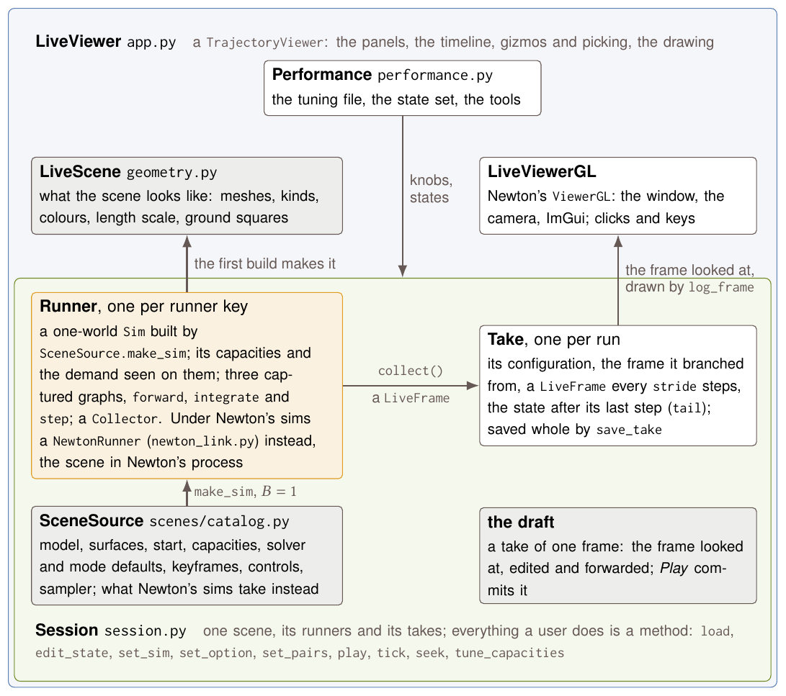

# Lodos v2: The Live Viewer

*Using it, how it is built, and how to add scenes, controls and overlays to it*

The code as of 2026-11-04. A guide beside the two manuals, *Collision Detection* (`docs/collision_detection.pdf`) and *Contact Dynamics* (`docs/contact_dynamics.pdf`), and the two guides *Creating a Simulation from an MJCF* (`docs/creating_new_sim_from_mjcf.pdf`) and *Performance Tuning* (`docs/performance_tuning.pdf`). The code is the top-level package `viewer/`. Built from `docs/manual/`.

**About this document.** The live viewer simulates one world of a scene in a window. You load a built-in scene or an MJCF file, set its state by gizmo or by value, play it under Lodos (or, for comparison, under two of Newton's sims), switch the sim, the solver's mode or any option at any frame, set the collision pairs' contact parameters, and scrub every run you have made, or save it and load it back. Each sim's capacities can be sized to the demand it has seen, and its whole configuration written to a file. Both collision pipelines' geometry and contacts are drawn. Lodos has one contact solver, the NLSP solver, in two modes, so the viewer's top-level choice is the sim rather than a solver.

This document is for two readers:

- someone who wants to use the viewer: Sections [1](#1-starting-it) and [2](#2-the-window), and [Section 7](#7-limits-and-troubleshooting) when something goes wrong;
- someone, a person or an agent, who wants to add a built-in scene, a solver option, an overlay or a panel section, or to drive the viewer from a script: Sections [3](#3-how-it-is-built), [4](#4-adding-a-built-in-scene), [5](#5-extending-the-viewer) and [6](#6-driving-it-from-scripts).

Every control is named as the panel names it, and every function and constant as the code names it.

**Contents**

- [1 Starting it](#1-starting-it)
  - [1.1 Commands](#11-commands)
  - [1.2 The built-in scenes](#12-the-built-in-scenes)
  - [1.3 MJCF files](#13-mjcf-files)
- [2 The window](#2-the-window)
  - [2.1 Layout](#21-layout)
  - [2.2 Takes and drafts](#22-takes-and-drafts)
  - [2.3 Scene](#23-scene)
  - [2.4 Sim](#24-sim)
  - [2.5 Capacities](#25-capacities)
  - [2.6 Collision pairs](#26-collision-pairs)
  - [2.7 State](#27-state)
  - [2.8 Recording and traces](#28-recording-and-traces)
  - [2.9 Camera](#29-camera)
  - [2.10 Overlays](#210-overlays)
  - [2.11 Geometries](#211-geometries)
  - [2.12 Scales, body velocity scales and thickness](#212-scales-body-velocity-scales-and-thickness)
  - [2.13 Render](#213-render)
  - [2.14 Performance](#214-performance)
  - [2.15 The timeline](#215-the-timeline)
  - [2.16 Picking and gizmos](#216-picking-and-gizmos)
  - [2.17 Keys and mouse](#217-keys-and-mouse)
- [3 How it is built](#3-how-it-is-built)
  - [3.1 The modules](#31-the-modules)
  - [3.2 The objects](#32-the-objects)
  - [3.3 The loop and the splash](#33-the-loop-and-the-splash)
  - [3.4 Configurations and runners](#34-configurations-and-runners)
  - [3.5 Capture](#35-capture)
  - [3.6 Capacities that grow](#36-capacities-that-grow)
  - [3.7 Frames](#37-frames)
  - [3.8 What is drawn](#38-what-is-drawn)
- [4 Adding a built-in scene](#4-adding-a-built-in-scene)
  - [4.1 SceneSource](#41-scenesource)
  - [4.2 Pre-recorded controls](#42-pre-recorded-controls)
  - [4.3 Step by step](#43-step-by-step)
  - [4.4 Example: the hand holding the armadillo](#44-example-the-hand-holding-the-armadillo)
  - [4.5 Example: the nut-bolt's starts](#45-example-the-nut-bolts-starts)
  - [4.6 Without code: an MJCF file](#46-without-code-an-mjcf-file)
  - [4.7 Without registering: a SceneSource from a script](#47-without-registering-a-scenesource-from-a-script)
- [5 Extending the viewer](#5-extending-the-viewer)
  - [5.1 A solver option](#51-a-solver-option)
  - [5.2 An overlay](#52-an-overlay)
  - [5.3 A trace](#53-a-trace)
  - [5.4 A panel section](#54-a-panel-section)
  - [5.5 A key](#55-a-key)
- [6 Driving it from scripts](#6-driving-it-from-scripts)
  - [6.1 A session without a window](#61-a-session-without-a-window)
  - [6.2 The window from a script, and screenshots](#62-the-window-from-a-script-and-screenshots)
  - [6.3 The Performance section without a window](#63-the-performance-section-without-a-window)
- [7 Limits and troubleshooting](#7-limits-and-troubleshooting)
  - [7.1 Limits](#71-limits)
  - [7.2 Troubleshooting](#72-troubleshooting)

## 1 Starting it

### 1.1 Commands

```bash
python -m viewer                                     # an empty window: load a scene from the Scene panel
python -m viewer arm_box_6                           # a built-in scene, under Lodos
python -m viewer arm_box_6 --sim mjwarp              # ... under Newton's MuJoCo Warp, for comparison
python -m viewer nutbolt_05 --seed 3                 # ... from the nut's third jittered start
python -m viewer sharpa_5_sdf --tuned                # ... with its tuning file's knobs
python -m viewer viewer/assets/mjcf/joints_demo.xml  # an MJCF file
python -m viewer nist_threading_m8                   # Isaac Lab's threading, replayed from its recording
python -m viewer scene.xml --controls rec.npz        # a scene playing pre-recorded controls
lodos-viewer arm_box_6                               # the same, installed with the vis extra
```

The viewer needs an NVIDIA GPU, a display, and the `vis` dependencies:

- Newton 1.5.1, whose OpenGL viewer (`newton.viewer.ViewerGL`) is the window;
- imgui-bundle: ImGui for the panels, ImGuizmo for the gizmos, ImPlot for the traces;
- pyglet for the window's events, mediapy for videos, and Pillow.

`uv sync` installs them as the `vis` group. `pip install ".[vis]"` installs them as the extra, with the `lodos-viewer` command, which is `python -m viewer`. Table 1 lists the options.

**Table 1: The command line's options.**

| option | default | what |
|---|---|---|
| `SCENE` | none | a built-in scene's name (Table 2), the Scene panel's or one that loads by name only, or an MJCF file's path. Without one the window opens empty; anything else is an error that lists the built-in names |
| `--sim` | `lodos` | the sim a scene starts under: `lodos`, or Newton's `mjwarp` or `kamino` where `viewer/newton/`'s environment is installed ([Section 2.4](#24-sim)); without it, only `lodos` is accepted. It is also the Scene panel's *start sim*, for scenes loaded later |
| `--seed` | 0 | a built-in scene's seed ([Section 1.2](#12-the-built-in-scenes)) |
| `--stride` | 1 | record every n-th step ([Section 2.8](#28-recording-and-traces)) |
| `--root DIR` | the working directory, the repository, the home directory | where the MJCF search looks. Repeatable; given, it replaces the three defaults |
| `--tuned` | off | apply the knobs of each scene's tuning file on every scene load and sim switch ([Section 2.14](#214-performance)) |
| `--controls FILE` | none | pre-recorded controls for `SCENE` to play from its start: an `.npz` of `ctrl`, `(T, nu)` for the scene's actuators, and `period`, the seconds each row holds ([Section 4.2](#42-pre-recorded-controls)). A recording for another number of actuators is an error |
| `--width`, `--height` | 85 % of the screen | the window's size in pixels; 1920 by 1080 when the screen's size cannot be read |

### 1.2 The built-in scenes

There are 76, listed in Table 2: the Scene panel lists 66 of them, in the table's order, and the last ten load by name only, from the command line or a script: the mixed piles, Newton's nut-bolt and two SHARPA hands. Their names are built from parts:

- **The representation.** `_sdf`: the bodies collide as Lodos surfaces, vertices against signed distance fields, in the pairs the scene declares. `_polytope`: they collide as MJCF convex pieces, boxes or a sphere, through MJWarp's pipeline and its exact hull narrowphase. The bodies, their inertia and their starts are the same either way.
- `_walled`: inside an open-top box of four walls. The walls are MJCF boxes in a polytope scene, and half-spaces on static bodies in an sdf scene, since a Lodos surface collides only with Lodos geometry.
- `_trilinear`: the nut-bolt's fields evaluated trilinearly ($S_{\mathrm{c0}}$) instead of tricubically ($S_{\mathrm{c2}}$).
- `_m8`, `_m12`, `_m16`: a NIST nut-bolt's thread. A NIST nut remeshed finer than its size's default carries its edge length in millimetres, as `_s0.25`.
- **The number**: the bodies (5 or 20 cubes, armadillos or hands, 6 or 20 in the mixed scenes, 2 hands), or the nut's remeshing edge length (`05` is 0.5 mm, `1` is 1 mm).

Every hand scene keeps the hand's joint limits and friction loss, which the solve has as MuJoCo's soft rows.

**Seeds.** The *seed* field beside the scene menu, and `--seed`, draw a built-in scene's start: the random stacks of the drops and of the hands. For the nut-bolts, Newton's and the NIST ones, and the NIST board, seed 0 is the scene's start, and seed $k > 0$ is world $k$ of the benchmarks' jittered starts, each nut turned further by an angle drawn from $\pm 0.05$ rad; the scene's name then ends in “`, start k`”. The FBF scenes, the time-of-arrival scenes, the two grasps, the driven nuts and the threading replays have one start and ignore the seed.

**Assets.** Every scene's assets ship in `viewer/assets/`: the shipped surfaces in `surfaces`, the armadillo's 34 pieces in `armadillo_cp`, the arch's stones in `arch`, the nut-bolt's in `nutbolt`, the SHARPA hand's in `sharpa`, the Shadow hand's and the Kong toy's in `shadow_kong`, and the NIST parts, with the Franka, in `nist`. A scene whose assets are missing is left out of the list: the registry is built when `viewer.scenes.catalog` is imported, and the cube, FBF and time-of-arrival sdf scenes check their surfaces then, the nut-bolt, hand and NIST scenes their directories and files. `$LODOS_ASSETS`, `$LODOS_NUTBOLT_DIR`, `$LODOS_SHARPA_DIR`, `$LODOS_SHADOW_KONG_DIR`, `$LODOS_NIST_DIR` and `$LODOS_FRANKA_DIR` move them. Isaac Lab states no licence for its NIST parts beyond the older Factory parts' BSD-3-Clause; `tools/mesh_processing/nist` makes them from Isaac Lab's USD files. The Franka is Menagerie's Panda (Apache-2.0), 33 MB of meshes in `viewer/assets/nist/franka`.

**Table 2: The built-in scenes: the Scene panel's, in its order, then those that load by name only. “Seed” says what the seed draws.**

| scenes | what | seed |
|---|---|---|
| `incline_sdf`, `incline_polytope` | a 0.2 m box sliding down a slope of $\arctan(1/2)$ at $\mu$ 0.45 | – |
| `painleve_box_sdf`, `painleve_box_polytope` | a 0.3 by 0.6 by 1.2 m box sliding at 4 m/s at the threshold between sliding and tipping over, $\mu$ 0.5 | – |
| `backspin_ball_sdf`, `backspin_ball_polytope` | a ball of radius 0.25 m launched at 4 m/s with 200 rad/s of backspin, $\mu$ 0.5 | – |
| `masonry_arch_sdf`, `masonry_arch_polytope` | an arch of 25 stones, the end ones welded, $\mu$ 0.8 | – |
| `house_of_cards_sdf`, `house_of_cards_polytope` | a house of 40 cards in five levels, $\mu$ 0.8 | – |
| `toa_wall_sdf` | thin features under time of arrival (`toa`, on by default in these five, which have a 2 ms step and, but for the bullet, no gravity, `viewer.scenes.toa`): five 0.2 m cubes shot at a fixed 4 cm card at 10, 20, 40, 80 and 160 m/s, half to eight card thicknesses a step. Every one stops at the card's face, at rest; with `toa` off the two slow ones sink in and bounce back, the next two stick in the card and the fastest passes through | – |
| `toa_flyby_sdf` | the same cubes flying past the card's edge with 5 or 20 mm to spare at 10 to 80 m/s, and one clipping it by 10 mm: four pass untouched, one is struck. With `toa trace` off, ghost collisions stop and spin the passing ones | – |
| `toa_ring_sdf` | four 2 cm cubes sliding around the inside of four thin rings (radius 10 cm, a 1 cm wall) at 5, 10, 20 and 40 m/s, $\mu$ 0.001, with `toa drift` on: all stay inside, slowing as each step's chord runs into the wall. With the drift off the two fast ones stick in the wall, and with `toa` off the fastest leaves the ring | – |
| `toa_hammer_sdf` | five 2 cm cubes on 0.3 m hinged arms swung at 30, 60, 90, 120 and 150 rad/s along 1 cm plates on the pivot's side, 2 mm off them. The arc bends into the plate by $\frac12\omega^2 r\,\Delta t^2$ a step, which `toa`'s straight lines miss: up to 90 rad/s the cubes stop, at 120 one crosses the plate's midsurface and sticks, at 150 one passes through. `toa side` holds the one at 120; the Collision pairs section reports the bend | – |
| `toa_bullet_sdf` | a light 0.2 m cube (0.8 kg) shot at 160 m/s, 32 card thicknesses a step, at a free 1 cm steel card (0.6 by 1.2 m, 56 kg) hanging in the air, 0.18 m off its centre, under gravity: the card spins away at about two turns a second as both fall to the floor. With `toa` off the cube clears the card between two steps and passes through it untouched | – |
| `cube_5_sdf`, `cube_5_polytope` | five cubes of 0.8 m dropped in one stack of random orientations onto a floor. As surfaces of 386 vertices spread over the faces, or as MJCF boxes | the stack |
| `cube_walled_5_sdf`, `cube_walled_5_polytope` | the same in a walled box 3 m across | the stack |
| `cube_20_sdf`, `cube_20_polytope`, `cube_walled_20_sdf`, `cube_walled_20_polytope` | twenty cubes in four stacks 3 m apart, on a floor or in a walled box 6 m across | the stacks |
| `arm_5_sdf`, `arm_5_polytope` | five armadillos, 1.64 m tall at density 100, dropped in one stack of random orientations onto a floor. As surfaces of 451 vertices, every ordered pair declared and each against the floor; or as 34 convex pieces each | the stack |
| `arm_walled_5_sdf`, `arm_walled_5_polytope` | the same in a walled box 3 m across | the stack |
| `arm_20_sdf`, `arm_20_polytope`, `arm_walled_20_sdf`, `arm_walled_20_polytope` | twenty armadillos in four stacks 3 m apart, on a floor or in a walled box 6 m across | the stacks |
| `sharpa_5_sdf`, `sharpa_5_polytope` | five SHARPA Wave right hands stacked at random orientations and dropped onto a floor, their fingers held open by their own servos at a tenth of the menagerie's stiffness. As 23 link surfaces each, or as 87 convex hulls each | the stack |
| `sharpa_walled_5_sdf`, `sharpa_walled_5_polytope` | the same in a walled box 0.5 m across | the stack |
| `sharpa_20_sdf`, `sharpa_20_polytope`, `sharpa_walled_20_sdf`, `sharpa_walled_20_polytope` | twenty hands in four stacks 0.5 m apart, on a floor or in a walled box 1 m across | the stacks |
| `shadow_5_sdf`, `shadow_5_polytope`, `shadow_walled_5_sdf`, `shadow_walled_5_polytope`, `shadow_20_sdf`, `shadow_20_polytope`, `shadow_walled_20_sdf`, `shadow_walled_20_polytope` | the same piles of the Shadow hand: Menagerie's Shadow Hand E3M5 as Dexonomy ships it, without its tendons, forearm and wrist, its fingers held open by the grasp scene's servos (below), $\mu$ 0.6. As 21 link surfaces each, or as 70 convex hulls each | the stacks |
| `sharpa_armadillo_sdf`, `sharpa_armadillo_polytope` | the SHARPA hand holding a 70 mm armadillo palm up, on a wrist of three hinges, at its keyframe `home` and holding that keyframe's control: the worked example of *Creating a Simulation from an MJCF*. As surfaces, or as 87 + 34 convex hulls | – |
| `shadow_grasp_sdf`, `shadow_grasp_polytope` | the Shadow hand lifting an 81 g Kong toy 100 mm in Dexonomy's four-finger prismatic grasp, replayed open loop (`viewer.scenes.shadow_kong`): its wrist on six servoed joints, a `RecordedControls` row each 4 ms for 1.7 s of the wrist's six targets, the fingers' 22 and the toy's weight, a force applied from 0.8 s on, 10 mm into the lift (the scene has no gravity), and the last row held after it; $\mu$ 0.6. As 21 link surfaces and the toy's, or as 70 + 13 convex hulls | – |
| `nist_threading_m8` | Isaac Lab's NIST policy threading the M8 nut onto its bolt, replayed (`viewer.scenes.nist.threading`): the Franka scene with the episode's board and bolt, from the recorded state of the policy's decision 280, its drives' targets the recording's (`RecordedControls`, a row each 10 ms tick for 6.2 s), its fingers on stiffer drives that follow their recorded path. The exact mode runs at 2 outer proximal iterations, and mj at MuJoCo's tolerance $10^{-5}$ with Isaac Lab's contact parameters (`nist.THREADING_OPTIONS`) | – |
| `nist_threading_m8_easy` | the same replay from an easier start (`nist.THREADING_EASY`): the nut at rest 3.4 pitches onto the thread, where it had screwed itself down with the drives held, the robot as recorded at decision 280 | – |
| `nist_nutbolt_m8`, `nist_nutbolt_m12`, `nist_nutbolt_m16` | Isaac Lab's NIST M8, M12 or M16 nut (30 g) started on its bolt's thread two pitches below the tip, turned to the thread's phase there, to screw itself down under gravity: its 3 235, 3 622 or 4 881 vertices, two fifths of a pitch apart, against the bolt's field; $\mu$ 0.01 on the thread, a step of 1/480 s, `implicitfast`; a Baumgarte slop of 0 (`nist.OPTIONS`), contact reduction, and the M20 nut's 6 by 4 bins where the contacts are grouped | the start |
| `nist_nutbolt_m8_s0.25`, `nist_nutbolt_m8_s0.125`, `nist_nutbolt_m12_s0.35`, `nist_nutbolt_m12_s0.175`, `nist_nutbolt_m16_s0.4`, `nist_nutbolt_m16_s0.2` | the same with the nut remeshed at a fifth and at a tenth of its pitch: 13 378 to 79 611 vertices | the start |
| `nist_driven_m8`, `nist_driven_m12`, `nist_driven_m16` | the same pair at the demo's $\mu$ 0.75, where the thread self-locks: the nut on two slides across the axis, sprung at 500 N/m, a free slide along it, and a hinge that a velocity servo turns at a turn a second, as the arm would | – |
| `nist_board` | the NIST task board fixed at the demo's pose, one field, with the M8, M12 and M16 bolts at the demo's offsets and each nut started on its thread; $\mu$ 0.01 on the threads, 0.75 against the board, 1.0 on the floor | the start |
| *By name only* |  |  |
| `arm_box_6`, `arm_box_20` | both pipelines in one scene: armadillos and cubes alternating, three and three in one stack or ten and ten in four, in the walled box. An armadillo carries its surface, which meets the other armadillos and the floor, and its 34 pieces, which meet the cubes, the walls and the other pieces and start hidden. A cube is an MJCF box | the stacks |
| `nutbolt_05`, `nutbolt_1` | Newton's nut-bolt example: IsaacGymEnvs' M20 loose nut dropped onto the bolt's thread 41 mm above its seat, turned $\pi/8$, to screw itself down under gravity. The 0.5 mm nut (19 100 vertices) or the 1 mm nut (4 799) against the bolt's field; $\mu$ 0.01 on the thread, a step of 1/480 s; contact reduction, and 6 normal bins by 4 moment sectors where its contacts are grouped | the start |
| `nutbolt_05_trilinear`, `nutbolt_1_trilinear` | the same with trilinear fields | the start |
| `sharpa_2_sdf`, `sharpa_2_polytope`, `sharpa_walled_2_sdf`, `sharpa_walled_2_polytope` | two SHARPA hands in one stack, on a floor or in the walled box 0.5 m across | the stack |

The first five pairs are the exactness scenes of Song, Fan, Ascher and Pai's FBF paper (SCA 2026), with a step of 1/60 s, and 1/240 s for the cards and the arch. Their polytope versions are MJCF boxes, an MJCF sphere, or the arch's 25 convex stones. Every family is a module of `viewer.scenes`: `representations` (the drops, with `drop`), `mixed`, `nutbolt`, `nist` (with `franka`, its arm), `sharpa`, `shadow`, `sharpa_armadillo`, `shadow_kong` and `fbf`. *Performance Tuning* measures each scene's throughput, before tuning and after.

### 1.3 MJCF files

Any MJCF loads: from the command line, or from the Scene panel's search or its *Browse...* button ([Section 2.3](#23-scene)). Everything in it collides through MJWarp's pipeline. A geom becomes a Lodos surface by a custom text field named after it:

```xml
<custom>
  <text name="lodos:arm0" data="armadillo"/>               <!-- a shipped surface -->
  <text name="lodos:shell" data="bake/surface_data.npz"/>  <!-- a bake, relative to the file -->
  <text name="lodos:floor" data="plane"/>                  <!-- a plane, for both pipelines -->
  <numeric name="lodos:mu" data="0.8"/>                    <!-- optional pair parameters -->
  <numeric name="lodos:stiffness" data="5000"/>
  <numeric name="lodos:dissipation" data="0.15"/>
  <text name="lodos:controls" data="controls.npz"/>       <!-- pre-recorded controls, relative to the file -->
</custom>
```

- **The data** is a shipped surface's name (`viewer/assets/surfaces/<name>`), a bake's path (any data that ends in `.npz` or holds a path separator, relative to the MJCF file), or `plane` on a plane geom. A plane keyed this way serves both pipelines: it stays a plane in MJWarp's collision, and every surface collides with it.
- **Surfaces load** tricubic and without inner spheres; the Sim panel's `spline_type` switches them (Table 3). A shipped surface named twice is loaded once and shared.
- **The keyed geom** puts the surface on its body. A surface's vertices are in its body's frame, so the geom should be the same mesh placed with no offset, as `viewer.scenes.assets.surface_obj(name)` writes it (into `.scratch/` in a clone, the user's cache directory otherwise, `$LODOS_CACHE` where set); MuJoCo then takes the body's inertia from it. `make_sim` takes it out of MJWarp's collision.
- **The pairs** are every ordered pair of surfaces on different bodies, and every surface against every plane, all with one row of parameters: `lodos:mu` (0.8 if not given), and `lodos:stiffness` and `lodos:dissipation` where given (the family's defaults otherwise).
- **The friction cone**: a file that names none (`<option cone>`, in it or in a file it includes) gets the elliptic one, as every built-in scene has, rather than MuJoCo's default, the pyramidal one; a file that names a cone keeps it. `lodos.sim.make_sim`, which takes a compiled model, keeps the model's.
- **The start** is the model's first keyframe, positions and velocities, if it has one, else `qpos0` at rest. Every keyframe is in the State panel's menu.
- **Recorded controls**: `lodos:controls` names no geom but a recording of the actuators' controls, an `.npz` relative to the file, which the viewer plays from the start ([Section 4.2](#42-pre-recorded-controls)).
- **Errors.** An annotation naming a geom the model lacks, or `plane` on a geom that is not a plane, is refused with a `ValueError`, and anything `lodos.rbd` or MJWarp's collision does not take is refused too (`lodos.rbd` raises a `NotImplementedError` that names it) (creation guide, *What lodos.rbd takes*). The message shows in the Scene panel's status line.

This suits piles of objects. It does not suit an articulated body, whose pairs need a filter and a direction each, nor a scene with per-pair parameters, a held control, controls that read the state, per-mode defaults or a sampler of starts: those need a scene in code ([Section 4](#4-adding-a-built-in-scene)). `viewer.scenes.catalog.from_mjcf(path)` is the loader, and the collision manual's *Lodos surfaces in an MJCF file* the reference.

`viewer/assets/mjcf/joints_demo.xml` ships as the example: a free box, a hinge pendulum, a slider and a ball-jointed arm over a floor, all colliding through MJWarp's pipeline, with a keyframe `tossed` that throws the box and displaces the other joints. It is the file for trying the gizmos.

**Export as MJCF.** The Scene panel's *Export as MJCF* writes a built-in scene in this form, at the frame being looked at (as the keyframe `initial`), to `<name>_live.xml` in the working directory. Asset paths stay absolute, so the file is for this machine. The export is lossy:

- it names each surface by finding one of the same vertex count in `viewer/assets/surfaces` (under `$LODOS_ASSETS` where set), so surfaces of equal count are confused: `cube_0.2` and `cube_0.8` (the cube drops export 0.2 m surfaces on 0.8 m boxes), and several of the arch's stones. A surface rescaled after loading is named at its shipped size;
- it cannot name the surfaces of the nut-bolts, the NIST parts, the hands or the Kong toy, which are not there, and fails with a message;
- it writes the first pair's `mu`, `stiffness` and `dissipation` for every pair, and on loading the pairs are derived again as above;
- it keeps none of the scene's `caps`, `sim_kwargs`, `solver_defaults`, `mode_defaults`, `group_bins`, held `ctrl` or Newton fields (Table 9): the nut-bolts' contact reduction and bins, the NIST scenes' Baumgarte slop of 0, the grasp's closed fingers;
- it keeps none of the configuration on screen: the Sim panel's options and the Collision pairs section's values are not in it (*Export sim config* writes those, [Section 2.4](#24-sim)).

## 2 The window

### 2.1 Layout

The window, titled *Lodos live*, is Newton's OpenGL viewer.

- **The sidebar** on the left is Newton's panel. The viewer's sections come first, in this order: Scene, Sim, Capacities, Collision pairs, State, Recording and traces, Camera, Overlays, Geometries, Scales, Body velocity scales, Thickness, Render and Performance. Until a scene is loaded only Scene shows. Scene, Sim, State, Camera and Overlays start open; the others start closed. Newton's own sections follow: Example Options (empty here), Rendering Options (vsync, off here, sky, shadows, wireframe, the light's and the sky's colours) and Controls (the camera's pose and Newton's list of keys, not all of which apply here: [Section 2.17](#217-keys-and-mouse)).
- **The timeline** along the bottom, right of the sidebar, is a window of its own, which can be moved and resized ([Section 2.15](#215-the-timeline)).
- **The view**, with the selected body's gizmos over it, and Newton's frame rate in the top right corner.
- **The splash.** While a scene loads, or a configuration is built for the first time, Newton's loading splash covers the window and says what is being built. The window does not respond until it is done: seconds for a build, and longer the first time ever, while Warp compiles the kernels (cached after that, in `~/.cache/warp`).
- **The status line**, at the bottom of the Scene section, says what was last loaded, built (and in how long), selected or written, or what failed.

ImGui keeps the windows' positions and sizes in `imgui.ini` in the working directory; delete it to get the default layout back.

### 2.2 Takes and drafts

A *take* is one run from one state under one configuration: a sim, its options and the contact parameters. It holds its frames, one every `stride` steps, and the state after its last step, from which it continues.

- **Play** from a frame before the end of a take replays what was recorded. At the end it continues simulating, recording as it goes.
- **Editing never changes the take being looked at.** Dragging a gizmo, typing in a field, choosing another sim, option or parameter, or loading a state makes a *draft*: a take of one frame, the frame being looked at, changed by the edit and forwarded so that its contacts and forces show. Further edits change the same draft. *Play* runs it as a new take; looking at another take discards it.
- **Every take is kept**, until *Delete*, and can be saved whole and loaded back ([Section 2.8](#28-recording-and-traces)). Run a pile under the exact mode, go back to a frame, switch the mode to mj and play: two takes from one state, to flip between in the timeline's menu.
- **Switching costs nothing after the first build.** Every configuration keeps its own simulation ([Section 3.4](#34-configurations-and-runners)), unless the GPU had no room for another and the session freed it ([Section 3.6](#36-capacities-that-grow)), and a take that is continued picks up where it stopped, MJWarp's warm start included, so a take continued after a detour is the run it would have been without one (the exceptions are in [Section 7.1](#71-limits)).

A take's label names it, its configuration and where it came from: “`take 3: Lodos exact, 100 it, ls 50 it, rho 1, alpha 0.1, 5 prox it, ray groups, 1x1 bins, dt 2 ms from take 1 frame 250`”. The configuration part names the sim. Under Lodos it gives the mode and its main options (the iteration caps, Newton's and the line search's, the proximal weight, the Baumgarte gain or its absence, a slop other than the default, the outer proximal iterations), then those of the others that differ from the solver's defaults, the contact reduction, the trilinear fields and `implicitfast` where they are on, the step, and what the Collision pairs section sets ([Section 2.6](#26-collision-pairs)). Newton's sims give their gap, MJWarp its iterations and tolerances, and Kamino whatever differs from Newton's defaults: “`MJWarp, gap 20.1 mm, iterations 100, tolerance 1e-06, ls iterations 50, ls tolerance 0.01, dt 2 ms`”. A loaded take's label ends in “`loaded from FILE`”. A draft is labelled “`draft: ...`”. When a scene loads, a draft at its start is what you see first: *Play* makes it take 1.

### 2.3 Scene

- **The line at the top**: the scene's name, its bodies, geoms and Lodos surfaces (planes among them).
- **Built-in scenes**: the menu, the *seed* field and *Load*, with the selected scene's description under them. The menu lists the panel's scenes (`viewer.scenes.catalog.PANEL`); the others load by name (Table 2).
- **MJCF files**: the search box; type any part of a path. Every MJCF under the search roots is indexed in the background from the moment the window opens: a walk of at most six levels that skips version control, environments, caches, build directories and every hidden directory, and keeps each `.xml` whose first 4 kB open a `<mujoco` element, at most 20 000 of them. Every whitespace-separated term must appear in the path, ignoring case; a term in the file name ranks above one only in the directories, and then shorter paths come first. The list shows the first 300 matches, and the line above it counts them and says *indexing...* until the walk is done.
- Click a match to select it, double-click to load it, hover for its full path. *Load file* loads the selected match, *Rescan* indexes again, and *Browse...* opens the system's file dialog.
- *start sim*: the sim a scene loaded from here starts under; `--sim` at first.
- *Export as MJCF*, for a built-in scene ([Section 1.3](#13-mjcf-files)).
- The status line.

### 2.4 Sim

The menu, *sim*, switches the sim at the frame being looked at: a draft under the new sim, at its defaults, keeping any contact-parameter overrides. The first switch to a configuration builds it under the splash; switching back costs nothing. The line under the menu says what the sim is. Its options follow, each with its speed arrow, then what the solve costs, and *Export sim config*.

- **Lodos**, the default, is Lodos's own simulation: its rigid-body dynamics, both collision pipelines (Lodos's for its surfaces, and MJWarp's for the MJCF geoms, which Lodos carries adapted in `lodos.col.prim`), and the NLSP solver, MJWarp's constraint solve (adapted, `lodos.cd.solver`) on Lodos's and MJWarp's contacts, under the exact mode or MuJoCo's. Table 3 lists its options.
- **MJWarp** and **Kamino** are Newton's, for comparison, where Newton's environment is installed (below).

Under Lodos:

- **A choice** is a menu. **A count** is a field with $-$ and $+$: typing applies when you leave the field, the buttons at once. **A real number** is typed in scientific notation and applies when you leave the field. Values are clipped to the ranges in Table 3.
- **An option shows only where it applies**: the Baumgarte options under the exact mode, the friction cone under mj; `contact_reduction`, `spline_type`, `groups` and the bins for a scene with Lodos surfaces.
- **The speed arrow** beside an option says which way makes the sim faster (`viewer.session.FASTER`, and `NEWTON_FASTER` for Newton's own options): `^` larger, `v` smaller, `<>` an optimum that depends on the scene, `-> x` the value `x`; its tooltip says so. A physics choice carries none: the mode, the Baumgarte and de Saxcé terms, `implicit_constraints`, the friction cone, Kamino's `gamma`.
- **Defaults** are the scene's (`SceneSource.defaults`: its `solver_defaults` and, over them, its `mode_defaults` for the mode), else the solver's, those of `lodos.cd.driver.resolve_options`. `iterations`, `tolerance`, `ls_iterations` and `ls_tolerance` are MuJoCo's own: the MJCF's, unless the scene's defaults set them, and the tolerance at least $10^{-6}$, the float32 floor at which `make_sim`'s model, as MuJoCo Warp's, holds it; `timestep`, `integrator` and, under mj, `cone` are the MJCF's; `spline_type` is the scene's surfaces'; `contact_reduction` and `implicit_constraints` come from the scene's `sim_kwargs`, and the bins from its `group_bins` (Table 9).
- **Some options follow others.** Switching the mode starts the proximal loop's options, the de Saxcé term, under exact the Baumgarte options and under mj the friction cone over at the mode's defaults, the scene's where it has them (`MODE_OPTIONS`, `mode_options`), and MuJoCo's own options too where the scene sets them for a mode. `refresh_de_saxce_per_prox` needs the de Saxcé term and a proximal loop: it goes off with either, and when an option brings both back it returns to the scene's default, else the solver's, on.
- **How a change reaches the solver**, the table's last column: *rebuild* is another runner, built under the splash the first time; *recapture* is the same runner with its step captured again, a fraction of a second; *in place* writes an array the captured step reads, at no cost. [Section 3.4](#34-configurations-and-runners) says why each is which.

**Table 3: Lodos's options in the Sim panel, in the panel's order. The defaults are the solver's, which a scene can change (Table 9); “faster” is the option's speed arrow; the contact dynamics manual explains each option.**

| option | values (default) | what | faster | a change |
|---|---|---|---|---|
| `mode` | `exact`, `mj` (`exact`) | the normal problem: the exact one, by proximal point with a Baumgarte target, or MuJoCo's soft one | – | rebuild |
| `iterations` | 1–500 (the MJCF's) | MJWarp's cap on its Newton iterations | `v` | recapture |
| `tolerance` | $10^{-6}$–$10^{-2}$ (the MJCF's) | MJWarp's tolerance | `^` | in place |
| `ls_iterations` | 1–1000 (the MJCF's) | the line search's cap on its iterations | `v` | recapture |
| `ls_tolerance` | $10^{-12}$–1 (the MJCF's) | the line search's tolerance | `^` | in place |
| `cone` | `elliptic`, `pyramidal` (the MJCF's); mj only | MuJoCo's friction cone; the exact mode's proximal loop runs the elliptic one | – | rebuild |
| `prox_rho` | $10^{-3}$–100 (1) | the proximal weight | `<>` | rebuild |
| `baumgarte` | 0, 1 (1); exact only | the Baumgarte bias in the normal target; 0 is the velocity-level target | – | recapture |
| `baumgarte_alpha` | 0–1 (0.1); exact only | the bias's gain | – | in place |
| `baumgarte_slop` | 0–0.01 m (0.2 mm); exact only | the penetration the bias leaves alone | – | in place |
| `prox_iters_per_qp` | 0–200 (10 under exact, 0 under mj) | the proximal loop's outer iterations; the exact mode needs at least one | `v` | rebuild |
| `prox_tol_z` | $10^{-12}$–1 ($10^{-3}$) | the proximal loop's tolerance on a world's anchor: the relative move below which the anchor counts as settled | `^` | in place |
| `prox_tol_sigma` | $10^{-12}$–1 ($10^{-3}$) | its tolerance on the de Saxcé term, in a round that re-took it; the loop stops once both hold | `^` | in place |
| `de_saxce` | 0, 1 (1 under exact, 0 under mj) | the de Saxcé term in the normal target | – | rebuild |
| `refresh_de_saxce_per_prox` | 0, 1 (1 where it applies) | the term taken again after every outer proximal iteration | `-> 0` | rebuild |
| `spline_type` | `cubic`, `linear` (the scene's) | the Lodos surfaces' fields: the tricubic B-spline ($S_{\mathrm{c2}}$) or trilinear interpolation ($S_{\mathrm{c0}}$) of the same bake (`lodos.col.sdf.with_spline_type`); a take's label says “trilinear” | `-> linear` | rebuild |
| `contact_reduction` | 0, 1 (the scene's) | hand MJWarp at most 240 of each Lodos pair segment's contacts, reduced as Newton reduces them; a grouped pair's groups are made of those | `-> 1` | rebuild |
| `warm_start` | 0, 1 (1) | MJWarp's warm start, and with a proximal loop its carry across steps | `-> 1` | rebuild |
| `fused_newton` | 0, 1 (0) | the solve as one kernel per world (`lodos.cd.fused`): MJWarp's iterates, faster on small models (nv $\le$ 16). It holds a world's rows in shared memory, so it takes a small row capacity, as the threading replay's own, and refuses larger ones; a model it cannot take fails its build with the reason | `<>` | rebuild |
| `groups` | `contact`, `ray`, `cone` (`contact`) | each Lodos contact its own MJWarp contact, or a pair segment's contacts gathered per normal bin and moment sector into contact groups (`lodos.cd.groups`): a ray group is one row, a cone group a full friction cone, and the group's force is shared among its members by the spring-damper's weights; a frame draws each member's share | `<>` | rebuild |
| `normal_bins` | 1, 6, 12, 20 (the scene's `group_bins`, else 1) | bins of contact normals per pair segment, for the groups (nothing under `contact`); a typed count snaps to the nearest | `<>` | rebuild |
| `moment_bins` | 1, 2, 3, 4, 6 (as `normal_bins`) | sectors per normal bin, by the moment's direction | `<>` | rebuild |
| `row_space` | 0, 1 (0) | MJWarp's Newton system solved through the constraint rows (`lodos.cd.rowspace`): the same iterates, at a cost set by a world's rows rather than its dofs, which lets the groups' fewer rows pay on the piles; not with `fused_newton` | `<>` | rebuild |
| `shared_hessian` | auto, 0, 1 (auto) | MJWarp's sparse Newton Hessian summed per world in shared memory (`opt.shared_hessian`): the same Hessian, built faster on the larger models, up to 144 padded dofs; auto, the solver's default (`lodos.cd.driver.shared_hessian_default`), turns it on where MJWarp can build it on a model of 64 padded dofs or more (48 dofs), off below; 1 on a scene it cannot take fails to build; a take's label names 0 and 1, not auto | `<>` | rebuild |
| `timestep` | $10^{-6}$–0.1 s (the MJCF's) | the step, written on the build's copy of the model; a take's frames, its pacing and its real-time factor follow it, and a scene's controls keep their period, so a recording's row holds for more or fewer steps | `^` | rebuild |
| `integrator` | `euler`, `implicitfast` (the MJCF's) | semi-implicit Euler, or MuJoCo's implicitfast: implicit in the actuators' and the dofs' damping (the contact dynamics manual) | `<>` | rebuild |
| `implicit_constraints` | 0, 1 (the scene's, else 0) | under implicitfast, the matrix the contact solve sees: 0 the mass matrix, as MuJoCo has it; 1 $M - \Delta t\,D$ throughout | – | rebuild |

**What the solve costs.** Under the options, the frame's solve: its iterations and whether it converged. Under Lodos they are MJWarp's Newton iterations, summed over the proximal rounds, with the rounds against their budget where the loop runs (the fused Newton solve records no convergence); under MJWarp, its Newton iterations against their cap; under Kamino, PADMM's iterations against their cap, with its primal, dual and complementarity residuals. Over the take's recorded frames the line under it gives the mean and largest iteration count, the mean proximal rounds, and how many frames did not converge.

**Export sim config.** writes everything the panel sets on the configuration on screen to `<scene>_<sim>_simconfig.json` in the working directory (`Session.export_config`, format `lodos-viewer-config/2`): the sim and every option it shows; its capacities, per world, with Lodos's arenas' fractions, their sizes and the demand seen ([Section 2.5](#25-capacities)); and each kind of pair's contact parameters ([Section 2.6](#26-collision-pairs)): the values most of its pairs share, every pair that differs by its name, and the fields the solve applies (under the exact mode friction, sidedness and Lodos's time of arrival alone, under Kamino friction alone; a pair's time of arrival in words: `toa` true or false, `toa_trace` its mode, `toa_horizon` in seconds or null for the step), with the overrides as a saved take holds them, which give the configuration back. Values are the solver's float32, in their shortest decimals.

**Newton's sims, for comparison.** Where `viewer/newton/`'s environment is installed (`cd viewer/newton && uv sync`, an environment of its own), the menu also offers MJWarp, Newton 1.7's `SolverMuJoCo` on upstream MuJoCo Warp 3.15, and Kamino, its `SolverKamino`. Neither uses any of Lodos's code.

- **They run in a process of their own**, in that environment (`viewer.newton_link`, `viewer/newton/runner.py`). The viewer hands it the state at the frame being looked at, in MuJoCo's layout, and draws what comes back each step: the poses by MuJoCo's kinematics on the viewer's model, the contacts and their forces as Newton reports them, in the MJCF column.
- **Newton imports the scene's MJCF**, with Newton's collision pipeline for both, and under MJWarp with the MJCF's own MuJoCo settings: its options, contact parameters and actuators. The convex pieces become convex hulls, and each Lodos surface becomes its mesh with Newton's mesh SDF at the bake's voxel size, with the smallest friction of its pairs, and their solref and solimp where they all agree. A scene can have Newton collide another shape for a surface (`SceneSource.newton_shapes`: the NIST parts as Isaac Lab's collision meshes, at the demo's SDF settings), import another MJCF (`newton_xml`) and play other controls (`newton_controls`): the threading replay runs as Isaac Lab's Newton benchmark of the demo ran it. `viewer/newton/README.md` lists the changes the import makes.
- **Their options** (Table 4) start at the MJCF's values and Newton 1.7's defaults, under the scene's own (`SceneSource.newton_options`: the threading's gap of 0). A change rebuilds the Newton side at the same state. A tuning file does not apply to them ([Section 2.14](#214-performance)).
- **Their capacities and pairs are Newton's**: the Capacities section tunes Newton's contacts, triangle pairs and rows ([Section 2.5](#25-capacities)), and the Collision pairs section sets Newton's shapes' parameters ([Section 2.6](#26-collision-pairs)). A scene's controls play under them as under Lodos ([Section 4.2](#42-pre-recorded-controls)).
- **They are slower to start**: the first switch starts the process and builds the scene (a few seconds), and every step crosses between the two processes. Throughput comparisons are the benchmarks' (`bench/lodos_mjwarp/`, `bench/lodos_kamino/`), not the viewer's.

**Table 4: Newton's sims' options in the Sim panel: MuJoCo Warp's, then Kamino's, in the panel's order. A change rebuilds the scene in Newton's process, at the same state.**

| option | values (default) | what | faster |
|---|---|---|---|
| `gap` | 0–1 m (1 % of the scene's typical body size) | both sims: every colliding shape's contact gap, but a geom's own where the MJCF gives one. Newton's own 0.1 m makes contacts between every pair of shapes within 10 cm | `v` |
| `timestep` | $10^{-6}$–0.1 s (the MJCF's) | both sims: the step | `^` |
| `integrator` | `euler`, `implicitfast` (the MJCF's) | MuJoCo Warp's integrator | `<>` |
| `solver` | `newton`, `cg` (the MJCF's) | MuJoCo Warp's solver | `<>` |
| `cone` | `elliptic`, `pyramidal` (the MJCF's) | MuJoCo Warp's friction cone | – |
| `iterations`, `tolerance` | 1–1000; $10^{-6}$–$10^{-2}$, at least MuJoCo Warp's float32 floor (the MJCF's) | MuJoCo Warp's cap on its iterations, and its tolerance | `v`, `^` |
| `ls_iterations`, `ls_tolerance` | 1–1000; $10^{-12}$–1 (the MJCF's) | its line search's | `v`, `^` |
| `primal_tolerance`, `dual_tolerance`, `compl_tolerance` | $10^{-12}$–1 ($10^{-6}$ each) | Kamino's PADMM: its tolerances on the primal, dual and complementarity residuals | `^` |
| `max_iterations` | 1–10 000 (200) | PADMM's iteration cap | `v` |
| `rho_0` | $10^{-6}$–$10^{6}$ (1) | the penalty's initial value | `<>` |
| `use_acceleration` | 0, 1 (1) | PADMM's acceleration | `<>` |
| `warmstart_mode` | `none`, `internal`, `containers` (`containers`) | PADMM's warm start | `<>` |
| `contact_warmstart_method` | `key_and_position`, `geom_pair_net_force`, `geom_pair_net_wrench`, and the first with either as its backup (`key_and_position`) | how a contact's warm start is found | `<>` |
| `preconditioning` | 0, 1 (1) | the dynamics' preconditioning | `<>` |
| `gamma` | 0–1 (0.01) | the contacts' Baumgarte gain | – |

### 2.5 Capacities

The section, closed at first, lists every capacity of the configuration on screen, at its one world: how much is allocated, and the largest demand on it so far, over every step simulated under the configuration, its rebuilds at other capacities included ([Section 3.6](#36-capacities-that-grow)).

- **Under Lodos**: *contacts (nconmax)*, every contact the solve takes, Lodos's among them; *constraint rows (njmax)*; *CCD slots (nccdmax)* where the exact hull narrowphase runs; and for a scene with Lodos surfaces, the collision's arenas: *Lodos tiles*, *Lodos compacted tiles* (where the pairs' tiles are compacted), *Lodos stage 1*, *Lodos stage 2* and *Lodos contacts*. A line gives the arenas as fractions of a world's worst case (`capacity_tile`, `capacity2`, `capacity1`), 1 unless the scene, a tuning or a growth set them.
- **Under Newton's sims**: *Newton contacts* and *Newton triangle pairs* (the mesh contacts' triangle pairs, a million at least), and under MJWarp *MuJoCo Warp rows (njmax)*.
- ***Tune capacities*** sets each to its peak times 1 + *capacity overhead* (0.5 at first: 1.5 times the peak), as a tuning file is sized (`lodos.utils.calibrate.settings`; rows 16 at least), and rebuilds from the state on screen, under the splash. What it did, or why it failed, shows under the button. The peaks are those of what the configuration has simulated so far: play it first. A step that later outgrows a tuned capacity grows it again ([Section 3.6](#36-capacities-that-grow)).

### 2.6 Collision pairs

The section, closed at first, sets the contact parameters of the configuration on screen pair by pair (`viewer.pairs`): friction (`mu`), `solref` and `solimp`, whether a Lodos pair is one- or two-sided, and a Lodos pair's time of arrival (`toa`, below). It lists the pairs of every kind the sim collides:

- **Lodos pairs**, under Lodos: the scene's `Surfaces.pairs`. The solver reads a row of parameters per pair (`cpr_friction`, `cpr_solref`, `cpr_solimp`), so a pair takes exactly what it is set, written in place. One-sided, a pair's first surface's vertices meet the second's SDF; two-sided, both ways (`cpr_is_symmetric`), a rebuild. A pair with a plane is one-sided: a plane has no vertices. A pair's time of arrival is a rebuild too: the collision options of `make_collision_context` (*Collision Detection*) spelled per pair.
- **MJCF pairs**, under Lodos: the geom pairs MJWarp's pipeline collides. MuJoCo resolves a contact's parameters from an explicit `<pair>`'s own, else from its two geoms': the larger friction, solref and solimp mixed by `solmix`, a geom of higher priority taking all. An explicit pair takes what it is set. For the rest, each geom takes the min, max or mean (*a geom's value from its pairs'*, min at first) of what is set on the pairs it is in, so the list shows what MJWarp then applies, which can differ from what was set.
- **Newton's pairs**, under Newton's sims: the shape pairs Newton's pipeline collides. Under MJWarp friction, solref and solimp, each shape taking the min, max or mean as an MJCF geom does; under Kamino friction alone, a contact's its two shapes' mixed by Kamino's rule, by default their average. They are set on the running model in Newton's process, without a rebuild.

A line at the top says what the solve reads: under the exact mode friction, sidedness and time of arrival alone, since no solref, solimp or impratio reaches it; under Kamino friction alone; under mj and MJWarp all three, a time constant below twice the step being raised to it (MuJoCo's `refsafe`). The fields the solve does not read are greyed.

- **All pairs**: one value for every pair of every kind, and the sidedness of every Lodos pair without a plane.
- **Each kind**: a filter, the pairs it matches and the same fields for those. The filter's words must all appear in a pair's two names, any case; with a `/`, the words before it in the first name and those after it in the second. The list shows the first 300 matches, each with its values as applied and `*` on those set on it; clicking one narrows the filter to it.
- **A field** shows the first pair's value, marked *(mixed)* where the pairs it covers differ and `*` where some are set; `solimp` is typed as five numbers, dmin, dmax, width, mid and power. A value applies when you leave the field, to every pair the field covers: with no filter, one value for all of the kind's pairs, held once rather than per pair (the twenty Shadow hands as hulls have nearly a million MJCF pairs). Right-clicking a set field restores the scene's values, or the value for all of the kind's pairs where one is set.
- **Time of arrival**, under the Lodos pairs: `toa` (off or on: the pairs' tests also keep what their motion can bring within reach over the horizon, and a vertex there becomes a speculative contact, so a thin feature is not crossed at any speed); `toa trace`, how a speculative contact's path is checked (off, sphere tracing, or over-relaxed, the default); `toa trace iters`, the most field evaluations a trace takes (128); `toa drift` and `toa side`, the opt-in concave-drift correction and side memory. They cover the pairs the filter matches, the trace's and the opt-ins' greyed where none of them has `toa` on, whose pairs alone read them. `toa horizon` (ms) is one value for every Lodos pair, since Lodos takes one per collision context: the step unless set, which 0 or a right-click restores. Each is a rebuild. Time of arrival needs the exact mode with its Baumgarte bias and no contact groups (`lodos.sim.make_sim` refuses the rest): the block is greyed under any other, and while a pair has `toa` on, a switch to one is refused (“`refused: ... turn their toa off first`”). Under the block, its checks (`Session.toa_checks`, from `lodos.col.sdf.collide`'s `check_toa_band` and `check_toa_bend`) report a speculative gap read outside a baked grid, where a band wider than the largest speed times the step would help, and a rotating body's arc bent off its straight line by more than half a voxel in a step, where a smaller step would; each keeps the worst of everything the configuration simulated since it was built, and *clear the checks* starts them over.

An edit makes a draft, as any other does. A take's label names what is set: “`Lodos mu 0.5 on all pairs`”, “`MJCF solref 0.004 1 on 3 pairs`”, “`2 Lodos pairs two-sided`”, “`Lodos toa on for all pairs`”, “`Lodos toa trace sphere on 2 pairs`”, “`Lodos toa horizon 4 ms`”, “`MJCF geoms by min`”.

### 2.7 State

- *body*: the bodies that have joints, or click one in the view ([Section 2.16](#216-picking-and-gizmos)). The selected body's joints are listed below, with fields for each.
- *local axes*: a free joint's gizmo in the body's axes, or in the world's. *gizmos on all bodies*: every joint's gizmo at once. *angular velocity in world frame*: the angular velocity fields in the world frame instead of `qvel`'s body frame.
- *Zero velocities*; *Initial state*, the scene's start; *keyframe...*, the model's keyframes. Each makes a draft.
- *play controls*, for a scene with controls ([Section 4.2](#42-pre-recorded-controls)): off, the drives keep the targets they last had while the scene runs, a recording's first row at its start; on again, the controls resume at the scene's time, from the tick that holds it. A recording's tick shows beside it. To let a scene settle before its controls play: off, run, pause, *Save state*.
- *Save state* writes `<scene>_state_<t>.npz` (`qpos`, `qvel`, `time`) in the working directory; the field and *Load* read one back, positions and velocities.
- *Copy state* puts the state on the clipboard as one line of Python, `dict(qpos=[...], qvel=[...])`, which a script can take, and *Paste state* reads such a line back.

Table 5 lists the joint fields. They follow MuJoCo's conventions: a free joint's linear velocity is in the world frame, and its angular velocity, like a ball joint's, in the body's.

**Table 5: A joint's fields in the State panel, and its gizmo.**

| joint | position | velocity | gizmo |
|---|---|---|---|
| free | position (m); quaternion ($w, x, y, z$, normalized when applied); roll, pitch and yaw (degrees, about the world's x, then y, then z) | linear velocity (world frame); angular velocity (body frame, or world) | translate arrows and rotation rings, in the body's axes or the world's |
| ball | quaternion; roll, pitch and yaw | angular velocity (body frame, or world) | rotation rings at the joint's anchor |
| hinge | position (rad), shown in degrees too | velocity (rad/s) | a ring about the axis |
| slide | position (m) | velocity (m/s) | an arrow along the axis |

A dragged field changes the state as it is dragged; a quaternion applies when you leave its field. Every change is a draft, and a drag keeps changing the same one.

### 2.8 Recording and traces

- *record every n-th step*: the stride of takes started from now on. A recorded frame holds everything drawn and the state, so a take scrubs at once; the twenty-body scenes record 5–27 MB per 1 000 frames. A stride of $n$ records $n$ times less and plays the same.
- The takes and the memory their frames hold. Playing pauses when the recording reaches 4 GB (`MEMORY_BUDGET`), with a message; delete takes or record less to go on.
- Which traces the timeline shows ([Section 2.15](#215-the-timeline)).
- *Save take* writes the take on screen whole to `<scene>_take<k>.npz` (`<scene>_draft.npz` for a draft) in the working directory (`viewer.session.save_take`): every frame, with its state, MJWarp's warm start, contacts, poses and traces, the state after its last step, and its configuration, the pairs' parameters included. The field and *Load* add a saved take back (`Session.load_take`), to scrub and to continue from its end: into a session of its scene, loading that scene first where another is open, a built-in scene by its name and an MJCF file by its path. A take of another scene (its name and model sizes) is refused, and a take of a seeded start (`, start k`) loads only into a session of that start. Continued, a loaded take follows the run it was saved from.
- The session's last message: a build and its time, a capacity that grew or was tuned ([Section 3.6](#36-capacities-that-grow)), the memory pause.

### 2.9 Camera

*Fly speed* sets how fast W, A, S, D, Q and E fly the camera, in m/s, on a logarithmic slider from 0.02 to 4 times the framed extent per second. Framing the camera (`F`) sets it to 0.6 of the framed extent per second, which is right for a hand and for a pile alike. *Zoom speed* sets how far a notch of the mouse wheel dollies the camera toward its pivot: the distance shrinks by $e^{-s}$ a notch, whatever the scene's size, $s$ on a logarithmic slider from 0.01 to 1, 1 to 63 % a notch (Newton's 0.15, 14 %, until it is moved).

### 2.10 Overlays

- **Contacts**, a table with a column per pipeline, Lodos and MJCF (MJWarp's pipeline): points, normals, velocities, forces, and the forces' normal and tangential parts. Lodos's are drawn in cool colours and the MJCF geoms' in warm ones.
- *Body linear velocity* and *Body angular velocity*: an arrow from each moving body's origin.
- *Body frames*: each body's axes, red, green and blue. *Joint axes*: a line through each hinge's and slide's anchor, along its axis.

**Every overlay is off when a scene loads**; a sim switch keeps what you switched on. Contacts are drawn in one convention, whichever sim made them: the force on the contact's second body, along a normal pointing out of the first, and the velocity of the second body relative to the first at the contact point. On a body at rest the drawn forces sum to its weight. Lodos's contacts are among MJWarp's, which the solve takes together, and are drawn as Lodos's. A contact that made no constraint row is not drawn, and with contact reduction only the contacts MJWarp was handed are. A contact group is drawn as its members, each with its share of the group's force ([Section 3.7](#37-frames)). Under Newton's sims every contact is Newton's, drawn in the MJCF column.

### 2.11 Geometries

Every drawn geometry is one of four kinds, and the panel shows and edges them by kind, with their counts:

- **Lodos surfaces**, drawn from their baked vertices;
- **MJCF geoms**: the MJCF geoms in MJWarp's collision;
- **planes**: every MJCF plane, whichever pipelines it is in;
- **non-colliding geoms**: the MJCF geoms in no collision, among them every geom a surface is keyed to.

**What shows at first.** Every geometry shows, except the non-colliding geoms and the MJCF geoms of a body that also carries a Lodos surface: in the mixed scenes those are an armadillo's 34 pieces, which would be drawn into its surface. The panel says so.

**Colours.** Each body has a colour of its own from a palette of eight, cycled; the world's is a grey. A geom keeps the colour the MJCF gives it, and its alpha becomes its transparency, except:

- a geom left at MuJoCo's default grey takes its body's colour;
- a colliding geom in MuJoCo's collision group 3 is drawn opaque in its body's colour, as its surface would be. MuJoCo's own viewer hides that group, so models tint what they put there: the menagerie's hulls on the SHARPA hands are green at a quarter opacity, and the grasp scene's armadillo pieces join that group;
- a plane is MuJoCo's ground colour, 0.2, 0.3, 0.4.

**The ground.** An opaque plane is a checker, every other square darker, at MuJoCo's contrast between its two colours. A square is half the scene's largest body, rounded down to 1, 2 or 5 times a power of ten: 2 cm under the nut-bolt, 5 cm under the hands, 0.2 m under the cubes, 0.5 m under the armadillos, 1 m under the house of cards, 5 m under the arch. *ground squares (m, 0 plain)* changes it, and 0 draws the ground plain. A see-through plane, such as the sdf drops' walls, is never checkered.

**Controls.** *Reset* shows every geometry, opaque and without edges, the hidden kinds included; it is not the scene's starting choice. *All wire* and *No wire* switch every geometry's edges. *All* is a master transparency that multiplies each geometry's own. Then the kinds, each with a show and an edges box, and the bodies, each a tree of its geometries with show, edges and transparency. Transparency is screen-door dithering, which keeps the depth buffer exact, so transparent bodies overlap correctly. A selected body is outlined: its shown geometries get their edges.

Primitives are triangulated once per size and meshes once per MJCF mesh, and each is drawn as instances. An MJCF mesh of fewer than 4 000 faces, and a cylinder, are drawn flat-shaded, each face with its own normal; a Lodos surface is drawn smooth. Heightfields and SDF geoms are not drawn.

### 2.12 Scales, body velocity scales and thickness

- **Scales**: *Point radius*, *Normal length*, *Frame length* and *Line width* (for body frames and joint axes). With *Auto scale* on, the default, the velocity and force arrows are scaled so that the *Percentile* (95th) of their lengths over the whole take is *Arrow length*: comparable from frame to frame, and visible across magnitudes that span decades. The scales are taken again when the take changes or has grown by a quarter. With it off, *Velocity scale* and *Force scale* are typed.
- **Body velocity scales**: metres of arrow per m/s and per rad/s. Auto scale sets them so that the 95th percentile speed over the take is half the scene's length scale, with floors of 1 m/s and 2 rad/s, so that a scene at rest does not blow a nudge up to a body's length.
- **Thickness**: each arrow's shaft radius, in metres: normals, contact velocity, force and its two parts, and the bodies' two velocities.

The scene's length scale, from which every default size comes, is the median body's extent, its surfaces and geoms together ([Section 3.8](#38-what-is-drawn)).

### 2.13 Render

*Render video* draws every frame of the current take, from the current camera, with the overlays that are on, and streams them into the file named in *Output* (`take.mp4` in the working directory). The panels are not in the video. *FPS* defaults to the take's frame rate, at most 120, and the panel says what that is against real time: a 2 ms step recorded every step renders at 120 frames per second, a quarter of real time, and recorded every fourth step in real time. The window waits until the video is written.

### 2.14 Performance

The Performance section, closed at first, connects the viewer to `tools/performance_tuning/`; *Performance Tuning*'s *In the live viewer* is its guide.

- **The tuning file**: the path (by default `tools/performance_tuning/tuned/<scene>.tuning.json`), *Load*, and the file's settings and throughput (`lodos.utils.tuning.describe`), its throughput before tuning, and in orange what makes it stale.
- ***Apply knobs*** takes the file's knobs and not its capacities (`lodos.utils.tuning.knobs_only`): the viewer runs one world and sizes its own ([Section 3.6](#36-capacities-that-grow)). The tile sizes go into the scene's collision options and rebuild every runner. The solver's budgets (in the shipped files, `prox_iters_per_qp`) and the contact reduction become the Sim panel's options, where they can be seen and changed, and they show in the take's label. A tuning file tunes Lodos: under Newton's sims the button says so and changes nothing.
- ***apply on every load and sim switch***, or `--tuned`: the file applied whenever a scene loads and whenever the sim menu switches. A switch to Lodos then starts at its defaults and takes the file's knobs. For an MJCF file, the file is `tools/performance_tuning/tuned/<stem>.tuning.json`; where there is none the scene runs at its own settings, and the section says so. An application sets only the collision options that differ from the scene's current ones, since setting them rebuilds every runner: the first application, at a scene's load, sets the file's tile sizes, and a later switch rebuilds nothing.
- **The state set** (by default `results/tuning/states/<scene>.states.npz`, under the working directory `results/tuning/` the section makes in the repository for its states and logs): *Add frame* adds the state on screen, *Add take* a frame of the current take every *every* frames (10), and *Save* and *Load* write and read it. Clicking a state in the list shows it, as a draft.
- **The tools** run `tools/performance_tuning/`'s scripts in the background, at batch size *B* (1024): *Explore* makes a state set, *Calibrate* sizes every capacity into the tuning file, *Profile* times each stage, and *Tune* does the whole tuning. One runs at a time, from the repository with the viewer's Python, logging to `results/tuning/logs/<scene>.<tool>.log`, whose last lines show; *Stop* ends it. A finished calibration or tuning reloads the file, an exploration the state set, and a profile shows its stage table. They share the viewer's GPU: pause the viewer for clean timings.
- ***Read counters***: the state on screen against the viewer's own capacities: each Lodos stage (candidates, tiles, voxel survivors, contacts), and the runtime's contacts and rows, every pipeline's; under Newton's sims, Newton's contacts against its buffer.
- ***tile size (all pairs)*** and *Rebuild*: one tile size for every Lodos pair, rebuilding every runner.

> **Calibrate and Tune write the file in the path field.** By default that is the scene's shipped file in `tools/performance_tuning/tuned/`, which *Calibrate* updates and *Tune* replaces. Point the field elsewhere first to keep it. Both need a saved state set.

### 2.15 The timeline

- **The title bar** says what is happening: a draft waiting for *Play*, paused, replaying at a rate, or simulating at a multiple of real time; and how much is recorded.
- **The first row**: `|<` and `>|`, the first and last frame; `<` one frame back; *Play* and *Pause*; `>` one recorded frame forward, simulating up to it at the end of a take; the speed, from 0.02 to 10 times real time, and *max*, as fast as the scene runs; the takes' menu, by label; and *Delete*, which forgets the current take. Deleting the only take left leaves a draft at the scene's start.
- **The second row**: the frame slider, with the frame and the time on it.
- **The traces**, side by side, as many as are switched on, over the current take: the contacts per pipeline, the deepest penetration (m), the kinetic energy (J), and the solver's iterations. A pipeline with no contact in the whole take gets no line, unless neither has any. Click in a trace, or drag its line, to seek.

The kinetic energy is $\frac{1}{2}\dot q^\top M \dot q$ with the step's own mass matrix, which equals MuJoCo's. The iterations are MJWarp's Newton iterations (`d.solver_niter`), summed over the proximal loop's rounds. Under Newton's sims they are the iterations the Newton process reports, MuJoCo Warp's Newton iterations or Kamino's PADMM ones, and the kinetic energy is MuJoCo's, of the state that comes back.

### 2.16 Picking and gizmos

**Picking.** A left click, moving less than 6 pixels (times the UI's scale), selects the body whose shown geometry the click's ray meets first. Only bodies that can move, by a joint of their own or an ancestor's, are candidates, and planes are not: the walls of a drop are in front of the pile, and a click goes through them. A click on empty space selects nothing. The State panel's *body* menu selects too. A selected body is outlined, a point marks its origin, and its joints get fields and gizmos.

**Gizmos.** ImGuizmo's handles, used as in viser (Table 5): a free joint's translate arrows and rotation rings, a ball joint's rings at its anchor, a hinge's ring about its axis, a slide's arrow along it. A hinge's and a slide's gizmo are always in the joint's own axes. A free joint's gizmo appears only on a body at the top of its tree, since it sets the body's pose in the world. A gizmo's frame is rebuilt every frame from the state, so a drag moves the joint by exactly what the mouse did, and MuJoCo's own kinematics then puts the gizmo where it was dragged, for every joint type. While the mouse is over a gizmo, or drags one, the camera ignores it.

### 2.17 Keys and mouse

**Table 6: Keys and mouse. A key goes to the panel instead while a text field has the keyboard.**

| input | does |
|---|---|
| `Space` | play or pause |
| `Right` | one recorded frame forward, simulating up to it at the end of a take |
| `Left` | one frame back |
| `F` | frame the camera on the frame being looked at |
| `H` | hide or show the panels |
| `Escape` | quit |
| `W` `A` `S` `D`, `Q` `E` | fly the camera; Newton reads the arrow keys as W, A, S, D too, so `Left` and `Right` also nudge it sideways |
| left click | select a body |
| left drag | look around |
| middle drag | orbit; with `Shift`, pan; with `Ctrl`, dolly |
| scroll | dolly, by the Camera section's *Zoom speed*; with `Ctrl`, the field of view |

Table 6 lists them. Framing the camera (`F`, and when a scene loads) fits the moving bodies and the ground under them, and aims at the part of the window the sidebar and the timeline leave free. Newton's Controls section lists Newton's own keys: `.` and right-click picking do nothing here.

## 3 How it is built

### 3.1 The modules

**Table 7: The viewer's modules, in `viewer/`.**

| file | holds |
|---|---|
| `__main__.py` | the command line, `main` |
| `app.py` | `LiveViewer`: the panel's sections (`_ui_*`), the timeline, gizmos, picking, the drawing, the loop (`run`), work deferred under the splash. `LiveViewerGL`: clicks and keys. `FileIndex`: the background MJCF index |
| `session.py` | `Session`, `Runner`, `Take`, `State`, `TrajectoryView`; the sims (`SIMS`, `SIM_NAMES`); the panel's options (`OPTIONS`) and how each is applied; their speed arrows (`FASTER`, `NEWTON_FASTER`, `speed_arrow`); configurations (`default_config`, `edit_config`, `edit_pairs`, `config_label`, `runner_key`); the capacities (`STAGES`, `FRACTIONS`, `CAPACITY_OVERHEAD`, `GROW`); saved takes (`save_take`, `read_take`, `take_meta`); `TICK_BUDGET`, `MEMORY_BUDGET` |
| `pairs.py` | the Collision pairs section's model: `PairTable`, one kind of pair's names, values and filter (`lodos`, `prim`, `newton`); a configuration's overrides (`no_overrides`, `check`, `label`); Lodos's fields that rebuild (`REBUILD_FIELDS`: sidedness and time of arrival, `TOA_FIELDS`; `scene_toa`, `lodos_values`, `rebuild_changes`, `toa_col_kwargs`); how MJWarp's geoms take what is set on their pairs (`GEOM_MODES`) |
| `scenes/catalog.py` | `SceneSource`; the built-in registry (`_builtin`, `BUILTIN`, `PANEL`, `builtin`) and its factories; pre-recorded controls (`RecordedControls`, `with_controls`); the surfaces' spline type (`spline_of`, `respline`); MJCF loading (`from_mjcf`, `lodos_surfaces`, `keyframes`), `export_mjcf`; the MJCF search (`find_mjcf`, `search`) |
| `scenes/` | the scene builders, one module a family ([Section 1.2](#12-the-built-in-scenes)); `assets.py`, where the shipped assets are (`ASSET_DIR`, `load_surface`, `surface_obj`, `CACHE_DIR`); `data/`, the recordings |
| `newton_link.py` | `NewtonRunner`, which stands in for `Runner` under Newton's sims; `NewtonProcess`, the process in `viewer/newton/`'s environment; `scene_package`, a scene as Newton takes it; Newton's options (`OPTIONS`, `default_options`, `KAMINO_DEFAULTS`) |
| `newton/` | the Newton side, a uv project of its own (`pyproject.toml`, Newton 1.7.0): `runner.py`, the process the viewer starts, and `newton_scene.py`, the scene in Newton: its model, its states in MuJoCo's layout, its capacities and its step |
| `collect.py` | `Collector` and `LiveFrame`; `total_force` and `energy_reference`, for checks |
| `geometry.py` | `LiveScene`, `make_live_scene`: what a scene looks like; the primitives' meshes, `checker_size`, `geom_xforms` |
| `joints.py` | `Joint`, `joints`; each gizmo's frame and its inverse (`gizmo_frame`, `gizmo_ops`, `apply_gizmo`); angular velocity between frames |
| `performance.py` | `Performance`, the Performance section |
| `draw.py` | `TrajectoryViewer`, which `LiveViewer` extends: the drawing, the Camera, Scales, Thickness and Render sections, the video; `enable_transparency`, the shader patch |
| `trajectory.py` | `Frame`, which `LiveFrame` extends |

Table 7 is the map.

### 3.2 The objects



*Figure 1: The viewer's objects. A `Session` holds one scene, a runner per runner key and the takes; the `LiveViewer` around it draws the frame being looked at and drives the session. Every runner of a scene shares the one `LiveScene`.*

Figure 1 shows how they fit.

- **`LiveViewer`** (`app.py`) is a `viewer.draw.TrajectoryViewer` whose trajectory is the take being looked at, wrapped as a `TrajectoryView`. So the drawing, the wireframes, transparency, scales and video are that viewer's, and the live viewer adds the panels, the timeline, gizmos, picking and the bodies' velocities. `LiveViewerGL` is Newton's `ViewerGL` with the clicks and keys the viewer needs.
- **`Session`** (`session.py`) holds everything that is not drawing: the scene's `SceneSource`, the runners by key, the takes, the take being looked at, the draft, the frame index, whether it plays and how fast. Everything a user can do is a method of it, which is what a script drives ([Section 6.1](#61-a-session-without-a-window)).
- **`Runner`**: one configuration of the scene at one world, with its step captured ([Section 3.4](#34-configurations-and-runners)), its capacities and the largest demand seen on them ([Section 3.6](#36-capacities-that-grow)). Under Newton's sims a `NewtonRunner` stands in for it, with the scene in Newton's process.
- **`Take`**: a run, with its configuration, the frame it branched from (`parent`), its frames, its stride, its step count and `tail`, the `State` after its last step: positions, velocities, time, and MJWarp's warm start. `save_take` writes one whole, and `read_take` reads it back.
- **`LiveFrame`** (`collect.py`): one recorded state and everything drawn of it ([Section 3.7](#37-frames)).
- **`SceneSource`** (`scenes/catalog.py`): a scene before it is a simulation, because a session builds it more than once ([Section 4.1](#41-scenesource)).
- **`LiveScene`** (`geometry.py`): what the scene looks like, made from the first runner's simulation when a scene loads and shared by every later runner ([Section 3.8](#38-what-is-drawn)).

### 3.3 The loop and the splash

`LiveViewer.run` loops until the window closes. Each pass:

1. runs the pending blocking work, if any, under the splash;
2. advances the session, `Session.tick`;
3. attaches the drawing to the session's scene if it changed (`_attach_scene`), points it at the current take and frame, and rescales the arrows;
4. draws the frame, after which Newton draws the panels: the sidebar's sections and the free windows, the timeline and the gizmos.

A step that raises pauses the session and shows “`step failed: ...`”; a drawing that raises does the same. Each panel section runs inside `_guarded`, with ImGui's error recovery: an exception there is printed once and shown in the status line, and the window, with every take in it, stays open.

**Tick.** `Session.tick` advances by the wall time since the last pass, capped at 0.25 s. Through recorded frames it moves at `rate` times real time. At the end of a take it simulates `rate` times the elapsed time's worth of steps, stopping after 30 ms of stepping (`TICK_BUDGET`), so the window stays responsive at about 30 frames per second. A scene slower than the rate drops its backlog and runs as fast as it can rather than lurching. *max* steps for the whole 30 ms. The multiple of real time in the timeline's title is smoothed over passes.

**The splash.** Work that blocks for seconds is deferred: `_defer(fn, message)` stores it, and the next passes draw the splash twice, so that the window says what it is doing before it blocks, then run it and hide the splash. An exception becomes “`failed: ...`” in the status line. Loading a scene is always deferred (`load`, `load_builtin`, `load_file`). The sim menu, the option fields and the Collision pairs fields go through `request_sim`, `request_option`, `request_pairs` and `request_all_pairs`, which defer only when the configuration's runner does not exist yet (`_maybe_build`); *Tune capacities* and loading a take are always deferred (`request_tune_capacities`, `request_load_take`).

### 3.4 Configurations and runners

**Configurations.** A configuration is a plain dictionary:

```python
dict(sim="lodos", options={"mode": "exact", "iterations": 100, ...},
     pairs={"lodos": {"all": {}, "mu": {}, "solref": {}, "solimp": {}, "sided": {},
                      "toa": {}, "toa_trace": {}, "toa_trace_iters": {}, "toa_drift": {},
                      "toa_side": {}, "toa_horizon": {}},
            "prim": {...}, "newton": {...}, "mode": "min"})
```

`default_config(source, sim)` gives a sim's at the scene's values, with no pair overrides (`viewer.pairs.no_overrides`). `pairs` holds, per kind of pair, a value for all of its pairs (`all`, by field) and each pair's own (by field, by pair index), and `mode`, how MJWarp's geoms take what is set on their pairs. `edit_config(source, cfg, name, value)` changes one option and what follows from it, `edit_pairs` and `edit_all_pairs` the pairs' parameters, and `config_label(cfg)` is the label part of a take's name. A Lodos field that rebuilds is not held where it is what the scene has already, so it keeps the scene's runner; and `toa_conflict(source, cfg)` says why a configuration cannot run its pairs' time of arrival, for which `edit_config` (`mode`, `baumgarte`, `groups`), `edit_pairs` and `Session.set_sim` refuse an edit.

**Runner keys.** `runner_key(cfg)` is the sim and the values of the options that change what a simulation allocates or which kernels its step launches: `REBUILD_OPTIONS`, and under Lodos also `LODOS_REBUILD_OPTIONS`: `prox_iters_per_qp` and `prox_rho`, which decide whether MJWarp's proximal path runs and with how many rounds (the path allocates its own state), `fused_newton`, a solve of its own, `groups` and `row_space`, which allocate theirs, and `shared_hessian`, a model option the step is captured with; and under Lodos the pairs made one- or two-sided or given their time of arrival against the scene's own (`viewer.pairs.REBUILD_FIELDS`, each as the field, its value for all and the pairs' own). A Newton sim's options are in none of them, so it has one runner, which its options rebuild in Newton's process. `Session.runner(cfg)` returns the runner for that key, building it the first time (where the GPU has no room, after freeing the others: [Section 3.6](#36-capacities-that-grow)), and applies the rest of `cfg` to it.

**Building.** `Runner.build` calls `SceneSource.make_sim(solver_kwargs=..., caps=..., overrides=..., sided=...)` at $B = 1$, with the key's options, less `groups` and the bins where its contacts are not grouped and `shared_hessian` at auto, the solver's default; the mj mode's cone goes in as a model override, the pairs' sidedness as `sided` and their time of arrival as `toa`, as far as each differs from the scene's (`viewer.pairs.rebuild_changes`). Its capacities, and its Lodos arenas over the surfaces' own, are those it holds ([Section 3.6](#36-capacities-that-grow)). The first runner of a scene makes the `LiveScene`. It adds a `lodos.utils.calibrate.Tracker`, which its captured graphs launch to keep the demand on every capacity, and a `Collector`, and applies the configuration it held before when it is rebuilt.

**Controls.** A scene's `controls` (Table 9) are called by `Runner.step` before a step that starts one of their ticks, and before the first step after `Runner.build` or `Runner.set_state`, whatever the time. What they return is written into `ctrl`, and the forward pass is redone, since the actuators' forces read the control. Reading the time and the joints back costs a host synchronization each step: affordable for the viewer's one world, not in a benchmark. Under Newton's sims `NewtonRunner` decides by the same rule and sends the row with the step, from the scene's `newton_controls` where it has them.

**Applying.** `Runner.apply(cfg)` sets everything that is not in the key on the built simulation, where it lives (Table 8). `RECAPTURE_OPTIONS` names the options a built runner may take, but nothing reads it: the key decides what rebuilds, and `Runner.apply` what recaptures.

**Table 8: How a change that keeps the runner reaches the simulation, in `Runner.apply`.**

| what | where it lives | a change |
|---|---|---|
| `iterations`, `ls_iterations`, `baumgarte` | MJWarp's model: host-side counts, launch bounds of the captured step, and a flag compiled into the proximal path's init kernel | recapture |
| `tolerance`, `ls_tolerance`, `baumgarte_alpha`, `baumgarte_slop`, `prox_tol_z`, `prox_tol_sigma` | device arrays of MJWarp's model; the last two are the proximal loop's tolerances, on its anchor and on the de Saxcé term | in place |
| the pairs' friction, solref and solimp | the Lodos pairs' rows (the solver's `cpr_friction`, `cpr_solref`, `cpr_solimp`), and the MJCF geoms' and explicit pairs' (`geom_*`, `pair_*`); the exact mode takes friction alone | in place |
| a Newton sim's options | the scene in Newton's process, built there again at the same state (`NewtonRunner.apply`) | rebuild there |
| Newton's pairs' parameters | its shapes, on the running model (`NewtonRunner._send_pairs`) | in place there |

### 3.5 Capture

A runner captures three CUDA graphs the first time it steps: `forward`, everything but the integrator (`lodos.step.forward`); `integrate`, the semi-implicit Euler step; and `step`, the whole step. `forward` and `step` end with the `Tracker`'s launch, which keeps the largest demand on every capacity. Capturing never advances the state: one forward pass and one integration first load every kernel, the state is put back, and then the three are captured. A recapture drops the graphs, and the next step captures them again.

- **A recorded step** is `forward`, the frame collected, then `integrate`: the one moment every part of a frame belongs to one state.
- **A step not recorded** is one `step` launch.
- **A state already forwarded**, a draft's, only integrates on its first step.

`Runner.set_state` loads a `State`. It restores MJWarp's warm start and, except when it only puts the state back around a capture, empties the proximal loop's cache across steps and has the contact groups forget the frames they carry from step to step, all of which belong to whatever state the runner held before. A runner records which take and step it holds (`owner`), so a take continued on its own runner just steps on, and one continued after the runner served another is loaded again from its `tail`.

### 3.6 Capacities that grow

- **The runtime's capacities**, MJWarp's (`nconmax`, the contacts every pipeline hands the solve, Lodos's among them; `njmax`, the constraint rows; `nccdmax`, the exact hull narrowphase's CCD slots), start from the scene's `caps` (`nconmax` 1 024 and `njmax` 4 096 where a scene names none).
- **Lodos's collision arenas** start at the scene's fractions of a world's worst case, the whole worst case unless it sets them, at which one world cannot overflow.
- **Newton's**, under Newton's sims: contacts and mesh triangle pairs a world, and under MJWarp the rows, which Newton's process sizes from the contacts at the scene's start (twice the most, at least 256).

A runner keeps the largest demand on each over everything simulated under its configuration, its builds at other capacities included (`Runner.seen`, from its `Tracker`; under Newton's sims, the counts the process returns), which the Capacities section shows and *Tune capacities* sizes them to ([Section 2.5](#25-capacities)). They are checked after every step and every forward pass: contacts or broadphase pairs above `naconmax` grow `nconmax`; rows at `njmax`, or rows the row space could not hold (`row_space`), grow `njmax`; the CCD's demand above its slots grows `nccdmax`; an arena that overflowed grows its fraction.

Growing raises a capacity to 1.5 times its demand, at least double (`GROW`), and a fraction to at most 1, the worst case; `njmax_nnz` doubles with `njmax` where the scene sets it, and `nccdmax` with `nconmax`, never above it. The runner is rebuilt with the same configuration and state, and the take rolls back: it drops its last recorded frame and steps again from it, every step since redone, so a session never shows a step with contacts dropped. After eight growths in a row that do not make a step fit, `simulate` gives up with “`the capacities kept overflowing`”, and so does a draft's forward pass. The session's message says what grew, and `Session.grown` lists every growth. A run that grew from tiny capacities thus equals one that never overflowed, and a pile tuned in the air grows as it lands and still equals the run at the scene's capacities.

**Room on the GPU.** Every configuration looked at keeps its runner, and its GPU memory. A rebuild, a growth or *Tune capacities*, drops the old simulation before it builds the new one, and a build that fails anyway puts back the capacities it ran at. Where a build finds no room on the GPU, the session frees every other runner (`Session.free_runners`; a Newton runner's process ends) and tries once more; a freed runner hands its capacities and the demand it has seen to its configuration's next build. Loading a scene frees the last scene's.

### 3.7 Frames

`Collector.collect` reads a `LiveFrame` off the one-world simulation, on the host, between the forward pass and the integrator. Its contacts are MJWarp's `d.contact`, Lodos's exported contacts among them (typed `NOCARRY`), each with its constraint force decoded into the world frame by `lodos.cd.solver.constraint.contact_force`, MuJoCo Warp's, adapted: the force on the second geom, along a normal from the first to the second, the convention the drawing and `total_force` rely on. A contact that made no constraint row is left out.

- **A contact group** (typed `GROUP`) is collected as its members, with their positions, normals and depths, each carrying its share of the group's force. With the group's force $\lambda$ in its own coordinates, and member $i$'s frame $(n_i, t_{1,i}, t_{2,i})$ and weight $a_i$ (`group_member_weight`), a cone group's force reaches member $i$ as $a_i(\lambda_n n_i + \lambda_{t1} t_{1,i} + \lambda_{t2} t_{2,i})$, and a ray group's as $a_i \lambda (n_i - r_i t_{1,i})$, $r_i$ the member's friction ratio (`group_member_slip`).
- **Under Newton's sims** `NewtonRunner` builds the frame instead, from the state Newton returns: the poses and velocities by MuJoCo's kinematics on the viewer's model, the contacts and forces as Newton reports them, all in the MJCF column, and the solve's iterations and convergence (and under Kamino its residuals) as the process reports them.

A frame holds:

- the state: `qpos`, `qvel`, the time, and, under Lodos, MJWarp's warm start the solve started from, so that restoring a frame repeats its step exactly;
- every drawn geometry's pose (`geom_xform`), each body's pose, and the joints' anchors and axes;
- the contacts: position, normal, relative velocity, force, depth, pipeline (`con_src`) and bodies (`con_body`);
- each body's linear velocity at its origin and angular velocity, in the world frame;
- the traces' values (`stats`): the contacts per pipeline, the deepest depth, the kinetic energy and the solver's iterations; and what the solve cost ([Section 2.4](#24-sim)): the proximal rounds and whether the solve converged, the loop's flag where it runs, else whether Newton stopped short of its cap.

Every array is host-side NumPy, so a recorded take scrubs with no simulation at all. `frame_bytes` counts what a frame holds, for the memory budget.

### 3.8 What is drawn

`make_live_scene(sim)` lists every drawn geometry: a mesh, the body it moves with, its pose in that body's frame, its kind, colour, transparency and label, and its MJCF geom ([Section 2.11](#211-geometries)). Lodos surfaces come from `sim.surfaces`, and MJCF geoms from `sim.mjm`, the model `make_sim` built, in which keyed geoms have left MJWarp's collision. Meshes are shared: twenty armadillos of 34 pieces are 34 prototypes, not 680. A plane the MJCF leaves infinite (size 0) is drawn as a quad reaching 20 times the length scale from its centre.

- **The length scale** (`scale`) is the median over the bodies of each body's extent: its surfaces' vertices and its geoms' boxes in its frame. It sets every default size of an overlay, the camera's framing and the body velocity arrows.
- **The ground's square** (`checker`) is `checker_size` of the largest body's extent.

**The shader patch.** Newton 1.5's mesh shader has no alpha. `viewer.draw.enable_transparency`, run when `viewer.draw` is imported and before any window is made, patches its source:

- **A material's `z` carries two things.** Newton uses it as the checker's switch and only ever sets it non-negative. Negative, it is $\alpha - 1$, and the patched shader dithers the fragment away below that alpha, in the shadow pass too. Positive, it is the checker's square width in metres.
- **The darker square** is at 0.4 of the lighter's linear colour, MuJoCo's contrast, where Newton's is 0.7.
- **It checks the strings the alpha needs** before changing anything. On a Newton whose shaders have moved on it changes nothing: transparency then fades colours toward the background instead, and the ground is plain. The checker's two changes are optional: where their lines have moved, the squares stay Newton's, one metre wide at its contrast.

`LiveViewer._appearance` gives an opaque plane its square width; a see-through one keeps its alpha.

**Per frame.** Drawing a frame, `log_frame` logs the geometries (`_log_geoms`), the contact overlays per pipeline (`_log_contacts`), the body frames and joint axes (`_log_frames`), and the bodies' velocities and the selection (`_log_bodies`).

- Every object is logged every frame, with Newton's `hidden` flag doing the toggling: Newton keeps whatever was last logged under a name, so an overlay switched off must be logged hidden.
- Names live under a per-scene namespace, `/traj<k>`; loading a scene hides every object of the previous one's.
- `_log_geoms` logs one instance batch per mesh, edges only for the geometries that have them, and nothing at all when neither the frame nor any display setting changed (its cache key). On twenty armadillos as pieces a frame took 18 ms with the base class's way, and 10 ms while playing and 5 while paused with this one.

## 4 Adding a built-in scene

A built-in scene is a name in `BUILTIN`, made of the two dictionaries `_builtin()` returns when `viewer.scenes.catalog` is imported, each `name -> (description, factory)`: the scenes the Scene panel lists, in its order (`PANEL`), and those that load by name only. `factory(seed)` returns a `SceneSource`. The viewer and `tools/performance_tuning/` take a scene by that name, through `viewer.scenes.catalog.builtin(name, seed)`.

### 4.1 SceneSource

**Table 9: `SceneSource`'s fields. `make_sim` is its method that builds the scene, and `defaults(mode)` its solver options under a mode.**

| field | what | default |
|---|---|---|
| `name` | what the panel and the take labels call it. Its part before the first comma names the scene's tuning file and state set | required |
| `mjm` | the MuJoCo model as loaded; `make_sim` copies it | required |
| `surfaces` | the Lodos half, a `lodos.sim.Surfaces` | `None` |
| `qpos0`, `qvel0` | the start, `(nq,)` and `(nv,)` | the model's `qpos0`, at rest |
| `caps` | MJWarp's capacities per world, at one world: `nconmax`, `njmax`, and `nccdmax` and `njmax_nnz` if set | `nconmax` 1 024, `njmax` 4 096 |
| `sim_kwargs` | every other `make_sim` option (`contact_reduction`, `implicit_constraints`, `joint_constraints`, `hybrid`, ...) | none |
| `solver_defaults` | the solver's options at the scene's values, one flat dictionary: any of `lodos.cd.driver.OPTIONS`, and MuJoCo's `iterations`, `tolerance`, `ls_iterations` and `ls_tolerance` (`MODEL_OPTIONS`), which a build writes on its copy of the model. An option the solver does not take raises, a solver's name among them; under the mj mode the Baumgarte options, which mj refuses, stay out | none: the solver's |
| `path` | the MJCF file, for a scene loaded from disk | `None` |
| `xml` | the MJCF text, for a scene made in code: what *Export as MJCF* writes | `None` |
| `keyframes` | `(name, qpos, qvel)` each: the State panel's menu, and `explore.py`'s perturbed starts | none |
| `ctrl` | a control held in every world built, `(nu,)`: a grasp's closed fingers | `None`: zero |
| `controls` | a control that changes as the scene plays, in the viewer: an object with a `period` (s) and a call `controls(t, qpos)` returning `(nu,)`, made before each step that starts at a multiple of `period`, and before the first step from a state just loaded (`RecordedControls` plays a recording, [Section 4.2](#42-pre-recorded-controls); `viewer.scenes.nist.ActionReplay` replays recorded actions). The tuning tools hold `ctrl` | `None`: `ctrl` held |
| `sampler` | `sampler(n, seed)` returns `(n, nq)` starts drawn as the scene draws its own, for `explore.py`'s scattered starts | `None`: one start |
| `mode_defaults` | the solver's options per mode, a dictionary from `exact` or `mj` to options, over `solver_defaults` when it runs under that mode: the threading replay's 2 outer proximal iterations under exact and MuJoCo's tolerance $10^{-5}$ under mj. Not the mode itself, and under mj none of the Baumgarte options; a mode the solver does not have raises | none |
| `group_bins` | the bins a scene's contacts take where the Sim panel groups them, `dict(normal_bins=..., moment_bins=...)`: the nut-bolts' 6 by 4 | `None`: 1 by 1 |
| `newton_shapes` | what Newton's sims collide for a Lodos surface, by the id of the geom it is keyed to: a mesh with an SDF at Newton's own settings, or `None` for the MJCF's geom (the NIST parts, `nist.newton_shapes`) | `None`: each surface's own mesh |
| `newton_xml`, `newton_controls` | the MJCF Newton's sims import, or one for each sim (a dictionary by sim), and the controls they play, where they are not `xml` and `controls`: the threading replay's, as Isaac Lab's Newton benchmark ran it | `None`: the scene's |
| `newton_options` | Newton's options at the scene's values (Table 4): the threading's gap of 0 | none |

Table 9 lists the fields. `SceneSource.defaults(mode=None)` is the solver's options at the scene's values: `solver_defaults`, then `mode_defaults` for `mode` (`None`: the scene's own mode, else exact), and under mj none of the Baumgarte options. `SceneSource.make_sim(solver_kwargs=None, overrides=(), caps=None, B=1, qpos=None, qvel=None, tuning=None, sim_options=None, sided=None)` builds $B$ worlds of the scene, each at the start unless `qpos` is given, and holds `ctrl` in all of them.

- `solver_kwargs` go over the scene's defaults for the mode they name, else for the scene's, and `contact_reduction` among them over the one in `sim_kwargs`. MuJoCo's `iterations` and `tolerance`, where the defaults or `solver_kwargs` set them, are written on the build's copy of the model.
- `caps` go over the scene's, and `overrides` are MJWarp model overrides after the scene's own.
- `sim_options` go over `sim_kwargs`: the other options of `lodos.sim.make_sim`, such as `integrator` and `implicit_constraints`; `timestep`, which a build writes on its copy of the model; and `spline_type`, which builds from the scene's surfaces switched to it (`respline`, each shared surface once), the scene's own untouched. The viewer passes those four among the solver's options, and `make_sim` takes them out.
- `sided`, a dictionary from pair index to 1 or 2, makes Lodos pairs one- or two-sided over the scene's own; a pair with a plane can only be one-sided.
- `toa`, a dictionary from each of `make_collision_context`'s per-pair time-of-arrival options (`toa`, `toa_trace`, `toa_trace_iters`, `toa_drift`, `toa_side`) to `{pair index: value}`, coded as `viewer.pairs.check` holds them, and `toa_horizon` in seconds, gives Lodos pairs their time of arrival over the scene's own (`viewer.pairs.toa_col_kwargs`): an option it touches is spelled per pair, a list that a two-sided pair (after `sided`) takes both ways, each pair it sets at its value and every other at what the scene's own spelling gives it; per direction only where that spelling gives a two-sided pair's directions different values.
- A tuning file replaces the scene's own defaults where it has settings at that $B$, and what is passed explicitly still wins (*Performance Tuning*, *The tuning file*).

The viewer calls it at $B = 1$, and the tuning tools at thousands of worlds.

### 4.2 Pre-recorded controls

A scene can play a recording of its actuators' controls: `RecordedControls(ctrl, period)`, row $k$ of `ctrl`, `(T, nu)`, held over the $k$-th `period` seconds of the scene's time, and the last row after the recording ends. It is a `SceneSource.controls` (Table 9): the viewer writes each row before the step that starts its tick, and again before the first step from a state loaded anywhere in the recording, so that scrubbing back and branching replay it from there. A row is counted a hundredth of a period early, so that time accumulated in float32 cannot hold a tick back.

- **The file** is an `.npz` holding `ctrl` and `period`: `RecordedControls.load(path)` reads one and `save(path)` writes one. Other arrays in it are ignored, so a scene's data file can be its recording too (`viewer/scenes/data/nist_threading_m8.npz`).
- **Three ways in.** A scene in code passes `controls=RecordedControls(...)` and its first row as `ctrl`; `with_controls(source, controls)` does both for any scene. An MJCF file names its recording by `lodos:controls` ([Section 1.3](#13-mjcf-files)). `--controls FILE` gives one to the scene on the command line ([Section 1.1](#11-commands)).
- **Refused**: a recording that is not `(T, nu)` with $T \geq 1$, or not finite, a period that is not positive, a file without `ctrl` or `period`, and a recording for another number of actuators than the model's.
- **Exported** by *Export as MJCF* beside the file, `<file>.controls.npz`, from the tick of the frame's time: the exported scene starts there. A frame between two ticks is refused, since the file would replay that tick whole, and so are controls that are not a recording, which cannot be written.
- **Held**: the State panel's *play controls* (`Session.play_controls`) holds the drives at their last targets while the scene runs, and resumes the recording at the scene's time.
- **Under Newton's sims** a scene's controls play too: the Newton runner sends each row with the step that starts its tick, by the same rule, and the Newton process writes it where its build put each actuator, MuJoCo's `ctrl` under MJWarp and the joint drives' targets under Kamino. A scene's `newton_controls` play there instead (Table 9).
- **The tuning tools** hold `ctrl`, the recording's first row.

### 4.3 Step by step

1. **The scene in code.** Write a module in `viewer/scenes/` with a function that returns the MJCF text for a representation, one that returns the `Surfaces`, and the start: a function of a seed if the scene has random starts. *Creating a Simulation from an MJCF* goes through each part. The viewer's suffixes map to `viewer.scenes`' representation names through `GEOMETRIES = {"sdf": "surfaces", "polytope": "polytopes"}`.
2. **A factory** in `viewer/scenes/catalog.py`, `_myscene(name, ..., seed)`: import the scene module inside the function, build the MJCF and the model, the surfaces for `"surfaces"`, the start, and return a `SceneSource`. The import is inside because `BUILTIN` is built when `catalog.py` is imported: a scene module imported at the top would slow every import of the viewer and fail where its assets are missing.
3. **Register it in `_builtin()`**, in `panel` for the Scene panel's menu, at the place it should take there, or in `by_name` to load it by name only: a name with the representation as its suffix, a one-line description, which the panel shows under the menu, and a function of the seed. Bind loop variables as default arguments, `lambda s, g=g: ...`: a closure would see the loop's last value. A scene with one start ignores the seed. Register a scene whose assets may be absent only when they are present, as the nut-bolt, hand and NIST scenes do.
4. **Capacities**, `caps`: MJWarp's contacts and rows per world at one world. Lodos's contacts are MJWarp's too, unless reduced or grouped: thousands in a pile of surfaces. The viewer grows them when a step overflows, and sizes them to the demand on *Tune capacities* ([Section 3.6](#36-capacities-that-grow)), so they set only where it starts; but they are also the tuning tools' baseline, the “before” of *Performance Tuning*. The shipped scenes use 4 096 contacts and 12 288 rows per five armadillos or per hand as surfaces, 2 048 and 4 096 per five armadillos as pieces, 512 and 2 048 per hand as hulls, and 8 192 and 24 576 for the nut-bolt.
5. **Solver defaults**, `solver_defaults`, where the scene needs other values than the solver's: the NIST scenes' Baumgarte slop of 0 (`nist.OPTIONS`), since the default 0.2 mm of penetration left alone let a self-locked nut sink into its thread. Per mode, where they differ, `mode_defaults`: the threading replay's 2 outer proximal iterations under exact and tolerance $10^{-5}$ under mj (`nist.THREADING_OPTIONS`). The bins its contacts take where they are grouped, `group_bins`: the nut-bolts' 6 by 4 (`nutbolt.GROUP_BINS`). **Other `make_sim` options**, `sim_kwargs`: the nut-bolts' `contact_reduction=True`.
6. **The start and the rest**: `qpos0` and `qvel0`, `keyframes`, `ctrl`, `controls` if the control changes as the scene plays (a recording: `RecordedControls`, its data in `viewer/scenes/data/`), and a `sampler` if the scene draws random starts. `xml` for the export. The Newton fields where Newton's sims should collide, import or drive the scene otherwise (Table 9).
7. **A tuning file.** `python tools/performance_tuning/tune.py <name>` writes `tools/performance_tuning/tuned/<name>.tuning.json` and its report. `tune.py`'s `FAMILIES` chooses how to explore a scene and the batch to start at, by the first prefix of its name that matches; the last, the empty prefix, tries every strategy that applies. Add a row where that is wrong for the scene: `initial` and `perturb` for a deterministic scene, `scatter` for a pile. A scene whose motion is not chaotic also goes in `PATHS`, so that the artifact guard holds its paths to the baseline's. Then `python docs/manual/make_tables.py` and `docs/manual/build.sh performance_tuning` put it in the performance guide's tables.
8. **Documents**: this manual's Table 2 and its count of the scenes ([Section 1.2](#12-the-built-in-scenes)), and the counts in `README.md` and the contact dynamics manual's *The viewer*.

### 4.4 Example: the hand holding the armadillo

The scene is `viewer/scenes/sharpa_armadillo.py`, whose making the creation guide's worked example describes. Its factory:

```python
def _sharpa_armadillo(name, geometry):
    """`viewer.scenes.sharpa_armadillo`: the hand holding the armadillo at its home keyframe, with its control."""
    from viewer.scenes import sharpa_armadillo as SA

    rep = GEOMETRIES[geometry]
    xml = SA.scene_xml(rep)
    mjm = mujoco.MjModel.from_xml_string(xml)
    surfaces = SA.surfaces(mjm) if rep == "surfaces" else None
    caps = dict(nconmax=4096, njmax=12288) if rep == "surfaces" else dict(nconmax=512, njmax=2048)
    return SceneSource(name, mjm, surfaces, SA.KEY_QPOS, caps=caps, xml=xml, ctrl=SA.KEY_CTRL,
                       keyframes=[("home", SA.KEY_QPOS.copy(), np.zeros(mjm.nv))])
```

and its registration in `_builtin()`:

```python
    if S.assets_present():
        for g in GEOMETRIES:
            how_ = ("as Lodos surfaces (SDF), its own pairs as MuJoCo's" if g == "sdf"
                    else "as 87 + 34 convex hulls (GJK/EPA)")
            panel[f"sharpa_armadillo_{g}"] = (f"the SHARPA hand holding a 70 mm armadillo, palm up, {how_}",
                                              lambda s, g=g: _sharpa_armadillo(f"sharpa_armadillo_{g}", g))
```

- **One start.** The factory takes no seed, and the lambda drops it. With no `sampler`, `explore.py` cannot scatter the scene's starts; its `FAMILIES` row explores it by perturbing the keyframe and driving the actuators at random instead.
- **The start is the keyframe**, and `keyframes` puts it in the State panel's menu, so a grasp knocked loose can be restored.
- **`ctrl`** holds the keyframe's control in every world built: the fingers closed on the object and the wrist level. Without it the servos would open the hand.
- **The capacities** follow the representation: as surfaces, Lodos's contacts are MJWarp's too; as hulls, only the hulls' are.
- **The defaults** are the solver's: the factory gives no `solver_defaults`, `mode_defaults` or `group_bins`.
- **The guard**, `S.assets_present()`, leaves both names out where the SHARPA assets are missing.

### 4.5 Example: the nut-bolt's starts

```python
def _nutbolt(name, nut, spline, seed):
    from viewer.scenes import nutbolt as NB

    xml = NB.scene_xml()
    mjm = mujoco.MjModel.from_xml_string(xml)
    surfaces = NB.surfaces(mjm, nut=nut, spline=spline)
    caps = dict(nconmax=8192, njmax=24576)
    q0 = NB.initial_qpos(seed + 1, jitter=0.05 if seed else 0.0)[seed]
    return SceneSource(name + (f", start {seed}" if seed else ""), mjm, surfaces, q0, caps=caps, xml=xml,
                       group_bins=NB.GROUP_BINS, sim_kwargs=dict(contact_reduction=True),
                       sampler=lambda n, seed: NB.initial_qpos(n, jitter=0.05, seed=seed))
```

- **The seed picks a start**: 0 is Newton's, and $k$ is world $k$ of a batch of jittered starts, so a world that fails in such a batch can be watched. The name says which, and its part before the comma is still the scene's, so its tuning file is found.
- **The sampler** draws $n$ jittered starts for the tuning tools.
- **`group_bins`** gives its contacts, where the Sim panel groups them, the 6 by 4 bins that held a seated nut, and **`sim_kwargs`** its contact reduction, which the Sim panel shows as the option's default.
- **Four registrations**, one per nut and field, in `by_name`, each only where that nut's surface is (`_nutbolt_available`).

### 4.6 Without code: an MJCF file

A scene that the annotations of [Section 1.3](#13-mjcf-files) describe needs no registration: pass the file to the viewer, to `tools/performance_tuning/`'s scripts (which take an MJCF path wherever they take a scene's name), or to `from_mjcf`. Its tuning file and state set go by the file's stem. It cannot carry per-pair parameters (the Collision pairs section sets them for a session, not in the file), directional pairs, a held control, a sampler, solver defaults, group bins or capacities; for those, register it.

### 4.7 Without registering: a SceneSource from a script

A scene built in a script can be viewed without touching `_builtin()`:

```python
from viewer.app import LiveViewer
from viewer.scenes.catalog import SceneSource

source = SceneSource("my_scene", mjm, surfaces, qpos0, caps=dict(nconmax=4096, njmax=12288), xml=xml)
app = LiveViewer()
app.load(source, "lodos")   # deferred: it builds under the splash once the window runs
app.run()
```

The Performance section then looks for `tools/performance_tuning/tuned/my_scene.tuning.json`, and its tools, which take a scene by name or path, cannot run on it.

## 5 Extending the viewer

### 5.1 A solver option

An option the Sim panel shows is a row of `OPTIONS[sim]` in `session.py`, the solver's in `OPTIONS["lodos"]` and Newton's sims' in `newton_link.OPTIONS`: `(name, kind, lo, hi)`, where `kind` is `int` or `float` with a range, or `"choice"` with the values in `lo`. The panel draws whatever the configuration has a value for. To add one of the solver's:

1. **The option in the solver**: a parameter of `lodos.cd.driver.resolve_options`, which checks it and gives its default, and its name in `lodos.cd.driver.OPTIONS`, which `make_sim` and a scene's defaults take options from.
2. **Its row** in `OPTIONS["lodos"]`, in the tuples its entry is made of (`_MODE`, `_PROX`, `_DE_SAXCE`, `_BINS`, `_INTEGRATOR`, or the entry's own).
3. **Its default** in `default_config`: the scene's (`SceneSource.defaults`), else the solver's; an option a mode decides comes through `mode_options`, which asks `resolve_options`. An option missing from `cfg["options"]` is not drawn.
4. **How it reaches the solver.**

   - If it changes what is allocated or which kernels run, add it to `REBUILD_OPTIONS` or `LODOS_REBUILD_OPTIONS`. It is then part of the runner key, and `Runner.build` passes it to `SceneSource.make_sim`, which hands the solver those of `lodos.cd.driver.OPTIONS`; a `make_sim` option, as `contact_reduction` is, needs a line in `SceneSource.make_sim`, and one of MuJoCo's own a place in `MODEL_OPTIONS` (written on the build's copy of the model) or, as the mj mode's cone, a model override in `Runner.build`.
   - If a captured graph holds its value, set it in `Runner.apply` and set `recapture`. List it in `RECAPTURE_OPTIONS` too, as documentation.
   - If it lives in a device array, write the array in `Runner.apply`, with no recapture.
5. **What follows from it**, in `edit_config`: as switching the mode starts the options in `MODE_OPTIONS` over, and as the refresh follows the de Saxcé term.
6. **Its label**, in `config_label`, where it differs from the default, and `normalize_option` if typed values must snap to allowed ones.
7. **Its speed arrow**, in `FASTER` (Lodos's options, and any other sim's of the same name) or `NEWTON_FASTER` (Newton's own); a physics choice gets none.

A tuning file whose `solver_kwargs` name the option is then applied to it too: *Apply knobs* sets every one the configuration has.

**A contact parameter.** The Collision pairs section's fields are `viewer.pairs.FIELDS`, each of a width (`WIDTH`) that `check` holds a value to, and Lodos's `sided` and time of arrival (`kind_fields`, `REBUILD_FIELDS`). `Runner._read_defaults` keeps the scene's values (the solver's `cpr_*` for Lodos's pairs, MJWarp's `geom_*` and `pair_*` for its own), `PairTable.values` gives what a configuration's overrides make of them, which the section shows, and `Runner.apply` writes them; under Newton's sims `PairTable.newton` and `NewtonRunner._send_pairs`. A parameter read anew needs each of them, a line in `viewer.pairs.label` for the take's label, and, unless it is friction or sidedness, to stay out of the exact mode, which takes no impedance. A Lodos field that rebuilds instead goes into `REBUILD_FIELDS`: the scene's own value (`scene_toa`, `scene_sided`), what a configuration makes of it (`lodos_values`) and what differs (`rebuild_changes`), which `runner_key` keys and `Runner.build` hands to `SceneSource.make_sim`.

### 5.2 An overlay

1. **Its data.** If a frame does not hold it yet, add a field to `LiveFrame` and fill it in `Collector.collect`, as host NumPy read from the simulation's arrays, and in `NewtonRunner._frame` for Newton's sims; add an array field to `frame_bytes`, which counts memory.
2. **Its switch**: an attribute set off in `LiveViewer.__init__` and again in `_attach_scene`, so that every scene starts without it and a sim switch keeps it; and a checkbox in `_ui_overlays`. A contact overlay is a row of `CONTACT_OVERLAYS` instead, with its vector in `_log_contacts`'s table and a colour per pipeline in `COLORS`: `show_con` and the Overlays table then take it per pipeline.
3. **Its drawing**, in `log_frame`, `_log_contacts` or `_log_bodies`. Use `self._log_arrows(name, starts, ends, colour, radius, hidden)` for arrows, which instances one arrow mesh with a shaft radius in metres, and `self.viewer.log_points` or `log_lines` otherwise. Log it every frame, with `hidden` set from the switch, under `self._ns`.
4. **Its size**: a scale, set in `rescale` if it should follow the take, and an entry in `self.thickness`, which the Thickness section then shows.
5. **Its colour**: cool for Lodos and warm for the MJCF geoms' contacts, as `COLORS` has them.

A video draws through `draw`, so the new overlay is in videos with no more work.

**A display setting.** A new setting of how the geometries are drawn, as the ground's square is, must also join `_log_geoms`'s cache key, or it shows only when the frame next changes.

### 5.3 A trace

Add the value to the `stats` dictionary in `Collector.collect` and in `NewtonRunner._frame`, its array to `_trace_data`, a plot to the `plots` tuple in `_ui_timeline`, a name to the list of checkboxes in `_ui_recording` and an entry to `show_trace`. `_ui_timeline` counts four traces where it picks the ones shown, and `TRACE_COLORS` needs a colour for the fifth.

### 5.4 A panel section

1. Write `_ui_<name>(self, imgui)`: a `collapsing_header` with its title, then its widgets. `imgui.set_next_item_open(True, imgui.Cond_.appearing)` first opens it at first.
2. Add it to the tuple in `LiveViewer._ui`, whose order is the sidebar's. Each section runs inside `_guarded`, so an exception in it is reported and does not close the window.
3. Keep what it changes in the session (`self.session`) when it is part of a run, so that a script can drive it without a window, and on the viewer when it is only display.
4. Work that blocks for seconds goes through `self._defer(fn, message)`, under the splash; work that takes minutes goes to a process of its own, polled each frame, as `Performance.start` and `Performance.poll` do.
5. A section with state of its own is a class, as `Performance` is: `Performance(app)`, its `ui(imgui)` drawing, and methods that do not draw, which a script can call with a stand-in for the app ([Section 6.3](#63-the-performance-section-without-a-window)).

### 5.5 A key

`LiveViewerGL.on_key_press` handles the viewer's keys, after checking that no text field has the keyboard, and passes only `H` and `Escape` on to Newton. Keys held down for the camera are Newton's, read every frame.

## 6 Driving it from scripts

### 6.1 A session without a window

Everything a user does is a method of `Session`, so a script, a notebook or a test drives the same paths as the panel, with no window and no display:

```python
from viewer.scenes import catalog as LS
from viewer.collect import total_force
from viewer.session import Session, save_take

ses = Session(stride=1).load(LS.builtin("arm_5_sdf", seed=0))  # under Lodos: a draft at the start
ses.play()                            # take 1: the draft, committed
ses.simulate(500)                     # 500 steps, every one recorded
fr = ses.take.frames[-1]              # a LiveFrame: qpos, contacts, forces, stats
ses.seek(100)
ses.set_option("mode", "mj")          # a draft at frame 100, under the mj mode
ses.set_option("iterations", 50)
ses.play(); ses.simulate(200)         # take 2, branched from take 1 frame 100
ses.select(0); ses.play(); ses.simulate(100)   # take 1 continues where it stopped
f = total_force(ses.frame, body=1)    # the contact force on body 1
ses.set_all_pairs("mu", 0.5)          # a draft with every pair's friction at 0.5
ses.set_pairs("lodos", None, "toa", 1)         # every Lodos pair on time of arrival: a rebuild
save_take(ses.takes[1], ses.source, "take2.npz")   # take 2, whole; load_take adds it back
```

**Table 10: `Session`'s methods and attributes.**

| call | does |
|---|---|
| `Session(stride=1)` | an empty session |
| `load(source, sim="lodos")` | start over on a `SceneSource`: a draft at its start under `sim` |
| `edit_state(qpos=, qvel=)` | a draft from the frame looked at, changed |
| `set_sim(sim)`, `set_option(name, value)` | a draft under another sim (`"lodos"`, or Newton's `"mjwarp"` or `"kamino"` where its environment is installed), at its defaults with the contact-parameter overrides kept, or with an option changed and what follows from it |
| `set_pairs(kind, indices, field, value)` | a draft with `field` (`"mu"`, `"solref"`, `"solimp"`, or Lodos's `"sided"`, `"toa"`, `"toa_trace"`, `"toa_trace_iters"`, `"toa_drift"`, `"toa_side"` and `"toa_horizon"`, the last for all pairs alone) at `value` on the pairs `indices` of `kind` (`"lodos"`, `"prim"`, `"newton"`), `indices` `None` for all of them; `value` `None` restores the scene's |
| `set_all_pairs(field, value)`, `set_geom_mode(mode)` | the same on every pair of every kind; how MJWarp's geoms take what is set on their pairs (`"min"`, `"max"`, `"mean"`) |
| `toa_checks()`, `clear_toa_checks()` | what the time-of-arrival checks report on the configuration looked at, as messages (none: nothing to report); their sticky values forgotten |
| `reset_state(key=None)` | a draft from the start, or keyframe `key` |
| `play_controls(on=True)` | play a scene's controls, or hold the drives at their last targets ([Section 4.2](#42-pre-recorded-controls)) |
| `tune_capacities(overhead=0.5)` | every capacity of the configuration looked at at its peak seen times 1 + `overhead`, rebuilt at the same state ([Section 2.5](#25-capacities)) |
| `export_config(path)` | *Export sim config*'s JSON file ([Section 2.4](#24-sim)) |
| `load_take(path)` | add a take `save_take(take, source, path)` wrote, and look at it |
| `play()`, `pause()`, `toggle()` | `play` commits a draft as a take |
| `simulate(n, deadline=None)` | step the current take $n$ times, recording every `stride`-th step; nothing on a draft |
| `step_once()` | one recorded frame forward |
| `seek(k)`, `select(i)`, `delete(i)` | look at frame $k$, or take $i$; forget take $i$ |
| `tick(now=None)` | the window's paced advance ([Section 3.3](#33-the-loop-and-the-splash)) |
| `take`, `takes`, `draft`, `frame`, `frame_index`, `config` | what is looked at |
| `runner(cfg)`, `runners`, `free_runners()` | a configuration's runner, built if need be; the runners by key; free them all |
| `pair_tables()` | the configuration's pairs, a `viewer.pairs.PairTable` per kind |
| `memory()`, `grown`, `status` | bytes recorded, the capacity growths, the last message |

Table 10 lists the rest. `simulate` steps only a committed take: `play` first.

### 6.2 The window from a script, and screenshots

A script that drives the window replaces `LiveViewer.run` with its own loop, one pass at a time, and acts between passes:

```python
from PIL import Image
from viewer.app import LiveViewer
from viewer.collect import SRC_LODOS
from viewer.session import Session, TrajectoryView

app = LiveViewer(Session(), width=2200, height=1300)
ses = app.session

def frame():
    """One pass of LiveViewer.run's loop."""
    if app.pending is not None:
        app._run_pending()
    ses.tick()
    if ses.loaded and ses.frame is not None:
        if app.scene is not ses.scene:
            app._attach_scene()
        app.traj = TrajectoryView(ses.take)
        app.frame_index = ses.frame_index
        app._autoscale()
        app.draw()
    else:
        app.viewer.begin_frame(0.0)
        app.viewer.end_frame()

app.load_builtin("sharpa_armadillo_sdf", 0, "lodos")
while not ses.loaded or ses.frame is None:       # the load runs on the third pass
    frame()
ses.play()
for _ in range(200):
    frame()
ses.pause()
app.show_con[(SRC_LODOS, "force")] = True        # any panel state is an attribute
app.frame_camera(ses.frame_index)
for _ in range(5):
    frame()
Image.fromarray(app.viewer.get_frame(render_ui=True).numpy()).save("shot.png")
```

- `get_frame(render_ui=True)` includes the panels; without it, only the view.
- `app.perf.expand = True` opens the Performance section when it first appears.
- Playing is paced to real time; `ses.max_speed = True` runs as fast as it can.
- A loaded scene's draw state is attributes of the viewer: `show_con[(pipeline, overlay)]`, `show_body_v`, `show_body_w`, `show_frames`, `show_joints`, `geom_show`, `geom_wire`, `geom_transparency`, `checker`, `selected`. `_attach_scene` resets them when a scene loads, so set them after.
- `app.render_video(path, fps)` renders the current take from the current camera.

### 6.3 The Performance section without a window

`Performance` needs only a session and a `_dpi` from the app, so a stand-in will do:

```python
from types import SimpleNamespace
from viewer.performance import Performance

perf = Performance(SimpleNamespace(session=ses, _dpi=lambda: 1.0))
perf.on_scene()                 # the scene's tuning file and state set, if they exist
perf.add_take(stride=20)        # a state every 20 frames of the current take
perf.save_states()
perf.apply_tuning()             # the file's knobs, under Lodos
rows = perf.read_counters()     # (name, used, capacity) per counter
cmd = perf.command("calibrate") # the command line a tool runs
```

`start(kind)` runs a tool in the background and `poll()` picks up what a finished one wrote; in the window `ui` calls `poll` every frame.

## 7 Limits and troubleshooting

### 7.1 Limits

- **One world.** The viewer is a one-world loop that reads results back to the host: a recorded step its whole frame, and every step the demand on its capacities. Its speed says nothing about a batched run's; *Performance Tuning* measures those.
- **Joint limits and dof friction loss** stay MuJoCo's soft rows under either mode: the exact mode is exact for contacts alone. `lodos.rbd` refuses tendons, equality constraints, flexes and mocap bodies, and a model that uses them does not load.
- **Some solver state is not part of a frame**: the proximal loop's carry across steps, and the frames the contact groups carry from step to step. A draft starts them cold, and so do a take continued on a runner that served another take in between or was rebuilt (a capacity grown or tuned, a runner freed for room), a take loaded from a file, and a step redone after a capacity grew. Only those runs differ from an uninterrupted one.
- **`–tuned` builds a scene more than once at every load** whose file sets tile sizes or a budget that is a rebuild option (`prox_iters_per_qp`): at its own settings, then at the file's ([Section 2.14](#214-performance)).
- **The export is lossy** ([Section 1.3](#13-mjcf-files)).
- **Transparency and the checkered ground need the shader patch**, which fits Newton 1.5's shaders; on another Newton the colours fade instead and the ground is plain. The video and per-geometry edges need Newton's OpenGL viewer, which is the only one the live viewer runs on.
- **Recording is bounded** at 4 GB of frames, where playing pauses.
- **Every configuration looked at keeps its simulation on the GPU**, until a build finds no room and the session frees the others ([Section 3.6](#36-capacities-that-grow)); a configuration freed so is built again when it is looked at.
- **Newton's sims cross between two processes every step**, so their pace in the window says nothing of their speed; the benchmarks measure it.

### 7.2 Troubleshooting

**Table 11: Symptoms, causes and fixes.**

| symptom | cause | fix |
|---|---|---|
| a built-in scene is missing from the menu | it loads by name only, or its assets are missing, or a `LODOS_*_DIR` or `LODOS_ASSETS` variable points elsewhere | load it by name (Table 2); restore `viewer/assets/`, or unset the variable ([Section 1.2](#12-the-built-in-scenes)) |
| `failed: ...` after loading an MJCF | `lodos.rbd` or MJWarp's collision refuses part of the model, or an annotation names a missing geom | the message names it; the creation guide's *Physics* and *Convex hulls in the MJCF* say what to change |
| the window freezes for seconds | a scene loading, or a configuration's first build under the splash; the first time ever, Warp compiling | wait; later switches to a built configuration cost nothing |
| `failed: the exact mode has rows with no softness of their own ...` | `prox_iters_per_qp` set to 0 under the exact mode, which needs the proximal loop | a positive count, or `mode` `mj` |
| `failed: the fused Newton solve ...` | `fused_newton` on a model it does not take: more than 16 dofs, or more rows than fit in shared memory | `fused_newton` off; the threading replay's own capacities suit it |
| the sim menu offers only Lodos, or `--sim mjwarp` is refused | `viewer/newton/`'s environment is not installed | `cd viewer/newton && uv sync`, or point `LODOS_NEWTON_PYTHON` at an interpreter with Newton ([Section 2.4](#24-sim)) |
| the status says `grew nconmax ...` | a step overflowed a capacity; the viewer grew it and redid the step | nothing to do; raise the scene's `caps` if it happens at every load |
| `the capacities kept overflowing` | eight growths in a row did not make a step fit | raise the scene's `caps` |
| a switch or a rebuild frees the other configurations | the GPU had no room for another simulation | expected ([Section 3.6](#36-capacities-that-grow)): each is built again when looked at |
| *Tune capacities* says `not tuned: ...` | nothing simulated under the configuration yet, or the rebuild failed, which puts the capacities back | play the configuration first; the message names a failure |
| *Load* refuses a take | it was recorded in another scene, or of another seeded start, or saved in an older format | load its scene first; the message names the migration of an old file |
| solref and solimp are greyed in Collision pairs | the exact mode, and Kamino, take friction alone | switch to mj, or to MJWarp |
| an MJCF pair shows other values than were set | MuJoCo takes a contact's parameters from its two geoms, each of which takes the min, max or mean of its pairs' | choose *a geom's value from its pairs'*, or give the MJCF an explicit `<pair>` |
| playing stops with `paused: the recording holds ...` | 4 GB of frames | delete takes, or record every n-th step |
| simulating at well under 1x real time | the scene is slower than real time at one world | *max*, a larger stride, or `--tuned` for the tuned budgets |
| no contacts, forces or velocities drawn | every overlay is off when a scene loads | switch them on in Overlays, per pipeline |
| arrows too long or too short | the scales follow the 95th percentile over the take, and a landing dominates | *Percentile*, *Arrow length*, or *Auto scale* off |
| the ground is plain | *ground squares* at 0, a see-through plane, or a Newton the shader patch does not fit | set the squares; on another Newton transparency fades colours too |
| a body cannot be clicked | it cannot move (no joint of its own or an ancestor's), or it is hidden | select it in the State panel's *body* menu |
| a free joint has no gizmo | its body is not at the top of its tree | edit its fields |
| the camera drifts while stepping with `Left` and `Right` | Newton's fly keys include the arrow keys | the timeline's `<` and `>` |
| the timeline is off the window | ImGui restored a layout saved for a larger window | move it, or delete `imgui.ini` in the working directory |
| *Export as MJCF* fails, or the exported scene differs | surfaces named by vertex count; the nut-bolt's and SHARPA's are not shipped surfaces | [Section 1.3](#13-mjcf-files): export only scenes of shipped surfaces, and check the result |
| the Performance tools say `save or explore a state set first` | *Calibrate* and *Tune* need a saved state set | *Explore*, or *Add take* and *Save* |
| the shipped tuning file changed | *Calibrate* or *Tune* wrote the path field's file | restore it with git; point the field elsewhere first |
| timings from the tools are low or noisy | they share the GPU with the viewer | pause the viewer |
| `--tuned` changes nothing | no tuning file for the scene (an MJCF file's is `<stem>.tuning.json`) | tune it ([Section 4.3](#43-step-by-step)) |
| a load takes longer under `--tuned` | the scene is built at its own settings, then again at the file's tile sizes and budgets | expected ([Section 7.1](#71-limits)) |
| *Apply knobs* says a tuning file tunes Lodos | the sim is one of Newton's, which a tuning file does not tune | switch to Lodos first |
| a take continued after a detour differs slightly | the proximal carry and the groups' frames start cold ([Section 7.1](#71-limits)) | expected |
| a section shows `<Section>: SomeError: ...` | an exception in that panel section, caught | the console has the traceback |
